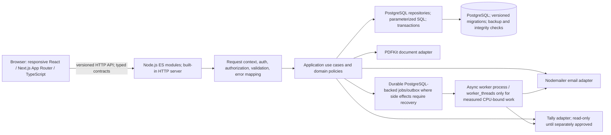

# Target architecture (proposal for review)

## Status

Planning proposal. It records the explicitly requested target shape; stakeholder approval of deployment, contracts, module boundaries, and production non-functional targets remains pending. The existing application continues to be authoritative until replacement behavior passes the gates in `frontend-migration-plan.md` and `implementation-roadmap.md`.

## Implemented foundation increment

The repository now contains a separate `apps/web/` Next.js App Router application and a typed client that checks the existing `GET /api/auth/me` route through a same-origin Next.js rewrite. The existing Node server remains the only business API. The UI reports the actual unauthenticated response and displays no fabricated business data. The backend applies checksummed PostgreSQL migrations before startup. CRM and connector records share PostgreSQL. Financial columns use NUMERIC(20,6); API calculations retain their existing JavaScript number behavior. See `frontend-migration-plan.md` and `database-migration-plan.md` for commands and evidence.

## Context

The current project is a single Node.js ES-module application with the built-in HTTP server, PostgreSQL via the `postgres` driver, static HTML/CSS/browser JavaScript, PDFKit, Nodemailer, and a read-only Tally adapter. The target request requires a Next.js/React/TypeScript frontend, while retaining the separate built-in HTTP backend and PostgreSQL. Do not use Express, Next.js API routes, or Server Actions for business operations.

## Proposed logical view

This diagram is a logical proposal, not a claim that these boundaries or jobs have already been implemented. Any job worker must define persistence, idempotency, attempts, timeout, failure visibility, recovery, and shutdown. Use asynchronous I/O for network operations; use `worker_threads` only after profiling shows CPU-bound work that justifies them.

## Responsibilities and boundaries

- **`apps/web/`**: Next.js UI, accessible responsive screens, typed API client, display and client-side convenience validation. No authoritative business rule or direct DB access.
- **`apps/api/`**: Separate Node.js server. Organize routes/middleware, application use cases, domain policies, repository implementations, integrations, jobs, PDF generation, configuration, and observability into explicit modules. The built-in HTTP server remains the transport.
- **`packages/contracts/`**: Shared request/response schemas and TypeScript types where beneficial. Runtime validation must also execute in the backend; a type alone is not input validation.
- **`database/postgres/migrations/`**: Ordered, checksummed migration scripts and migration metadata. Schema changes are forward-applied; production rollback uses an explicitly rehearsed recovery path, not destructive automatic downgrade.
- **PostgreSQL**: Single relational source for CRM-owned operational data. Use database foreign keys, parameterized SQL, request-scoped connections for transactions, and tested pg_dump/pg_restore backup and recovery. Tally remains the accounting system of record as stated in the supplied scope.
- **Integration adapters**: Tally, email, PDF, and later authorized providers behind explicit contracts, with bounded timeouts/retries, idempotency/reconciliation as relevant, and safe failure states.

## API compatibility and versioning

First capture the existing routes, methods, auth/CSRF behavior, request and response shapes, status codes, pagination, and error messages as characterization evidence. Publish an actual-route API reference. Introduce `/api/v1` only as an additive contract after clients and compatibility behavior are understood; do not silently change existing routes. Keep the old UI operational until the replacement has parity for its current workflows and is accepted. During coexistence both UIs call the same backend, preventing split business logic.

## Security and data handling

Backend permission checks remain authoritative. Define record-level scope and sensitive financial visibility from approved policy. Separate commercial approval permissions from system administration. Add correlation IDs, structured/redacted logs, safe errors, appropriate security headers/CORS, upload constraints if needed, and deployment HTTPS. Session/CSRF semantics must be preserved or deliberately versioned. Never expose credentials, tokens, OTPs, or raw DB errors.

## Decisions still needed

- Approved frontend deployment topology and same-origin/reverse-proxy strategy.
- Contract format and runtime schema library (dependency decision after repository/runtime review).
- Job execution topology and operational controls for durable work.
- Role/record visibility, identity provisioning, MFA and session policies.
- Hosting, scale, latency, availability, backup/RPO/RTO targets.
- Approved provider contracts and whether/when Tally write capability is authorized.

Related records: `architecture-decisions/ADR-0001-frontend-backend-boundary.md`, `ADR-0002-postgresql-migrations-and-money.md`, and `ADR-0003-compatibility-first-migration.md`.
