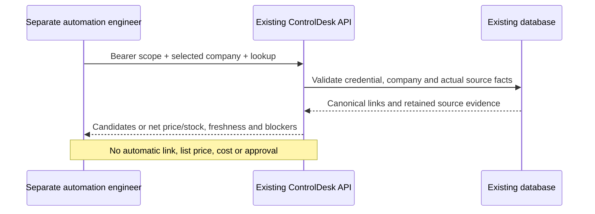
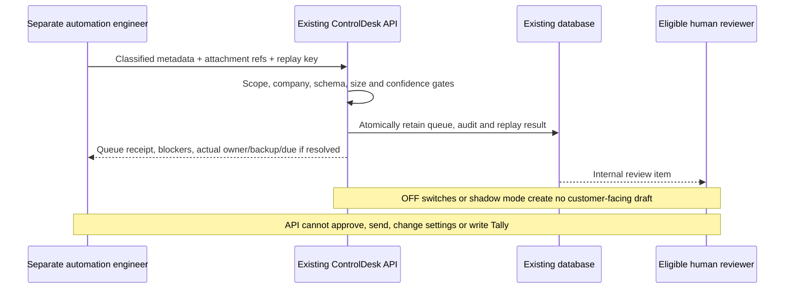

# Automation engineer handover — v1 design

**Not yet an operational integration.** The initial contract, metadata freeze, Owner credential management and switch-state
read are implemented; the other machine handlers and complete mock acceptance remain pending. Do not substitute staff cookies or connector
credentials while waiting. No credential has been provisioned by this work.

## Shared boundary

ControlDesk is the system that checks company identity, canonical customer/item
links, exact net prices, stock evidence, current business settings, permissions,
review/approval state and retained audit/replay records. Your integration owns
mailbox/provider access, email/WhatsApp intake, classification/extraction and its
own orchestration. No mailbox access, LLM, Make, SMTP or outbound transport is
being built in this task.

Read `automation-contract.md` and `automation-openapi.yaml`. All calls target the
existing application; no new server, service URL, callback URL or port is added.
The contract generator marks every proposed operation PLANNED until its actual
handler and tests are delivered. The existing staff `/api/v1/messages/*` and
automation-switch editing routes are not machine APIs.

## Eventual request conventions

- Use an Owner-provisioned service bearer token with the minimum scopes and
  company allowlist. Rotation/revocation must be handled; never log the token.
- Send company identity on every request, not only a display name. Do not reuse
  Tally identity from a different company or assume a name is unique.
- Supply a stable `Idempotency-Key` for each logical write. Retries use the same
  payload and key; a changed body needs a different key or the CRM returns 409.
- Money and quantities use decimal strings; never send floating-point money.
- Send extracted facts as candidates. Unknown fields are errors; approval flags,
  setting overrides, business master changes and raw attachment URLs are refused.
- Read freshness and blockedBy. A stale/unknown stock or missing price is not a
  promise of availability. A candidate match is not a linked CRM identity.
- A draft/queue receipt never means approved or sent. No machine scope grants
  either action. Existing send gates remain the final authority.

Examples in the eventual mock client must use synthetic ZZTEST_ identities and
rollback transactions. This handover does not publish a sample live token,
customer, GSTIN, price, bank account, document handle or external API URL.

## Read sequence

## Intake/review sequence

## Error handling

| Status | Engineer action |
|---|---|
| 401 | Obtain a valid service credential; do not fall back to another auth type |
| 403 | Fix the scope/company assignment with Owner |
| 409 | Inspect replay mismatch or named blocked setting; do not force the action |
| 413 / 422 | Correct the bounded payload or referenced evidence |
| 429 | Respect Retry-After and retry with the same logical replay key |
| 503 | Retry safely; do not assume the previous write committed |

## Compatibility and acceptance still required

The initial freeze inventories 20 existing tables and 25 staff route guard
contracts, plus permission and database metadata. It does not yet prove all
machine response shapes, auth, rate-limit or replay behavior. A10 must exercise
every actual endpoint, wrong scope/company, revocation, duplicate/reused key,
missing/low confidence, unknown customer, bank alert, missing template field,
switch OFF and shadow mode before this integration is handed over as usable.

Required Notion “Email automation orchestration” and diagram sources are missing
from this checkout. Their exact field alignment is a recorded risk, not accepted
compatibility. Keep newly agreed fields additive and versioned; preserve existing
schema/permission/endpoint members. Do not regenerate the frozen baseline merely
to make a breaking test pass. The client and the other engineer must perform a
real acceptance round-trip after implementation and Owner configuration.

Runtime scope: only GET /api/v1/automation/switches is implemented. See automation-service-credentials.md for Owner provisioning, one-time issuance, rotation/revocation and rate/IP/company restrictions. Other operation statuses remain explicit in OpenAPI. No credential has been provisioned outside rollback tests by this work.
