# Database schema reference

Generated read-only from information_schema and pg_catalog at 2026-11-07T04:58:15.370Z.

Database: **mehta_electronics_local**. 203 base tables; 4 views. No business row contents are included.

This is observed schema evidence, not a claim that every workflow is complete. FOUNDATION means reserved and not a delivered feature. LEGACY remains supported for compatibility; no table is deleted.

## Canonical models

| Concept | Current canonical model | Compatibility / reserved model |
|---|---|---|
| CRM customer | customers + crm_customer_profiles / crm_customer_controls | parties is the reserved UUID domain; crm_parties and stable Tally links bridge identities. Do not merge by name. |
| CRM product | items + crm_item_profiles + crm_tally_item_links | parts is the reserved UUID domain. Tally owns the external stock master. |
| Current quotation pricing | crm_price_lists / crm_price_list_items; crm_quotation_policy and crm_quotation_costs | price_lists / price_list_items / price_list_imports are reserved domain structures; imports need explicit reviewed translation, never dual writes. |
| Current order execution | sales_orders + sales_order_lines + crm_order_workflows; crm_shipments / crm_shipment_items | customer_pos / customer_po_lines are normalized retained customer PO evidence linked through sales_orders.customer_po_id, not a second order executor. crm_order_versions/events retain reviewed snapshots. |
| Accounting source | selected-company Tally snapshots | CRM invoice/payment references do not assert statutory invoice authority. |

## Remaining S0 review

- DONE (schema and focused rollback tests): migration 0043 adds actual future creation/update provenance to canonical quotation and sales-order lines; nine newly added historical creation columns remain NULL for legacy records, verified by scripts/verify-row-provenance.mjs --after. No historical actors/timestamps were invented.
- DONE (covered existing workflows): migration 0043 adds row archive metadata and delete/truncate denial on 89 business tables. Legacy contact/enquiry paths supply actual maker/reason; full guarded regression passed 207 tests with zero residue. New later-stage write paths must use the same audited context.
- DONE for reviewed typed operational fields: migration 0044 adds 16 nonnegative quantity/price checks plus received-versus-accepted/rejected consistency. workflow-integrity-policy.json and rollback tests verify required parent/core columns, nullable unreviewed source facts and signed accounting exceptions. Exact LLD-wide coverage remains limited by the missing source documents noted below.
- PARTIAL: the named LLD and prompt-pack Markdown source files remain unavailable. The 25-workflow matrix maps the explicit S0-S10 request; it is not proof that every absent LLD workflow is covered.
- PARTIAL: ten queries are ranked by estimated cost among 32 generated application SELECTs. No observed global production-query ranking, ANALYZE, independent-session concurrency or load test has been run.
- OUT-OF-SCOPE: eleven lifecycle/status fields belong to the teammate messaging/extraction engine and remain explicit schema exceptions; no sending/intake gate or automation switch was changed.
- Identity: imported voucher numbers are not globally unique across voucher kinds and financial years. Preserve stable company/source identity; never impose company+voucher_number alone or merge originals to force uniqueness.

These items remain incomplete even when the narrower structural-finding count is zero.

## Provenance compatibility

Business row metadata version 0 marks records that predate the provenance migration. Unknown historical creators/timestamps remain NULL. Version 1 is required for new inserts; a new archive action records its actual actor, reason and time. Existing statuses and source originals are retained. Metadata audit events contain provenance fields, not document bytes, bank payloads or prices.

## Table classification

| Table | Module | Classification | Basis |
|---|---|---|---|
| acceptance_lines | Procurement | FOUNDATION | Reserved target-domain schema; no runtime reference found. A table alone is not a delivered workflow. |
| access_matrix_events | Platform and operations | ACTIVE | Runtime reference: src/app.js, src/modules/access/access-repository.js, src/modules/access/access-service.js |
| approval_decisions | Platform and operations | ACTIVE | Runtime reference: src/modules/exceptions/exception-service.js, src/modules/outbound/outbound-repository.js, src/modules/pricing/disposition.js |
| approval_requests | Platform and operations | ACTIVE | Runtime reference: src/modules/exceptions/exception-service.js, src/modules/outbound/outbound-repository.js, src/modules/pricing/disposition.js |
| audit_logs | Platform and operations | ACTIVE | Runtime reference: src/app.js, src/connector-store.js, src/db.js |
| automation_service_companies | Automation boundary | ACTIVE | V2 A2 isolated scoped service credential lifecycle and authentication; no users/credentials seeded, no messaging transport or switch change. |
| automation_service_credential_events | Automation boundary | ACTIVE | V2 A2 isolated scoped service credential lifecycle and authentication; no users/credentials seeded, no messaging transport or switch change. |
| automation_service_credentials | Automation boundary | ACTIVE | V2 A2 isolated scoped service credential lifecycle and authentication; no users/credentials seeded, no messaging transport or switch change. |
| automation_switch_events | Automation boundary | ACTIVE | Runtime reference: src/modules/automation/automation-service.js |
| automation_switches | Automation boundary | ACTIVE | Runtime reference: src/modules/automation/automation-service.js |
| bank_accounts | Accounts | FOUNDATION | Added by S0 migration 0040 as a reserved workflow structure, not a delivered UI/API feature. No business rows or policy values seeded. |
| bank_reconciliation_matches | Accounts | FOUNDATION | Added by S0 migration 0040 as a reserved workflow structure, not a delivered UI/API feature. No business rows or policy values seeded. |
| bank_statement_imports | Accounts | FOUNDATION | Added by S0 migration 0040 as a reserved workflow structure, not a delivered UI/API feature. No business rows or policy values seeded. |
| bank_statement_lines | Accounts | FOUNDATION | Added by S0 migration 0040 as a reserved workflow structure, not a delivered UI/API feature. No business rows or policy values seeded. |
| brands | CRM masters | ACTIVE | Runtime reference: src/modules/admin/tally-item-wizard.js |
| business_rule_values | Platform and operations | ACTIVE | Runtime reference: src/sales-orders.js, src/modules/rules/rule-repository.js, src/modules/rules/workflow-rules.js |
| crm_claims | Platform and operations | FOUNDATION | Added by S0 migration 0040 as a reserved workflow structure, not a delivered UI/API feature. No business rows or policy values seeded. |
| crm_customer_controls | CRM masters | ACTIVE | Runtime reference: src/sales-orders.js, src/modules/operations/operations-repository.js |
| crm_customer_part_mappings | CRM masters | ACTIVE | Runtime reference: src/crm-modules.js, src/sales-orders.js |
| crm_customer_profiles | CRM masters | ACTIVE | Runtime reference: src/crm-modules.js, src/quotation-workflow.js, src/tally-read-service.js |
| crm_customer_rate_contracts | CRM masters | ACTIVE | Runtime reference: src/modules/operations/contracts.js, src/modules/operations/customer-gates.js |
| crm_customer_tally_facts | CRM masters | ACTIVE | Runtime reference: src/crm-modules.js, src/modules/admin/setup-service.js |
| crm_grns | Platform and operations | ACTIVE | Runtime reference: src/logistics-access.js, src/logistics.js, src/procurement.js |
| crm_intake_originals | Platform and operations | ACTIVE | Runtime reference: src/modules/operations/operations-repository.js |
| crm_item_profiles | CRM masters | ACTIVE | Runtime reference: src/crm-modules.js, src/tally-read-service.js, src/modules/admin/setup-service.js |
| crm_item_tally_facts | CRM masters | ACTIVE | Runtime reference: src/crm-modules.js, src/modules/admin/setup-service.js |
| crm_operation_events | Platform and operations | ACTIVE | Runtime reference: src/modules/operations/operations-repository.js |
| crm_operations | Platform and operations | ACTIVE | Runtime reference: src/modules/dashboard/dashboard.js, src/modules/operations/operations-repository.js |
| crm_order_documents | Platform and operations | ACTIVE | Runtime reference: src/sales-orders.js |
| crm_order_events | Platform and operations | ACTIVE | Runtime reference: src/sales-orders.js |
| crm_order_versions | Platform and operations | ACTIVE | Runtime reference: src/sales-orders.js |
| crm_order_workflows | Platform and operations | ACTIVE | Runtime reference: src/app.js, src/crm-modules.js, src/logistics-access.js |
| crm_parties | CRM masters | ACTIVE | Runtime reference: src/crm-modules.js, src/procurement-routes.js, src/procurement.js |
| crm_price_import_entries | Pricing | ACTIVE | S2 reviewed imports bridge the source registry to canonical items/crm_price_lists; no automatic activation. |
| crm_price_import_events | Pricing | ACTIVE | S2 reviewed imports bridge the source registry to canonical items/crm_price_lists; no automatic activation. |
| crm_price_import_workflows | Pricing | ACTIVE | S2 reviewed imports bridge the source registry to canonical items/crm_price_lists; no automatic activation. |
| crm_price_levels | Pricing | ACTIVE | S2 Owner-confirmed level configuration and approved source resolution; src/modules/pricing/levels.js. Missing meanings and source mappings block pricing; no values seeded. |
| crm_price_list_items | Pricing | ACTIVE | Runtime reference: src/crm-modules.js |
| crm_price_lists | Pricing | ACTIVE | Runtime reference: src/crm-modules.js |
| crm_procurement_events | Platform and operations | ACTIVE | Runtime reference: src/procurement.js |
| crm_procurement_vendors | Platform and operations | ACTIVE | Runtime reference: src/procurement.js |
| crm_purchase_requests | Procurement | ACTIVE | Runtime reference: src/procurement.js |
| crm_quotation_costs | Pricing | ACTIVE | Runtime reference: src/quotation-cost-import.js, src/quotation-workflow.js, src/sales-orders.js |
| crm_quotation_events | Pricing | ACTIVE | Runtime reference: src/quotation-workflow.js, src/modules/dashboard/dashboard.js |
| crm_quotation_policy | Pricing | ACTIVE | Runtime reference: src/quotation-workflow.js, src/modules/admin/setup-service.js, src/modules/rules/quotation-policy-source.js |
| crm_quotation_versions | Pricing | ACTIVE | Runtime reference: src/quotation-workflow.js |
| crm_quotation_workflows | Pricing | ACTIVE | Runtime reference: src/app.js, src/crm-modules.js, src/quotation-workflow.js |
| crm_rfq_vendor_replies | Platform and operations | ACTIVE | Runtime reference: src/procurement.js |
| crm_rfq_vendors | Platform and operations | ACTIVE | Runtime reference: src/procurement.js |
| crm_rfqs | Platform and operations | ACTIVE | Runtime reference: src/procurement.js |
| crm_shipment_items | Platform and operations | ACTIVE | Runtime reference: src/sales-orders.js |
| crm_shipments | Platform and operations | ACTIVE | Runtime reference: src/logistics-access.js, src/logistics.js, src/sales-orders.js |
| crm_stock_consumption_reviews | Platform and operations | ACTIVE | Append-only independent active Owner attestation bound to a later retained source receipt, with actor/hash idempotency and audit. Imports do not auto-clear consumption. |
| crm_stock_consumptions | Platform and operations | ACTIVE | Append-only company/item/order/shipment stock evidence; src/modules/stock/fulfillment.js. Pending movements block later fulfillment until independent reconciliation. No stock subtraction, historical backfill or Tally writes. |
| crm_supplier_documents | Procurement | ACTIVE | Runtime reference: src/procurement.js |
| crm_supplier_pos | Procurement | ACTIVE | Runtime reference: src/logistics-access.js, src/logistics.js, src/procurement.js |
| crm_tally_item_links | Tally | ACTIVE | Runtime reference: src/crm-modules.js, src/tally-conflicts.js, src/tally-global-search.js |
| crm_tally_stock_coverage | Tally | ACTIVE | Runtime reference: src/tally-read-service.js |
| crm_tally_sync_jobs | Tally | LEGACY | Retained compatibility model; src/app.js, src/tally-visibility-repository.js, src/tally.js |
| customer_contacts | CRM masters | ACTIVE | Runtime reference: src/crm-modules.js, src/db.js, src/quotation-workflow.js |
| customer_message_checklist | CRM masters | ACTIVE | Runtime reference: src/modules/outbound/outbound-repository.js |
| customer_open_order_lines | CRM masters | FOUNDATION | Added by S0 migration 0040 as a reserved workflow structure, not a delivered UI/API feature. No business rows or policy values seeded. |
| customer_po_lines | Orders and warehouse | ACTIVE | Runtime reference: src/sales-orders.js |
| customer_po_versions | Orders and warehouse | ACTIVE | Runtime reference: src/sales-orders.js |
| customer_pos | Orders and warehouse | ACTIVE | Runtime reference: src/sales-orders.js |
| customer_schedule_imports | CRM masters | FOUNDATION | Added by S0 migration 0040 as a reserved workflow structure, not a delivered UI/API feature. No business rows or policy values seeded. |
| customers | CRM masters | ACTIVE | Runtime reference: src/app.js, src/crm-module-routes.js, src/crm-modules.js |
| decision_register | Platform and operations | ACTIVE | Append-only Owner decision versions, confirmed canonical bindings and audited history; src/modules/decisions. No values seeded or historical decisions auto-confirmed. |
| decision_register_requests | Platform and operations | ACTIVE | Append-only actor-bound idempotency receipts for decision commands; no business setting values or credentials seeded. |
| delivery_confirmations | Platform and operations | FOUNDATION | Reserved target-domain schema; no runtime reference found. A table alone is not a delivered workflow. |
| dispatch_lines | Orders and warehouse | FOUNDATION | Reserved target-domain schema; no runtime reference found. A table alone is not a delivered workflow. |
| dispatches | Orders and warehouse | ACTIVE | Runtime reference: src/sales-orders.js |
| document_acceptance_links | Documents | FOUNDATION | Reserved target-domain schema; no runtime reference found. A table alone is not a delivered workflow. |
| document_customer_po_links | Documents | FOUNDATION | Reserved target-domain schema; no runtime reference found. A table alone is not a delivered workflow. |
| document_dispatch_links | Documents | FOUNDATION | Reserved target-domain schema; no runtime reference found. A table alone is not a delivered workflow. |
| document_enquiry_links | Documents | FOUNDATION | Reserved target-domain schema; no runtime reference found. A table alone is not a delivered workflow. |
| document_goods_receipt_links | Documents | FOUNDATION | Reserved target-domain schema; no runtime reference found. A table alone is not a delivered workflow. |
| document_invoice_links | Documents | FOUNDATION | Reserved target-domain schema; no runtime reference found. A table alone is not a delivered workflow. |
| document_order_links | Documents | FOUNDATION | Reserved target-domain schema; no runtime reference found. A table alone is not a delivered workflow. |
| document_purchase_request_links | Documents | FOUNDATION | Reserved target-domain schema; no runtime reference found. A table alone is not a delivered workflow. |
| document_quotation_links | Documents | FOUNDATION | Reserved target-domain schema; no runtime reference found. A table alone is not a delivered workflow. |
| document_reviews | Documents | FOUNDATION | Reserved target-domain schema; no runtime reference found. A table alone is not a delivered workflow. |
| document_rfq_links | Documents | FOUNDATION | Reserved target-domain schema; no runtime reference found. A table alone is not a delivered workflow. |
| document_supplier_po_links | Documents | FOUNDATION | Reserved target-domain schema; no runtime reference found. A table alone is not a delivered workflow. |
| email_accounts | Automation boundary | FOUNDATION | Reserved target-domain schema; no runtime reference found. A table alone is not a delivered workflow. |
| email_draft_documents | Automation boundary | FOUNDATION | Reserved target-domain schema; no runtime reference found. A table alone is not a delivered workflow. |
| email_drafts | Automation boundary | ACTIVE | Runtime reference: src/modules/dashboard/dashboard.js, src/modules/outbound/outbound-repository.js, src/modules/preferences/preferences.js |
| email_messages | Automation boundary | FOUNDATION | Reserved target-domain schema; no runtime reference found. A table alone is not a delivered workflow. |
| email_send_attempts | Automation boundary | ACTIVE | Runtime reference: src/modules/outbound/outbound-repository.js, src/modules/outbound/outbound-service.js |
| email_threads | Automation boundary | FOUNDATION | Reserved target-domain schema; no runtime reference found. A table alone is not a delivered workflow. |
| enquiries | CRM masters | ACTIVE | Runtime reference: src/app.js, src/crm-module-routes.js, src/crm-modules.js |
| enquiry_lines | CRM masters | ACTIVE | Runtime reference: src/app.js, src/crm-modules.js, src/db.js |
| enquiry_revisions | CRM masters | LEGACY | Retained compatibility model; src/db.js |
| exception_cases | Platform and operations | ACTIVE | Runtime reference: src/modules/dashboard/dashboard.js, src/modules/exceptions/exception-service.js, src/modules/preferences/preferences.js |
| extracted_fields | Automation boundary | FOUNDATION | Reserved target-domain schema; no runtime reference found. A table alone is not a delivered workflow. |
| extraction_runs | Automation boundary | FOUNDATION | Reserved target-domain schema; no runtime reference found. A table alone is not a delivered workflow. |
| field_corrections | Documents | FOUNDATION | Reserved target-domain schema; no runtime reference found. A table alone is not a delivered workflow. |
| goods_receipt_lines | Procurement | FOUNDATION | Reserved target-domain schema; no runtime reference found. A table alone is not a delivered workflow. |
| goods_receipts | Procurement | FOUNDATION | Reserved target-domain schema; no runtime reference found. A table alone is not a delivered workflow. |
| idempotency_keys | Platform and operations | ACTIVE | Runtime reference: src/core/http.js |
| invoice_lines | Accounts | FOUNDATION | Reserved target-domain schema; no runtime reference found. A table alone is not a delivered workflow. |
| item_pack_factors | Orders and warehouse | FOUNDATION | Added by S0 migration 0040 as a reserved workflow structure, not a delivered UI/API feature. No business rows or policy values seeded. |
| items | CRM masters | ACTIVE | Runtime reference: src/app.js, src/crm-module-routes.js, src/crm-modules.js |
| job_logs | Platform and operations | ACTIVE | Runtime reference: src/core/scheduler.js |
| kpi_confirmed_events | Platform and operations | FOUNDATION | Added by S0 migration 0040 as a reserved workflow structure, not a delivered UI/API feature. No business rows or policy values seeded. |
| kpi_formula_settings | Platform and operations | FOUNDATION | Added by S0 migration 0040 as a reserved workflow structure, not a delivered UI/API feature. No business rows or policy values seeded. |
| logistics_evidence | Platform and operations | ACTIVE | Runtime reference: src/logistics-access.js, src/logistics.js |
| logistics_order_assignments | Platform and operations | ACTIVE | Runtime reference: src/logistics-access.js, src/logistics.js |
| manual_response_exceptions | Platform and operations | ACTIVE | Runtime reference: src/modules/outbound/outbound-repository.js |
| mehta_schema_migrations | Platform and operations | ACTIVE | Runtime reference: src/migrations.js |
| notifications | Platform and operations | ACTIVE | Runtime reference: src/modules/container.js, src/modules/admin/user-admin-service.js, src/modules/notifications/notification-service.js |
| packing_box_items | Orders and warehouse | FOUNDATION | Added by S0 migration 0040 as a reserved workflow structure, not a delivered UI/API feature. No business rows or policy values seeded. |
| packing_box_photos | Orders and warehouse | FOUNDATION | Added by S0 migration 0040 as a reserved workflow structure, not a delivered UI/API feature. No business rows or policy values seeded. |
| packing_boxes | Orders and warehouse | FOUNDATION | Added by S0 migration 0040 as a reserved workflow structure, not a delivered UI/API feature. No business rows or policy values seeded. |
| part_external_mappings | CRM masters | ACTIVE | Runtime reference: src/sales-orders.js |
| part_identifiers | CRM masters | FOUNDATION | Reserved target-domain schema; no runtime reference found. A table alone is not a delivered workflow. |
| parties | CRM masters | ACTIVE | Runtime reference: src/quotation-document.js, src/sales-orders.js, src/tally-read-service.js |
| parts | CRM masters | ACTIVE | Runtime reference: src/quotation-document.js, src/sales-orders.js, src/tally-financial-read.js |
| party_addresses | CRM masters | FOUNDATION | Reserved target-domain schema; no runtime reference found. A table alone is not a delivered workflow. |
| party_contacts | CRM masters | FOUNDATION | Reserved target-domain schema; no runtime reference found. A table alone is not a delivered workflow. |
| party_external_mappings | CRM masters | ACTIVE | Runtime reference: src/sales-orders.js |
| party_identifiers | CRM masters | FOUNDATION | Reserved target-domain schema; no runtime reference found. A table alone is not a delivered workflow. |
| party_roles | CRM masters | ACTIVE | Runtime reference: src/sales-orders.js |
| permissions | Platform and operations | ACTIVE | Runtime reference: src/app.js, src/logistics-policy.js, src/rbac.js |
| pick_scans | Orders and warehouse | FOUNDATION | Added by S0 migration 0040 as a reserved workflow structure, not a delivered UI/API feature. No business rows or policy values seeded. |
| po_line_schedules | Platform and operations | FOUNDATION | Reserved target-domain schema; no runtime reference found. A table alone is not a delivered workflow. |
| price_list_import_rows | Pricing | FOUNDATION | Reserved target-domain schema; no runtime reference found. A table alone is not a delivered workflow. |
| price_list_imports | Pricing | FOUNDATION | Reserved target-domain schema; no runtime reference found. A table alone is not a delivered workflow. |
| price_list_items | Pricing | FOUNDATION | Reserved target-domain schema; no runtime reference found. A table alone is not a delivered workflow. |
| price_lists | Pricing | FOUNDATION | Reserved target-domain schema; no runtime reference found. A table alone is not a delivered workflow. |
| procurement_events | Procurement | FOUNDATION | Reserved target-domain schema; no runtime reference found. A table alone is not a delivered workflow. |
| purchase_request_lines | Procurement | FOUNDATION | Reserved target-domain schema; no runtime reference found. A table alone is not a delivered workflow. |
| quotation_lines | Pricing | ACTIVE | Runtime reference: src/app.js, src/db.js, src/overview.js |
| quotation_revisions | Pricing | LEGACY | Retained compatibility model; src/db.js |
| quotations | Pricing | ACTIVE | Runtime reference: src/app.js, src/crm-module-routes.js, src/crm-modules.js |
| reminders | Platform and operations | ACTIVE | Runtime reference: src/modules/notifications/notification-service.js, src/modules/rules/business-rule-definitions.js, src/modules/rules/rule-definitions.js |
| rfq_vendor_reply_lines | Procurement | FOUNDATION | Reserved target-domain schema; no runtime reference found. A table alone is not a delivered workflow. |
| role_permissions | Platform and operations | ACTIVE | Runtime reference: src/rbac.js, src/modules/access/access-repository.js |
| roles | Platform and operations | ACTIVE | Runtime reference: src/app.js, src/rbac.js, src/sales-orders.js |
| sales_invoices | Accounts | FOUNDATION | Reserved target-domain schema; no runtime reference found. A table alone is not a delivered workflow. |
| sales_order_lines | Orders and warehouse | ACTIVE | Runtime reference: src/app.js, src/db.js, src/logistics-access.js |
| sales_orders | Orders and warehouse | ACTIVE | Runtime reference: src/app.js, src/crm-modules.js, src/db.js |
| sessions | Platform and operations | ACTIVE | Runtime reference: src/app.js, src/local-access.js, src/modules/admin/user-admin-service.js |
| source_documents | Documents | FOUNDATION | Reserved target-domain schema; no runtime reference found. A table alone is not a delivered workflow. |
| stock_check_log | Orders and warehouse | ACTIVE | S2 company-scoped stock evidence preview/record, immutable history and daily staff counts; src/modules/stock/repository.js. Real reservation mappings remain unconfirmed and block verified checks. |
| supplier_acceptances | Procurement | FOUNDATION | Reserved target-domain schema; no runtime reference found. A table alone is not a delivered workflow. |
| supplier_po_lines | Procurement | FOUNDATION | Reserved target-domain schema; no runtime reference found. A table alone is not a delivered workflow. |
| supplier_po_schedules | Procurement | FOUNDATION | Reserved target-domain schema; no runtime reference found. A table alone is not a delivered workflow. |
| supply_allocations | Procurement | FOUNDATION | Reserved target-domain schema; no runtime reference found. A table alone is not a delivered workflow. |
| tally_companies | Tally | ACTIVE | Runtime reference: src/app.js, src/connector-store.js, src/overview.js |
| tally_conflicts | Tally | ACTIVE | Runtime reference: src/tally-conflicts.js, src/tally-order-sync-state.js |
| tally_connector_heartbeats | Tally | ACTIVE | Runtime reference: src/connector-store.js, src/overview.js, src/tally-sync-monitor.js |
| tally_connectors | Tally | ACTIVE | Runtime reference: src/connector-store.js, src/overview.js, src/tally-import.js |
| tally_customers | Tally | LEGACY | Retained compatibility model; src/postgres.js, src/tally.js |
| tally_groups | Tally | ACTIVE | Runtime reference: src/crm-modules.js, src/overview.js, src/tally-import.js |
| tally_import_quarantine | Tally | ACTIVE | Runtime reference: src/app.js, src/overview.js, src/tally-import.js |
| tally_import_warnings | Tally | ACTIVE | Runtime reference: src/app.js, src/overview.js, src/tally-import.js |
| tally_items | Tally | LEGACY | Retained compatibility model; src/postgres.js, src/tally.js |
| tally_ledgers | Tally | ACTIVE | Runtime reference: src/crm-modules.js, src/overview.js, src/tally-import.js |
| tally_outbox | Tally | FOUNDATION | Added by S0 migration 0040 as a reserved workflow structure, not a delivered UI/API feature. No business rows or policy values seeded. |
| tally_raw_payloads | Tally | ACTIVE | Runtime reference: src/overview.js, src/tally-financial-read.js, src/tally-import.js |
| tally_read_requests | Tally | ACTIVE | Runtime reference: src/connector-store.js, src/tally-conflicts.js, src/tally-import.js |
| tally_reconciliations | Tally | ACTIVE | Runtime reference: src/tally-conflicts.js, src/tally-order-sync-state.js |
| tally_run_datasets | Tally | ACTIVE | Runtime reference: src/overview.js, src/tally-conflicts.js, src/tally-freshness.js |
| tally_source_observations | Tally | ACTIVE | Runtime reference: src/connector-store.js, src/tally-visibility-repository.js |
| tally_stock_items | Tally | ACTIVE | Runtime reference: src/crm-modules.js, src/overview.js, src/tally-import.js |
| tally_sync_job_items | Tally | ACTIVE | Runtime reference: src/tally-order-sync-state.js |
| tally_sync_jobs | Tally | ACTIVE | Runtime reference: src/connector-store.js, src/overview.js, src/tally-import.js |
| tally_upload_chunks | Tally | ACTIVE | Runtime reference: src/connector-store.js, src/tally-import.js |
| tally_upload_sessions | Tally | ACTIVE | Runtime reference: src/app.js, src/connector-store.js, src/overview.js |
| tally_visibility_company_aliases | Tally | ACTIVE | Runtime reference: src/tally-visibility-repository.js |
| tally_visibility_crm_links | Tally | ACTIVE | Runtime reference: src/tally-conflicts.js, src/tally-customer-links.js, src/tally-financial-read.js |
| tally_visibility_current_cache | Tally | ACTIVE | Runtime reference: src/tally-conflicts.js, src/tally-customer-links.js, src/tally-financial-read.js |
| tally_visibility_field_catalogue | Tally | ACTIVE | Runtime reference: src/tally-visibility-repository.js |
| tally_visibility_public_fields | Tally | ACTIVE | Runtime reference: src/tally-visibility-repository.js |
| tally_visibility_records | Tally | ACTIVE | Runtime reference: src/tally-conflicts.js, src/tally-financial-read.js, src/tally-item-links.js |
| tally_write_category_config | Tally | FOUNDATION | Added by S0 migration 0040 as a reserved workflow structure, not a delivered UI/API feature. No business rows or policy values seeded. |
| task_events | Platform and operations | ACTIVE | Runtime reference: src/modules/tasks/task-repository.js |
| tasks | Platform and operations | ACTIVE | Runtime reference: src/overview.js, src/rbac.js, src/modules/container.js |
| tracking_events | Platform and operations | FOUNDATION | Reserved target-domain schema; no runtime reference found. A table alone is not a delivered workflow. |
| tw_alerts | Platform and operations | FOUNDATION | Isolated create-only Tally write infrastructure; default master/category flags OFF. Not live transport acceptance. |
| tw_categories | Platform and operations | FOUNDATION | Isolated create-only Tally write infrastructure; default master/category flags OFF. Not live transport acceptance. |
| tw_conflict_observations | Platform and operations | FOUNDATION | Isolated create-only Tally write infrastructure; default master/category flags OFF. Not live transport acceptance. |
| tw_connector_capabilities | Platform and operations | FOUNDATION | Isolated create-only Tally write infrastructure; default master/category flags OFF. Not live transport acceptance. |
| tw_control | Platform and operations | FOUNDATION | Isolated create-only Tally write infrastructure; default master/category flags OFF. Not live transport acceptance. |
| tw_document_links | Platform and operations | FOUNDATION | Isolated create-only Tally write infrastructure; default master/category flags OFF. Not live transport acceptance. |
| tw_mapping_evidence | Platform and operations | ACTIVE | Append-only retained-source mapping review evidence, independent Owner promotion and named expert reference; no source or switch writes. |
| tw_mapping_versions | Platform and operations | FOUNDATION | Isolated create-only Tally write infrastructure; default master/category flags OFF. Not live transport acceptance. |
| tw_outbox | Platform and operations | FOUNDATION | Isolated create-only Tally write infrastructure; default master/category flags OFF. Not live transport acceptance. |
| tw_outbox_events | Platform and operations | FOUNDATION | Isolated create-only Tally write infrastructure; default master/category flags OFF. Not live transport acceptance. |
| tw_party_reviews | Platform and operations | FOUNDATION | Isolated create-only Tally write infrastructure; default master/category flags OFF. Not live transport acceptance. |
| unit_conversions | CRM masters | FOUNDATION | Reserved target-domain schema; no runtime reference found. A table alone is not a delivered workflow. |
| units_of_measure | CRM masters | FOUNDATION | Reserved target-domain schema; no runtime reference found. A table alone is not a delivered workflow. |
| user_mfa | Platform and operations | ACTIVE | Runtime reference: src/app.js, src/modules/admin/user-admin-service.js, src/modules/mfa/mfa-repository.js |
| user_preferences | Platform and operations | ACTIVE | Runtime reference: src/modules/preferences/preferences.js |
| user_recovery_codes | Platform and operations | ACTIVE | Runtime reference: src/modules/mfa/mfa-repository.js |
| users | Platform and operations | ACTIVE | Runtime reference: src/app.js, src/crm-module-routes.js, src/crm-modules.js |
| vendor_debit_notes | Procurement | FOUNDATION | Added by S0 migration 0040 as a reserved workflow structure, not a delivered UI/API feature. No business rows or policy values seeded. |
| vendor_due_lines | Procurement | FOUNDATION | Added by S0 migration 0040 as a reserved workflow structure, not a delivered UI/API feature. No business rows or policy values seeded. |
| vendor_payment_advices | Procurement | FOUNDATION | Added by S0 migration 0040 as a reserved workflow structure, not a delivered UI/API feature. No business rows or policy values seeded. |
| vendor_statements | Procurement | FOUNDATION | Added by S0 migration 0040 as a reserved workflow structure, not a delivered UI/API feature. No business rows or policy values seeded. |
| work_item_events | Platform and operations | ACTIVE | Runtime reference: src/modules/work/work-repository.js |
| work_items | Platform and operations | ACTIVE | Runtime reference: src/modules/dashboard/dashboard.js, src/modules/preferences/preferences.js, src/modules/work/record-sync.js |
| workflow_definitions | Platform and operations | ACTIVE | Runtime reference: src/modules/automation/automation-service.js |
| workflow_executions | Platform and operations | FOUNDATION | Reserved target-domain schema; no runtime reference found. A table alone is not a delivered workflow. |
| workflow_steps | Platform and operations | FOUNDATION | Reserved target-domain schema; no runtime reference found. A table alone is not a delivered workflow. |
| workflow_versions | Platform and operations | FOUNDATION | Reserved target-domain schema; no runtime reference found. A table alone is not a delivered workflow. |

## Procurement relationships

```mermaid
erDiagram
  acceptance_lines {
    string schema_reference "See column inventory"
  }
  crm_purchase_requests {
    string schema_reference "See column inventory"
  }
  crm_supplier_documents {
    string schema_reference "See column inventory"
  }
  crm_supplier_pos {
    string schema_reference "See column inventory"
  }
  goods_receipt_lines {
    string schema_reference "See column inventory"
  }
  goods_receipts {
    string schema_reference "See column inventory"
  }
  procurement_events {
    string schema_reference "See column inventory"
  }
  purchase_request_lines {
    string schema_reference "See column inventory"
  }
  rfq_vendor_reply_lines {
    string schema_reference "See column inventory"
  }
  supplier_acceptances {
    string schema_reference "See column inventory"
  }
  supplier_po_lines {
    string schema_reference "See column inventory"
  }
  supplier_po_schedules {
    string schema_reference "See column inventory"
  }
  supply_allocations {
    string schema_reference "See column inventory"
  }
  vendor_debit_notes {
    string schema_reference "See column inventory"
  }
  vendor_due_lines {
    string schema_reference "See column inventory"
  }
  vendor_payment_advices {
    string schema_reference "See column inventory"
  }
  vendor_statements {
    string schema_reference "See column inventory"
  }
  supplier_acceptances ||--o{ acceptance_lines : "acceptance_id"
  users ||--o{ acceptance_lines : "created_by"
  users ||--o{ acceptance_lines : "deleted_by"
  supplier_po_lines ||--o{ acceptance_lines : "supplier_po_line_id"
  units_of_measure ||--o{ acceptance_lines : "uom_code"
  users ||--o{ acceptance_lines : "updated_by"
  users ||--o{ crm_purchase_requests : "created_by"
  users ||--o{ crm_purchase_requests : "deleted_by"
  sales_orders ||--o{ crm_purchase_requests : "sales_order_id"
  users ||--o{ crm_purchase_requests : "updated_by"
  users ||--o{ crm_supplier_documents : "created_by"
  users ||--o{ crm_supplier_documents : "deleted_by"
  crm_supplier_pos ||--o{ crm_supplier_documents : "supplier_po_id"
  users ||--o{ crm_supplier_documents : "updated_by"
  users ||--o{ crm_supplier_pos : "approved_by"
  users ||--o{ crm_supplier_pos : "created_by"
  users ||--o{ crm_supplier_pos : "deleted_by"
  crm_rfqs ||--o{ crm_supplier_pos : "rfq_id"
  sales_orders ||--o{ crm_supplier_pos : "sales_order_id"
  users ||--o{ crm_supplier_pos : "updated_by"
  crm_procurement_vendors ||--o{ crm_supplier_pos : "vendor_id"
  users ||--o{ goods_receipt_lines : "created_by"
  users ||--o{ goods_receipt_lines : "deleted_by"
  goods_receipts ||--o{ goods_receipt_lines : "goods_receipt_id"
  parts ||--o{ goods_receipt_lines : "part_id"
  supplier_po_lines ||--o{ goods_receipt_lines : "supplier_po_line_id"
  units_of_measure ||--o{ goods_receipt_lines : "uom_code"
  users ||--o{ goods_receipt_lines : "updated_by"
  users ||--o{ goods_receipts : "created_by"
  users ||--o{ goods_receipts : "deleted_by"
  crm_grns ||--o{ goods_receipts : "legacy_grn_id"
  users ||--o{ goods_receipts : "posted_by"
  users ||--o{ goods_receipts : "reviewed_by"
  source_documents ||--o{ goods_receipts : "source_document_id"
  crm_supplier_pos ||--o{ goods_receipts : "supplier_po_id"
  users ||--o{ goods_receipts : "updated_by"
  users ||--o{ procurement_events : "actor_user_id"
  goods_receipts ||--o{ procurement_events : "goods_receipt_id"
  crm_purchase_requests ||--o{ procurement_events : "purchase_request_id"
  crm_rfqs ||--o{ procurement_events : "rfq_id"
  crm_supplier_pos ||--o{ procurement_events : "supplier_po_id"
  users ||--o{ purchase_request_lines : "created_by"
  users ||--o{ purchase_request_lines : "deleted_by"
  parts ||--o{ purchase_request_lines : "part_id"
  crm_purchase_requests ||--o{ purchase_request_lines : "purchase_request_id"
  sales_order_lines ||--o{ purchase_request_lines : "sales_order_line_id"
  units_of_measure ||--o{ purchase_request_lines : "uom_code"
  users ||--o{ purchase_request_lines : "updated_by"
  users ||--o{ rfq_vendor_reply_lines : "created_by"
  users ||--o{ rfq_vendor_reply_lines : "deleted_by"
  parts ||--o{ rfq_vendor_reply_lines : "part_id"
  crm_rfq_vendor_replies ||--o{ rfq_vendor_reply_lines : "reply_id"
  units_of_measure ||--o{ rfq_vendor_reply_lines : "uom_code"
  users ||--o{ rfq_vendor_reply_lines : "updated_by"
  users ||--o{ supplier_acceptances : "created_by"
  users ||--o{ supplier_acceptances : "deleted_by"
  crm_supplier_documents ||--o{ supplier_acceptances : "legacy_supplier_document_id"
  source_documents ||--o{ supplier_acceptances : "source_document_id"
  crm_supplier_pos ||--o{ supplier_acceptances : "supplier_po_id"
  users ||--o{ supplier_acceptances : "updated_by"
  users ||--o{ supplier_po_lines : "created_by"
  users ||--o{ supplier_po_lines : "deleted_by"
  parts ||--o{ supplier_po_lines : "part_id"
  crm_supplier_pos ||--o{ supplier_po_lines : "supplier_po_id"
  units_of_measure ||--o{ supplier_po_lines : "uom_code"
  users ||--o{ supplier_po_lines : "updated_by"
  users ||--o{ supplier_po_schedules : "created_by"
  users ||--o{ supplier_po_schedules : "deleted_by"
  supplier_po_lines ||--o{ supplier_po_schedules : "supplier_po_line_id"
  users ||--o{ supplier_po_schedules : "updated_by"
  users ||--o{ supply_allocations : "created_by"
  users ||--o{ supply_allocations : "deleted_by"
  sales_order_lines ||--o{ supply_allocations : "sales_order_line_id"
  supplier_po_lines ||--o{ supply_allocations : "supplier_po_line_id"
  units_of_measure ||--o{ supply_allocations : "uom_code"
  users ||--o{ supply_allocations : "updated_by"
  users ||--o{ vendor_debit_notes : "approved_by"
  users ||--o{ vendor_debit_notes : "created_by"
  users ||--o{ vendor_debit_notes : "deleted_by"
  vendor_due_lines ||--o{ vendor_debit_notes : "due_line_id,vendor_id"
  source_documents ||--o{ vendor_debit_notes : "source_document_id"
  users ||--o{ vendor_debit_notes : "updated_by"
  crm_procurement_vendors ||--o{ vendor_debit_notes : "vendor_id"
  crm_supplier_pos ||--o{ vendor_due_lines : "supplier_po_id,vendor_id"
  users ||--o{ vendor_due_lines : "created_by"
  users ||--o{ vendor_due_lines : "deleted_by"
  vendor_statements ||--o{ vendor_due_lines : "statement_id,vendor_id"
  crm_supplier_pos ||--o{ vendor_due_lines : "supplier_po_id"
  users ||--o{ vendor_due_lines : "updated_by"
  crm_procurement_vendors ||--o{ vendor_due_lines : "vendor_id"
  users ||--o{ vendor_payment_advices : "approved_by"
  users ||--o{ vendor_payment_advices : "created_by"
  users ||--o{ vendor_payment_advices : "deleted_by"
  vendor_due_lines ||--o{ vendor_payment_advices : "due_line_id,vendor_id"
  source_documents ||--o{ vendor_payment_advices : "source_document_id"
  users ||--o{ vendor_payment_advices : "updated_by"
  crm_procurement_vendors ||--o{ vendor_payment_advices : "vendor_id"
  users ||--o{ vendor_statements : "approved_by"
  tally_companies ||--o{ vendor_statements : "company_id"
  users ||--o{ vendor_statements : "created_by"
  users ||--o{ vendor_statements : "deleted_by"
  source_documents ||--o{ vendor_statements : "source_document_id"
  users ||--o{ vendor_statements : "updated_by"
  crm_procurement_vendors ||--o{ vendor_statements : "vendor_id"
```

## Platform and operations relationships

```mermaid
erDiagram
  access_matrix_events {
    string schema_reference "See column inventory"
  }
  approval_decisions {
    string schema_reference "See column inventory"
  }
  approval_requests {
    string schema_reference "See column inventory"
  }
  audit_logs {
    string schema_reference "See column inventory"
  }
  business_rule_values {
    string schema_reference "See column inventory"
  }
  crm_claims {
    string schema_reference "See column inventory"
  }
  crm_grns {
    string schema_reference "See column inventory"
  }
  crm_intake_originals {
    string schema_reference "See column inventory"
  }
  crm_operation_events {
    string schema_reference "See column inventory"
  }
  crm_operations {
    string schema_reference "See column inventory"
  }
  crm_order_documents {
    string schema_reference "See column inventory"
  }
  crm_order_events {
    string schema_reference "See column inventory"
  }
  crm_order_versions {
    string schema_reference "See column inventory"
  }
  crm_order_workflows {
    string schema_reference "See column inventory"
  }
  crm_procurement_events {
    string schema_reference "See column inventory"
  }
  crm_procurement_vendors {
    string schema_reference "See column inventory"
  }
  crm_rfq_vendor_replies {
    string schema_reference "See column inventory"
  }
  crm_rfq_vendors {
    string schema_reference "See column inventory"
  }
  crm_rfqs {
    string schema_reference "See column inventory"
  }
  crm_shipment_items {
    string schema_reference "See column inventory"
  }
  crm_shipments {
    string schema_reference "See column inventory"
  }
  crm_stock_consumption_reviews {
    string schema_reference "See column inventory"
  }
  crm_stock_consumptions {
    string schema_reference "See column inventory"
  }
  decision_register {
    string schema_reference "See column inventory"
  }
  decision_register_requests {
    string schema_reference "See column inventory"
  }
  delivery_confirmations {
    string schema_reference "See column inventory"
  }
  exception_cases {
    string schema_reference "See column inventory"
  }
  idempotency_keys {
    string schema_reference "See column inventory"
  }
  job_logs {
    string schema_reference "See column inventory"
  }
  kpi_formula_settings {
    string schema_reference "See column inventory"
  }
  logistics_evidence {
    string schema_reference "See column inventory"
  }
  logistics_order_assignments {
    string schema_reference "See column inventory"
  }
  manual_response_exceptions {
    string schema_reference "See column inventory"
  }
  mehta_schema_migrations {
    string schema_reference "See column inventory"
  }
  notifications {
    string schema_reference "See column inventory"
  }
  permissions {
    string schema_reference "See column inventory"
  }
  po_line_schedules {
    string schema_reference "See column inventory"
  }
  reminders {
    string schema_reference "See column inventory"
  }
  role_permissions {
    string schema_reference "See column inventory"
  }
  roles {
    string schema_reference "See column inventory"
  }
  sessions {
    string schema_reference "See column inventory"
  }
  task_events {
    string schema_reference "See column inventory"
  }
  tasks {
    string schema_reference "See column inventory"
  }
  tracking_events {
    string schema_reference "See column inventory"
  }
  tw_alerts {
    string schema_reference "See column inventory"
  }
  tw_categories {
    string schema_reference "See column inventory"
  }
  tw_conflict_observations {
    string schema_reference "See column inventory"
  }
  tw_connector_capabilities {
    string schema_reference "See column inventory"
  }
  tw_control {
    string schema_reference "See column inventory"
  }
  tw_document_links {
    string schema_reference "See column inventory"
  }
  tw_mapping_evidence {
    string schema_reference "See column inventory"
  }
  tw_mapping_versions {
    string schema_reference "See column inventory"
  }
  tw_outbox {
    string schema_reference "See column inventory"
  }
  tw_outbox_events {
    string schema_reference "See column inventory"
  }
  tw_party_reviews {
    string schema_reference "See column inventory"
  }
  user_mfa {
    string schema_reference "See column inventory"
  }
  user_preferences {
    string schema_reference "See column inventory"
  }
  user_recovery_codes {
    string schema_reference "See column inventory"
  }
  users {
    string schema_reference "See column inventory"
  }
  work_item_events {
    string schema_reference "See column inventory"
  }
  work_items {
    string schema_reference "See column inventory"
  }
  workflow_definitions {
    string schema_reference "See column inventory"
  }
  workflow_executions {
    string schema_reference "See column inventory"
  }
  workflow_steps {
    string schema_reference "See column inventory"
  }
  workflow_versions {
    string schema_reference "See column inventory"
  }
  users ||--o{ access_matrix_events : "changed_by"
  approval_requests ||--o{ approval_decisions : "approval_request_id"
  users ||--o{ approval_decisions : "decided_by"
  users ||--o{ approval_requests : "requested_by"
  users ||--o{ audit_logs : "user_id"
  users ||--o{ business_rule_values : "created_by"
  users ||--o{ crm_claims : "approved_by"
  users ||--o{ crm_claims : "created_by"
  customers ||--o{ crm_claims : "customer_id"
  users ||--o{ crm_claims : "deleted_by"
  crm_operations ||--o{ crm_claims : "operation_id"
  users ||--o{ crm_claims : "reply_approved_by"
  sales_orders ||--o{ crm_claims : "sales_order_id"
  source_documents ||--o{ crm_claims : "source_document_id"
  users ||--o{ crm_claims : "updated_by"
  crm_operations ||--o{ crm_claims : "operation_id,customer_id"
  users ||--o{ crm_grns : "created_by"
  users ||--o{ crm_grns : "deleted_by"
  crm_supplier_pos ||--o{ crm_grns : "supplier_po_id"
  users ||--o{ crm_grns : "updated_by"
  crm_operations ||--o{ crm_intake_originals : "record_id"
  users ||--o{ crm_operation_events : "actor_id"
  crm_operations ||--o{ crm_operation_events : "record_id"
  users ||--o{ crm_operations : "backup_id"
  users ||--o{ crm_operations : "created_by"
  customers ||--o{ crm_operations : "customer_id"
  users ||--o{ crm_operations : "deleted_by"
  users ||--o{ crm_operations : "owner_id"
  users ||--o{ crm_operations : "updated_by"
  users ||--o{ crm_order_documents : "created_by"
  customers ||--o{ crm_order_documents : "customer_id"
  users ||--o{ crm_order_documents : "deleted_by"
  sales_orders ||--o{ crm_order_documents : "sales_order_id"
  crm_shipments ||--o{ crm_order_documents : "shipment_id"
  users ||--o{ crm_order_documents : "updated_by"
  users ||--o{ crm_order_events : "created_by"
  sales_orders ||--o{ crm_order_events : "sales_order_id"
  users ||--o{ crm_order_versions : "created_by"
  sales_orders ||--o{ crm_order_versions : "sales_order_id"
  users ||--o{ crm_order_workflows : "approved_by"
  users ||--o{ crm_order_workflows : "created_by"
  customers ||--o{ crm_order_workflows : "customer_id"
  users ||--o{ crm_order_workflows : "deleted_by"
  sales_orders ||--o{ crm_order_workflows : "sales_order_id"
  users ||--o{ crm_order_workflows : "updated_by"
  users ||--o{ crm_procurement_events : "created_by"
  users ||--o{ crm_procurement_vendors : "created_by"
  users ||--o{ crm_procurement_vendors : "deleted_by"
  crm_parties ||--o{ crm_procurement_vendors : "source_party_id"
  users ||--o{ crm_procurement_vendors : "updated_by"
  users ||--o{ crm_rfq_vendor_replies : "created_by"
  users ||--o{ crm_rfq_vendor_replies : "deleted_by"
  crm_rfqs ||--o{ crm_rfq_vendor_replies : "rfq_id"
  users ||--o{ crm_rfq_vendor_replies : "updated_by"
  crm_procurement_vendors ||--o{ crm_rfq_vendor_replies : "vendor_id"
  users ||--o{ crm_rfq_vendors : "created_by"
  users ||--o{ crm_rfq_vendors : "deleted_by"
  crm_rfqs ||--o{ crm_rfq_vendors : "rfq_id"
  users ||--o{ crm_rfq_vendors : "updated_by"
  crm_procurement_vendors ||--o{ crm_rfq_vendors : "vendor_id"
  crm_rfq_vendor_replies ||--o{ crm_rfqs : "winner_reply_id"
  users ||--o{ crm_rfqs : "created_by"
  users ||--o{ crm_rfqs : "deleted_by"
  crm_purchase_requests ||--o{ crm_rfqs : "request_id"
  users ||--o{ crm_rfqs : "updated_by"
  users ||--o{ crm_shipment_items : "created_by"
  users ||--o{ crm_shipment_items : "deleted_by"
  sales_order_lines ||--o{ crm_shipment_items : "order_line_id"
  crm_shipments ||--o{ crm_shipment_items : "shipment_id"
  users ||--o{ crm_shipment_items : "updated_by"
  users ||--o{ crm_shipments : "created_by"
  users ||--o{ crm_shipments : "deleted_by"
  sales_orders ||--o{ crm_shipments : "sales_order_id"
  users ||--o{ crm_shipments : "updated_by"
  crm_stock_consumptions ||--o{ crm_stock_consumption_reviews : "consumption_id"
  users ||--o{ crm_stock_consumption_reviews : "reviewer_id"
  tally_visibility_records ||--o{ crm_stock_consumption_reviews : "source_record_id"
  tally_upload_sessions ||--o{ crm_stock_consumption_reviews : "source_session_id"
  tally_companies ||--o{ crm_stock_consumptions : "company_id"
  users ||--o{ crm_stock_consumptions : "created_by"
  items ||--o{ crm_stock_consumptions : "item_id"
  sales_order_lines ||--o{ crm_stock_consumptions : "order_line_id"
  sales_orders ||--o{ crm_stock_consumptions : "sales_order_id"
  crm_shipments ||--o{ crm_stock_consumptions : "shipment_id"
  tally_visibility_records ||--o{ crm_stock_consumptions : "source_record_id"
  tally_upload_sessions ||--o{ crm_stock_consumptions : "source_session_id"
  stock_check_log ||--o{ crm_stock_consumptions : "stock_check_id"
  users ||--o{ decision_register : "confirmed_by"
  users ||--o{ decision_register : "created_by"
  users ||--o{ decision_register : "entered_by"
  users ||--o{ decision_register_requests : "actor_id"
  users ||--o{ delivery_confirmations : "confirmed_by"
  users ||--o{ delivery_confirmations : "created_by"
  users ||--o{ delivery_confirmations : "deleted_by"
  dispatches ||--o{ delivery_confirmations : "dispatch_id"
  source_documents ||--o{ delivery_confirmations : "proof_document_id"
  users ||--o{ delivery_confirmations : "updated_by"
  approval_requests ||--o{ exception_cases : "approval_request_id"
  users ||--o{ exception_cases : "decided_by"
  users ||--o{ exception_cases : "raised_by"
  users ||--o{ exception_cases : "record_creator_id"
  users ||--o{ idempotency_keys : "user_id"
  users ||--o{ kpi_formula_settings : "created_by"
  users ||--o{ kpi_formula_settings : "deleted_by"
  users ||--o{ kpi_formula_settings : "updated_by"
  users ||--o{ logistics_evidence : "created_by"
  crm_grns ||--o{ logistics_evidence : "grn_id"
  sales_orders ||--o{ logistics_evidence : "sales_order_id"
  crm_shipments ||--o{ logistics_evidence : "shipment_id"
  users ||--o{ logistics_order_assignments : "created_by"
  sales_orders ||--o{ logistics_order_assignments : "sales_order_id"
  users ||--o{ logistics_order_assignments : "updated_by"
  users ||--o{ logistics_order_assignments : "user_id"
  users ||--o{ manual_response_exceptions : "archived_by"
  users ||--o{ manual_response_exceptions : "created_by"
  customers ||--o{ manual_response_exceptions : "customer_id"
  items ||--o{ manual_response_exceptions : "item_id"
  reminders ||--o{ notifications : "reminder_id"
  users ||--o{ notifications : "user_id"
  users ||--o{ po_line_schedules : "created_by"
  users ||--o{ po_line_schedules : "deleted_by"
  customer_po_lines ||--o{ po_line_schedules : "po_line_id"
  users ||--o{ po_line_schedules : "updated_by"
  users ||--o{ reminders : "assigned_user_id"
  users ||--o{ reminders : "created_by"
  customers ||--o{ reminders : "customer_id"
  enquiries ||--o{ reminders : "enquiry_id"
  sales_invoices ||--o{ reminders : "invoice_id"
  quotations ||--o{ reminders : "quotation_id"
  sales_orders ||--o{ reminders : "sales_order_id"
  tasks ||--o{ reminders : "task_id"
  users ||--o{ reminders : "updated_by"
  work_items ||--o{ reminders : "work_item_id"
  users ||--o{ role_permissions : "granted_by"
  permissions ||--o{ role_permissions : "permission_key"
  roles ||--o{ role_permissions : "role_key"
  users ||--o{ roles : "created_by"
  users ||--o{ roles : "updated_by"
  users ||--o{ sessions : "user_id"
  users ||--o{ task_events : "actor_user_id"
  tasks ||--o{ task_events : "task_id"
  users ||--o{ tasks : "backup_user_id"
  users ||--o{ tasks : "created_by"
  tasks ||--o{ tasks : "forwarded_to_task_id"
  users ||--o{ tasks : "owner_user_id"
  tasks ||--o{ tasks : "parent_task_id"
  users ||--o{ tasks : "updated_by"
  users ||--o{ tracking_events : "actor_user_id"
  dispatches ||--o{ tracking_events : "dispatch_id"
  users ||--o{ tw_alerts : "acknowledged_by"
  tw_categories ||--o{ tw_alerts : "category"
  tally_companies ||--o{ tw_alerts : "company_id"
  users ||--o{ tw_alerts : "deleted_by"
  tw_outbox ||--o{ tw_alerts : "outbox_id"
  tally_companies ||--o{ tw_categories : "company_id"
  users ||--o{ tw_categories : "created_by"
  users ||--o{ tw_categories : "deleted_by"
  tw_mapping_versions ||--o{ tw_categories : "mapping_id"
  users ||--o{ tw_categories : "updated_by"
  tally_conflicts ||--o{ tw_conflict_observations : "conflict_id"
  tally_visibility_records ||--o{ tw_conflict_observations : "imported_record_id"
  tw_outbox ||--o{ tw_conflict_observations : "outbox_id"
  tally_companies ||--o{ tw_connector_capabilities : "company_id"
  tally_connectors ||--o{ tw_connector_capabilities : "connector_id"
  users ||--o{ tw_control : "created_by"
  users ||--o{ tw_control : "deleted_by"
  users ||--o{ tw_control : "updated_by"
  tw_categories ||--o{ tw_document_links : "category"
  tally_companies ||--o{ tw_document_links : "company_id"
  tw_outbox ||--o{ tw_document_links : "outbox_id"
  tally_companies ||--o{ tw_mapping_evidence : "company_id"
  users ||--o{ tw_mapping_evidence : "created_by"
  tw_mapping_versions ||--o{ tw_mapping_evidence : "mapping_id"
  users ||--o{ tw_mapping_versions : "approved_by"
  tally_companies ||--o{ tw_mapping_versions : "company_id"
  users ||--o{ tw_mapping_versions : "created_by"
  tw_mapping_versions ||--o{ tw_mapping_versions : "parent_version_id"
  users ||--o{ tw_outbox : "approved_by"
  users ||--o{ tw_outbox : "business_maker_id"
  tw_categories ||--o{ tw_outbox : "category"
  tally_companies ||--o{ tw_outbox : "company_id"
  users ||--o{ tw_outbox : "created_by"
  users ||--o{ tw_outbox : "deleted_by"
  tally_connectors ||--o{ tw_outbox : "lease_owner"
  tw_mapping_versions ||--o{ tw_outbox : "mapping_id"
  users ||--o{ tw_outbox_events : "actor_id"
  tally_connectors ||--o{ tw_outbox_events : "connector_id"
  tw_outbox ||--o{ tw_outbox_events : "outbox_id"
  users ||--o{ tw_party_reviews : "approved_by"
  tally_companies ||--o{ tw_party_reviews : "company_id"
  users ||--o{ tw_party_reviews : "created_by"
  users ||--o{ tw_party_reviews : "deleted_by"
  users ||--o{ user_mfa : "user_id"
  users ||--o{ user_preferences : "user_id"
  users ||--o{ user_recovery_codes : "user_id"
  users ||--o{ users : "backup_user_id"
  users ||--o{ users : "manager_user_id"
  roles ||--o{ users : "role"
  users ||--o{ work_item_events : "actor_user_id"
  users ||--o{ work_item_events : "from_user_id"
  users ||--o{ work_item_events : "to_user_id"
  work_items ||--o{ work_item_events : "work_item_id"
  users ||--o{ work_items : "backup_user_id"
  users ||--o{ work_items : "created_by"
  users ||--o{ work_items : "escalated_to_user_id"
  users ||--o{ work_items : "owner_user_id"
  users ||--o{ work_items : "updated_by"
  workflow_versions ||--o{ workflow_definitions : "active_version"
  users ||--o{ workflow_definitions : "created_by"
  users ||--o{ workflow_definitions : "owner_user_id"
  users ||--o{ workflow_definitions : "updated_by"
  workflow_definitions ||--o{ workflow_executions : "workflow_definition_id"
  workflow_versions ||--o{ workflow_executions : "workflow_version_id"
  workflow_versions ||--o{ workflow_executions : "workflow_version_id,workflow_definition_id"
  workflow_executions ||--o{ workflow_steps : "execution_id"
  users ||--o{ workflow_versions : "created_by"
  workflow_definitions ||--o{ workflow_versions : "workflow_definition_id"
```

## Automation boundary relationships

```mermaid
erDiagram
  automation_service_companies {
    string schema_reference "See column inventory"
  }
  automation_service_credential_events {
    string schema_reference "See column inventory"
  }
  automation_service_credentials {
    string schema_reference "See column inventory"
  }
  automation_switch_events {
    string schema_reference "See column inventory"
  }
  automation_switches {
    string schema_reference "See column inventory"
  }
  email_accounts {
    string schema_reference "See column inventory"
  }
  email_draft_documents {
    string schema_reference "See column inventory"
  }
  email_drafts {
    string schema_reference "See column inventory"
  }
  email_messages {
    string schema_reference "See column inventory"
  }
  email_send_attempts {
    string schema_reference "See column inventory"
  }
  email_threads {
    string schema_reference "See column inventory"
  }
  extracted_fields {
    string schema_reference "See column inventory"
  }
  extraction_runs {
    string schema_reference "See column inventory"
  }
  tally_companies ||--o{ automation_service_companies : "company_id"
  users ||--o{ automation_service_companies : "created_by"
  automation_service_credentials ||--o{ automation_service_companies : "credential_id"
  users ||--o{ automation_service_companies : "deleted_by"
  users ||--o{ automation_service_companies : "updated_by"
  automation_service_credentials ||--o{ automation_service_credential_events : "actor_credential_id"
  users ||--o{ automation_service_credential_events : "actor_user_id"
  automation_service_credentials ||--o{ automation_service_credential_events : "credential_id"
  users ||--o{ automation_service_credentials : "backup_owner_id"
  users ||--o{ automation_service_credentials : "created_by"
  users ||--o{ automation_service_credentials : "deleted_by"
  users ||--o{ automation_service_credentials : "owner_id"
  users ||--o{ automation_service_credentials : "updated_by"
  users ||--o{ automation_switch_events : "changed_by"
  automation_switches ||--o{ automation_switch_events : "workflow_key"
  users ||--o{ automation_switches : "updated_by"
  workflow_definitions ||--o{ automation_switches : "workflow_key"
  users ||--o{ email_accounts : "created_by"
  users ||--o{ email_draft_documents : "created_by"
  email_drafts ||--o{ email_draft_documents : "email_draft_id"
  source_documents ||--o{ email_draft_documents : "source_document_id"
  approval_requests ||--o{ email_drafts : "approval_request_id"
  users ||--o{ email_drafts : "created_by"
  customers ||--o{ email_drafts : "customer_id"
  enquiries ||--o{ email_drafts : "enquiry_id"
  quotations ||--o{ email_drafts : "quotation_id"
  sales_orders ||--o{ email_drafts : "sales_order_id"
  users ||--o{ email_drafts : "updated_by"
  workflow_executions ||--o{ email_drafts : "workflow_execution_id"
  workflow_definitions ||--o{ email_drafts : "workflow_key"
  email_accounts ||--o{ email_messages : "email_account_id"
  email_threads ||--o{ email_messages : "thread_id,email_account_id"
  email_threads ||--o{ email_messages : "thread_id"
  approval_decisions ||--o{ email_send_attempts : "approval_decision_id"
  email_drafts ||--o{ email_send_attempts : "email_draft_id"
  customers ||--o{ email_threads : "customer_id"
  email_accounts ||--o{ email_threads : "email_account_id"
  enquiries ||--o{ email_threads : "enquiry_id"
  sales_invoices ||--o{ email_threads : "invoice_id"
  quotations ||--o{ email_threads : "quotation_id"
  sales_orders ||--o{ email_threads : "sales_order_id"
  extraction_runs ||--o{ extracted_fields : "run_id"
  users ||--o{ extraction_runs : "created_by"
  source_documents ||--o{ extraction_runs : "document_id"
```

## Accounts relationships

```mermaid
erDiagram
  bank_accounts {
    string schema_reference "See column inventory"
  }
  bank_reconciliation_matches {
    string schema_reference "See column inventory"
  }
  bank_statement_imports {
    string schema_reference "See column inventory"
  }
  bank_statement_lines {
    string schema_reference "See column inventory"
  }
  invoice_lines {
    string schema_reference "See column inventory"
  }
  sales_invoices {
    string schema_reference "See column inventory"
  }
  tally_companies ||--o{ bank_accounts : "company_id"
  users ||--o{ bank_accounts : "created_by"
  users ||--o{ bank_accounts : "deleted_by"
  users ||--o{ bank_accounts : "updated_by"
  users ||--o{ bank_reconciliation_matches : "confirmed_by"
  users ||--o{ bank_reconciliation_matches : "created_by"
  users ||--o{ bank_reconciliation_matches : "deleted_by"
  crm_operations ||--o{ bank_reconciliation_matches : "operation_id"
  bank_statement_lines ||--o{ bank_reconciliation_matches : "statement_line_id"
  users ||--o{ bank_reconciliation_matches : "updated_by"
  users ||--o{ bank_statement_imports : "approved_by"
  bank_accounts ||--o{ bank_statement_imports : "bank_account_id"
  users ||--o{ bank_statement_imports : "created_by"
  users ||--o{ bank_statement_imports : "deleted_by"
  source_documents ||--o{ bank_statement_imports : "source_document_id"
  users ||--o{ bank_statement_imports : "updated_by"
  bank_accounts ||--o{ bank_statement_lines : "bank_account_id"
  users ||--o{ bank_statement_lines : "created_by"
  users ||--o{ bank_statement_lines : "deleted_by"
  bank_statement_imports ||--o{ bank_statement_lines : "import_id,bank_account_id"
  users ||--o{ bank_statement_lines : "updated_by"
  users ||--o{ invoice_lines : "created_by"
  users ||--o{ invoice_lines : "deleted_by"
  sales_invoices ||--o{ invoice_lines : "invoice_id"
  parts ||--o{ invoice_lines : "part_id"
  sales_order_lines ||--o{ invoice_lines : "sales_order_line_id"
  units_of_measure ||--o{ invoice_lines : "uom_code"
  users ||--o{ invoice_lines : "updated_by"
  sales_invoices ||--o{ sales_invoices : "amended_invoice_id"
  users ||--o{ sales_invoices : "created_by"
  parties ||--o{ sales_invoices : "customer_party_id"
  users ||--o{ sales_invoices : "deleted_by"
  parties ||--o{ sales_invoices : "issuer_party_id"
  tally_companies ||--o{ sales_invoices : "source_company_id"
  source_documents ||--o{ sales_invoices : "source_document_id"
  users ||--o{ sales_invoices : "updated_by"
```

## CRM masters relationships

```mermaid
erDiagram
  brands {
    string schema_reference "See column inventory"
  }
  crm_customer_controls {
    string schema_reference "See column inventory"
  }
  crm_customer_part_mappings {
    string schema_reference "See column inventory"
  }
  crm_customer_profiles {
    string schema_reference "See column inventory"
  }
  crm_customer_rate_contracts {
    string schema_reference "See column inventory"
  }
  crm_item_profiles {
    string schema_reference "See column inventory"
  }
  crm_parties {
    string schema_reference "See column inventory"
  }
  customer_contacts {
    string schema_reference "See column inventory"
  }
  customer_message_checklist {
    string schema_reference "See column inventory"
  }
  customer_open_order_lines {
    string schema_reference "See column inventory"
  }
  customer_schedule_imports {
    string schema_reference "See column inventory"
  }
  customers {
    string schema_reference "See column inventory"
  }
  enquiries {
    string schema_reference "See column inventory"
  }
  enquiry_lines {
    string schema_reference "See column inventory"
  }
  enquiry_revisions {
    string schema_reference "See column inventory"
  }
  items {
    string schema_reference "See column inventory"
  }
  part_external_mappings {
    string schema_reference "See column inventory"
  }
  part_identifiers {
    string schema_reference "See column inventory"
  }
  parties {
    string schema_reference "See column inventory"
  }
  parts {
    string schema_reference "See column inventory"
  }
  party_addresses {
    string schema_reference "See column inventory"
  }
  party_contacts {
    string schema_reference "See column inventory"
  }
  party_external_mappings {
    string schema_reference "See column inventory"
  }
  party_identifiers {
    string schema_reference "See column inventory"
  }
  party_roles {
    string schema_reference "See column inventory"
  }
  unit_conversions {
    string schema_reference "See column inventory"
  }
  units_of_measure {
    string schema_reference "See column inventory"
  }
  users ||--o{ brands : "created_by"
  users ||--o{ brands : "deleted_by"
  parties ||--o{ brands : "principal_party_id"
  users ||--o{ brands : "updated_by"
  users ||--o{ crm_customer_controls : "created_by"
  customers ||--o{ crm_customer_controls : "customer_id"
  users ||--o{ crm_customer_controls : "deleted_by"
  users ||--o{ crm_customer_controls : "updated_by"
  users ||--o{ crm_customer_part_mappings : "created_by"
  customers ||--o{ crm_customer_part_mappings : "customer_id"
  users ||--o{ crm_customer_part_mappings : "deleted_by"
  items ||--o{ crm_customer_part_mappings : "item_id"
  users ||--o{ crm_customer_part_mappings : "updated_by"
  tally_companies ||--o{ crm_customer_profiles : "company_id"
  users ||--o{ crm_customer_profiles : "created_by"
  customers ||--o{ crm_customer_profiles : "customer_id"
  users ||--o{ crm_customer_profiles : "deleted_by"
  users ||--o{ crm_customer_profiles : "updated_by"
  users ||--o{ crm_customer_rate_contracts : "approved_by"
  users ||--o{ crm_customer_rate_contracts : "created_by"
  customers ||--o{ crm_customer_rate_contracts : "customer_id"
  users ||--o{ crm_customer_rate_contracts : "deleted_by"
  items ||--o{ crm_customer_rate_contracts : "item_id"
  users ||--o{ crm_customer_rate_contracts : "updated_by"
  tally_companies ||--o{ crm_item_profiles : "company_id"
  users ||--o{ crm_item_profiles : "created_by"
  users ||--o{ crm_item_profiles : "deleted_by"
  items ||--o{ crm_item_profiles : "item_id"
  users ||--o{ crm_item_profiles : "updated_by"
  tally_companies ||--o{ crm_parties : "company_id"
  users ||--o{ crm_parties : "created_by"
  customers ||--o{ crm_parties : "customer_id"
  users ||--o{ crm_parties : "deleted_by"
  users ||--o{ crm_parties : "updated_by"
  users ||--o{ customer_contacts : "created_by"
  customers ||--o{ customer_contacts : "customer_id"
  users ||--o{ customer_contacts : "deleted_by"
  users ||--o{ customer_contacts : "updated_by"
  customers ||--o{ customer_message_checklist : "customer_id"
  users ||--o{ customer_message_checklist : "updated_by"
  users ||--o{ customer_open_order_lines : "created_by"
  customers ||--o{ customer_open_order_lines : "customer_id"
  users ||--o{ customer_open_order_lines : "deleted_by"
  customer_schedule_imports ||--o{ customer_open_order_lines : "import_id,customer_id"
  sales_order_lines ||--o{ customer_open_order_lines : "order_line_id,sales_order_id"
  sales_orders ||--o{ customer_open_order_lines : "sales_order_id"
  users ||--o{ customer_open_order_lines : "updated_by"
  sales_orders ||--o{ customer_open_order_lines : "sales_order_id,customer_id"
  users ||--o{ customer_schedule_imports : "approved_by"
  tally_companies ||--o{ customer_schedule_imports : "company_id"
  users ||--o{ customer_schedule_imports : "created_by"
  customers ||--o{ customer_schedule_imports : "customer_id"
  users ||--o{ customer_schedule_imports : "deleted_by"
  source_documents ||--o{ customer_schedule_imports : "source_document_id"
  users ||--o{ customer_schedule_imports : "updated_by"
  users ||--o{ customers : "created_by"
  users ||--o{ customers : "deleted_by"
  users ||--o{ customers : "owner_id"
  users ||--o{ customers : "updated_by"
  users ||--o{ enquiries : "assigned_to"
  users ||--o{ enquiries : "created_by"
  customers ||--o{ enquiries : "customer_id"
  users ||--o{ enquiries : "deleted_by"
  users ||--o{ enquiries : "updated_by"
  users ||--o{ enquiry_lines : "created_by"
  users ||--o{ enquiry_lines : "deleted_by"
  enquiries ||--o{ enquiry_lines : "enquiry_id"
  items ||--o{ enquiry_lines : "item_id"
  users ||--o{ enquiry_lines : "updated_by"
  users ||--o{ enquiry_revisions : "created_by"
  enquiries ||--o{ enquiry_revisions : "enquiry_id"
  users ||--o{ items : "created_by"
  users ||--o{ items : "deleted_by"
  users ||--o{ items : "updated_by"
  tally_companies ||--o{ part_external_mappings : "company_id"
  users ||--o{ part_external_mappings : "created_by"
  users ||--o{ part_external_mappings : "deleted_by"
  parts ||--o{ part_external_mappings : "part_id"
  users ||--o{ part_external_mappings : "updated_by"
  tally_companies ||--o{ part_identifiers : "company_id"
  users ||--o{ part_identifiers : "created_by"
  users ||--o{ part_identifiers : "deleted_by"
  parts ||--o{ part_identifiers : "part_id"
  parties ||--o{ part_identifiers : "party_id"
  users ||--o{ part_identifiers : "updated_by"
  users ||--o{ parties : "created_by"
  users ||--o{ parties : "deleted_by"
  users ||--o{ parties : "updated_by"
  units_of_measure ||--o{ parts : "base_uom_code"
  brands ||--o{ parts : "brand_id"
  users ||--o{ parts : "created_by"
  users ||--o{ parts : "deleted_by"
  users ||--o{ parts : "updated_by"
  users ||--o{ party_addresses : "created_by"
  users ||--o{ party_addresses : "deleted_by"
  parties ||--o{ party_addresses : "party_id"
  users ||--o{ party_addresses : "updated_by"
  users ||--o{ party_contacts : "created_by"
  users ||--o{ party_contacts : "deleted_by"
  parties ||--o{ party_contacts : "party_id"
  users ||--o{ party_contacts : "updated_by"
  tally_companies ||--o{ party_external_mappings : "company_id"
  users ||--o{ party_external_mappings : "created_by"
  users ||--o{ party_external_mappings : "deleted_by"
  parties ||--o{ party_external_mappings : "party_id"
  users ||--o{ party_external_mappings : "updated_by"
  users ||--o{ party_identifiers : "created_by"
  users ||--o{ party_identifiers : "deleted_by"
  parties ||--o{ party_identifiers : "party_id"
  users ||--o{ party_identifiers : "updated_by"
  users ||--o{ party_roles : "created_by"
  users ||--o{ party_roles : "deleted_by"
  parties ||--o{ party_roles : "party_id"
  users ||--o{ party_roles : "updated_by"
  users ||--o{ unit_conversions : "created_by"
  users ||--o{ unit_conversions : "deleted_by"
  units_of_measure ||--o{ unit_conversions : "from_uom_code"
  units_of_measure ||--o{ unit_conversions : "to_uom_code"
  users ||--o{ unit_conversions : "updated_by"
  users ||--o{ units_of_measure : "created_by"
  users ||--o{ units_of_measure : "deleted_by"
  users ||--o{ units_of_measure : "updated_by"
```

## Pricing relationships

```mermaid
erDiagram
  crm_price_import_entries {
    string schema_reference "See column inventory"
  }
  crm_price_import_events {
    string schema_reference "See column inventory"
  }
  crm_price_import_workflows {
    string schema_reference "See column inventory"
  }
  crm_price_levels {
    string schema_reference "See column inventory"
  }
  crm_price_list_items {
    string schema_reference "See column inventory"
  }
  crm_price_lists {
    string schema_reference "See column inventory"
  }
  crm_quotation_costs {
    string schema_reference "See column inventory"
  }
  crm_quotation_events {
    string schema_reference "See column inventory"
  }
  crm_quotation_policy {
    string schema_reference "See column inventory"
  }
  crm_quotation_versions {
    string schema_reference "See column inventory"
  }
  crm_quotation_workflows {
    string schema_reference "See column inventory"
  }
  price_list_import_rows {
    string schema_reference "See column inventory"
  }
  price_list_imports {
    string schema_reference "See column inventory"
  }
  price_list_items {
    string schema_reference "See column inventory"
  }
  price_lists {
    string schema_reference "See column inventory"
  }
  quotation_lines {
    string schema_reference "See column inventory"
  }
  quotation_revisions {
    string schema_reference "See column inventory"
  }
  quotations {
    string schema_reference "See column inventory"
  }
  crm_price_list_items ||--o{ crm_price_import_entries : "activated_entry_id"
  users ||--o{ crm_price_import_entries : "created_by"
  users ||--o{ crm_price_import_entries : "deleted_by"
  crm_price_import_workflows ||--o{ crm_price_import_entries : "import_id"
  items ||--o{ crm_price_import_entries : "item_id"
  users ||--o{ crm_price_import_entries : "updated_by"
  users ||--o{ crm_price_import_events : "actor_id"
  crm_price_import_workflows ||--o{ crm_price_import_events : "import_id"
  business_rule_values ||--o{ crm_price_import_workflows : "approval_rule_key,approval_rule_version"
  users ||--o{ crm_price_import_workflows : "approved_by"
  users ||--o{ crm_price_import_workflows : "created_by"
  users ||--o{ crm_price_import_workflows : "deleted_by"
  price_list_imports ||--o{ crm_price_import_workflows : "id"
  crm_price_import_workflows ||--o{ crm_price_import_workflows : "replaces_id"
  crm_price_lists ||--o{ crm_price_import_workflows : "target_list_id"
  users ||--o{ crm_price_import_workflows : "updated_by"
  users ||--o{ crm_price_levels : "created_by"
  users ||--o{ crm_price_levels : "deleted_by"
  users ||--o{ crm_price_levels : "updated_by"
  users ||--o{ crm_price_list_items : "created_by"
  users ||--o{ crm_price_list_items : "deleted_by"
  items ||--o{ crm_price_list_items : "item_id"
  crm_price_lists ||--o{ crm_price_list_items : "price_list_id"
  users ||--o{ crm_price_list_items : "updated_by"
  users ||--o{ crm_price_lists : "created_by"
  users ||--o{ crm_price_lists : "deleted_by"
  users ||--o{ crm_price_lists : "updated_by"
  users ||--o{ crm_quotation_costs : "created_by"
  users ||--o{ crm_quotation_costs : "deleted_by"
  items ||--o{ crm_quotation_costs : "item_id"
  users ||--o{ crm_quotation_costs : "updated_by"
  users ||--o{ crm_quotation_events : "created_by"
  quotations ||--o{ crm_quotation_events : "quotation_id"
  users ||--o{ crm_quotation_policy : "created_by"
  users ||--o{ crm_quotation_policy : "deleted_by"
  users ||--o{ crm_quotation_policy : "updated_by"
  users ||--o{ crm_quotation_versions : "created_by"
  quotations ||--o{ crm_quotation_versions : "quotation_id"
  users ||--o{ crm_quotation_workflows : "created_by"
  users ||--o{ crm_quotation_workflows : "deleted_by"
  quotations ||--o{ crm_quotation_workflows : "duplicate_of"
  quotations ||--o{ crm_quotation_workflows : "quotation_id"
  users ||--o{ crm_quotation_workflows : "updated_by"
  price_list_items ||--o{ price_list_import_rows : "accepted_price_list_item_id"
  users ||--o{ price_list_import_rows : "created_by"
  users ||--o{ price_list_import_rows : "deleted_by"
  price_list_imports ||--o{ price_list_import_rows : "import_id"
  parts ||--o{ price_list_import_rows : "part_id"
  users ||--o{ price_list_import_rows : "updated_by"
  users ||--o{ price_list_imports : "created_by"
  users ||--o{ price_list_imports : "deleted_by"
  users ||--o{ price_list_imports : "reviewed_by"
  source_documents ||--o{ price_list_imports : "source_document_id"
  price_lists ||--o{ price_list_imports : "target_price_list_id"
  users ||--o{ price_list_imports : "updated_by"
  users ||--o{ price_list_items : "created_by"
  users ||--o{ price_list_items : "deleted_by"
  parts ||--o{ price_list_items : "part_id"
  price_lists ||--o{ price_list_items : "price_list_id"
  users ||--o{ price_list_items : "updated_by"
  brands ||--o{ price_lists : "brand_id"
  users ||--o{ price_lists : "created_by"
  users ||--o{ price_lists : "deleted_by"
  parties ||--o{ price_lists : "owner_party_id"
  source_documents ||--o{ price_lists : "source_document_id"
  users ||--o{ price_lists : "updated_by"
  users ||--o{ quotation_lines : "created_by"
  users ||--o{ quotation_lines : "deleted_by"
  items ||--o{ quotation_lines : "item_id"
  quotations ||--o{ quotation_lines : "quotation_id"
  users ||--o{ quotation_lines : "updated_by"
  users ||--o{ quotation_revisions : "created_by"
  quotations ||--o{ quotation_revisions : "quotation_id"
  users ||--o{ quotations : "created_by"
  customers ||--o{ quotations : "customer_id"
  users ||--o{ quotations : "deleted_by"
  enquiries ||--o{ quotations : "enquiry_id"
  users ||--o{ quotations : "updated_by"
```

## Tally relationships

```mermaid
erDiagram
  crm_tally_item_links {
    string schema_reference "See column inventory"
  }
  crm_tally_sync_jobs {
    string schema_reference "See column inventory"
  }
  tally_companies {
    string schema_reference "See column inventory"
  }
  tally_conflicts {
    string schema_reference "See column inventory"
  }
  tally_connector_heartbeats {
    string schema_reference "See column inventory"
  }
  tally_connectors {
    string schema_reference "See column inventory"
  }
  tally_customers {
    string schema_reference "See column inventory"
  }
  tally_groups {
    string schema_reference "See column inventory"
  }
  tally_import_quarantine {
    string schema_reference "See column inventory"
  }
  tally_import_warnings {
    string schema_reference "See column inventory"
  }
  tally_items {
    string schema_reference "See column inventory"
  }
  tally_ledgers {
    string schema_reference "See column inventory"
  }
  tally_outbox {
    string schema_reference "See column inventory"
  }
  tally_raw_payloads {
    string schema_reference "See column inventory"
  }
  tally_read_requests {
    string schema_reference "See column inventory"
  }
  tally_reconciliations {
    string schema_reference "See column inventory"
  }
  tally_run_datasets {
    string schema_reference "See column inventory"
  }
  tally_source_observations {
    string schema_reference "See column inventory"
  }
  tally_stock_items {
    string schema_reference "See column inventory"
  }
  tally_sync_job_items {
    string schema_reference "See column inventory"
  }
  tally_sync_jobs {
    string schema_reference "See column inventory"
  }
  tally_upload_chunks {
    string schema_reference "See column inventory"
  }
  tally_upload_sessions {
    string schema_reference "See column inventory"
  }
  tally_visibility_company_aliases {
    string schema_reference "See column inventory"
  }
  tally_visibility_crm_links {
    string schema_reference "See column inventory"
  }
  tally_visibility_current_cache {
    string schema_reference "See column inventory"
  }
  tally_visibility_field_catalogue {
    string schema_reference "See column inventory"
  }
  tally_visibility_public_fields {
    string schema_reference "See column inventory"
  }
  tally_visibility_records {
    string schema_reference "See column inventory"
  }
  tally_write_category_config {
    string schema_reference "See column inventory"
  }
  tally_companies ||--o{ crm_tally_item_links : "company_id"
  users ||--o{ crm_tally_item_links : "created_by"
  users ||--o{ crm_tally_item_links : "deleted_by"
  items ||--o{ crm_tally_item_links : "item_id"
  users ||--o{ crm_tally_item_links : "updated_by"
  users ||--o{ crm_tally_sync_jobs : "started_by"
  tally_companies ||--o{ tally_conflicts : "company_id"
  users ||--o{ tally_conflicts : "created_by"
  sales_orders ||--o{ tally_conflicts : "crm_sales_order_id"
  tally_sync_job_items ||--o{ tally_conflicts : "job_item_id"
  part_external_mappings ||--o{ tally_conflicts : "part_mapping_id"
  party_external_mappings ||--o{ tally_conflicts : "party_mapping_id"
  users ||--o{ tally_conflicts : "resolved_by"
  tally_connectors ||--o{ tally_connector_heartbeats : "connector_id"
  tally_companies ||--o{ tally_groups : "company_id"
  tally_upload_sessions ||--o{ tally_groups : "session_id"
  tally_companies ||--o{ tally_import_quarantine : "company_id"
  tally_upload_sessions ||--o{ tally_import_quarantine : "session_id"
  tally_companies ||--o{ tally_import_warnings : "company_id"
  tally_upload_sessions ||--o{ tally_import_warnings : "session_id"
  tally_companies ||--o{ tally_ledgers : "company_id"
  tally_upload_sessions ||--o{ tally_ledgers : "session_id"
  users ||--o{ tally_outbox : "approved_by"
  tally_write_category_config ||--o{ tally_outbox : "category,company_id"
  tally_companies ||--o{ tally_outbox : "company_id"
  users ||--o{ tally_outbox : "created_by"
  users ||--o{ tally_outbox : "deleted_by"
  sales_orders ||--o{ tally_outbox : "sales_order_id"
  users ||--o{ tally_outbox : "updated_by"
  tally_companies ||--o{ tally_raw_payloads : "company_id"
  tally_sync_jobs ||--o{ tally_raw_payloads : "run_id"
  tally_upload_sessions ||--o{ tally_raw_payloads : "session_id"
  tally_companies ||--o{ tally_read_requests : "company_id"
  tally_conflicts ||--o{ tally_read_requests : "conflict_id"
  tally_connectors ||--o{ tally_read_requests : "connector_id"
  users ||--o{ tally_read_requests : "created_by"
  tally_upload_sessions ||--o{ tally_read_requests : "last_session_id"
  tally_companies ||--o{ tally_reconciliations : "company_id"
  users ||--o{ tally_reconciliations : "created_by"
  sales_orders ||--o{ tally_reconciliations : "crm_sales_order_id"
  tally_sync_jobs ||--o{ tally_reconciliations : "job_id"
  users ||--o{ tally_reconciliations : "reviewed_by"
  tally_companies ||--o{ tally_run_datasets : "company_id"
  tally_upload_sessions ||--o{ tally_run_datasets : "session_id"
  tally_sync_jobs ||--o{ tally_source_observations : "job_id"
  tally_upload_sessions ||--o{ tally_source_observations : "session_id"
  tally_companies ||--o{ tally_stock_items : "company_id"
  tally_upload_sessions ||--o{ tally_stock_items : "session_id"
  tally_companies ||--o{ tally_sync_job_items : "company_id"
  sales_orders ||--o{ tally_sync_job_items : "crm_sales_order_id"
  tally_sync_jobs ||--o{ tally_sync_job_items : "job_id"
  tally_connectors ||--o{ tally_sync_jobs : "connector_id"
  tally_upload_sessions ||--o{ tally_upload_chunks : "session_id"
  tally_connectors ||--o{ tally_upload_sessions : "connector_id"
  tally_sync_jobs ||--o{ tally_upload_sessions : "sync_job_id"
  tally_companies ||--o{ tally_visibility_company_aliases : "company_id"
  tally_companies ||--o{ tally_visibility_crm_links : "company_id"
  users ||--o{ tally_visibility_crm_links : "created_by"
  tally_companies ||--o{ tally_visibility_current_cache : "company_id"
  tally_upload_sessions ||--o{ tally_visibility_current_cache : "session_id"
  tally_companies ||--o{ tally_visibility_field_catalogue : "company_id"
  tally_visibility_records ||--o{ tally_visibility_public_fields : "record_id"
  tally_companies ||--o{ tally_visibility_records : "company_id"
  tally_raw_payloads ||--o{ tally_visibility_records : "payload_id"
  tally_upload_sessions ||--o{ tally_visibility_records : "session_id"
  tally_companies ||--o{ tally_write_category_config : "company_id"
  users ||--o{ tally_write_category_config : "created_by"
  users ||--o{ tally_write_category_config : "deleted_by"
  users ||--o{ tally_write_category_config : "updated_by"
```

## Orders and warehouse relationships

```mermaid
erDiagram
  customer_po_lines {
    string schema_reference "See column inventory"
  }
  customer_po_versions {
    string schema_reference "See column inventory"
  }
  customer_pos {
    string schema_reference "See column inventory"
  }
  dispatch_lines {
    string schema_reference "See column inventory"
  }
  dispatches {
    string schema_reference "See column inventory"
  }
  item_pack_factors {
    string schema_reference "See column inventory"
  }
  packing_box_items {
    string schema_reference "See column inventory"
  }
  packing_box_photos {
    string schema_reference "See column inventory"
  }
  packing_boxes {
    string schema_reference "See column inventory"
  }
  pick_scans {
    string schema_reference "See column inventory"
  }
  sales_order_lines {
    string schema_reference "See column inventory"
  }
  sales_orders {
    string schema_reference "See column inventory"
  }
  stock_check_log {
    string schema_reference "See column inventory"
  }
  users ||--o{ customer_po_lines : "created_by"
  customer_pos ||--o{ customer_po_lines : "customer_po_id"
  users ||--o{ customer_po_lines : "deleted_by"
  sales_order_lines ||--o{ customer_po_lines : "legacy_sales_order_line_id"
  parts ||--o{ customer_po_lines : "part_id"
  users ||--o{ customer_po_lines : "updated_by"
  users ||--o{ customer_po_versions : "created_by"
  customer_pos ||--o{ customer_po_versions : "customer_po_id"
  users ||--o{ customer_pos : "created_by"
  parties ||--o{ customer_pos : "customer_party_id"
  users ||--o{ customer_pos : "deleted_by"
  customers ||--o{ customer_pos : "legacy_customer_id"
  source_documents ||--o{ customer_pos : "source_document_id"
  users ||--o{ customer_pos : "updated_by"
  users ||--o{ dispatch_lines : "created_by"
  users ||--o{ dispatch_lines : "deleted_by"
  dispatches ||--o{ dispatch_lines : "dispatch_id"
  invoice_lines ||--o{ dispatch_lines : "invoice_line_id"
  sales_order_lines ||--o{ dispatch_lines : "sales_order_line_id"
  units_of_measure ||--o{ dispatch_lines : "uom_code"
  users ||--o{ dispatch_lines : "updated_by"
  users ||--o{ dispatches : "created_by"
  users ||--o{ dispatches : "deleted_by"
  crm_shipments ||--o{ dispatches : "legacy_shipment_id"
  sales_orders ||--o{ dispatches : "sales_order_id"
  source_documents ||--o{ dispatches : "source_document_id"
  parties ||--o{ dispatches : "transporter_party_id"
  users ||--o{ dispatches : "updated_by"
  users ||--o{ item_pack_factors : "approved_by"
  users ||--o{ item_pack_factors : "created_by"
  users ||--o{ item_pack_factors : "deleted_by"
  items ||--o{ item_pack_factors : "item_id"
  source_documents ||--o{ item_pack_factors : "source_document_id"
  users ||--o{ item_pack_factors : "updated_by"
  packing_boxes ||--o{ packing_box_items : "box_id,sales_order_id"
  users ||--o{ packing_box_items : "created_by"
  users ||--o{ packing_box_items : "deleted_by"
  sales_order_lines ||--o{ packing_box_items : "order_line_id,sales_order_id"
  sales_orders ||--o{ packing_box_items : "sales_order_id"
  users ||--o{ packing_box_items : "updated_by"
  packing_boxes ||--o{ packing_box_photos : "box_id,sales_order_id"
  users ||--o{ packing_box_photos : "created_by"
  users ||--o{ packing_box_photos : "deleted_by"
  logistics_evidence ||--o{ packing_box_photos : "evidence_id,sales_order_id"
  sales_orders ||--o{ packing_box_photos : "sales_order_id"
  users ||--o{ packing_box_photos : "updated_by"
  users ||--o{ packing_boxes : "created_by"
  users ||--o{ packing_boxes : "deleted_by"
  sales_orders ||--o{ packing_boxes : "sales_order_id"
  crm_shipments ||--o{ packing_boxes : "shipment_id"
  crm_shipments ||--o{ packing_boxes : "shipment_id,sales_order_id"
  users ||--o{ packing_boxes : "updated_by"
  packing_boxes ||--o{ pick_scans : "box_id,sales_order_id"
  users ||--o{ pick_scans : "created_by"
  users ||--o{ pick_scans : "deleted_by"
  sales_order_lines ||--o{ pick_scans : "order_line_id,sales_order_id"
  sales_orders ||--o{ pick_scans : "sales_order_id"
  crm_shipments ||--o{ pick_scans : "shipment_id,sales_order_id"
  users ||--o{ pick_scans : "updated_by"
  users ||--o{ sales_order_lines : "created_by"
  customer_po_lines ||--o{ sales_order_lines : "customer_po_line_id"
  users ||--o{ sales_order_lines : "deleted_by"
  items ||--o{ sales_order_lines : "item_id"
  sales_orders ||--o{ sales_order_lines : "sales_order_id"
  users ||--o{ sales_order_lines : "updated_by"
  users ||--o{ sales_orders : "created_by"
  customers ||--o{ sales_orders : "customer_id"
  customer_pos ||--o{ sales_orders : "customer_po_id,customer_id"
  users ||--o{ sales_orders : "deleted_by"
  quotations ||--o{ sales_orders : "quotation_id"
  users ||--o{ sales_orders : "updated_by"
  tally_companies ||--o{ stock_check_log : "company_id"
  users ||--o{ stock_check_log : "created_by"
  users ||--o{ stock_check_log : "deleted_by"
  items ||--o{ stock_check_log : "item_id"
  sales_orders ||--o{ stock_check_log : "sales_order_id"
  tally_upload_sessions ||--o{ stock_check_log : "source_session_id"
  users ||--o{ stock_check_log : "updated_by"
```

## Documents relationships

```mermaid
erDiagram
  document_acceptance_links {
    string schema_reference "See column inventory"
  }
  document_customer_po_links {
    string schema_reference "See column inventory"
  }
  document_dispatch_links {
    string schema_reference "See column inventory"
  }
  document_enquiry_links {
    string schema_reference "See column inventory"
  }
  document_goods_receipt_links {
    string schema_reference "See column inventory"
  }
  document_invoice_links {
    string schema_reference "See column inventory"
  }
  document_order_links {
    string schema_reference "See column inventory"
  }
  document_purchase_request_links {
    string schema_reference "See column inventory"
  }
  document_quotation_links {
    string schema_reference "See column inventory"
  }
  document_reviews {
    string schema_reference "See column inventory"
  }
  document_rfq_links {
    string schema_reference "See column inventory"
  }
  document_supplier_po_links {
    string schema_reference "See column inventory"
  }
  field_corrections {
    string schema_reference "See column inventory"
  }
  source_documents {
    string schema_reference "See column inventory"
  }
  supplier_acceptances ||--o{ document_acceptance_links : "acceptance_id"
  users ||--o{ document_acceptance_links : "created_by"
  source_documents ||--o{ document_acceptance_links : "source_document_id"
  users ||--o{ document_customer_po_links : "created_by"
  customer_pos ||--o{ document_customer_po_links : "customer_po_id"
  source_documents ||--o{ document_customer_po_links : "source_document_id"
  users ||--o{ document_dispatch_links : "created_by"
  dispatches ||--o{ document_dispatch_links : "dispatch_id"
  source_documents ||--o{ document_dispatch_links : "source_document_id"
  users ||--o{ document_enquiry_links : "created_by"
  enquiries ||--o{ document_enquiry_links : "enquiry_id"
  source_documents ||--o{ document_enquiry_links : "source_document_id"
  users ||--o{ document_goods_receipt_links : "created_by"
  goods_receipts ||--o{ document_goods_receipt_links : "goods_receipt_id"
  source_documents ||--o{ document_goods_receipt_links : "source_document_id"
  users ||--o{ document_invoice_links : "created_by"
  sales_invoices ||--o{ document_invoice_links : "invoice_id"
  source_documents ||--o{ document_invoice_links : "source_document_id"
  users ||--o{ document_order_links : "created_by"
  sales_orders ||--o{ document_order_links : "sales_order_id"
  source_documents ||--o{ document_order_links : "source_document_id"
  users ||--o{ document_purchase_request_links : "created_by"
  crm_purchase_requests ||--o{ document_purchase_request_links : "purchase_request_id"
  source_documents ||--o{ document_purchase_request_links : "source_document_id"
  users ||--o{ document_quotation_links : "created_by"
  quotations ||--o{ document_quotation_links : "quotation_id"
  source_documents ||--o{ document_quotation_links : "source_document_id"
  source_documents ||--o{ document_reviews : "document_id"
  extraction_runs ||--o{ document_reviews : "extraction_run_id"
  users ||--o{ document_reviews : "reviewer_id"
  users ||--o{ document_rfq_links : "created_by"
  crm_rfqs ||--o{ document_rfq_links : "rfq_id"
  source_documents ||--o{ document_rfq_links : "source_document_id"
  users ||--o{ document_supplier_po_links : "created_by"
  source_documents ||--o{ document_supplier_po_links : "source_document_id"
  crm_supplier_pos ||--o{ document_supplier_po_links : "supplier_po_id"
  extracted_fields ||--o{ field_corrections : "extracted_field_id"
  users ||--o{ field_corrections : "reviewer_id"
  users ||--o{ source_documents : "created_by"
  users ||--o{ source_documents : "deleted_by"
  parties ||--o{ source_documents : "issuer_party_id"
  users ||--o{ source_documents : "updated_by"
```

## Integrity findings

| Finding | Detail | Disposition / exception |
|---|---|---|
| foreign-key:audit_logs:record_id | No foreign key; external/polymorphic identifiers need an explicit documented exception. | Polymorphic audited entity key; entity selects its domain. A single FK cannot target multiple record tables. |
| foreign-key:crm_intake_originals:external_id | No foreign key; external/polymorphic identifiers need an explicit documented exception. | Upstream message identifier; the original is retained and its record_id has the local FK. Intake integration remains out of scope. |
| foreign-key:crm_procurement_events:record_id | No foreign key; external/polymorphic identifiers need an explicit documented exception. | Polymorphic procurement event key; entity selects RFQ, supplier PO, receipt or request. Immutable event and service transaction validate it. |
| foreign-key:crm_tally_item_links:tally_master_id | No foreign key; external/polymorphic identifiers need an explicit documented exception. | Tally-owned master identifier, not a local row ID. Stable identity is scoped by company_id and source key. |
| status-check:customers:state | No CHECK constraint limiting this status/state. | Postal state/province text, not a workflow state. Preserve client address exactly. |
| foreign-key:email_accounts:provider_account_id | No foreign key; external/polymorphic identifiers need an explicit documented exception. | External provider account identifier; no local account table. Automation is out of scope. |
| status-check:email_accounts:status | No CHECK constraint limiting this status/state. | OUT-OF-SCOPE: messaging/extraction engine lifecycle belongs to the teammate. Existing approval/send gates stay unchanged. Agree the lifecycle contract before adding a status enum; this remains a reported schema gap, not DONE. |
| status-check:email_drafts:status | No CHECK constraint limiting this status/state. | OUT-OF-SCOPE: messaging/extraction engine lifecycle belongs to the teammate. Existing approval/send gates stay unchanged. Agree the lifecycle contract before adding a status enum; this remains a reported schema gap, not DONE. |
| foreign-key:email_messages:provider_message_id | No foreign key; external/polymorphic identifiers need an explicit documented exception. | External provider message identity, scoped by mailbox/thread. Automation is out of scope. |
| status-check:email_messages:status | No CHECK constraint limiting this status/state. | OUT-OF-SCOPE: messaging/extraction engine lifecycle belongs to the teammate. Existing approval/send gates stay unchanged. Agree the lifecycle contract before adding a status enum; this remains a reported schema gap, not DONE. |
| status-check:email_send_attempts:status | No CHECK constraint limiting this status/state. | OUT-OF-SCOPE: messaging/extraction engine lifecycle belongs to the teammate. Existing approval/send gates stay unchanged. Agree the lifecycle contract before adding a status enum; this remains a reported schema gap, not DONE. |
| foreign-key:email_send_attempts:provider_message_id | No foreign key; external/polymorphic identifiers need an explicit documented exception. | External transport receipt identifier. No sending implementation is authorized. |
| foreign-key:email_threads:provider_thread_id | No foreign key; external/polymorphic identifiers need an explicit documented exception. | External provider thread identifier, scoped by account. Automation is out of scope. |
| status-check:email_threads:status | No CHECK constraint limiting this status/state. | OUT-OF-SCOPE: messaging/extraction engine lifecycle belongs to the teammate. Existing approval/send gates stay unchanged. Agree the lifecycle contract before adding a status enum; this remains a reported schema gap, not DONE. |
| foreign-key:exception_cases:entity_id | No foreign key; external/polymorphic identifiers need an explicit documented exception. | Polymorphic entity reference with entity_type; existing service validates type, identity and approval fingerprint. |
| status-check:extracted_fields:validation_state | No CHECK constraint limiting this status/state. | OUT-OF-SCOPE: messaging/extraction engine lifecycle belongs to the teammate. Existing approval/send gates stay unchanged. Agree the lifecycle contract before adding a status enum; this remains a reported schema gap, not DONE. |
| status-check:extraction_runs:status | No CHECK constraint limiting this status/state. | OUT-OF-SCOPE: messaging/extraction engine lifecycle belongs to the teammate. Existing approval/send gates stay unchanged. Agree the lifecycle contract before adding a status enum; this remains a reported schema gap, not DONE. |
| foreign-key:part_external_mappings:external_id | No foreign key; external/polymorphic identifiers need an explicit documented exception. | External stock identifier scoped by company/source; part_id is the local FK. |
| status-check:party_addresses:state | No CHECK constraint limiting this status/state. | Postal state/province text, not a workflow state. |
| foreign-key:party_external_mappings:external_id | No foreign key; external/polymorphic identifiers need an explicit documented exception. | External party identifier scoped by company/source; party_id is the local FK. |
| foreign-key:sales_invoices:source_voucher_id | No foreign key; external/polymorphic identifiers need an explicit documented exception. | Tally-owned voucher identity; company_id scopes it. CRM does not issue or overwrite the source invoice. |
| foreign-key:tally_conflicts:external_id | No foreign key; external/polymorphic identifiers need an explicit documented exception. | External source identity scoped by company and entity kind; job and mapping links have local FKs. |
| foreign-key:tally_connectors:installation_id | No foreign key; external/polymorphic identifiers need an explicit documented exception. | Opaque Windows installation UUID; it is not a database row identity. |
| foreign-key:tally_groups:master_id | No foreign key; external/polymorphic identifiers need an explicit documented exception. | Tally-owned numeric master identifier; company_id defines identity scope. |
| foreign-key:tally_groups:alter_id | No foreign key; external/polymorphic identifiers need an explicit documented exception. | Tally-owned monotonically changing alteration marker, not a relation identifier. |
| foreign-key:tally_ledgers:master_id | No foreign key; external/polymorphic identifiers need an explicit documented exception. | Tally-owned numeric master identifier; company_id defines identity scope. |
| foreign-key:tally_ledgers:alter_id | No foreign key; external/polymorphic identifiers need an explicit documented exception. | Tally-owned alteration marker, not a relation identifier. |
| foreign-key:tally_sync_job_items:external_id | No foreign key; external/polymorphic identifiers need an explicit documented exception. | External entity identifier scoped by company/kind; job_id has a local FK. |
| foreign-key:tally_upload_sessions:sync_id | No foreign key; external/polymorphic identifiers need an explicit documented exception. | Opaque connector cycle token used for idempotency; not the local tally_sync_jobs.id. |
| foreign-key:tally_visibility_crm_links:crm_id | No foreign key; external/polymorphic identifiers need an explicit documented exception. | Polymorphic CRM record ID selected by crm_entity; service validates the selected target before linking. |
| foreign-key:tally_visibility_current_cache:record_id | No foreign key; external/polymorphic identifiers need an explicit documented exception. | Disposable source projection may refer to retained visibility history OR legacy imported masters, depending on has_raw. No single valid FK target. |
| foreign-key:tasks:entity_id | No foreign key; external/polymorphic identifiers need an explicit documented exception. | Polymorphic task context selected by entity_type. It does not grant access to its target. |
| foreign-key:tracking_events:source_event_id | No foreign key; external/polymorphic identifiers need an explicit documented exception. | External shipment/carrier event identity, not a local event ID. |
| status-check:tracking_events:status | No CHECK constraint limiting this status/state. | Original carrier/source status vocabulary, not a normalized CRM workflow. Preserve source value; reviewed dispatch status is constrained on dispatches/crm_shipments. |
| foreign-key:tw_document_links:entity_id | No foreign key; external/polymorphic identifiers need an explicit documented exception. | Category-qualified polymorphic CRM source identity; the write service loads the real canonical CRM entity and validates company/version before queueing. Never matched by name. |
| foreign-key:tw_outbox:entity_id | No foreign key; external/polymorphic identifiers need an explicit documented exception. | Category-qualified polymorphic CRM source identity; the write service loads the real canonical CRM entity and validates company/version before queueing. Never matched by name. |
| foreign-key:tw_outbox_events:entity_id | No foreign key; external/polymorphic identifiers need an explicit documented exception. | Category-qualified polymorphic CRM source identity; the write service loads the real canonical CRM entity and validates company/version before queueing. Never matched by name. |
| foreign-key:tw_party_reviews:entity_id | No foreign key; external/polymorphic identifiers need an explicit documented exception. | Category-qualified polymorphic CRM source identity; the write service loads the real canonical CRM entity and validates company/version before queueing. Never matched by name. |
| foreign-key:work_items:entity_id | No foreign key; external/polymorphic identifiers need an explicit documented exception. | Polymorphic workflow subject selected by entity_type; existing service validates the selected workflow. |
| status-check:workflow_definitions:status | No CHECK constraint limiting this status/state. | OUT-OF-SCOPE: messaging/extraction engine lifecycle belongs to the teammate. Existing approval/send gates stay unchanged. Agree the lifecycle contract before adding a status enum; this remains a reported schema gap, not DONE. |
| status-check:workflow_executions:status | No CHECK constraint limiting this status/state. | OUT-OF-SCOPE: messaging/extraction engine lifecycle belongs to the teammate. Existing approval/send gates stay unchanged. Agree the lifecycle contract before adding a status enum; this remains a reported schema gap, not DONE. |
| status-check:workflow_steps:status | No CHECK constraint limiting this status/state. | OUT-OF-SCOPE: messaging/extraction engine lifecycle belongs to the teammate. Existing approval/send gates stay unchanged. Agree the lifecycle contract before adding a status enum; this remains a reported schema gap, not DONE. |
| status-check:workflow_versions:status | No CHECK constraint limiting this status/state. | OUT-OF-SCOPE: messaging/extraction engine lifecycle belongs to the teammate. Existing approval/send gates stay unchanged. Agree the lifecycle contract before adding a status enum; this remains a reported schema gap, not DONE. |

## acceptance_lines

| Column | Type | Null | Default |
|---|---|---|---|
| id | uuid | NO | gen_random_uuid() |
| acceptance_id | uuid | NO | — |
| supplier_po_line_id | uuid | YES | — |
| line_number | integer | YES | — |
| source_line_reference | text | YES | — |
| quantity | numeric(20,6) | YES | — |
| uom_code | USER-DEFINED | YES | — |
| net_price | numeric(20,6) | YES | — |
| currency_code | character | YES | — |
| source_values | jsonb | NO | '{}'::jsonb |
| created_at | timestamp with time zone | NO | now() |
| created_by | integer | YES | — |
| updated_at | timestamp with time zone | YES | clock_timestamp() |
| updated_by | integer | YES | — |
| is_deleted | boolean | NO | false |
| deleted_at | timestamp with time zone | YES | — |
| deleted_by | integer | YES | — |
| delete_reason | text | YES | — |
| row_metadata_version | smallint | NO | 1 |
- Constraint acceptance_lines_acceptance_id_fkey: FOREIGN KEY (acceptance_id) REFERENCES supplier_acceptances(id)
- Constraint acceptance_lines_created_by_fkey: FOREIGN KEY (created_by) REFERENCES users(id)
- Constraint acceptance_lines_deleted_by_fkey: FOREIGN KEY (deleted_by) REFERENCES users(id)
- Constraint acceptance_lines_pkey: PRIMARY KEY (id)
- Constraint acceptance_lines_source_values_check: CHECK ((jsonb_typeof(source_values) = 'object'::text))
- Constraint acceptance_lines_supplier_po_line_id_fkey: FOREIGN KEY (supplier_po_line_id) REFERENCES supplier_po_lines(id)
- Constraint acceptance_lines_uom_code_fkey: FOREIGN KEY (uom_code) REFERENCES units_of_measure(code)
- Constraint acceptance_lines_updated_by_fkey: FOREIGN KEY (updated_by) REFERENCES users(id)
- Constraint s0_archive_metadata: CHECK (((row_metadata_version = 0) OR (NOT is_deleted) OR ((deleted_at IS NOT NULL) AND (deleted_by IS NOT NULL) AND (delete_reason IS NOT NULL) AND (length(TRIM(BOTH FROM delete_reason)) >= 3))))
- Constraint s0_nonnegative_net_price: CHECK ((net_price >= (0)::numeric))
- Constraint s0_nonnegative_quantity: CHECK ((quantity >= (0)::numeric))
- Constraint s0_row_metadata_version: CHECK ((row_metadata_version = ANY (ARRAY[0, 1])))
- Index acceptance_lines_acceptance_idx: CREATE INDEX acceptance_lines_acceptance_idx ON public.acceptance_lines USING btree (acceptance_id, line_number)
- Index acceptance_lines_pkey: CREATE UNIQUE INDEX acceptance_lines_pkey ON public.acceptance_lines USING btree (id)
- Index acceptance_lines_po_line_idx: CREATE INDEX acceptance_lines_po_line_idx ON public.acceptance_lines USING btree (supplier_po_line_id) WHERE (supplier_po_line_id IS NOT NULL)
- Index s0_filter_e80ac74f4e62003e: CREATE INDEX s0_filter_e80ac74f4e62003e ON public.acceptance_lines USING btree (created_at)
- Index s0_fk_10415377c6e14359: CREATE INDEX s0_fk_10415377c6e14359 ON public.acceptance_lines USING btree (created_by)
- Index s0_fk_eced8334c312bcb8: CREATE INDEX s0_fk_eced8334c312bcb8 ON public.acceptance_lines USING btree (uom_code)
- Index s0_meta_0a43f405e47bb86e: CREATE INDEX s0_meta_0a43f405e47bb86e ON public.acceptance_lines USING btree (updated_by)
- Index s0_meta_692c52b4ca654863: CREATE INDEX s0_meta_692c52b4ca654863 ON public.acceptance_lines USING btree (deleted_by)
- Trigger zz_s0_metadata_audit (O): CREATE TRIGGER zz_s0_metadata_audit AFTER INSERT OR UPDATE ON public.acceptance_lines FOR EACH ROW EXECUTE FUNCTION s0_row_metadata_audit('id')
- Trigger zz_s0_no_truncate (O): CREATE TRIGGER zz_s0_no_truncate BEFORE TRUNCATE ON public.acceptance_lines FOR EACH STATEMENT EXECUTE FUNCTION s0_row_metadata_guard()
- Trigger zz_s0_row_metadata (O): CREATE TRIGGER zz_s0_row_metadata BEFORE INSERT OR DELETE OR UPDATE ON public.acceptance_lines FOR EACH ROW EXECUTE FUNCTION s0_row_metadata_guard()

## access_matrix_events

| Column | Type | Null | Default |
|---|---|---|---|
| id | bigint | NO | IDENTITY |
| role_key | text | NO | — |
| permission_key | text | YES | — |
| change | text | NO | — |
| old_value | jsonb | YES | — |
| new_value | jsonb | YES | — |
| reason | text | NO | — |
| changed_by | integer | YES | — |
| changed_at | timestamp with time zone | NO | now() |
- Constraint access_matrix_events_change_check: CHECK ((change = ANY (ARRAY['GRANT'::text, 'REVOKE'::text, 'ROLE_CREATED'::text, 'ROLE_UPDATED'::text, 'SEED'::text])))
- Constraint access_matrix_events_changed_by_fkey: FOREIGN KEY (changed_by) REFERENCES users(id)
- Constraint access_matrix_events_pkey: PRIMARY KEY (id)
- Constraint access_matrix_events_reason_check: CHECK ((length(TRIM(BOTH FROM reason)) >= 3))
- Index access_matrix_events_pkey: CREATE UNIQUE INDEX access_matrix_events_pkey ON public.access_matrix_events USING btree (id)
- Index s0_fk_a0cff3ff9b50724b: CREATE INDEX s0_fk_a0cff3ff9b50724b ON public.access_matrix_events USING btree (changed_by)
- Trigger access_matrix_events_append_only (O): CREATE TRIGGER access_matrix_events_append_only BEFORE DELETE OR UPDATE ON public.access_matrix_events FOR EACH ROW EXECUTE FUNCTION f1_append_only()
- Trigger s0_no_truncate (O): CREATE TRIGGER s0_no_truncate BEFORE TRUNCATE ON public.access_matrix_events FOR EACH STATEMENT EXECUTE FUNCTION f1_append_only()

## approval_decisions

| Column | Type | Null | Default |
|---|---|---|---|
| id | uuid | NO | gen_random_uuid() |
| approval_request_id | uuid | NO | — |
| decision | text | NO | — |
| decided_by | integer | NO | — |
| reason | text | NO | — |
| payload_fingerprint | character | NO | — |
| decided_at | timestamp with time zone | NO | now() |
| decision_metadata | jsonb | NO | '{}'::jsonb |
- Constraint approval_decisions_approval_request_id_fkey: FOREIGN KEY (approval_request_id) REFERENCES approval_requests(id)
- Constraint approval_decisions_decided_by_fkey: FOREIGN KEY (decided_by) REFERENCES users(id)
- Constraint approval_decisions_decision_metadata_check: CHECK ((jsonb_typeof(decision_metadata) = 'object'::text))
- Constraint approval_decisions_payload_fingerprint_check: CHECK ((payload_fingerprint ~ '^[0-9a-f]{64}$'::text))
- Constraint approval_decisions_pkey: PRIMARY KEY (id)
- Index approval_decisions_pkey: CREATE UNIQUE INDEX approval_decisions_pkey ON public.approval_decisions USING btree (id)
- Index approval_decisions_request_idx: CREATE INDEX approval_decisions_request_idx ON public.approval_decisions USING btree (approval_request_id, decided_at DESC)
- Index s0_fk_5087dbb90be4fb41: CREATE INDEX s0_fk_5087dbb90be4fb41 ON public.approval_decisions USING btree (decided_by)
- Trigger approval_decisions_append_only (O): CREATE TRIGGER approval_decisions_append_only BEFORE DELETE OR UPDATE ON public.approval_decisions FOR EACH ROW EXECUTE FUNCTION f1_append_only()
- Trigger approval_decisions_immutable (O): CREATE TRIGGER approval_decisions_immutable BEFORE DELETE OR UPDATE ON public.approval_decisions FOR EACH ROW EXECUTE FUNCTION target_immutable_history_guard()
- Trigger approval_decisions_no_truncate (O): CREATE TRIGGER approval_decisions_no_truncate BEFORE TRUNCATE ON public.approval_decisions FOR EACH STATEMENT EXECUTE FUNCTION target_immutable_history_guard()

## approval_requests

| Column | Type | Null | Default |
|---|---|---|---|
| id | uuid | NO | gen_random_uuid() |
| request_type | text | NO | — |
| requested_by | integer | NO | — |
| payload_fingerprint | character | NO | — |
| record_version | integer | YES | — |
| payload_snapshot | jsonb | NO | — |
| status | text | NO | 'PENDING'::text |
| expires_at | timestamp with time zone | YES | — |
| created_at | timestamp with time zone | NO | now() |
- Constraint approval_requests_payload_fingerprint_check: CHECK ((payload_fingerprint ~ '^[0-9a-f]{64}$'::text))
- Constraint approval_requests_payload_snapshot_check: CHECK ((jsonb_typeof(payload_snapshot) = 'object'::text))
- Constraint approval_requests_pkey: PRIMARY KEY (id)
- Constraint approval_requests_requested_by_fkey: FOREIGN KEY (requested_by) REFERENCES users(id)
- Constraint s0_approval_requests_status_check: CHECK ((status = ANY (ARRAY['PENDING'::text, 'APPROVED'::text, 'REJECTED'::text, 'WITHDRAWN'::text, 'EXPIRED'::text, 'CANCELLED'::text])))
- Index approval_requests_pkey: CREATE UNIQUE INDEX approval_requests_pkey ON public.approval_requests USING btree (id)
- Index approval_requests_requester_idx: CREATE INDEX approval_requests_requester_idx ON public.approval_requests USING btree (requested_by, created_at DESC)
- Index approval_requests_status_idx: CREATE INDEX approval_requests_status_idx ON public.approval_requests USING btree (status, created_at)
- Index s0_filter_3a2cb845592a6572: CREATE INDEX s0_filter_3a2cb845592a6572 ON public.approval_requests USING btree (created_at)

## audit_logs

| Column | Type | Null | Default |
|---|---|---|---|
| id | integer | NO | IDENTITY |
| user_id | integer | YES | — |
| entity | text | NO | — |
| record_id | text | NO | — |
| action | text | NO | — |
| old_value | text | YES | — |
| new_value | text | YES | — |
| reason | text | YES | — |
| ip_address | text | YES | — |
| created_at | timestamp with time zone | NO | CURRENT_TIMESTAMP |
- Constraint audit_logs_pkey: PRIMARY KEY (id)
- Constraint audit_logs_user_id_fkey: FOREIGN KEY (user_id) REFERENCES users(id)
- Index audit_entity_record: CREATE INDEX audit_entity_record ON public.audit_logs USING btree (entity, record_id, created_at)
- Index audit_logs_entity_record: CREATE INDEX audit_logs_entity_record ON public.audit_logs USING btree (entity, record_id, created_at DESC)
- Index audit_logs_pkey: CREATE UNIQUE INDEX audit_logs_pkey ON public.audit_logs USING btree (id)
- Index audit_logs_time: CREATE INDEX audit_logs_time ON public.audit_logs USING btree (created_at DESC)
- Index audit_logs_user_time: CREATE INDEX audit_logs_user_time ON public.audit_logs USING btree (user_id, created_at DESC)
- Trigger audit_logs_immutable (O): CREATE TRIGGER audit_logs_immutable BEFORE DELETE OR UPDATE ON public.audit_logs FOR EACH ROW EXECUTE FUNCTION reject_immutable_change()
- Trigger s0_no_truncate (O): CREATE TRIGGER s0_no_truncate BEFORE TRUNCATE ON public.audit_logs FOR EACH STATEMENT EXECUTE FUNCTION f1_append_only()

## automation_service_companies

| Column | Type | Null | Default |
|---|---|---|---|
| credential_id | uuid | NO | — |
| company_id | uuid | NO | — |
| created_at | timestamp with time zone | NO | clock_timestamp() |
| updated_at | timestamp with time zone | NO | clock_timestamp() |
| created_by | integer | NO | — |
| updated_by | integer | YES | — |
| is_deleted | boolean | NO | false |
| deleted_at | timestamp with time zone | YES | — |
| deleted_by | integer | YES | — |
| delete_reason | text | YES | — |
| row_metadata_version | smallint | NO | 1 |
- Constraint automation_service_companies_check: CHECK (((NOT is_deleted) OR ((deleted_at IS NOT NULL) AND (deleted_by IS NOT NULL) AND (delete_reason IS NOT NULL) AND (length(TRIM(BOTH FROM delete_reason)) >= 3))))
- Constraint automation_service_companies_company_id_fkey: FOREIGN KEY (company_id) REFERENCES tally_companies(id)
- Constraint automation_service_companies_created_by_fkey: FOREIGN KEY (created_by) REFERENCES users(id)
- Constraint automation_service_companies_credential_id_fkey: FOREIGN KEY (credential_id) REFERENCES automation_service_credentials(id)
- Constraint automation_service_companies_deleted_by_fkey: FOREIGN KEY (deleted_by) REFERENCES users(id)
- Constraint automation_service_companies_pkey: PRIMARY KEY (credential_id, company_id)
- Constraint automation_service_companies_row_metadata_version_check: CHECK ((row_metadata_version = 1))
- Constraint automation_service_companies_updated_by_fkey: FOREIGN KEY (updated_by) REFERENCES users(id)
- Index automation_company_company: CREATE INDEX automation_company_company ON public.automation_service_companies USING btree (company_id)
- Index automation_company_created: CREATE INDEX automation_company_created ON public.automation_service_companies USING btree (created_at)
- Index automation_company_creator: CREATE INDEX automation_company_creator ON public.automation_service_companies USING btree (created_by)
- Index automation_company_deleter: CREATE INDEX automation_company_deleter ON public.automation_service_companies USING btree (deleted_by)
- Index automation_company_updater: CREATE INDEX automation_company_updater ON public.automation_service_companies USING btree (updated_by)
- Index automation_service_companies_pkey: CREATE UNIQUE INDEX automation_service_companies_pkey ON public.automation_service_companies USING btree (credential_id, company_id)
- Trigger automation_company_immutable (O): CREATE TRIGGER automation_company_immutable BEFORE DELETE OR UPDATE OR TRUNCATE ON public.automation_service_companies FOR EACH STATEMENT EXECUTE FUNCTION f1_append_only()
- Trigger automation_company_owner (O): CREATE TRIGGER automation_company_owner BEFORE INSERT OR DELETE OR UPDATE ON public.automation_service_companies FOR EACH ROW EXECUTE FUNCTION automation_service_owner_guard()
- Trigger zz_s0_metadata_audit (O): CREATE TRIGGER zz_s0_metadata_audit AFTER INSERT OR UPDATE ON public.automation_service_companies FOR EACH ROW EXECUTE FUNCTION s0_row_metadata_audit('credential_id,company_id')
- Trigger zz_s0_row_metadata (O): CREATE TRIGGER zz_s0_row_metadata BEFORE INSERT OR DELETE OR UPDATE ON public.automation_service_companies FOR EACH ROW EXECUTE FUNCTION s0_row_metadata_guard()

## automation_service_credential_events

| Column | Type | Null | Default |
|---|---|---|---|
| id | uuid | NO | gen_random_uuid() |
| credential_id | uuid | NO | — |
| action | text | NO | — |
| generation | integer | NO | — |
| actor_kind | text | NO | — |
| actor_user_id | integer | YES | — |
| actor_credential_id | uuid | YES | — |
| reason | text | NO | — |
| request_key | text | YES | — |
| details | jsonb | NO | — |
| created_at | timestamp with time zone | NO | clock_timestamp() |
- Constraint automation_service_credential_eve_credential_id_request_key_key: UNIQUE (credential_id, request_key)
- Constraint automation_service_credential_events_action_check: CHECK ((action = ANY (ARRAY['CREATE'::text, 'ROTATE'::text, 'REVOKE'::text, 'AUTH_ACCEPTED'::text, 'AUTH_REFUSED'::text])))
- Constraint automation_service_credential_events_actor_credential_id_fkey: FOREIGN KEY (actor_credential_id) REFERENCES automation_service_credentials(id)
- Constraint automation_service_credential_events_actor_kind_check: CHECK ((actor_kind = ANY (ARRAY['OWNER'::text, 'SERVICE'::text, 'UNAUTHENTICATED'::text])))
- Constraint automation_service_credential_events_actor_user_id_fkey: FOREIGN KEY (actor_user_id) REFERENCES users(id)
- Constraint automation_service_credential_events_check: CHECK ((((actor_kind = 'OWNER'::text) AND (actor_user_id IS NOT NULL) AND (actor_credential_id IS NULL)) OR ((actor_kind = 'SERVICE'::text) AND (actor_user_id IS NULL) AND (actor_credential_id = credential_id)) OR ((actor_kind = 'UNAUTHENTICATED'::text) AND (actor_user_id IS NULL) AND (actor_credential_id IS NULL))))
- Constraint automation_service_credential_events_credential_id_fkey: FOREIGN KEY (credential_id) REFERENCES automation_service_credentials(id)
- Constraint automation_service_credential_events_details_check: CHECK (((jsonb_typeof(details) = 'object'::text) AND (octet_length((details)::text) <= 8192) AND (NOT (details ?\| ARRAY['token'::text, 'tokenHash'::text, 'token_hash'::text, 'authorization'::text, 'secret'::text]))))
- Constraint automation_service_credential_events_generation_check: CHECK ((generation > 0))
- Constraint automation_service_credential_events_pkey: PRIMARY KEY (id)
- Constraint automation_service_credential_events_reason_check: CHECK ((length(TRIM(BOTH FROM reason)) >= 3))
- Constraint automation_service_credential_events_request_key_check: CHECK (((request_key IS NULL) OR (request_key ~ '^[a-f0-9-]{36}$'::text)))
- Index automation_credential_event_actor: CREATE INDEX automation_credential_event_actor ON public.automation_service_credential_events USING btree (actor_credential_id)
- Index automation_credential_event_created: CREATE INDEX automation_credential_event_created ON public.automation_service_credential_events USING btree (created_at)
- Index automation_credential_event_rate: CREATE INDEX automation_credential_event_rate ON public.automation_service_credential_events USING btree (credential_id, created_at) WHERE (action = 'AUTH_ACCEPTED'::text)
- Index automation_credential_event_user: CREATE INDEX automation_credential_event_user ON public.automation_service_credential_events USING btree (actor_user_id)
- Index automation_service_credential_eve_credential_id_request_key_key: CREATE UNIQUE INDEX automation_service_credential_eve_credential_id_request_key_key ON public.automation_service_credential_events USING btree (credential_id, request_key)
- Index automation_service_credential_events_pkey: CREATE UNIQUE INDEX automation_service_credential_events_pkey ON public.automation_service_credential_events USING btree (id)
- Trigger automation_event_actor (O): CREATE TRIGGER automation_event_actor BEFORE INSERT ON public.automation_service_credential_events FOR EACH ROW EXECUTE FUNCTION automation_service_event_guard()
- Trigger automation_event_immutable (O): CREATE TRIGGER automation_event_immutable BEFORE DELETE OR UPDATE OR TRUNCATE ON public.automation_service_credential_events FOR EACH STATEMENT EXECUTE FUNCTION f1_append_only()

## automation_service_credentials

| Column | Type | Null | Default |
|---|---|---|---|
| id | uuid | NO | — |
| label | text | NO | — |
| token_hash | character | NO | — |
| generation | integer | NO | 1 |
| scopes | jsonb | NO | — |
| owner_id | integer | NO | — |
| backup_owner_id | integer | NO | — |
| expires_at | timestamp with time zone | NO | — |
| rate_per_minute | integer | NO | — |
| ip_allowlist | jsonb | NO | — |
| config_hash | character | NO | — |
| status | text | NO | 'ACTIVE'::text |
| created_at | timestamp with time zone | NO | clock_timestamp() |
| updated_at | timestamp with time zone | NO | clock_timestamp() |
| created_by | integer | NO | — |
| updated_by | integer | YES | — |
| is_deleted | boolean | NO | false |
| deleted_at | timestamp with time zone | YES | — |
| deleted_by | integer | YES | — |
| delete_reason | text | YES | — |
| row_metadata_version | smallint | NO | 1 |
- Constraint automation_service_credentials_backup_owner_id_fkey: FOREIGN KEY (backup_owner_id) REFERENCES users(id)
- Constraint automation_service_credentials_check: CHECK ((owner_id <> backup_owner_id))
- Constraint automation_service_credentials_check1: CHECK ((expires_at > created_at))
- Constraint automation_service_credentials_check2: CHECK (((NOT is_deleted) OR ((deleted_at IS NOT NULL) AND (deleted_by IS NOT NULL) AND (delete_reason IS NOT NULL) AND (length(TRIM(BOTH FROM delete_reason)) >= 3))))
- Constraint automation_service_credentials_config_hash_check: CHECK ((config_hash ~ '^[a-f0-9]{64}$'::text))
- Constraint automation_service_credentials_created_by_fkey: FOREIGN KEY (created_by) REFERENCES users(id)
- Constraint automation_service_credentials_deleted_by_fkey: FOREIGN KEY (deleted_by) REFERENCES users(id)
- Constraint automation_service_credentials_generation_check: CHECK ((generation > 0))
- Constraint automation_service_credentials_ip_allowlist_check: CHECK (((jsonb_typeof(ip_allowlist) = 'array'::text) AND (jsonb_array_length(ip_allowlist) <= 100)))
- Constraint automation_service_credentials_label_check: CHECK (((length(TRIM(BOTH FROM label)) >= 1) AND (length(TRIM(BOTH FROM label)) <= 120)))
- Constraint automation_service_credentials_owner_id_fkey: FOREIGN KEY (owner_id) REFERENCES users(id)
- Constraint automation_service_credentials_pkey: PRIMARY KEY (id)
- Constraint automation_service_credentials_rate_per_minute_check: CHECK (((rate_per_minute >= 1) AND (rate_per_minute <= 100000)))
- Constraint automation_service_credentials_row_metadata_version_check: CHECK ((row_metadata_version = 1))
- Constraint automation_service_credentials_scopes_check: CHECK (((jsonb_typeof(scopes) = 'array'::text) AND ((jsonb_array_length(scopes) >= 1) AND (jsonb_array_length(scopes) <= 3)) AND (scopes <@ '["automation.read", "automation.write.drafts", "automation.write.intake"]'::jsonb)))
- Constraint automation_service_credentials_status_check: CHECK ((status = ANY (ARRAY['ACTIVE'::text, 'REVOKED'::text])))
- Constraint automation_service_credentials_token_hash_check: CHECK ((token_hash ~ '^[a-f0-9]{64}$'::text))
- Constraint automation_service_credentials_updated_by_fkey: FOREIGN KEY (updated_by) REFERENCES users(id)
- Index automation_credential_backup: CREATE INDEX automation_credential_backup ON public.automation_service_credentials USING btree (backup_owner_id)
- Index automation_credential_created: CREATE INDEX automation_credential_created ON public.automation_service_credentials USING btree (created_at)
- Index automation_credential_creator: CREATE INDEX automation_credential_creator ON public.automation_service_credentials USING btree (created_by)
- Index automation_credential_deleter: CREATE INDEX automation_credential_deleter ON public.automation_service_credentials USING btree (deleted_by)
- Index automation_credential_owner: CREATE INDEX automation_credential_owner ON public.automation_service_credentials USING btree (owner_id)
- Index automation_credential_status: CREATE INDEX automation_credential_status ON public.automation_service_credentials USING btree (status, expires_at)
- Index automation_credential_updater: CREATE INDEX automation_credential_updater ON public.automation_service_credentials USING btree (updated_by)
- Index automation_service_credentials_pkey: CREATE UNIQUE INDEX automation_service_credentials_pkey ON public.automation_service_credentials USING btree (id)
- Trigger automation_credential_no_truncate (O): CREATE TRIGGER automation_credential_no_truncate BEFORE TRUNCATE ON public.automation_service_credentials FOR EACH STATEMENT EXECUTE FUNCTION automation_service_owner_guard()
- Trigger automation_credential_owner (O): CREATE TRIGGER automation_credential_owner BEFORE INSERT OR DELETE OR UPDATE ON public.automation_service_credentials FOR EACH ROW EXECUTE FUNCTION automation_service_owner_guard()
- Trigger zz_s0_metadata_audit (O): CREATE TRIGGER zz_s0_metadata_audit AFTER INSERT OR UPDATE ON public.automation_service_credentials FOR EACH ROW EXECUTE FUNCTION s0_row_metadata_audit('id')
- Trigger zz_s0_row_metadata (O): CREATE TRIGGER zz_s0_row_metadata BEFORE INSERT OR DELETE OR UPDATE ON public.automation_service_credentials FOR EACH ROW EXECUTE FUNCTION s0_row_metadata_guard()

## automation_switch_events

| Column | Type | Null | Default |
|---|---|---|---|
| id | bigint | NO | IDENTITY |
| workflow_key | text | NO | — |
| field | text | NO | — |
| old_value | text | NO | — |
| new_value | text | NO | — |
| reason | text | NO | — |
| changed_by | integer | NO | — |
| changed_at | timestamp with time zone | NO | now() |
- Constraint automation_switch_events_changed_by_fkey: FOREIGN KEY (changed_by) REFERENCES users(id)
- Constraint automation_switch_events_field_check: CHECK ((field = ANY (ARRAY['enabled'::text, 'rollout_stage'::text])))
- Constraint automation_switch_events_pkey: PRIMARY KEY (id)
- Constraint automation_switch_events_reason_check: CHECK ((length(TRIM(BOTH FROM reason)) >= 3))
- Constraint automation_switch_events_workflow_key_fkey: FOREIGN KEY (workflow_key) REFERENCES automation_switches(workflow_key)
- Index automation_switch_events_pkey: CREATE UNIQUE INDEX automation_switch_events_pkey ON public.automation_switch_events USING btree (id)
- Index s0_fk_0dd0073e1b9ca488: CREATE INDEX s0_fk_0dd0073e1b9ca488 ON public.automation_switch_events USING btree (changed_by)
- Index s0_fk_6a762cd1c30239ab: CREATE INDEX s0_fk_6a762cd1c30239ab ON public.automation_switch_events USING btree (workflow_key)
- Trigger automation_switch_events_append_only (O): CREATE TRIGGER automation_switch_events_append_only BEFORE DELETE OR UPDATE ON public.automation_switch_events FOR EACH ROW EXECUTE FUNCTION f1_append_only()
- Trigger s0_no_truncate (O): CREATE TRIGGER s0_no_truncate BEFORE TRUNCATE ON public.automation_switch_events FOR EACH STATEMENT EXECUTE FUNCTION f1_append_only()

## automation_switches

| Column | Type | Null | Default |
|---|---|---|---|
| workflow_key | text | NO | — |
| enabled | boolean | NO | false |
| rollout_stage | text | NO | 'DRAFT_AND_APPROVAL'::text |
| updated_by | integer | YES | — |
| updated_at | timestamp with time zone | NO | now() |
- Constraint automation_switches_pkey: PRIMARY KEY (workflow_key)
- Constraint automation_switches_rollout_stage_check: CHECK ((rollout_stage = ANY (ARRAY['DRAFT_AND_APPROVAL'::text, 'SELECTIVE'::text])))
- Constraint automation_switches_updated_by_fkey: FOREIGN KEY (updated_by) REFERENCES users(id)
- Constraint automation_switches_workflow_key_fkey: FOREIGN KEY (workflow_key) REFERENCES workflow_definitions(workflow_key)
- Index automation_switches_pkey: CREATE UNIQUE INDEX automation_switches_pkey ON public.automation_switches USING btree (workflow_key)
- Index s0_fk_17d595780e38a523: CREATE INDEX s0_fk_17d595780e38a523 ON public.automation_switches USING btree (updated_by)

## bank_accounts

| Column | Type | Null | Default |
|---|---|---|---|
| id | uuid | NO | gen_random_uuid() |
| created_at | timestamp with time zone | NO | now() |
| updated_at | timestamp with time zone | NO | now() |
| created_by | integer | NO | — |
| updated_by | integer | YES | — |
| is_deleted | boolean | NO | false |
| deleted_at | timestamp with time zone | YES | — |
| deleted_by | integer | YES | — |
| delete_reason | text | YES | — |
| company_id | uuid | NO | — |
| account_reference | text | NO | — |
| currency_code | character | NO | — |
| status | text | NO | 'DRAFT'::text |
| row_metadata_version | smallint | NO | 1 |
- Constraint bank_accounts_check: CHECK (((NOT is_deleted) OR ((deleted_at IS NOT NULL) AND (deleted_by IS NOT NULL) AND (delete_reason IS NOT NULL) AND (length(TRIM(BOTH FROM delete_reason)) >= 3))))
- Constraint bank_accounts_company_id_account_reference_key: UNIQUE (company_id, account_reference)
- Constraint bank_accounts_company_id_fkey: FOREIGN KEY (company_id) REFERENCES tally_companies(id)
- Constraint bank_accounts_created_by_fkey: FOREIGN KEY (created_by) REFERENCES users(id)
- Constraint bank_accounts_deleted_by_fkey: FOREIGN KEY (deleted_by) REFERENCES users(id)
- Constraint bank_accounts_id_company_id_key: UNIQUE (id, company_id)
- Constraint bank_accounts_pkey: PRIMARY KEY (id)
- Constraint bank_accounts_status_check: CHECK ((status = ANY (ARRAY['DRAFT'::text, 'ACTIVE'::text, 'INACTIVE'::text, 'ARCHIVED'::text])))
- Constraint bank_accounts_updated_by_fkey: FOREIGN KEY (updated_by) REFERENCES users(id)
- Constraint s0_archive_metadata: CHECK (((row_metadata_version = 0) OR (NOT is_deleted) OR ((deleted_at IS NOT NULL) AND (deleted_by IS NOT NULL) AND (delete_reason IS NOT NULL) AND (length(TRIM(BOTH FROM delete_reason)) >= 3))))
- Constraint s0_row_metadata_version: CHECK ((row_metadata_version = ANY (ARRAY[0, 1])))
- Index bank_accounts_company_id_account_reference_key: CREATE UNIQUE INDEX bank_accounts_company_id_account_reference_key ON public.bank_accounts USING btree (company_id, account_reference)
- Index bank_accounts_id_company_id_key: CREATE UNIQUE INDEX bank_accounts_id_company_id_key ON public.bank_accounts USING btree (id, company_id)
- Index bank_accounts_pkey: CREATE UNIQUE INDEX bank_accounts_pkey ON public.bank_accounts USING btree (id)
- Index s0_filter_a8fbd9dc6aa7ebe5: CREATE INDEX s0_filter_a8fbd9dc6aa7ebe5 ON public.bank_accounts USING btree (status)
- Index s0_filter_e243f7e83779d005: CREATE INDEX s0_filter_e243f7e83779d005 ON public.bank_accounts USING btree (created_at)
- Index s0_fk_1fbd8871e070a74e: CREATE INDEX s0_fk_1fbd8871e070a74e ON public.bank_accounts USING btree (updated_by)
- Index s0_fk_25b755c092d4f776: CREATE INDEX s0_fk_25b755c092d4f776 ON public.bank_accounts USING btree (deleted_by)
- Index s0_fk_e25e627de6f603fb: CREATE INDEX s0_fk_e25e627de6f603fb ON public.bank_accounts USING btree (created_by)
- Trigger s0_foundation_audit (O): CREATE TRIGGER s0_foundation_audit BEFORE INSERT OR DELETE OR UPDATE ON public.bank_accounts FOR EACH ROW EXECUTE FUNCTION s0_foundation_audit_guard()
- Trigger s0_foundation_no_truncate (O): CREATE TRIGGER s0_foundation_no_truncate BEFORE TRUNCATE ON public.bank_accounts FOR EACH STATEMENT EXECUTE FUNCTION s0_foundation_audit_guard()
- Trigger zz_s0_metadata_audit (O): CREATE TRIGGER zz_s0_metadata_audit AFTER INSERT OR UPDATE ON public.bank_accounts FOR EACH ROW EXECUTE FUNCTION s0_row_metadata_audit('id')
- Trigger zz_s0_no_truncate (O): CREATE TRIGGER zz_s0_no_truncate BEFORE TRUNCATE ON public.bank_accounts FOR EACH STATEMENT EXECUTE FUNCTION s0_row_metadata_guard()
- Trigger zz_s0_row_metadata (O): CREATE TRIGGER zz_s0_row_metadata BEFORE INSERT OR DELETE OR UPDATE ON public.bank_accounts FOR EACH ROW EXECUTE FUNCTION s0_row_metadata_guard()

## bank_reconciliation_matches

| Column | Type | Null | Default |
|---|---|---|---|
| id | uuid | NO | gen_random_uuid() |
| created_at | timestamp with time zone | NO | now() |
| updated_at | timestamp with time zone | NO | now() |
| created_by | integer | NO | — |
| updated_by | integer | YES | — |
| is_deleted | boolean | NO | false |
| deleted_at | timestamp with time zone | YES | — |
| deleted_by | integer | YES | — |
| delete_reason | text | YES | — |
| statement_line_id | uuid | NO | — |
| operation_id | uuid | NO | — |
| amount | numeric(30,6) | NO | — |
| reason | text | NO | — |
| status | text | NO | 'PROPOSED'::text |
| confirmed_by | integer | YES | — |
| confirmed_at | timestamp with time zone | YES | — |
| row_metadata_version | smallint | NO | 1 |
- Constraint bank_reconciliation_matches_amount_check: CHECK ((amount > (0)::numeric))
- Constraint bank_reconciliation_matches_check: CHECK (((NOT is_deleted) OR ((deleted_at IS NOT NULL) AND (deleted_by IS NOT NULL) AND (delete_reason IS NOT NULL) AND (length(TRIM(BOTH FROM delete_reason)) >= 3))))
- Constraint bank_reconciliation_matches_check1: CHECK (((confirmed_by IS NULL) OR (confirmed_by <> created_by)))
- Constraint bank_reconciliation_matches_check2: CHECK (((status <> 'CONFIRMED'::text) OR ((confirmed_by IS NOT NULL) AND (confirmed_at IS NOT NULL))))
- Constraint bank_reconciliation_matches_confirmed_by_fkey: FOREIGN KEY (confirmed_by) REFERENCES users(id)
- Constraint bank_reconciliation_matches_created_by_fkey: FOREIGN KEY (created_by) REFERENCES users(id)
- Constraint bank_reconciliation_matches_deleted_by_fkey: FOREIGN KEY (deleted_by) REFERENCES users(id)
- Constraint bank_reconciliation_matches_operation_id_fkey: FOREIGN KEY (operation_id) REFERENCES crm_operations(id)
- Constraint bank_reconciliation_matches_pkey: PRIMARY KEY (id)
- Constraint bank_reconciliation_matches_reason_check: CHECK ((length(TRIM(BOTH FROM reason)) >= 3))
- Constraint bank_reconciliation_matches_statement_line_id_fkey: FOREIGN KEY (statement_line_id) REFERENCES bank_statement_lines(id)
- Constraint bank_reconciliation_matches_statement_line_id_operation_id_key: UNIQUE (statement_line_id, operation_id)
- Constraint bank_reconciliation_matches_status_check: CHECK ((status = ANY (ARRAY['PROPOSED'::text, 'CONFIRMED'::text, 'REJECTED'::text, 'ARCHIVED'::text])))
- Constraint bank_reconciliation_matches_updated_by_fkey: FOREIGN KEY (updated_by) REFERENCES users(id)
- Constraint s0_archive_metadata: CHECK (((row_metadata_version = 0) OR (NOT is_deleted) OR ((deleted_at IS NOT NULL) AND (deleted_by IS NOT NULL) AND (delete_reason IS NOT NULL) AND (length(TRIM(BOTH FROM delete_reason)) >= 3))))
- Constraint s0_row_metadata_version: CHECK ((row_metadata_version = ANY (ARRAY[0, 1])))
- Index bank_reconciliation_matches_pkey: CREATE UNIQUE INDEX bank_reconciliation_matches_pkey ON public.bank_reconciliation_matches USING btree (id)
- Index bank_reconciliation_matches_statement_line_id_operation_id_key: CREATE UNIQUE INDEX bank_reconciliation_matches_statement_line_id_operation_id_key ON public.bank_reconciliation_matches USING btree (statement_line_id, operation_id)
- Index s0_filter_7df1f1618bdd7929: CREATE INDEX s0_filter_7df1f1618bdd7929 ON public.bank_reconciliation_matches USING btree (created_at)
- Index s0_filter_f081c4045492f74a: CREATE INDEX s0_filter_f081c4045492f74a ON public.bank_reconciliation_matches USING btree (status)
- Index s0_fk_0f145667bc91d4a0: CREATE INDEX s0_fk_0f145667bc91d4a0 ON public.bank_reconciliation_matches USING btree (operation_id)
- Index s0_fk_a36b8a2bad6140bd: CREATE INDEX s0_fk_a36b8a2bad6140bd ON public.bank_reconciliation_matches USING btree (confirmed_by)
- Index s0_fk_a3e7b7a548ff6543: CREATE INDEX s0_fk_a3e7b7a548ff6543 ON public.bank_reconciliation_matches USING btree (updated_by)
- Index s0_fk_b4efefa855ad5eae: CREATE INDEX s0_fk_b4efefa855ad5eae ON public.bank_reconciliation_matches USING btree (deleted_by)
- Index s0_fk_fce3eed64d11ab3a: CREATE INDEX s0_fk_fce3eed64d11ab3a ON public.bank_reconciliation_matches USING btree (created_by)
- Trigger s0_foundation_audit (O): CREATE TRIGGER s0_foundation_audit BEFORE INSERT OR DELETE OR UPDATE ON public.bank_reconciliation_matches FOR EACH ROW EXECUTE FUNCTION s0_foundation_audit_guard()
- Trigger s0_foundation_no_truncate (O): CREATE TRIGGER s0_foundation_no_truncate BEFORE TRUNCATE ON public.bank_reconciliation_matches FOR EACH STATEMENT EXECUTE FUNCTION s0_foundation_audit_guard()
- Trigger zz_s0_metadata_audit (O): CREATE TRIGGER zz_s0_metadata_audit AFTER INSERT OR UPDATE ON public.bank_reconciliation_matches FOR EACH ROW EXECUTE FUNCTION s0_row_metadata_audit('id')
- Trigger zz_s0_no_truncate (O): CREATE TRIGGER zz_s0_no_truncate BEFORE TRUNCATE ON public.bank_reconciliation_matches FOR EACH STATEMENT EXECUTE FUNCTION s0_row_metadata_guard()
- Trigger zz_s0_row_metadata (O): CREATE TRIGGER zz_s0_row_metadata BEFORE INSERT OR DELETE OR UPDATE ON public.bank_reconciliation_matches FOR EACH ROW EXECUTE FUNCTION s0_row_metadata_guard()

## bank_statement_imports

| Column | Type | Null | Default |
|---|---|---|---|
| id | uuid | NO | gen_random_uuid() |
| created_at | timestamp with time zone | NO | now() |
| updated_at | timestamp with time zone | NO | now() |
| created_by | integer | NO | — |
| updated_by | integer | YES | — |
| is_deleted | boolean | NO | false |
| deleted_at | timestamp with time zone | YES | — |
| deleted_by | integer | YES | — |
| delete_reason | text | YES | — |
| bank_account_id | uuid | NO | — |
| source_document_id | uuid | NO | — |
| file_sha256 | character | NO | — |
| layout_key | text | NO | — |
| status | text | NO | 'PENDING_REVIEW'::text |
| approved_by | integer | YES | — |
| approval_reason | text | YES | — |
| approved_at | timestamp with time zone | YES | — |
| row_metadata_version | smallint | NO | 1 |
- Constraint bank_statement_imports_approved_by_fkey: FOREIGN KEY (approved_by) REFERENCES users(id)
- Constraint bank_statement_imports_bank_account_id_file_sha256_key: UNIQUE (bank_account_id, file_sha256)
- Constraint bank_statement_imports_bank_account_id_fkey: FOREIGN KEY (bank_account_id) REFERENCES bank_accounts(id)
- Constraint bank_statement_imports_check: CHECK (((NOT is_deleted) OR ((deleted_at IS NOT NULL) AND (deleted_by IS NOT NULL) AND (delete_reason IS NOT NULL) AND (length(TRIM(BOTH FROM delete_reason)) >= 3))))
- Constraint bank_statement_imports_check1: CHECK (((approved_by IS NULL) OR (approved_by <> created_by)))
- Constraint bank_statement_imports_created_by_fkey: FOREIGN KEY (created_by) REFERENCES users(id)
- Constraint bank_statement_imports_deleted_by_fkey: FOREIGN KEY (deleted_by) REFERENCES users(id)
- Constraint bank_statement_imports_file_sha256_check: CHECK ((file_sha256 ~ '^[0-9a-f]{64}$'::text))
- Constraint bank_statement_imports_id_bank_account_id_key: UNIQUE (id, bank_account_id)
- Constraint bank_statement_imports_pkey: PRIMARY KEY (id)
- Constraint bank_statement_imports_source_document_id_fkey: FOREIGN KEY (source_document_id) REFERENCES source_documents(id)
- Constraint bank_statement_imports_status_check: CHECK ((status = ANY (ARRAY['PENDING_REVIEW'::text, 'APPROVED'::text, 'REJECTED'::text, 'FAILED'::text, 'ARCHIVED'::text])))
- Constraint bank_statement_imports_updated_by_fkey: FOREIGN KEY (updated_by) REFERENCES users(id)
- Constraint s0_archive_metadata: CHECK (((row_metadata_version = 0) OR (NOT is_deleted) OR ((deleted_at IS NOT NULL) AND (deleted_by IS NOT NULL) AND (delete_reason IS NOT NULL) AND (length(TRIM(BOTH FROM delete_reason)) >= 3))))
- Constraint s0_bank_statement_imports_review: CHECK (((status <> ALL (ARRAY['APPROVED'::text, 'CONFIRMED'::text])) OR ((approved_by IS NOT NULL) AND (approved_by <> created_by) AND (approved_at IS NOT NULL) AND (approval_reason IS NOT NULL) AND (length(TRIM(BOTH FROM approval_reason)) >= 3))))
- Constraint s0_row_metadata_version: CHECK ((row_metadata_version = ANY (ARRAY[0, 1])))
- Index bank_statement_imports_bank_account_id_file_sha256_key: CREATE UNIQUE INDEX bank_statement_imports_bank_account_id_file_sha256_key ON public.bank_statement_imports USING btree (bank_account_id, file_sha256)
- Index bank_statement_imports_id_bank_account_id_key: CREATE UNIQUE INDEX bank_statement_imports_id_bank_account_id_key ON public.bank_statement_imports USING btree (id, bank_account_id)
- Index bank_statement_imports_pkey: CREATE UNIQUE INDEX bank_statement_imports_pkey ON public.bank_statement_imports USING btree (id)
- Index s0_filter_e52960a3ebfb13de: CREATE INDEX s0_filter_e52960a3ebfb13de ON public.bank_statement_imports USING btree (created_at)
- Index s0_filter_ed917e0cca1b9aa9: CREATE INDEX s0_filter_ed917e0cca1b9aa9 ON public.bank_statement_imports USING btree (status)
- Index s0_fk_01f3e72488d2a720: CREATE INDEX s0_fk_01f3e72488d2a720 ON public.bank_statement_imports USING btree (source_document_id)
- Index s0_fk_17b8f7dbbd254e53: CREATE INDEX s0_fk_17b8f7dbbd254e53 ON public.bank_statement_imports USING btree (deleted_by)
- Index s0_fk_cc8c7b81aeb41ec3: CREATE INDEX s0_fk_cc8c7b81aeb41ec3 ON public.bank_statement_imports USING btree (created_by)
- Index s0_fk_e47daded7338b0ca: CREATE INDEX s0_fk_e47daded7338b0ca ON public.bank_statement_imports USING btree (approved_by)
- Index s0_fk_f09520f4ac2c98e9: CREATE INDEX s0_fk_f09520f4ac2c98e9 ON public.bank_statement_imports USING btree (updated_by)
- Trigger s0_foundation_audit (O): CREATE TRIGGER s0_foundation_audit BEFORE INSERT OR DELETE OR UPDATE ON public.bank_statement_imports FOR EACH ROW EXECUTE FUNCTION s0_foundation_audit_guard()
- Trigger s0_foundation_no_truncate (O): CREATE TRIGGER s0_foundation_no_truncate BEFORE TRUNCATE ON public.bank_statement_imports FOR EACH STATEMENT EXECUTE FUNCTION s0_foundation_audit_guard()
- Trigger zz_s0_metadata_audit (O): CREATE TRIGGER zz_s0_metadata_audit AFTER INSERT OR UPDATE ON public.bank_statement_imports FOR EACH ROW EXECUTE FUNCTION s0_row_metadata_audit('id')
- Trigger zz_s0_no_truncate (O): CREATE TRIGGER zz_s0_no_truncate BEFORE TRUNCATE ON public.bank_statement_imports FOR EACH STATEMENT EXECUTE FUNCTION s0_row_metadata_guard()
- Trigger zz_s0_row_metadata (O): CREATE TRIGGER zz_s0_row_metadata BEFORE INSERT OR DELETE OR UPDATE ON public.bank_statement_imports FOR EACH ROW EXECUTE FUNCTION s0_row_metadata_guard()

## bank_statement_lines

| Column | Type | Null | Default |
|---|---|---|---|
| id | uuid | NO | gen_random_uuid() |
| created_at | timestamp with time zone | NO | now() |
| updated_at | timestamp with time zone | NO | now() |
| created_by | integer | NO | — |
| updated_by | integer | YES | — |
| is_deleted | boolean | NO | false |
| deleted_at | timestamp with time zone | YES | — |
| deleted_by | integer | YES | — |
| delete_reason | text | YES | — |
| import_id | uuid | NO | — |
| bank_account_id | uuid | NO | — |
| source_line_key | text | NO | — |
| transaction_date | date | NO | — |
| value_date | date | YES | — |
| direction | text | NO | — |
| amount | numeric(30,6) | NO | — |
| balance | numeric(30,6) | YES | — |
| utr | text | YES | — |
| narration | text | YES | — |
| raw_row | jsonb | NO | — |
| status | text | NO | 'UNMATCHED'::text |
| row_metadata_version | smallint | NO | 1 |
- Constraint bank_statement_lines_amount_check: CHECK ((amount > (0)::numeric))
- Constraint bank_statement_lines_bank_account_id_fkey: FOREIGN KEY (bank_account_id) REFERENCES bank_accounts(id)
- Constraint bank_statement_lines_bank_account_id_source_line_key_key: UNIQUE (bank_account_id, source_line_key)
- Constraint bank_statement_lines_check: CHECK (((NOT is_deleted) OR ((deleted_at IS NOT NULL) AND (deleted_by IS NOT NULL) AND (delete_reason IS NOT NULL) AND (length(TRIM(BOTH FROM delete_reason)) >= 3))))
- Constraint bank_statement_lines_created_by_fkey: FOREIGN KEY (created_by) REFERENCES users(id)
- Constraint bank_statement_lines_deleted_by_fkey: FOREIGN KEY (deleted_by) REFERENCES users(id)
- Constraint bank_statement_lines_direction_check: CHECK ((direction = ANY (ARRAY['DEBIT'::text, 'CREDIT'::text])))
- Constraint bank_statement_lines_import_id_bank_account_id_fkey: FOREIGN KEY (import_id, bank_account_id) REFERENCES bank_statement_imports(id, bank_account_id)
- Constraint bank_statement_lines_pkey: PRIMARY KEY (id)
- Constraint bank_statement_lines_raw_row_check: CHECK ((jsonb_typeof(raw_row) = 'object'::text))
- Constraint bank_statement_lines_status_check: CHECK ((status = ANY (ARRAY['UNMATCHED'::text, 'PARTIALLY_MATCHED'::text, 'MATCHED'::text, 'DISPUTED'::text, 'ARCHIVED'::text])))
- Constraint bank_statement_lines_updated_by_fkey: FOREIGN KEY (updated_by) REFERENCES users(id)
- Constraint s0_archive_metadata: CHECK (((row_metadata_version = 0) OR (NOT is_deleted) OR ((deleted_at IS NOT NULL) AND (deleted_by IS NOT NULL) AND (delete_reason IS NOT NULL) AND (length(TRIM(BOTH FROM delete_reason)) >= 3))))
- Constraint s0_row_metadata_version: CHECK ((row_metadata_version = ANY (ARRAY[0, 1])))
- Index bank_statement_lines_bank_account_id_source_line_key_key: CREATE UNIQUE INDEX bank_statement_lines_bank_account_id_source_line_key_key ON public.bank_statement_lines USING btree (bank_account_id, source_line_key)
- Index bank_statement_lines_pkey: CREATE UNIQUE INDEX bank_statement_lines_pkey ON public.bank_statement_lines USING btree (id)
- Index s0_bank_unmatched: CREATE INDEX s0_bank_unmatched ON public.bank_statement_lines USING btree (bank_account_id, transaction_date) WHERE ((status = ANY (ARRAY['UNMATCHED'::text, 'PARTIALLY_MATCHED'::text])) AND (NOT is_deleted))
- Index s0_bank_utr: CREATE UNIQUE INDEX s0_bank_utr ON public.bank_statement_lines USING btree (bank_account_id, utr) WHERE ((utr IS NOT NULL) AND (length(TRIM(BOTH FROM utr)) > 0) AND (NOT is_deleted))
- Index s0_filter_3d3914e434cdf1e7: CREATE INDEX s0_filter_3d3914e434cdf1e7 ON public.bank_statement_lines USING btree (created_at)
- Index s0_filter_c9a2f651a7eeea21: CREATE INDEX s0_filter_c9a2f651a7eeea21 ON public.bank_statement_lines USING btree (status)
- Index s0_fk_09869638739c9016: CREATE INDEX s0_fk_09869638739c9016 ON public.bank_statement_lines USING btree (import_id, bank_account_id)
- Index s0_fk_2d927c7fccd316e3: CREATE INDEX s0_fk_2d927c7fccd316e3 ON public.bank_statement_lines USING btree (deleted_by)
- Index s0_fk_4a8ab51a1b74ff58: CREATE INDEX s0_fk_4a8ab51a1b74ff58 ON public.bank_statement_lines USING btree (created_by)
- Index s0_fk_62554c8554835a82: CREATE INDEX s0_fk_62554c8554835a82 ON public.bank_statement_lines USING btree (updated_by)
- Trigger s0_foundation_audit (O): CREATE TRIGGER s0_foundation_audit BEFORE INSERT OR DELETE OR UPDATE ON public.bank_statement_lines FOR EACH ROW EXECUTE FUNCTION s0_foundation_audit_guard()
- Trigger s0_foundation_no_truncate (O): CREATE TRIGGER s0_foundation_no_truncate BEFORE TRUNCATE ON public.bank_statement_lines FOR EACH STATEMENT EXECUTE FUNCTION s0_foundation_audit_guard()
- Trigger zz_s0_metadata_audit (O): CREATE TRIGGER zz_s0_metadata_audit AFTER INSERT OR UPDATE ON public.bank_statement_lines FOR EACH ROW EXECUTE FUNCTION s0_row_metadata_audit('id')
- Trigger zz_s0_no_truncate (O): CREATE TRIGGER zz_s0_no_truncate BEFORE TRUNCATE ON public.bank_statement_lines FOR EACH STATEMENT EXECUTE FUNCTION s0_row_metadata_guard()
- Trigger zz_s0_row_metadata (O): CREATE TRIGGER zz_s0_row_metadata BEFORE INSERT OR DELETE OR UPDATE ON public.bank_statement_lines FOR EACH ROW EXECUTE FUNCTION s0_row_metadata_guard()

## brands

| Column | Type | Null | Default |
|---|---|---|---|
| id | uuid | NO | gen_random_uuid() |
| name | text | NO | — |
| principal_party_id | uuid | YES | — |
| status | text | NO | 'ACTIVE'::text |
| created_at | timestamp with time zone | NO | now() |
| updated_at | timestamp with time zone | NO | now() |
| created_by | integer | YES | — |
| updated_by | integer | YES | — |
| is_deleted | boolean | NO | false |
| deleted_at | timestamp with time zone | YES | — |
| deleted_by | integer | YES | — |
| delete_reason | text | YES | — |
| row_metadata_version | smallint | NO | 1 |
- Constraint brands_created_by_fkey: FOREIGN KEY (created_by) REFERENCES users(id)
- Constraint brands_deleted_by_fkey: FOREIGN KEY (deleted_by) REFERENCES users(id)
- Constraint brands_pkey: PRIMARY KEY (id)
- Constraint brands_principal_party_id_fkey: FOREIGN KEY (principal_party_id) REFERENCES parties(id)
- Constraint brands_updated_by_fkey: FOREIGN KEY (updated_by) REFERENCES users(id)
- Constraint s0_archive_metadata: CHECK (((row_metadata_version = 0) OR (NOT is_deleted) OR ((deleted_at IS NOT NULL) AND (deleted_by IS NOT NULL) AND (delete_reason IS NOT NULL) AND (length(TRIM(BOTH FROM delete_reason)) >= 3))))
- Constraint s0_brands_status_check: CHECK ((status = ANY (ARRAY['ACTIVE'::text, 'INACTIVE'::text, 'ARCHIVED'::text])))
- Constraint s0_row_metadata_version: CHECK ((row_metadata_version = ANY (ARRAY[0, 1])))
- Index brands_name_idx: CREATE INDEX brands_name_idx ON public.brands USING btree (name)
- Index brands_pkey: CREATE UNIQUE INDEX brands_pkey ON public.brands USING btree (id)
- Index brands_principal_idx: CREATE INDEX brands_principal_idx ON public.brands USING btree (principal_party_id)
- Index s0_filter_1e04b67d7ae37915: CREATE INDEX s0_filter_1e04b67d7ae37915 ON public.brands USING btree (status)
- Index s0_filter_50c26e01e8102d87: CREATE INDEX s0_filter_50c26e01e8102d87 ON public.brands USING btree (created_at)
- Index s0_fk_aff3d6a181a6379f: CREATE INDEX s0_fk_aff3d6a181a6379f ON public.brands USING btree (updated_by)
- Index s0_fk_f1574a1fa5f7ef6d: CREATE INDEX s0_fk_f1574a1fa5f7ef6d ON public.brands USING btree (created_by)
- Index s0_meta_14da22b8b66700f9: CREATE INDEX s0_meta_14da22b8b66700f9 ON public.brands USING btree (deleted_by)
- Trigger zz_s0_metadata_audit (O): CREATE TRIGGER zz_s0_metadata_audit AFTER INSERT OR UPDATE ON public.brands FOR EACH ROW EXECUTE FUNCTION s0_row_metadata_audit('id')
- Trigger zz_s0_no_truncate (O): CREATE TRIGGER zz_s0_no_truncate BEFORE TRUNCATE ON public.brands FOR EACH STATEMENT EXECUTE FUNCTION s0_row_metadata_guard()
- Trigger zz_s0_row_metadata (O): CREATE TRIGGER zz_s0_row_metadata BEFORE INSERT OR DELETE OR UPDATE ON public.brands FOR EACH ROW EXECUTE FUNCTION s0_row_metadata_guard()

## business_rule_values

| Column | Type | Null | Default |
|---|---|---|---|
| id | uuid | NO | gen_random_uuid() |
| rule_key | text | NO | — |
| version | integer | NO | — |
| value | jsonb | YES | — |
| is_cleared | boolean | NO | false |
| reason | text | NO | — |
| created_by | integer | NO | — |
| created_at | timestamp with time zone | NO | now() |
- Constraint business_rule_values_check: CHECK ((is_cleared OR (value IS NOT NULL)))
- Constraint business_rule_values_created_by_fkey: FOREIGN KEY (created_by) REFERENCES users(id)
- Constraint business_rule_values_pkey: PRIMARY KEY (id)
- Constraint business_rule_values_reason_check: CHECK ((length(TRIM(BOTH FROM reason)) >= 3))
- Constraint business_rule_values_rule_key_check: CHECK ((rule_key ~ '^[a-z][a-z0-9_.]+$'::text))
- Constraint business_rule_values_rule_key_version_key: UNIQUE (rule_key, version)
- Constraint business_rule_values_version_check: CHECK ((version > 0))
- Index business_rule_values_current: CREATE INDEX business_rule_values_current ON public.business_rule_values USING btree (rule_key, version DESC)
- Index business_rule_values_pkey: CREATE UNIQUE INDEX business_rule_values_pkey ON public.business_rule_values USING btree (id)
- Index business_rule_values_rule_key_version_key: CREATE UNIQUE INDEX business_rule_values_rule_key_version_key ON public.business_rule_values USING btree (rule_key, version)
- Index s0_filter_85dd4ca61897492b: CREATE INDEX s0_filter_85dd4ca61897492b ON public.business_rule_values USING btree (created_at)
- Index s0_fk_0d54607d3abead99: CREATE INDEX s0_fk_0d54607d3abead99 ON public.business_rule_values USING btree (created_by)
- Trigger business_rule_values_append_only (O): CREATE TRIGGER business_rule_values_append_only BEFORE DELETE OR UPDATE ON public.business_rule_values FOR EACH ROW EXECUTE FUNCTION f1_append_only()

## crm_claims

| Column | Type | Null | Default |
|---|---|---|---|
| id | uuid | NO | gen_random_uuid() |
| created_at | timestamp with time zone | NO | now() |
| updated_at | timestamp with time zone | NO | now() |
| created_by | integer | NO | — |
| updated_by | integer | YES | — |
| is_deleted | boolean | NO | false |
| deleted_at | timestamp with time zone | YES | — |
| deleted_by | integer | YES | — |
| delete_reason | text | YES | — |
| operation_id | uuid | NO | — |
| customer_id | integer | NO | — |
| sales_order_id | integer | YES | — |
| source_document_id | uuid | YES | — |
| claim_type | text | NO | — |
| status | text | NO | 'OPEN'::text |
| approved_reply_at | timestamp with time zone | YES | — |
| reply_approved_by | integer | YES | — |
| approved_by | integer | YES | — |
| approved_at | timestamp with time zone | YES | — |
| approval_reason | text | YES | — |
| row_metadata_version | smallint | NO | 1 |
- Constraint crm_claims_approved_by_fkey: FOREIGN KEY (approved_by) REFERENCES users(id)
- Constraint crm_claims_check: CHECK (((NOT is_deleted) OR ((deleted_at IS NOT NULL) AND (deleted_by IS NOT NULL) AND (delete_reason IS NOT NULL) AND (length(TRIM(BOTH FROM delete_reason)) >= 3))))
- Constraint crm_claims_check1: CHECK (((reply_approved_by IS NULL) OR (reply_approved_by <> created_by)))
- Constraint crm_claims_claim_type_check: CHECK ((claim_type = ANY (ARRAY['WARRANTY'::text, 'SHORTAGE'::text, 'DAMAGE'::text, 'RETURN'::text, 'WRONG_ITEM'::text])))
- Constraint crm_claims_created_by_fkey: FOREIGN KEY (created_by) REFERENCES users(id)
- Constraint crm_claims_customer_id_fkey: FOREIGN KEY (customer_id) REFERENCES customers(id)
- Constraint crm_claims_deleted_by_fkey: FOREIGN KEY (deleted_by) REFERENCES users(id)
- Constraint crm_claims_operation_id_fkey: FOREIGN KEY (operation_id) REFERENCES crm_operations(id)
- Constraint crm_claims_operation_id_key: UNIQUE (operation_id)
- Constraint crm_claims_pkey: PRIMARY KEY (id)
- Constraint crm_claims_reply_approved_by_fkey: FOREIGN KEY (reply_approved_by) REFERENCES users(id)
- Constraint crm_claims_sales_order_id_fkey: FOREIGN KEY (sales_order_id) REFERENCES sales_orders(id)
- Constraint crm_claims_source_document_id_fkey: FOREIGN KEY (source_document_id) REFERENCES source_documents(id)
- Constraint crm_claims_status_check: CHECK ((status = ANY (ARRAY['OPEN'::text, 'IN_PROGRESS'::text, 'PENDING_APPROVAL'::text, 'APPROVED'::text, 'REJECTED'::text, 'RESOLVED'::text, 'ARCHIVED'::text])))
- Constraint crm_claims_updated_by_fkey: FOREIGN KEY (updated_by) REFERENCES users(id)
- Constraint s0_archive_metadata: CHECK (((row_metadata_version = 0) OR (NOT is_deleted) OR ((deleted_at IS NOT NULL) AND (deleted_by IS NOT NULL) AND (delete_reason IS NOT NULL) AND (length(TRIM(BOTH FROM delete_reason)) >= 3))))
- Constraint s0_claim_customer_fk: FOREIGN KEY (operation_id, customer_id) REFERENCES crm_operations(id, customer_id)
- Constraint s0_claim_decision: CHECK (((status <> 'APPROVED'::text) OR ((approved_by IS NOT NULL) AND (approved_by <> created_by) AND (approved_at IS NOT NULL) AND (approval_reason IS NOT NULL) AND (length(TRIM(BOTH FROM approval_reason)) >= 3))))
- Constraint s0_row_metadata_version: CHECK ((row_metadata_version = ANY (ARRAY[0, 1])))
- Index crm_claims_operation_id_key: CREATE UNIQUE INDEX crm_claims_operation_id_key ON public.crm_claims USING btree (operation_id)
- Index crm_claims_pkey: CREATE UNIQUE INDEX crm_claims_pkey ON public.crm_claims USING btree (id)
- Index s0_filter_270ca4c0d46a5b3c: CREATE INDEX s0_filter_270ca4c0d46a5b3c ON public.crm_claims USING btree (status)
- Index s0_filter_a222ae9dfb075ec6: CREATE INDEX s0_filter_a222ae9dfb075ec6 ON public.crm_claims USING btree (created_at)
- Index s0_fk_31f0f13b33400105: CREATE INDEX s0_fk_31f0f13b33400105 ON public.crm_claims USING btree (source_document_id)
- Index s0_fk_34221440d2b980bd: CREATE INDEX s0_fk_34221440d2b980bd ON public.crm_claims USING btree (customer_id)
- Index s0_fk_3d703b1999e29b03: CREATE INDEX s0_fk_3d703b1999e29b03 ON public.crm_claims USING btree (reply_approved_by)
- Index s0_fk_416300a2dd299735: CREATE INDEX s0_fk_416300a2dd299735 ON public.crm_claims USING btree (updated_by)
- Index s0_fk_9a0b4b6868a3ea56: CREATE INDEX s0_fk_9a0b4b6868a3ea56 ON public.crm_claims USING btree (created_by)
- Index s0_fk_af5763933cea0d07: CREATE INDEX s0_fk_af5763933cea0d07 ON public.crm_claims USING btree (approved_by)
- Index s0_fk_d014ad88e6c673a8: CREATE INDEX s0_fk_d014ad88e6c673a8 ON public.crm_claims USING btree (operation_id, customer_id)
- Index s0_fk_deac1bcf3437054f: CREATE INDEX s0_fk_deac1bcf3437054f ON public.crm_claims USING btree (deleted_by)
- Index s0_fk_fcbf7e36af9cef0e: CREATE INDEX s0_fk_fcbf7e36af9cef0e ON public.crm_claims USING btree (sales_order_id)
- Trigger s0_foundation_audit (O): CREATE TRIGGER s0_foundation_audit BEFORE INSERT OR DELETE OR UPDATE ON public.crm_claims FOR EACH ROW EXECUTE FUNCTION s0_foundation_audit_guard()
- Trigger s0_foundation_no_truncate (O): CREATE TRIGGER s0_foundation_no_truncate BEFORE TRUNCATE ON public.crm_claims FOR EACH STATEMENT EXECUTE FUNCTION s0_foundation_audit_guard()
- Trigger zz_s0_metadata_audit (O): CREATE TRIGGER zz_s0_metadata_audit AFTER INSERT OR UPDATE ON public.crm_claims FOR EACH ROW EXECUTE FUNCTION s0_row_metadata_audit('id')
- Trigger zz_s0_no_truncate (O): CREATE TRIGGER zz_s0_no_truncate BEFORE TRUNCATE ON public.crm_claims FOR EACH STATEMENT EXECUTE FUNCTION s0_row_metadata_guard()
- Trigger zz_s0_row_metadata (O): CREATE TRIGGER zz_s0_row_metadata BEFORE INSERT OR DELETE OR UPDATE ON public.crm_claims FOR EACH ROW EXECUTE FUNCTION s0_row_metadata_guard()

## crm_customer_controls

| Column | Type | Null | Default |
|---|---|---|---|
| customer_id | integer | NO | — |
| classification | text | NO | — |
| credit_exempt | boolean | NO | false |
| version | integer | NO | 1 |
| reason | text | NO | — |
| updated_by | integer | NO | — |
| updated_at | timestamp with time zone | NO | now() |
| pricing_class | text | YES | — |
| created_at | timestamp with time zone | YES | clock_timestamp() |
| created_by | integer | YES | — |
| is_deleted | boolean | NO | false |
| deleted_at | timestamp with time zone | YES | — |
| deleted_by | integer | YES | — |
| delete_reason | text | YES | — |
| row_metadata_version | smallint | NO | 1 |
- Constraint crm_customer_controls_classification_check: CHECK ((classification = ANY (ARRAY['NEW'::text, 'EXISTING'::text, 'POTENTIAL'::text, 'DO_NOT_QUOTE'::text])))
- Constraint crm_customer_controls_created_by_fkey: FOREIGN KEY (created_by) REFERENCES users(id)
- Constraint crm_customer_controls_customer_id_fkey: FOREIGN KEY (customer_id) REFERENCES customers(id)
- Constraint crm_customer_controls_deleted_by_fkey: FOREIGN KEY (deleted_by) REFERENCES users(id)
- Constraint crm_customer_controls_pkey: PRIMARY KEY (customer_id)
- Constraint crm_customer_controls_pricing_class_check: CHECK ((pricing_class = ANY (ARRAY['RATE_CONTRACT'::text, 'MEDIUM_DISCOUNT'::text, 'DEALER_NETWORK'::text, 'NEW'::text])))
- Constraint crm_customer_controls_updated_by_fkey: FOREIGN KEY (updated_by) REFERENCES users(id)
- Constraint s0_archive_metadata: CHECK (((row_metadata_version = 0) OR (NOT is_deleted) OR ((deleted_at IS NOT NULL) AND (deleted_by IS NOT NULL) AND (delete_reason IS NOT NULL) AND (length(TRIM(BOTH FROM delete_reason)) >= 3))))
- Constraint s0_row_metadata_version: CHECK ((row_metadata_version = ANY (ARRAY[0, 1])))
- Index crm_customer_controls_pkey: CREATE UNIQUE INDEX crm_customer_controls_pkey ON public.crm_customer_controls USING btree (customer_id)
- Index s0_fk_3e8345396a7382f4: CREATE INDEX s0_fk_3e8345396a7382f4 ON public.crm_customer_controls USING btree (updated_by)
- Index s0_meta_6f09dfd40c503da5: CREATE INDEX s0_meta_6f09dfd40c503da5 ON public.crm_customer_controls USING btree (deleted_by)
- Index s0_meta_9ef6608c47f74f66: CREATE INDEX s0_meta_9ef6608c47f74f66 ON public.crm_customer_controls USING btree (created_by)
- Trigger zz_s0_metadata_audit (O): CREATE TRIGGER zz_s0_metadata_audit AFTER INSERT OR UPDATE ON public.crm_customer_controls FOR EACH ROW EXECUTE FUNCTION s0_row_metadata_audit('customer_id')
- Trigger zz_s0_no_truncate (O): CREATE TRIGGER zz_s0_no_truncate BEFORE TRUNCATE ON public.crm_customer_controls FOR EACH STATEMENT EXECUTE FUNCTION s0_row_metadata_guard()
- Trigger zz_s0_row_metadata (O): CREATE TRIGGER zz_s0_row_metadata BEFORE INSERT OR DELETE OR UPDATE ON public.crm_customer_controls FOR EACH ROW EXECUTE FUNCTION s0_row_metadata_guard()

## crm_customer_part_mappings

| Column | Type | Null | Default |
|---|---|---|---|
| id | bigint | NO | IDENTITY |
| customer_id | integer | NO | — |
| item_id | integer | NO | — |
| customer_part_number | text | NO | — |
| created_at | timestamp with time zone | NO | now() |
| updated_at | timestamp with time zone | NO | now() |
| created_by | integer | NO | — |
| status | text | NO | 'ACTIVE'::text |
| is_deleted | boolean | NO | false |
| updated_by | integer | YES | — |
| deleted_at | timestamp with time zone | YES | — |
| deleted_by | integer | YES | — |
| delete_reason | text | YES | — |
| row_metadata_version | smallint | NO | 1 |
- Constraint crm_customer_part_mappings_created_by_fkey: FOREIGN KEY (created_by) REFERENCES users(id)
- Constraint crm_customer_part_mappings_customer_id_customer_part_number_key: UNIQUE (customer_id, customer_part_number)
- Constraint crm_customer_part_mappings_customer_id_fkey: FOREIGN KEY (customer_id) REFERENCES customers(id)
- Constraint crm_customer_part_mappings_customer_part_number_check: CHECK ((length(TRIM(BOTH FROM customer_part_number)) > 0))
- Constraint crm_customer_part_mappings_deleted_by_fkey: FOREIGN KEY (deleted_by) REFERENCES users(id)
- Constraint crm_customer_part_mappings_item_id_fkey: FOREIGN KEY (item_id) REFERENCES items(id)
- Constraint crm_customer_part_mappings_pkey: PRIMARY KEY (id)
- Constraint crm_customer_part_mappings_status_check: CHECK ((status = ANY (ARRAY['ACTIVE'::text, 'INACTIVE'::text, 'ARCHIVED'::text])))
- Constraint crm_customer_part_mappings_updated_by_fkey: FOREIGN KEY (updated_by) REFERENCES users(id)
- Constraint s0_archive_metadata: CHECK (((row_metadata_version = 0) OR (NOT is_deleted) OR ((deleted_at IS NOT NULL) AND (deleted_by IS NOT NULL) AND (delete_reason IS NOT NULL) AND (length(TRIM(BOTH FROM delete_reason)) >= 3))))
- Constraint s0_row_metadata_version: CHECK ((row_metadata_version = ANY (ARRAY[0, 1])))
- Index crm_customer_part_item: CREATE INDEX crm_customer_part_item ON public.crm_customer_part_mappings USING btree (customer_id, item_id)
- Index crm_customer_part_mappings_customer_id_customer_part_number_key: CREATE UNIQUE INDEX crm_customer_part_mappings_customer_id_customer_part_number_key ON public.crm_customer_part_mappings USING btree (customer_id, customer_part_number)
- Index crm_customer_part_mappings_pkey: CREATE UNIQUE INDEX crm_customer_part_mappings_pkey ON public.crm_customer_part_mappings USING btree (id)
- Index s0_filter_19c3f5f938094152: CREATE INDEX s0_filter_19c3f5f938094152 ON public.crm_customer_part_mappings USING btree (created_at)
- Index s0_filter_f1f8259196998870: CREATE INDEX s0_filter_f1f8259196998870 ON public.crm_customer_part_mappings USING btree (status)
- Index s0_fk_51dfe0720c44b476: CREATE INDEX s0_fk_51dfe0720c44b476 ON public.crm_customer_part_mappings USING btree (item_id)
- Index s0_fk_d50c039dc20c4b36: CREATE INDEX s0_fk_d50c039dc20c4b36 ON public.crm_customer_part_mappings USING btree (created_by)
- Index s0_meta_0bd4c1df1b05c60b: CREATE INDEX s0_meta_0bd4c1df1b05c60b ON public.crm_customer_part_mappings USING btree (updated_by)
- Index s0_meta_d7b7d76e30c8919f: CREATE INDEX s0_meta_d7b7d76e30c8919f ON public.crm_customer_part_mappings USING btree (deleted_by)
- Trigger crm_module_audit (O): CREATE TRIGGER crm_module_audit BEFORE INSERT OR DELETE OR UPDATE ON public.crm_customer_part_mappings FOR EACH ROW EXECUTE FUNCTION crm_module_audit_guard()
- Trigger crm_module_no_truncate (O): CREATE TRIGGER crm_module_no_truncate BEFORE TRUNCATE ON public.crm_customer_part_mappings FOR EACH STATEMENT EXECUTE FUNCTION crm_module_audit_guard()
- Trigger zz_s0_metadata_audit (O): CREATE TRIGGER zz_s0_metadata_audit AFTER INSERT OR UPDATE ON public.crm_customer_part_mappings FOR EACH ROW EXECUTE FUNCTION s0_row_metadata_audit('id')
- Trigger zz_s0_no_truncate (O): CREATE TRIGGER zz_s0_no_truncate BEFORE TRUNCATE ON public.crm_customer_part_mappings FOR EACH STATEMENT EXECUTE FUNCTION s0_row_metadata_guard()
- Trigger zz_s0_row_metadata (O): CREATE TRIGGER zz_s0_row_metadata BEFORE INSERT OR DELETE OR UPDATE ON public.crm_customer_part_mappings FOR EACH ROW EXECUTE FUNCTION s0_row_metadata_guard()

## crm_customer_profiles

| Column | Type | Null | Default |
|---|---|---|---|
| id | bigint | NO | IDENTITY |
| customer_id | integer | NO | — |
| state_code | text | YES | — |
| payment_terms | text | YES | — |
| company_id | uuid | YES | — |
| tally_ledger_name | text | YES | — |
| created_at | timestamp with time zone | NO | now() |
| updated_at | timestamp with time zone | NO | now() |
| created_by | integer | NO | — |
| status | text | NO | 'ACTIVE'::text |
| is_deleted | boolean | NO | false |
| updated_by | integer | YES | — |
| deleted_at | timestamp with time zone | YES | — |
| deleted_by | integer | YES | — |
| delete_reason | text | YES | — |
| row_metadata_version | smallint | NO | 1 |
- Constraint crm_customer_profiles_check: CHECK (((company_id IS NULL) = (tally_ledger_name IS NULL)))
- Constraint crm_customer_profiles_company_id_fkey: FOREIGN KEY (company_id) REFERENCES tally_companies(id)
- Constraint crm_customer_profiles_created_by_fkey: FOREIGN KEY (created_by) REFERENCES users(id)
- Constraint crm_customer_profiles_customer_id_fkey: FOREIGN KEY (customer_id) REFERENCES customers(id)
- Constraint crm_customer_profiles_customer_id_key: UNIQUE (customer_id)
- Constraint crm_customer_profiles_deleted_by_fkey: FOREIGN KEY (deleted_by) REFERENCES users(id)
- Constraint crm_customer_profiles_pkey: PRIMARY KEY (id)
- Constraint crm_customer_profiles_state_code_check: CHECK (((state_code IS NULL) OR (state_code ~ '^[0-9]{2}$'::text)))
- Constraint crm_customer_profiles_status_check: CHECK ((status = ANY (ARRAY['ACTIVE'::text, 'INACTIVE'::text, 'ARCHIVED'::text])))
- Constraint crm_customer_profiles_updated_by_fkey: FOREIGN KEY (updated_by) REFERENCES users(id)
- Constraint s0_archive_metadata: CHECK (((row_metadata_version = 0) OR (NOT is_deleted) OR ((deleted_at IS NOT NULL) AND (deleted_by IS NOT NULL) AND (delete_reason IS NOT NULL) AND (length(TRIM(BOTH FROM delete_reason)) >= 3))))
- Constraint s0_row_metadata_version: CHECK ((row_metadata_version = ANY (ARRAY[0, 1])))
- Index crm_customer_profiles_customer_id_key: CREATE UNIQUE INDEX crm_customer_profiles_customer_id_key ON public.crm_customer_profiles USING btree (customer_id)
- Index crm_customer_profiles_link: CREATE INDEX crm_customer_profiles_link ON public.crm_customer_profiles USING btree (company_id, tally_ledger_name)
- Index crm_customer_profiles_pkey: CREATE UNIQUE INDEX crm_customer_profiles_pkey ON public.crm_customer_profiles USING btree (id)
- Index s0_filter_615312b73ae54616: CREATE INDEX s0_filter_615312b73ae54616 ON public.crm_customer_profiles USING btree (status)
- Index s0_filter_9ac1a600d95de346: CREATE INDEX s0_filter_9ac1a600d95de346 ON public.crm_customer_profiles USING btree (created_at)
- Index s0_fk_56448edd20646067: CREATE INDEX s0_fk_56448edd20646067 ON public.crm_customer_profiles USING btree (created_by)
- Index s0_meta_98a7e3001ff6438e: CREATE INDEX s0_meta_98a7e3001ff6438e ON public.crm_customer_profiles USING btree (deleted_by)
- Index s0_meta_b39dde04db42116f: CREATE INDEX s0_meta_b39dde04db42116f ON public.crm_customer_profiles USING btree (updated_by)
- Trigger crm_module_audit (O): CREATE TRIGGER crm_module_audit BEFORE INSERT OR DELETE OR UPDATE ON public.crm_customer_profiles FOR EACH ROW EXECUTE FUNCTION crm_module_audit_guard()
- Trigger crm_module_no_truncate (O): CREATE TRIGGER crm_module_no_truncate BEFORE TRUNCATE ON public.crm_customer_profiles FOR EACH STATEMENT EXECUTE FUNCTION crm_module_audit_guard()
- Trigger zz_s0_metadata_audit (O): CREATE TRIGGER zz_s0_metadata_audit AFTER INSERT OR UPDATE ON public.crm_customer_profiles FOR EACH ROW EXECUTE FUNCTION s0_row_metadata_audit('id')
- Trigger zz_s0_no_truncate (O): CREATE TRIGGER zz_s0_no_truncate BEFORE TRUNCATE ON public.crm_customer_profiles FOR EACH STATEMENT EXECUTE FUNCTION s0_row_metadata_guard()
- Trigger zz_s0_row_metadata (O): CREATE TRIGGER zz_s0_row_metadata BEFORE INSERT OR DELETE OR UPDATE ON public.crm_customer_profiles FOR EACH ROW EXECUTE FUNCTION s0_row_metadata_guard()

## crm_customer_rate_contracts

| Column | Type | Null | Default |
|---|---|---|---|
| id | uuid | NO | gen_random_uuid() |
| customer_id | integer | NO | — |
| item_id | integer | NO | — |
| quantity | numeric(30,6) | NO | — |
| unit_price | numeric(30,6) | NO | — |
| valid_from | date | NO | — |
| valid_to | date | NO | — |
| status | text | NO | 'DRAFT'::text |
| reason | text | NO | — |
| created_by | integer | NO | — |
| approved_by | integer | YES | — |
| decision_reason | text | YES | — |
| created_at | timestamp with time zone | NO | now() |
| decided_at | timestamp with time zone | YES | — |
| updated_at | timestamp with time zone | YES | clock_timestamp() |
| updated_by | integer | YES | — |
| is_deleted | boolean | NO | false |
| deleted_at | timestamp with time zone | YES | — |
| deleted_by | integer | YES | — |
| delete_reason | text | YES | — |
| row_metadata_version | smallint | NO | 1 |
- Constraint crm_customer_rate_contracts_approved_by_fkey: FOREIGN KEY (approved_by) REFERENCES users(id)
- Constraint crm_customer_rate_contracts_check: CHECK ((valid_to >= valid_from))
- Constraint crm_customer_rate_contracts_check1: CHECK (((approved_by IS NULL) OR (approved_by <> created_by)))
- Constraint crm_customer_rate_contracts_created_by_fkey: FOREIGN KEY (created_by) REFERENCES users(id)
- Constraint crm_customer_rate_contracts_customer_id_fkey: FOREIGN KEY (customer_id) REFERENCES customers(id)
- Constraint crm_customer_rate_contracts_deleted_by_fkey: FOREIGN KEY (deleted_by) REFERENCES users(id)
- Constraint crm_customer_rate_contracts_item_id_fkey: FOREIGN KEY (item_id) REFERENCES items(id)
- Constraint crm_customer_rate_contracts_pkey: PRIMARY KEY (id)
- Constraint crm_customer_rate_contracts_quantity_check: CHECK ((quantity > (0)::numeric))
- Constraint crm_customer_rate_contracts_status_check: CHECK ((status = ANY (ARRAY['DRAFT'::text, 'APPROVED'::text, 'REJECTED'::text])))
- Constraint crm_customer_rate_contracts_unit_price_check: CHECK ((unit_price >= (0)::numeric))
- Constraint crm_customer_rate_contracts_updated_by_fkey: FOREIGN KEY (updated_by) REFERENCES users(id)
- Constraint s0_archive_metadata: CHECK (((row_metadata_version = 0) OR (NOT is_deleted) OR ((deleted_at IS NOT NULL) AND (deleted_by IS NOT NULL) AND (delete_reason IS NOT NULL) AND (length(TRIM(BOTH FROM delete_reason)) >= 3))))
- Constraint s0_row_metadata_version: CHECK ((row_metadata_version = ANY (ARRAY[0, 1])))
- Index crm_contracts_customer_item: CREATE INDEX crm_contracts_customer_item ON public.crm_customer_rate_contracts USING btree (customer_id, item_id, status, valid_from, valid_to)
- Index crm_customer_rate_contracts_pkey: CREATE UNIQUE INDEX crm_customer_rate_contracts_pkey ON public.crm_customer_rate_contracts USING btree (id)
- Index s0_filter_571f95bfcbc940b6: CREATE INDEX s0_filter_571f95bfcbc940b6 ON public.crm_customer_rate_contracts USING btree (status)
- Index s0_filter_fff3174dbcdb56b8: CREATE INDEX s0_filter_fff3174dbcdb56b8 ON public.crm_customer_rate_contracts USING btree (created_at)
- Index s0_fk_2e211af535851a68: CREATE INDEX s0_fk_2e211af535851a68 ON public.crm_customer_rate_contracts USING btree (approved_by)
- Index s0_fk_8ec7b3896222c2a8: CREATE INDEX s0_fk_8ec7b3896222c2a8 ON public.crm_customer_rate_contracts USING btree (item_id)
- Index s0_fk_f2f4eaff93ca5fb6: CREATE INDEX s0_fk_f2f4eaff93ca5fb6 ON public.crm_customer_rate_contracts USING btree (created_by)
- Index s0_meta_60d40df6970db066: CREATE INDEX s0_meta_60d40df6970db066 ON public.crm_customer_rate_contracts USING btree (deleted_by)
- Index s0_meta_fb866e540d8c0c0a: CREATE INDEX s0_meta_fb866e540d8c0c0a ON public.crm_customer_rate_contracts USING btree (updated_by)
- Trigger crm_contract_no_delete (O): CREATE TRIGGER crm_contract_no_delete BEFORE DELETE ON public.crm_customer_rate_contracts FOR EACH ROW EXECUTE FUNCTION crm_operation_immutable()
- Trigger crm_contract_no_edit (O): CREATE TRIGGER crm_contract_no_edit BEFORE UPDATE ON public.crm_customer_rate_contracts FOR EACH ROW EXECUTE FUNCTION crm_contract_content_immutable()
- Trigger crm_contract_no_truncate (O): CREATE TRIGGER crm_contract_no_truncate BEFORE TRUNCATE ON public.crm_customer_rate_contracts FOR EACH STATEMENT EXECUTE FUNCTION crm_operation_immutable()
- Trigger zz_s0_metadata_audit (O): CREATE TRIGGER zz_s0_metadata_audit AFTER INSERT OR UPDATE ON public.crm_customer_rate_contracts FOR EACH ROW EXECUTE FUNCTION s0_row_metadata_audit('id')
- Trigger zz_s0_no_truncate (O): CREATE TRIGGER zz_s0_no_truncate BEFORE TRUNCATE ON public.crm_customer_rate_contracts FOR EACH STATEMENT EXECUTE FUNCTION s0_row_metadata_guard()
- Trigger zz_s0_row_metadata (O): CREATE TRIGGER zz_s0_row_metadata BEFORE INSERT OR DELETE OR UPDATE ON public.crm_customer_rate_contracts FOR EACH ROW EXECUTE FUNCTION s0_row_metadata_guard()

## crm_customer_tally_facts

| Column | Type | Null | Default |
|---|---|---|---|
| customer_id | integer | YES | — |
| company_id | uuid | YES | — |
| tally_ledger_name | text | YES | — |
| match_count | bigint | YES | — |
| closing_balance | text | YES | — |
| dr_cr | text | YES | — |
| fetched_at | timestamp with time zone | YES | — |

## crm_grns

| Column | Type | Null | Default |
|---|---|---|---|
| id | integer | NO | IDENTITY |
| number | text | NO | — |
| supplier_po_id | integer | NO | — |
| payload | jsonb | NO | — |
| version | integer | NO | 1 |
| request_key | uuid | NO | — |
| status | text | NO | 'HELD'::text |
| created_at | timestamp with time zone | NO | now() |
| updated_at | timestamp with time zone | NO | now() |
| created_by | integer | NO | — |
| is_deleted | boolean | NO | false |
| updated_by | integer | YES | — |
| deleted_at | timestamp with time zone | YES | — |
| deleted_by | integer | YES | — |
| delete_reason | text | YES | — |
| row_metadata_version | smallint | NO | 1 |
- Constraint crm_grns_created_by_fkey: FOREIGN KEY (created_by) REFERENCES users(id)
- Constraint crm_grns_deleted_by_fkey: FOREIGN KEY (deleted_by) REFERENCES users(id)
- Constraint crm_grns_number_key: UNIQUE (number)
- Constraint crm_grns_payload_check: CHECK ((jsonb_typeof(payload) = 'object'::text))
- Constraint crm_grns_pkey: PRIMARY KEY (id)
- Constraint crm_grns_request_key_key: UNIQUE (request_key)
- Constraint crm_grns_status_check: CHECK ((status = ANY (ARRAY['HELD'::text, 'POSTED'::text, 'CANCELLED'::text])))
- Constraint crm_grns_supplier_po_id_fkey: FOREIGN KEY (supplier_po_id) REFERENCES crm_supplier_pos(id)
- Constraint crm_grns_updated_by_fkey: FOREIGN KEY (updated_by) REFERENCES users(id)
- Constraint s0_archive_metadata: CHECK (((row_metadata_version = 0) OR (NOT is_deleted) OR ((deleted_at IS NOT NULL) AND (deleted_by IS NOT NULL) AND (delete_reason IS NOT NULL) AND (length(TRIM(BOTH FROM delete_reason)) >= 3))))
- Constraint s0_row_metadata_version: CHECK ((row_metadata_version = ANY (ARRAY[0, 1])))
- Index crm_grns_number_key: CREATE UNIQUE INDEX crm_grns_number_key ON public.crm_grns USING btree (number)
- Index crm_grns_pkey: CREATE UNIQUE INDEX crm_grns_pkey ON public.crm_grns USING btree (id)
- Index crm_grns_po: CREATE INDEX crm_grns_po ON public.crm_grns USING btree (supplier_po_id, status)
- Index crm_grns_request_key_key: CREATE UNIQUE INDEX crm_grns_request_key_key ON public.crm_grns USING btree (request_key)
- Index s0_filter_51e50d0415dd20f2: CREATE INDEX s0_filter_51e50d0415dd20f2 ON public.crm_grns USING btree (created_at)
- Index s0_filter_b0c14e96ef05d71c: CREATE INDEX s0_filter_b0c14e96ef05d71c ON public.crm_grns USING btree (status)
- Index s0_fk_6de39349e9c9bb5e: CREATE INDEX s0_fk_6de39349e9c9bb5e ON public.crm_grns USING btree (created_by)
- Index s0_meta_58477fda751a47a4: CREATE INDEX s0_meta_58477fda751a47a4 ON public.crm_grns USING btree (updated_by)
- Index s0_meta_a060447318287987: CREATE INDEX s0_meta_a060447318287987 ON public.crm_grns USING btree (deleted_by)
- Trigger procurement_truncate_guard (O): CREATE TRIGGER procurement_truncate_guard BEFORE TRUNCATE ON public.crm_grns FOR EACH STATEMENT EXECUTE FUNCTION crm_procurement_guard()
- Trigger procurement_write_guard (O): CREATE TRIGGER procurement_write_guard BEFORE INSERT OR DELETE OR UPDATE ON public.crm_grns FOR EACH ROW EXECUTE FUNCTION crm_procurement_guard()
- Trigger zz_s0_metadata_audit (O): CREATE TRIGGER zz_s0_metadata_audit AFTER INSERT OR UPDATE ON public.crm_grns FOR EACH ROW EXECUTE FUNCTION s0_row_metadata_audit('id')
- Trigger zz_s0_no_truncate (O): CREATE TRIGGER zz_s0_no_truncate BEFORE TRUNCATE ON public.crm_grns FOR EACH STATEMENT EXECUTE FUNCTION s0_row_metadata_guard()
- Trigger zz_s0_row_metadata (O): CREATE TRIGGER zz_s0_row_metadata BEFORE INSERT OR DELETE OR UPDATE ON public.crm_grns FOR EACH ROW EXECUTE FUNCTION s0_row_metadata_guard()

## crm_intake_originals

| Column | Type | Null | Default |
|---|---|---|---|
| id | uuid | NO | gen_random_uuid() |
| record_id | uuid | NO | — |
| channel | text | NO | — |
| external_id | text | NO | — |
| sha256 | text | NO | — |
| original_text | text | NO | — |
| created_at | timestamp with time zone | NO | now() |
- Constraint crm_intake_originals_channel_check: CHECK ((channel = ANY (ARRAY['EMAIL'::text, 'WHATSAPP'::text, 'MANUAL'::text])))
- Constraint crm_intake_originals_channel_external_id_key: UNIQUE (channel, external_id)
- Constraint crm_intake_originals_pkey: PRIMARY KEY (id)
- Constraint crm_intake_originals_record_id_fkey: FOREIGN KEY (record_id) REFERENCES crm_operations(id)
- Constraint crm_intake_originals_record_id_key: UNIQUE (record_id)
- Index crm_intake_originals_channel_external_id_key: CREATE UNIQUE INDEX crm_intake_originals_channel_external_id_key ON public.crm_intake_originals USING btree (channel, external_id)
- Index crm_intake_originals_pkey: CREATE UNIQUE INDEX crm_intake_originals_pkey ON public.crm_intake_originals USING btree (id)
- Index crm_intake_originals_record_id_key: CREATE UNIQUE INDEX crm_intake_originals_record_id_key ON public.crm_intake_originals USING btree (record_id)
- Index s0_filter_99fe4f6a6ce9b55f: CREATE INDEX s0_filter_99fe4f6a6ce9b55f ON public.crm_intake_originals USING btree (created_at)
- Trigger crm_intake_no_change (O): CREATE TRIGGER crm_intake_no_change BEFORE DELETE OR UPDATE ON public.crm_intake_originals FOR EACH ROW EXECUTE FUNCTION crm_operation_immutable()
- Trigger crm_intake_no_truncate (O): CREATE TRIGGER crm_intake_no_truncate BEFORE TRUNCATE ON public.crm_intake_originals FOR EACH STATEMENT EXECUTE FUNCTION crm_operation_immutable()

## crm_item_profiles

| Column | Type | Null | Default |
|---|---|---|---|
| id | bigint | NO | IDENTITY |
| item_id | integer | NO | — |
| moq | numeric(20,6) | NO | 1 |
| list_price | numeric(20,6) | NO | 0 |
| discount_percent | numeric(9,6) | NO | 0 |
| company_id | uuid | YES | — |
| tally_stock_name | text | YES | — |
| created_at | timestamp with time zone | NO | now() |
| updated_at | timestamp with time zone | NO | now() |
| created_by | integer | NO | — |
| status | text | NO | 'ACTIVE'::text |
| is_deleted | boolean | NO | false |
| updated_by | integer | YES | — |
| deleted_at | timestamp with time zone | YES | — |
| deleted_by | integer | YES | — |
| delete_reason | text | YES | — |
| row_metadata_version | smallint | NO | 1 |
- Constraint crm_item_profiles_check: CHECK (((company_id IS NULL) = (tally_stock_name IS NULL)))
- Constraint crm_item_profiles_company_id_fkey: FOREIGN KEY (company_id) REFERENCES tally_companies(id)
- Constraint crm_item_profiles_created_by_fkey: FOREIGN KEY (created_by) REFERENCES users(id)
- Constraint crm_item_profiles_deleted_by_fkey: FOREIGN KEY (deleted_by) REFERENCES users(id)
- Constraint crm_item_profiles_discount_percent_check: CHECK (((discount_percent >= (0)::numeric) AND (discount_percent <= (100)::numeric)))
- Constraint crm_item_profiles_item_id_fkey: FOREIGN KEY (item_id) REFERENCES items(id)
- Constraint crm_item_profiles_item_id_key: UNIQUE (item_id)
- Constraint crm_item_profiles_list_price_check: CHECK ((list_price >= (0)::numeric))
- Constraint crm_item_profiles_moq_check: CHECK ((moq > (0)::numeric))
- Constraint crm_item_profiles_pkey: PRIMARY KEY (id)
- Constraint crm_item_profiles_status_check: CHECK ((status = ANY (ARRAY['ACTIVE'::text, 'INACTIVE'::text, 'ARCHIVED'::text])))
- Constraint crm_item_profiles_updated_by_fkey: FOREIGN KEY (updated_by) REFERENCES users(id)
- Constraint s0_archive_metadata: CHECK (((row_metadata_version = 0) OR (NOT is_deleted) OR ((deleted_at IS NOT NULL) AND (deleted_by IS NOT NULL) AND (delete_reason IS NOT NULL) AND (length(TRIM(BOTH FROM delete_reason)) >= 3))))
- Constraint s0_row_metadata_version: CHECK ((row_metadata_version = ANY (ARRAY[0, 1])))
- Index crm_item_profiles_item_id_key: CREATE UNIQUE INDEX crm_item_profiles_item_id_key ON public.crm_item_profiles USING btree (item_id)
- Index crm_item_profiles_link: CREATE INDEX crm_item_profiles_link ON public.crm_item_profiles USING btree (company_id, tally_stock_name)
- Index crm_item_profiles_pkey: CREATE UNIQUE INDEX crm_item_profiles_pkey ON public.crm_item_profiles USING btree (id)
- Index s0_filter_f19c3daf8302e346: CREATE INDEX s0_filter_f19c3daf8302e346 ON public.crm_item_profiles USING btree (status)
- Index s0_filter_f7215c703cfb80c6: CREATE INDEX s0_filter_f7215c703cfb80c6 ON public.crm_item_profiles USING btree (created_at)
- Index s0_fk_4f8d9b1f7a1158ff: CREATE INDEX s0_fk_4f8d9b1f7a1158ff ON public.crm_item_profiles USING btree (created_by)
- Index s0_meta_0f23a8b7f405b97b: CREATE INDEX s0_meta_0f23a8b7f405b97b ON public.crm_item_profiles USING btree (deleted_by)
- Index s0_meta_d6c09d4e098220c8: CREATE INDEX s0_meta_d6c09d4e098220c8 ON public.crm_item_profiles USING btree (updated_by)
- Trigger crm_module_audit (O): CREATE TRIGGER crm_module_audit BEFORE INSERT OR DELETE OR UPDATE ON public.crm_item_profiles FOR EACH ROW EXECUTE FUNCTION crm_module_audit_guard()
- Trigger crm_module_no_truncate (O): CREATE TRIGGER crm_module_no_truncate BEFORE TRUNCATE ON public.crm_item_profiles FOR EACH STATEMENT EXECUTE FUNCTION crm_module_audit_guard()
- Trigger zz_s0_metadata_audit (O): CREATE TRIGGER zz_s0_metadata_audit AFTER INSERT OR UPDATE ON public.crm_item_profiles FOR EACH ROW EXECUTE FUNCTION s0_row_metadata_audit('id')
- Trigger zz_s0_no_truncate (O): CREATE TRIGGER zz_s0_no_truncate BEFORE TRUNCATE ON public.crm_item_profiles FOR EACH STATEMENT EXECUTE FUNCTION s0_row_metadata_guard()
- Trigger zz_s0_row_metadata (O): CREATE TRIGGER zz_s0_row_metadata BEFORE INSERT OR DELETE OR UPDATE ON public.crm_item_profiles FOR EACH ROW EXECUTE FUNCTION s0_row_metadata_guard()

## crm_item_tally_facts

| Column | Type | Null | Default |
|---|---|---|---|
| item_id | integer | YES | — |
| company_id | uuid | YES | — |
| tally_stock_name | text | YES | — |
| match_count | bigint | YES | — |
| quantity | text | YES | — |
| rate | text | YES | — |
| value | text | YES | — |
| fetched_at | timestamp with time zone | YES | — |

## crm_operation_events

| Column | Type | Null | Default |
|---|---|---|---|
| id | bigint | NO | nextval('crm_operation_events_id_seq'::regclass) |
| record_id | uuid | NO | — |
| action | text | NO | — |
| from_status | text | YES | — |
| to_status | text | YES | — |
| version | integer | NO | — |
| reason | text | NO | — |
| detail | jsonb | NO | '{}'::jsonb |
| actor_id | integer | NO | — |
| created_at | timestamp with time zone | NO | now() |
- Constraint crm_operation_events_actor_id_fkey: FOREIGN KEY (actor_id) REFERENCES users(id)
- Constraint crm_operation_events_pkey: PRIMARY KEY (id)
- Constraint crm_operation_events_record_id_fkey: FOREIGN KEY (record_id) REFERENCES crm_operations(id)
- Constraint s0_crm_operation_events_from_status_check: CHECK ((from_status = ANY (ARRAY['OPEN'::text, 'IN_PROGRESS'::text, 'RESPONDED'::text, 'PENDING_APPROVAL'::text, 'APPROVED'::text, 'REJECTED'::text, 'CONFIRMED'::text, 'RESOLVED'::text, 'CANCELLED'::text])))
- Constraint s0_crm_operation_events_to_status_check: CHECK ((to_status = ANY (ARRAY['OPEN'::text, 'IN_PROGRESS'::text, 'RESPONDED'::text, 'PENDING_APPROVAL'::text, 'APPROVED'::text, 'REJECTED'::text, 'CONFIRMED'::text, 'RESOLVED'::text, 'CANCELLED'::text])))
- Index crm_operation_events_pkey: CREATE UNIQUE INDEX crm_operation_events_pkey ON public.crm_operation_events USING btree (id)
- Index crm_operation_events_record: CREATE INDEX crm_operation_events_record ON public.crm_operation_events USING btree (record_id, id DESC)
- Index s0_filter_21a9fee6cbd19c67: CREATE INDEX s0_filter_21a9fee6cbd19c67 ON public.crm_operation_events USING btree (created_at)
- Index s0_fk_bda6cefa380cad8b: CREATE INDEX s0_fk_bda6cefa380cad8b ON public.crm_operation_events USING btree (actor_id)
- Trigger crm_events_no_change (O): CREATE TRIGGER crm_events_no_change BEFORE DELETE OR UPDATE ON public.crm_operation_events FOR EACH ROW EXECUTE FUNCTION crm_operation_immutable()
- Trigger crm_events_no_truncate (O): CREATE TRIGGER crm_events_no_truncate BEFORE TRUNCATE ON public.crm_operation_events FOR EACH STATEMENT EXECUTE FUNCTION crm_operation_immutable()

## crm_operations

| Column | Type | Null | Default |
|---|---|---|---|
| id | uuid | NO | gen_random_uuid() |
| kind | text | NO | — |
| reference | text | NO | — |
| title | text | NO | — |
| customer_id | integer | YES | — |
| owner_id | integer | NO | — |
| backup_id | integer | YES | — |
| status | text | NO | 'OPEN'::text |
| version | integer | NO | 1 |
| payload | jsonb | NO | '{}'::jsonb |
| first_response_at | timestamp with time zone | YES | — |
| due_at | timestamp with time zone | YES | — |
| closed_at | timestamp with time zone | YES | — |
| created_by | integer | NO | — |
| updated_by | integer | NO | — |
| created_at | timestamp with time zone | NO | now() |
| updated_at | timestamp with time zone | NO | now() |
| is_deleted | boolean | NO | false |
| deleted_at | timestamp with time zone | YES | — |
| deleted_by | integer | YES | — |
| delete_reason | text | YES | — |
| row_metadata_version | smallint | NO | 1 |
- Constraint crm_operations_backup_id_fkey: FOREIGN KEY (backup_id) REFERENCES users(id)
- Constraint crm_operations_check: CHECK (((backup_id IS NULL) OR (backup_id <> owner_id)))
- Constraint crm_operations_created_by_fkey: FOREIGN KEY (created_by) REFERENCES users(id)
- Constraint crm_operations_customer_id_fkey: FOREIGN KEY (customer_id) REFERENCES customers(id)
- Constraint crm_operations_deleted_by_fkey: FOREIGN KEY (deleted_by) REFERENCES users(id)
- Constraint crm_operations_kind_check: CHECK ((kind = ANY (ARRAY['INTAKE'::text, 'INVOICE'::text, 'COLLECTION'::text, 'RECEIPT'::text, 'PAYMENT'::text, 'SUPPORT'::text, 'WARRANTY'::text, 'RETURN'::text])))
- Constraint crm_operations_owner_id_fkey: FOREIGN KEY (owner_id) REFERENCES users(id)
- Constraint crm_operations_pkey: PRIMARY KEY (id)
- Constraint crm_operations_reference_key: UNIQUE (reference)
- Constraint crm_operations_updated_by_fkey: FOREIGN KEY (updated_by) REFERENCES users(id)
- Constraint s0_archive_metadata: CHECK (((row_metadata_version = 0) OR (NOT is_deleted) OR ((deleted_at IS NOT NULL) AND (deleted_by IS NOT NULL) AND (delete_reason IS NOT NULL) AND (length(TRIM(BOTH FROM delete_reason)) >= 3))))
- Constraint s0_crm_operations_status_check: CHECK ((status = ANY (ARRAY['OPEN'::text, 'IN_PROGRESS'::text, 'RESPONDED'::text, 'PENDING_APPROVAL'::text, 'APPROVED'::text, 'REJECTED'::text, 'CONFIRMED'::text, 'RESOLVED'::text, 'CANCELLED'::text])))
- Constraint s0_operation_customer_identity: UNIQUE (id, customer_id)
- Constraint s0_row_metadata_version: CHECK ((row_metadata_version = ANY (ARRAY[0, 1])))
- Index crm_operations_customer: CREATE INDEX crm_operations_customer ON public.crm_operations USING btree (customer_id, kind)
- Index crm_operations_kind_status: CREATE INDEX crm_operations_kind_status ON public.crm_operations USING btree (kind, status, updated_at DESC, id)
- Index crm_operations_owner: CREATE INDEX crm_operations_owner ON public.crm_operations USING btree (owner_id, status, due_at)
- Index crm_operations_pkey: CREATE UNIQUE INDEX crm_operations_pkey ON public.crm_operations USING btree (id)
- Index crm_operations_reference_key: CREATE UNIQUE INDEX crm_operations_reference_key ON public.crm_operations USING btree (reference)
- Index crm_operations_search: CREATE INDEX crm_operations_search ON public.crm_operations USING gin (to_tsvector('simple'::regconfig, ((title \|\| ' '::text) \|\| reference)))
- Index s0_filter_479b18cd8ac670b2: CREATE INDEX s0_filter_479b18cd8ac670b2 ON public.crm_operations USING btree (status)
- Index s0_filter_873cac2d9decfe58: CREATE INDEX s0_filter_873cac2d9decfe58 ON public.crm_operations USING btree (due_at)
- Index s0_filter_b4a496d6dbee8432: CREATE INDEX s0_filter_b4a496d6dbee8432 ON public.crm_operations USING btree (created_at)
- Index s0_fk_571944ec2a8a8f41: CREATE INDEX s0_fk_571944ec2a8a8f41 ON public.crm_operations USING btree (created_by)
- Index s0_fk_e80adaea187f0c29: CREATE INDEX s0_fk_e80adaea187f0c29 ON public.crm_operations USING btree (backup_id)
- Index s0_fk_f4811c814d6d82ee: CREATE INDEX s0_fk_f4811c814d6d82ee ON public.crm_operations USING btree (updated_by)
- Index s0_meta_2e2aa1ff160260bc: CREATE INDEX s0_meta_2e2aa1ff160260bc ON public.crm_operations USING btree (deleted_by)
- Index s0_operation_customer_identity: CREATE UNIQUE INDEX s0_operation_customer_identity ON public.crm_operations USING btree (id, customer_id)
- Trigger zz_s0_metadata_audit (O): CREATE TRIGGER zz_s0_metadata_audit AFTER INSERT OR UPDATE ON public.crm_operations FOR EACH ROW EXECUTE FUNCTION s0_row_metadata_audit('id')
- Trigger zz_s0_no_truncate (O): CREATE TRIGGER zz_s0_no_truncate BEFORE TRUNCATE ON public.crm_operations FOR EACH STATEMENT EXECUTE FUNCTION s0_row_metadata_guard()
- Trigger zz_s0_row_metadata (O): CREATE TRIGGER zz_s0_row_metadata BEFORE INSERT OR DELETE OR UPDATE ON public.crm_operations FOR EACH ROW EXECUTE FUNCTION s0_row_metadata_guard()

## crm_order_documents

| Column | Type | Null | Default |
|---|---|---|---|
| id | integer | NO | IDENTITY |
| sales_order_id | integer | NO | — |
| shipment_id | integer | YES | — |
| customer_id | integer | NO | — |
| po_key | text | NO | — |
| kind | text | NO | — |
| original_name | text | NO | — |
| mime_type | text | NO | — |
| sha256 | text | NO | — |
| byte_count | integer | NO | — |
| original_bytes | bytea | NO | — |
| created_at | timestamp with time zone | NO | now() |
| updated_at | timestamp with time zone | NO | now() |
| created_by | integer | NO | — |
| status | text | NO | 'ACTIVE'::text |
| is_deleted | boolean | NO | false |
| updated_by | integer | YES | — |
| deleted_at | timestamp with time zone | YES | — |
| deleted_by | integer | YES | — |
| delete_reason | text | YES | — |
| row_metadata_version | smallint | NO | 1 |
- Constraint crm_order_documents_byte_count_check: CHECK (((byte_count >= 1) AND (byte_count <= 10485760)))
- Constraint crm_order_documents_check: CHECK ((((kind = 'CUSTOMER_PO'::text) AND (shipment_id IS NULL)) OR ((kind = 'DELIVERY_PROOF'::text) AND (shipment_id IS NOT NULL))))
- Constraint crm_order_documents_created_by_fkey: FOREIGN KEY (created_by) REFERENCES users(id)
- Constraint crm_order_documents_customer_id_fkey: FOREIGN KEY (customer_id) REFERENCES customers(id)
- Constraint crm_order_documents_deleted_by_fkey: FOREIGN KEY (deleted_by) REFERENCES users(id)
- Constraint crm_order_documents_kind_check: CHECK ((kind = ANY (ARRAY['CUSTOMER_PO'::text, 'DELIVERY_PROOF'::text])))
- Constraint crm_order_documents_pkey: PRIMARY KEY (id)
- Constraint crm_order_documents_sales_order_id_fkey: FOREIGN KEY (sales_order_id) REFERENCES sales_orders(id)
- Constraint crm_order_documents_sha256_check: CHECK ((length(sha256) = 64))
- Constraint crm_order_documents_shipment_id_fkey: FOREIGN KEY (shipment_id) REFERENCES crm_shipments(id)
- Constraint crm_order_documents_status_check: CHECK ((status = ANY (ARRAY['ACTIVE'::text, 'ARCHIVED'::text])))
- Constraint crm_order_documents_updated_by_fkey: FOREIGN KEY (updated_by) REFERENCES users(id)
- Constraint s0_archive_metadata: CHECK (((row_metadata_version = 0) OR (NOT is_deleted) OR ((deleted_at IS NOT NULL) AND (deleted_by IS NOT NULL) AND (delete_reason IS NOT NULL) AND (length(TRIM(BOTH FROM delete_reason)) >= 3))))
- Constraint s0_row_metadata_version: CHECK ((row_metadata_version = ANY (ARRAY[0, 1])))
- Index crm_order_documents_pkey: CREATE UNIQUE INDEX crm_order_documents_pkey ON public.crm_order_documents USING btree (id)
- Index crm_po_current_original: CREATE UNIQUE INDEX crm_po_current_original ON public.crm_order_documents USING btree (sales_order_id) WHERE ((kind = 'CUSTOMER_PO'::text) AND (status = 'ACTIVE'::text))
- Index crm_po_duplicate_hash: CREATE UNIQUE INDEX crm_po_duplicate_hash ON public.crm_order_documents USING btree (customer_id, po_key, sha256) WHERE (kind = 'CUSTOMER_PO'::text)
- Index crm_proof_current_original: CREATE UNIQUE INDEX crm_proof_current_original ON public.crm_order_documents USING btree (shipment_id) WHERE ((kind = 'DELIVERY_PROOF'::text) AND (status = 'ACTIVE'::text))
- Index s0_filter_0dfec0910644b8e9: CREATE INDEX s0_filter_0dfec0910644b8e9 ON public.crm_order_documents USING btree (created_at)
- Index s0_filter_1617d64a25d5fb1a: CREATE INDEX s0_filter_1617d64a25d5fb1a ON public.crm_order_documents USING btree (status)
- Index s0_fk_031d203021fcf86c: CREATE INDEX s0_fk_031d203021fcf86c ON public.crm_order_documents USING btree (customer_id)
- Index s0_fk_2ab46fd184b33b6e: CREATE INDEX s0_fk_2ab46fd184b33b6e ON public.crm_order_documents USING btree (shipment_id)
- Index s0_fk_5cfb601446934363: CREATE INDEX s0_fk_5cfb601446934363 ON public.crm_order_documents USING btree (created_by)
- Index s0_fk_c3a92a384ec1cb55: CREATE INDEX s0_fk_c3a92a384ec1cb55 ON public.crm_order_documents USING btree (sales_order_id)
- Index s0_meta_9e2669429f00a388: CREATE INDEX s0_meta_9e2669429f00a388 ON public.crm_order_documents USING btree (deleted_by)
- Index s0_meta_aa3f5ab35b626f8d: CREATE INDEX s0_meta_aa3f5ab35b626f8d ON public.crm_order_documents USING btree (updated_by)
- Trigger order_truncate_guard (O): CREATE TRIGGER order_truncate_guard BEFORE TRUNCATE ON public.crm_order_documents FOR EACH STATEMENT EXECUTE FUNCTION crm_order_guard()
- Trigger order_write_guard (O): CREATE TRIGGER order_write_guard BEFORE INSERT OR DELETE OR UPDATE ON public.crm_order_documents FOR EACH ROW EXECUTE FUNCTION crm_order_guard()
- Trigger zz_s0_metadata_audit (O): CREATE TRIGGER zz_s0_metadata_audit AFTER INSERT OR UPDATE ON public.crm_order_documents FOR EACH ROW EXECUTE FUNCTION s0_row_metadata_audit('id')
- Trigger zz_s0_no_truncate (O): CREATE TRIGGER zz_s0_no_truncate BEFORE TRUNCATE ON public.crm_order_documents FOR EACH STATEMENT EXECUTE FUNCTION s0_row_metadata_guard()
- Trigger zz_s0_row_metadata (O): CREATE TRIGGER zz_s0_row_metadata BEFORE INSERT OR DELETE OR UPDATE ON public.crm_order_documents FOR EACH ROW EXECUTE FUNCTION s0_row_metadata_guard()

## crm_order_events

| Column | Type | Null | Default |
|---|---|---|---|
| id | integer | NO | IDENTITY |
| sales_order_id | integer | NO | — |
| version | integer | NO | — |
| action | text | NO | — |
| reason | text | NO | — |
| public_detail | jsonb | NO | '{}'::jsonb |
| private_detail | jsonb | NO | '{}'::jsonb |
| created_at | timestamp with time zone | NO | now() |
| updated_at | timestamp with time zone | NO | now() |
| created_by | integer | NO | — |
| status | text | NO | 'RECORDED'::text |
| is_deleted | boolean | NO | false |
- Constraint crm_order_events_created_by_fkey: FOREIGN KEY (created_by) REFERENCES users(id)
- Constraint crm_order_events_is_deleted_check: CHECK ((NOT is_deleted))
- Constraint crm_order_events_pkey: PRIMARY KEY (id)
- Constraint crm_order_events_reason_check: CHECK ((length(TRIM(BOTH FROM reason)) >= 3))
- Constraint crm_order_events_sales_order_id_fkey: FOREIGN KEY (sales_order_id) REFERENCES sales_orders(id)
- Constraint crm_order_events_status_check: CHECK ((status = 'RECORDED'::text))
- Index crm_dispatch_retry_key: CREATE UNIQUE INDEX crm_dispatch_retry_key ON public.crm_order_events USING btree (sales_order_id, ((public_detail ->> 'requestKey'::text))) WHERE ((action = 'DISPATCHED'::text) AND (public_detail ? 'requestKey'::text))
- Index crm_order_events_pkey: CREATE UNIQUE INDEX crm_order_events_pkey ON public.crm_order_events USING btree (id)
- Index s0_filter_87620bebfcd9f41b: CREATE INDEX s0_filter_87620bebfcd9f41b ON public.crm_order_events USING btree (created_at)
- Index s0_filter_ee8cd205790e1e75: CREATE INDEX s0_filter_ee8cd205790e1e75 ON public.crm_order_events USING btree (status)
- Index s0_fk_d776c0010c703369: CREATE INDEX s0_fk_d776c0010c703369 ON public.crm_order_events USING btree (created_by)
- Index s0_fk_f882870344b01c39: CREATE INDEX s0_fk_f882870344b01c39 ON public.crm_order_events USING btree (sales_order_id)
- Trigger order_truncate_guard (O): CREATE TRIGGER order_truncate_guard BEFORE TRUNCATE ON public.crm_order_events FOR EACH STATEMENT EXECUTE FUNCTION crm_order_guard()
- Trigger order_write_guard (O): CREATE TRIGGER order_write_guard BEFORE INSERT OR DELETE OR UPDATE ON public.crm_order_events FOR EACH ROW EXECUTE FUNCTION crm_order_guard()

## crm_order_versions

| Column | Type | Null | Default |
|---|---|---|---|
| id | integer | NO | IDENTITY |
| sales_order_id | integer | NO | — |
| version | integer | NO | — |
| public_snapshot | jsonb | NO | — |
| private_snapshot | jsonb | NO | — |
| reason | text | NO | — |
| created_at | timestamp with time zone | NO | now() |
| updated_at | timestamp with time zone | NO | now() |
| created_by | integer | NO | — |
| status | text | NO | 'RECORDED'::text |
| is_deleted | boolean | NO | false |
- Constraint crm_order_versions_created_by_fkey: FOREIGN KEY (created_by) REFERENCES users(id)
- Constraint crm_order_versions_is_deleted_check: CHECK ((NOT is_deleted))
- Constraint crm_order_versions_pkey: PRIMARY KEY (id)
- Constraint crm_order_versions_reason_check: CHECK ((length(TRIM(BOTH FROM reason)) >= 3))
- Constraint crm_order_versions_sales_order_id_fkey: FOREIGN KEY (sales_order_id) REFERENCES sales_orders(id)
- Constraint crm_order_versions_sales_order_id_version_key: UNIQUE (sales_order_id, version)
- Constraint crm_order_versions_status_check: CHECK ((status = 'RECORDED'::text))
- Index crm_order_versions_pkey: CREATE UNIQUE INDEX crm_order_versions_pkey ON public.crm_order_versions USING btree (id)
- Index crm_order_versions_sales_order_id_version_key: CREATE UNIQUE INDEX crm_order_versions_sales_order_id_version_key ON public.crm_order_versions USING btree (sales_order_id, version)
- Index s0_filter_5a62ea304c313e64: CREATE INDEX s0_filter_5a62ea304c313e64 ON public.crm_order_versions USING btree (created_at)
- Index s0_filter_da79bf827fd9ccc0: CREATE INDEX s0_filter_da79bf827fd9ccc0 ON public.crm_order_versions USING btree (status)
- Index s0_fk_9219fccbc3cff793: CREATE INDEX s0_fk_9219fccbc3cff793 ON public.crm_order_versions USING btree (created_by)
- Trigger order_truncate_guard (O): CREATE TRIGGER order_truncate_guard BEFORE TRUNCATE ON public.crm_order_versions FOR EACH STATEMENT EXECUTE FUNCTION crm_order_guard()
- Trigger order_write_guard (O): CREATE TRIGGER order_write_guard BEFORE INSERT OR DELETE OR UPDATE ON public.crm_order_versions FOR EACH ROW EXECUTE FUNCTION crm_order_guard()

## crm_order_workflows

| Column | Type | Null | Default |
|---|---|---|---|
| id | integer | NO | IDENTITY |
| sales_order_id | integer | NO | — |
| customer_id | integer | NO | — |
| po_key | text | NO | — |
| version | integer | NO | 1 |
| source_quote_version | integer | YES | — |
| source_quote_snapshot | jsonb | YES | — |
| public_snapshot | jsonb | NO | — |
| private_snapshot | jsonb | NO | — |
| approval_fingerprint | text | YES | — |
| approved_by | integer | YES | — |
| approved_version | integer | YES | — |
| created_at | timestamp with time zone | NO | now() |
| updated_at | timestamp with time zone | NO | now() |
| created_by | integer | NO | — |
| status | text | NO | 'DRAFT'::text |
| is_deleted | boolean | NO | false |
| updated_by | integer | YES | — |
| deleted_at | timestamp with time zone | YES | — |
| deleted_by | integer | YES | — |
| delete_reason | text | YES | — |
| row_metadata_version | smallint | NO | 1 |
- Constraint crm_order_workflows_approved_by_fkey: FOREIGN KEY (approved_by) REFERENCES users(id)
- Constraint crm_order_workflows_created_by_fkey: FOREIGN KEY (created_by) REFERENCES users(id)
- Constraint crm_order_workflows_customer_id_fkey: FOREIGN KEY (customer_id) REFERENCES customers(id)
- Constraint crm_order_workflows_customer_id_po_key_key: UNIQUE (customer_id, po_key)
- Constraint crm_order_workflows_deleted_by_fkey: FOREIGN KEY (deleted_by) REFERENCES users(id)
- Constraint crm_order_workflows_is_deleted_check: CHECK ((NOT is_deleted))
- Constraint crm_order_workflows_pkey: PRIMARY KEY (id)
- Constraint crm_order_workflows_sales_order_id_fkey: FOREIGN KEY (sales_order_id) REFERENCES sales_orders(id)
- Constraint crm_order_workflows_sales_order_id_key: UNIQUE (sales_order_id)
- Constraint crm_order_workflows_status_check: CHECK ((status = ANY (ARRAY['DRAFT'::text, 'HELD'::text, 'APPROVED'::text, 'PARTIALLY_DISPATCHED'::text, 'DISPATCHED'::text, 'DELIVERED'::text, 'CANCELLED'::text])))
- Constraint crm_order_workflows_updated_by_fkey: FOREIGN KEY (updated_by) REFERENCES users(id)
- Constraint s0_archive_metadata: CHECK (((row_metadata_version = 0) OR (NOT is_deleted) OR ((deleted_at IS NOT NULL) AND (deleted_by IS NOT NULL) AND (delete_reason IS NOT NULL) AND (length(TRIM(BOTH FROM delete_reason)) >= 3))))
- Constraint s0_row_metadata_version: CHECK ((row_metadata_version = ANY (ARRAY[0, 1])))
- Index crm_order_status: CREATE INDEX crm_order_status ON public.crm_order_workflows USING btree (status, updated_at DESC)
- Index crm_order_workflows_customer_id_po_key_key: CREATE UNIQUE INDEX crm_order_workflows_customer_id_po_key_key ON public.crm_order_workflows USING btree (customer_id, po_key)
- Index crm_order_workflows_pkey: CREATE UNIQUE INDEX crm_order_workflows_pkey ON public.crm_order_workflows USING btree (id)
- Index crm_order_workflows_sales_order_id_key: CREATE UNIQUE INDEX crm_order_workflows_sales_order_id_key ON public.crm_order_workflows USING btree (sales_order_id)
- Index s0_filter_6587737b000b4330: CREATE INDEX s0_filter_6587737b000b4330 ON public.crm_order_workflows USING btree (created_at)
- Index s0_fk_b3868f4288df687c: CREATE INDEX s0_fk_b3868f4288df687c ON public.crm_order_workflows USING btree (created_by)
- Index s0_fk_ba2bc42e395ca537: CREATE INDEX s0_fk_ba2bc42e395ca537 ON public.crm_order_workflows USING btree (approved_by)
- Index s0_meta_1a1b439f97f46ff5: CREATE INDEX s0_meta_1a1b439f97f46ff5 ON public.crm_order_workflows USING btree (deleted_by)
- Index s0_meta_f6718670046ecf3e: CREATE INDEX s0_meta_f6718670046ecf3e ON public.crm_order_workflows USING btree (updated_by)
- Trigger order_truncate_guard (O): CREATE TRIGGER order_truncate_guard BEFORE TRUNCATE ON public.crm_order_workflows FOR EACH STATEMENT EXECUTE FUNCTION crm_order_guard()
- Trigger order_write_guard (O): CREATE TRIGGER order_write_guard BEFORE INSERT OR DELETE OR UPDATE ON public.crm_order_workflows FOR EACH ROW EXECUTE FUNCTION crm_order_guard()
- Trigger zz_s0_metadata_audit (O): CREATE TRIGGER zz_s0_metadata_audit AFTER INSERT OR UPDATE ON public.crm_order_workflows FOR EACH ROW EXECUTE FUNCTION s0_row_metadata_audit('id')
- Trigger zz_s0_no_truncate (O): CREATE TRIGGER zz_s0_no_truncate BEFORE TRUNCATE ON public.crm_order_workflows FOR EACH STATEMENT EXECUTE FUNCTION s0_row_metadata_guard()
- Trigger zz_s0_row_metadata (O): CREATE TRIGGER zz_s0_row_metadata BEFORE INSERT OR DELETE OR UPDATE ON public.crm_order_workflows FOR EACH ROW EXECUTE FUNCTION s0_row_metadata_guard()

## crm_parties

| Column | Type | Null | Default |
|---|---|---|---|
| id | bigint | NO | IDENTITY |
| company_id | uuid | NO | — |
| name | text | NO | — |
| party_role | text | NO | — |
| customer_id | integer | YES | — |
| phone | text | YES | — |
| email | text | YES | — |
| gstin | text | YES | — |
| address | text | YES | — |
| created_at | timestamp with time zone | NO | now() |
| updated_at | timestamp with time zone | NO | now() |
| created_by | integer | NO | — |
| status | text | NO | 'ACTIVE'::text |
| is_deleted | boolean | NO | false |
| archive_reason | text | YES | — |
| updated_by | integer | YES | — |
| deleted_at | timestamp with time zone | YES | — |
| deleted_by | integer | YES | — |
| delete_reason | text | YES | — |
| row_metadata_version | smallint | NO | 1 |
- Constraint crm_parties_archive_reason_present: CHECK (((NOT is_deleted) OR ((status = 'ARCHIVED'::text) AND (COALESCE(length(TRIM(BOTH FROM archive_reason)), 0) > 0))))
- Constraint crm_parties_check: CHECK (((NOT is_deleted) OR ((status = 'ARCHIVED'::text) AND (length(TRIM(BOTH FROM archive_reason)) > 0))))
- Constraint crm_parties_company_id_fkey: FOREIGN KEY (company_id) REFERENCES tally_companies(id)
- Constraint crm_parties_company_id_name_party_role_key: UNIQUE (company_id, name, party_role)
- Constraint crm_parties_created_by_fkey: FOREIGN KEY (created_by) REFERENCES users(id)
- Constraint crm_parties_customer_id_fkey: FOREIGN KEY (customer_id) REFERENCES customers(id)
- Constraint crm_parties_deleted_by_fkey: FOREIGN KEY (deleted_by) REFERENCES users(id)
- Constraint crm_parties_party_role_check: CHECK ((party_role = ANY (ARRAY['CUSTOMER'::text, 'VENDOR'::text])))
- Constraint crm_parties_pkey: PRIMARY KEY (id)
- Constraint crm_parties_status_check: CHECK ((status = ANY (ARRAY['ACTIVE'::text, 'INACTIVE'::text, 'ARCHIVED'::text])))
- Constraint crm_parties_updated_by_fkey: FOREIGN KEY (updated_by) REFERENCES users(id)
- Constraint s0_archive_metadata: CHECK (((row_metadata_version = 0) OR (NOT is_deleted) OR ((deleted_at IS NOT NULL) AND (deleted_by IS NOT NULL) AND (delete_reason IS NOT NULL) AND (length(TRIM(BOTH FROM delete_reason)) >= 3))))
- Constraint s0_row_metadata_version: CHECK ((row_metadata_version = ANY (ARRAY[0, 1])))
- Index crm_parties_company_id_name_party_role_key: CREATE UNIQUE INDEX crm_parties_company_id_name_party_role_key ON public.crm_parties USING btree (company_id, name, party_role)
- Index crm_parties_pkey: CREATE UNIQUE INDEX crm_parties_pkey ON public.crm_parties USING btree (id)
- Index s0_filter_490683b3bbb501e2: CREATE INDEX s0_filter_490683b3bbb501e2 ON public.crm_parties USING btree (created_at)
- Index s0_filter_a8000b5087e8d62b: CREATE INDEX s0_filter_a8000b5087e8d62b ON public.crm_parties USING btree (status)
- Index s0_fk_6c202eea009b76e8: CREATE INDEX s0_fk_6c202eea009b76e8 ON public.crm_parties USING btree (customer_id)
- Index s0_fk_8532de00e3f8a089: CREATE INDEX s0_fk_8532de00e3f8a089 ON public.crm_parties USING btree (created_by)
- Index s0_meta_037a98a5c370344f: CREATE INDEX s0_meta_037a98a5c370344f ON public.crm_parties USING btree (deleted_by)
- Index s0_meta_309cc85eb7033c71: CREATE INDEX s0_meta_309cc85eb7033c71 ON public.crm_parties USING btree (updated_by)
- Trigger crm_parties_audited (O): CREATE TRIGGER crm_parties_audited BEFORE INSERT OR DELETE OR UPDATE ON public.crm_parties FOR EACH ROW EXECUTE FUNCTION crm_read_metadata_guard()
- Trigger crm_parties_no_truncate (O): CREATE TRIGGER crm_parties_no_truncate BEFORE TRUNCATE ON public.crm_parties FOR EACH STATEMENT EXECUTE FUNCTION crm_read_metadata_guard()
- Trigger zz_s0_metadata_audit (O): CREATE TRIGGER zz_s0_metadata_audit AFTER INSERT OR UPDATE ON public.crm_parties FOR EACH ROW EXECUTE FUNCTION s0_row_metadata_audit('id')
- Trigger zz_s0_no_truncate (O): CREATE TRIGGER zz_s0_no_truncate BEFORE TRUNCATE ON public.crm_parties FOR EACH STATEMENT EXECUTE FUNCTION s0_row_metadata_guard()
- Trigger zz_s0_row_metadata (O): CREATE TRIGGER zz_s0_row_metadata BEFORE INSERT OR DELETE OR UPDATE ON public.crm_parties FOR EACH ROW EXECUTE FUNCTION s0_row_metadata_guard()

## crm_price_import_entries

| Column | Type | Null | Default |
|---|---|---|---|
| id | uuid | NO | gen_random_uuid() |
| import_id | uuid | NO | — |
| source_row_number | integer | NO | — |
| raw_row | jsonb | NO | — |
| item_id | integer | NO | — |
| item_revision | text | NO | — |
| part_code | text | NO | — |
| uom | text | NO | — |
| min_quantity | numeric(20,6) | NO | — |
| unit_price | numeric(20,6) | NO | — |
| discount_percent | numeric(9,6) | NO | — |
| edition | text | YES | — |
| source_level | text | YES | — |
| activated_entry_id | bigint | YES | — |
| created_by | integer | NO | — |
| updated_by | integer | YES | — |
| created_at | timestamp with time zone | NO | clock_timestamp() |
| updated_at | timestamp with time zone | NO | clock_timestamp() |
| is_deleted | boolean | NO | false |
| deleted_at | timestamp with time zone | YES | — |
| deleted_by | integer | YES | — |
| delete_reason | text | YES | — |
| row_metadata_version | smallint | NO | 1 |
- Constraint crm_price_import_entries_activated_entry_id_fkey: FOREIGN KEY (activated_entry_id) REFERENCES crm_price_list_items(id)
- Constraint crm_price_import_entries_check: CHECK (((NOT is_deleted) OR ((deleted_at IS NOT NULL) AND (deleted_by IS NOT NULL) AND (delete_reason IS NOT NULL) AND (length(TRIM(BOTH FROM delete_reason)) >= 3))))
- Constraint crm_price_import_entries_created_by_fkey: FOREIGN KEY (created_by) REFERENCES users(id)
- Constraint crm_price_import_entries_deleted_by_fkey: FOREIGN KEY (deleted_by) REFERENCES users(id)
- Constraint crm_price_import_entries_discount_percent_check: CHECK (((discount_percent >= (0)::numeric) AND (discount_percent <= (100)::numeric)))
- Constraint crm_price_import_entries_import_id_fkey: FOREIGN KEY (import_id) REFERENCES crm_price_import_workflows(id)
- Constraint crm_price_import_entries_import_id_item_id_min_quantity_key: UNIQUE (import_id, item_id, min_quantity)
- Constraint crm_price_import_entries_import_id_source_row_number_key: UNIQUE (import_id, source_row_number)
- Constraint crm_price_import_entries_item_id_fkey: FOREIGN KEY (item_id) REFERENCES items(id)
- Constraint crm_price_import_entries_min_quantity_check: CHECK ((min_quantity > (0)::numeric))
- Constraint crm_price_import_entries_part_code_check: CHECK (((length(TRIM(BOTH FROM part_code)) >= 1) AND (length(TRIM(BOTH FROM part_code)) <= 200)))
- Constraint crm_price_import_entries_pkey: PRIMARY KEY (id)
- Constraint crm_price_import_entries_raw_row_check: CHECK ((jsonb_typeof(raw_row) = 'object'::text))
- Constraint crm_price_import_entries_row_metadata_version_check: CHECK ((row_metadata_version = 1))
- Constraint crm_price_import_entries_source_row_number_check: CHECK ((source_row_number > 0))
- Constraint crm_price_import_entries_unit_price_check: CHECK ((unit_price >= (0)::numeric))
- Constraint crm_price_import_entries_uom_check: CHECK (((length(TRIM(BOTH FROM uom)) >= 1) AND (length(TRIM(BOTH FROM uom)) <= 40)))
- Constraint crm_price_import_entries_updated_by_fkey: FOREIGN KEY (updated_by) REFERENCES users(id)
- Index crm_price_import_entries_import_id_item_id_min_quantity_key: CREATE UNIQUE INDEX crm_price_import_entries_import_id_item_id_min_quantity_key ON public.crm_price_import_entries USING btree (import_id, item_id, min_quantity)
- Index crm_price_import_entries_import_id_source_row_number_key: CREATE UNIQUE INDEX crm_price_import_entries_import_id_source_row_number_key ON public.crm_price_import_entries USING btree (import_id, source_row_number)
- Index crm_price_import_entries_pkey: CREATE UNIQUE INDEX crm_price_import_entries_pkey ON public.crm_price_import_entries USING btree (id)
- Index price_import_entries_activated: CREATE INDEX price_import_entries_activated ON public.crm_price_import_entries USING btree (activated_entry_id)
- Index price_import_entries_created: CREATE INDEX price_import_entries_created ON public.crm_price_import_entries USING btree (created_at)
- Index price_import_entries_creator: CREATE INDEX price_import_entries_creator ON public.crm_price_import_entries USING btree (created_by)
- Index price_import_entries_deleter: CREATE INDEX price_import_entries_deleter ON public.crm_price_import_entries USING btree (deleted_by)
- Index price_import_entries_item: CREATE INDEX price_import_entries_item ON public.crm_price_import_entries USING btree (item_id)
- Index price_import_entries_updater: CREATE INDEX price_import_entries_updater ON public.crm_price_import_entries USING btree (updated_by)
- Trigger price_import_entry_guard (O): CREATE TRIGGER price_import_entry_guard BEFORE INSERT OR DELETE OR UPDATE ON public.crm_price_import_entries FOR EACH ROW EXECUTE FUNCTION crm_price_import_guard()
- Trigger price_import_entry_no_truncate (O): CREATE TRIGGER price_import_entry_no_truncate BEFORE TRUNCATE ON public.crm_price_import_entries FOR EACH STATEMENT EXECUTE FUNCTION crm_price_import_guard()
- Trigger zz_s0_metadata_audit (O): CREATE TRIGGER zz_s0_metadata_audit AFTER INSERT OR UPDATE ON public.crm_price_import_entries FOR EACH ROW EXECUTE FUNCTION s0_row_metadata_audit('id')
- Trigger zz_s0_no_truncate (O): CREATE TRIGGER zz_s0_no_truncate BEFORE TRUNCATE ON public.crm_price_import_entries FOR EACH STATEMENT EXECUTE FUNCTION s0_row_metadata_guard()
- Trigger zz_s0_row_metadata (O): CREATE TRIGGER zz_s0_row_metadata BEFORE INSERT OR DELETE OR UPDATE ON public.crm_price_import_entries FOR EACH ROW EXECUTE FUNCTION s0_row_metadata_guard()

## crm_price_import_events

| Column | Type | Null | Default |
|---|---|---|---|
| id | uuid | NO | gen_random_uuid() |
| import_id | uuid | NO | — |
| action | text | NO | — |
| actor_id | integer | NO | — |
| reason | text | NO | — |
| plan_hash | character | NO | — |
| created_at | timestamp with time zone | NO | clock_timestamp() |
- Constraint crm_price_import_events_action_check: CHECK ((action = ANY (ARRAY['CREATED'::text, 'SUBMIT'::text, 'RETURN'::text, 'APPROVE'::text, 'REJECT'::text, 'ACTIVATE'::text, 'CANCEL'::text, 'ARCHIVE'::text])))
- Constraint crm_price_import_events_actor_id_fkey: FOREIGN KEY (actor_id) REFERENCES users(id)
- Constraint crm_price_import_events_import_id_fkey: FOREIGN KEY (import_id) REFERENCES crm_price_import_workflows(id)
- Constraint crm_price_import_events_pkey: PRIMARY KEY (id)
- Constraint crm_price_import_events_plan_hash_check: CHECK ((plan_hash ~ '^[0-9a-f]{64}$'::text))
- Constraint crm_price_import_events_reason_check: CHECK ((length(TRIM(BOTH FROM reason)) >= 3))
- Index crm_price_import_events_pkey: CREATE UNIQUE INDEX crm_price_import_events_pkey ON public.crm_price_import_events USING btree (id)
- Index price_import_events_actor: CREATE INDEX price_import_events_actor ON public.crm_price_import_events USING btree (actor_id)
- Index price_import_events_import: CREATE INDEX price_import_events_import ON public.crm_price_import_events USING btree (import_id, created_at)
- Trigger price_import_event_actor (O): CREATE TRIGGER price_import_event_actor BEFORE INSERT OR DELETE ON public.crm_price_import_events FOR EACH ROW EXECUTE FUNCTION crm_price_import_guard()
- Trigger price_import_event_immutable (O): CREATE TRIGGER price_import_event_immutable BEFORE DELETE OR UPDATE OR TRUNCATE ON public.crm_price_import_events FOR EACH STATEMENT EXECUTE FUNCTION f1_append_only()

## crm_price_import_workflows

| Column | Type | Null | Default |
|---|---|---|---|
| id | uuid | NO | — |
| file_sha256 | character | NO | — |
| original_bytes | bytea | NO | — |
| source_format | text | NO | — |
| source_revision | integer | NO | — |
| replaces_id | uuid | YES | — |
| mapping | jsonb | NO | — |
| metadata | jsonb | NO | — |
| plan_hash | character | NO | — |
| row_count | integer | NO | — |
| status | text | NO | 'PENDING_REVIEW'::text |
| target_list_id | bigint | YES | — |
| approval_rule_key | text | YES | — |
| approval_rule_version | integer | YES | — |
| approved_by | integer | YES | — |
| approved_at | timestamp with time zone | YES | — |
| approved_hash | character | YES | — |
| decision_reason | text | YES | — |
| created_by | integer | NO | — |
| updated_by | integer | YES | — |
| created_at | timestamp with time zone | NO | clock_timestamp() |
| updated_at | timestamp with time zone | NO | clock_timestamp() |
| is_deleted | boolean | NO | false |
| deleted_at | timestamp with time zone | YES | — |
| deleted_by | integer | YES | — |
| delete_reason | text | YES | — |
| row_metadata_version | smallint | NO | 1 |
- Constraint crm_price_import_workflows_approval_rule_key_approval_rule_fkey: FOREIGN KEY (approval_rule_key, approval_rule_version) REFERENCES business_rule_values(rule_key, version) MATCH FULL
- Constraint crm_price_import_workflows_approval_rule_key_check: CHECK ((approval_rule_key = 'price_lists.approval_policy'::text))
- Constraint crm_price_import_workflows_approved_by_fkey: FOREIGN KEY (approved_by) REFERENCES users(id)
- Constraint crm_price_import_workflows_check: CHECK (((NOT is_deleted) OR ((deleted_at IS NOT NULL) AND (deleted_by IS NOT NULL) AND (delete_reason IS NOT NULL) AND (length(TRIM(BOTH FROM delete_reason)) >= 3))))
- Constraint crm_price_import_workflows_check1: CHECK (((approved_by IS NULL) OR (approved_by <> created_by)))
- Constraint crm_price_import_workflows_check2: CHECK (((status <> ALL (ARRAY['APPROVED'::text, 'ACTIVATED'::text])) OR ((approved_by IS NOT NULL) AND (approved_at IS NOT NULL) AND (approved_hash IS NOT NULL) AND (approved_hash = plan_hash) AND (approval_rule_key IS NOT NULL) AND (approval_rule_version IS NOT NULL) AND (decision_reason IS NOT NULL) AND (length(TRIM(BOTH FROM decision_reason)) >= 3))))
- Constraint crm_price_import_workflows_check3: CHECK (((status <> 'ACTIVATED'::text) OR (target_list_id IS NOT NULL)))
- Constraint crm_price_import_workflows_created_by_fkey: FOREIGN KEY (created_by) REFERENCES users(id)
- Constraint crm_price_import_workflows_deleted_by_fkey: FOREIGN KEY (deleted_by) REFERENCES users(id)
- Constraint crm_price_import_workflows_file_sha256_check: CHECK ((file_sha256 ~ '^[0-9a-f]{64}$'::text))
- Constraint crm_price_import_workflows_file_sha256_plan_hash_key: UNIQUE (file_sha256, plan_hash)
- Constraint crm_price_import_workflows_file_sha256_source_revision_key: UNIQUE (file_sha256, source_revision)
- Constraint crm_price_import_workflows_id_fkey: FOREIGN KEY (id) REFERENCES price_list_imports(id)
- Constraint crm_price_import_workflows_mapping_check: CHECK ((jsonb_typeof(mapping) = 'object'::text))
- Constraint crm_price_import_workflows_metadata_check: CHECK ((jsonb_typeof(metadata) = 'object'::text))
- Constraint crm_price_import_workflows_original_bytes_check: CHECK (((octet_length(original_bytes) >= 1) AND (octet_length(original_bytes) <= 8388608)))
- Constraint crm_price_import_workflows_pkey: PRIMARY KEY (id)
- Constraint crm_price_import_workflows_plan_hash_check: CHECK ((plan_hash ~ '^[0-9a-f]{64}$'::text))
- Constraint crm_price_import_workflows_replaces_id_fkey: FOREIGN KEY (replaces_id) REFERENCES crm_price_import_workflows(id)
- Constraint crm_price_import_workflows_row_count_check: CHECK (((row_count >= 1) AND (row_count <= 15000)))
- Constraint crm_price_import_workflows_row_metadata_version_check: CHECK ((row_metadata_version = 1))
- Constraint crm_price_import_workflows_source_format_check: CHECK ((source_format = ANY (ARRAY['CSV'::text, 'XLSX'::text, 'PDF_TABLE'::text])))
- Constraint crm_price_import_workflows_source_revision_check: CHECK ((source_revision > 0))
- Constraint crm_price_import_workflows_status_check: CHECK ((status = ANY (ARRAY['PENDING_REVIEW'::text, 'PENDING_APPROVAL'::text, 'APPROVED'::text, 'ACTIVATED'::text, 'REJECTED'::text, 'CANCELLED'::text, 'ARCHIVED'::text])))
- Constraint crm_price_import_workflows_target_list_id_fkey: FOREIGN KEY (target_list_id) REFERENCES crm_price_lists(id)
- Constraint crm_price_import_workflows_updated_by_fkey: FOREIGN KEY (updated_by) REFERENCES users(id)
- Index crm_price_import_workflows_file_sha256_plan_hash_key: CREATE UNIQUE INDEX crm_price_import_workflows_file_sha256_plan_hash_key ON public.crm_price_import_workflows USING btree (file_sha256, plan_hash)
- Index crm_price_import_workflows_file_sha256_source_revision_key: CREATE UNIQUE INDEX crm_price_import_workflows_file_sha256_source_revision_key ON public.crm_price_import_workflows USING btree (file_sha256, source_revision)
- Index crm_price_import_workflows_pkey: CREATE UNIQUE INDEX crm_price_import_workflows_pkey ON public.crm_price_import_workflows USING btree (id)
- Index price_import_workflow_approver: CREATE INDEX price_import_workflow_approver ON public.crm_price_import_workflows USING btree (approved_by)
- Index price_import_workflow_created: CREATE INDEX price_import_workflow_created ON public.crm_price_import_workflows USING btree (created_at)
- Index price_import_workflow_creator: CREATE INDEX price_import_workflow_creator ON public.crm_price_import_workflows USING btree (created_by)
- Index price_import_workflow_deleter: CREATE INDEX price_import_workflow_deleter ON public.crm_price_import_workflows USING btree (deleted_by)
- Index price_import_workflow_open: CREATE INDEX price_import_workflow_open ON public.crm_price_import_workflows USING btree (status, created_at) WHERE ((NOT is_deleted) AND (status = ANY (ARRAY['PENDING_REVIEW'::text, 'PENDING_APPROVAL'::text, 'APPROVED'::text])))
- Index price_import_workflow_replace: CREATE INDEX price_import_workflow_replace ON public.crm_price_import_workflows USING btree (replaces_id)
- Index price_import_workflow_rule: CREATE INDEX price_import_workflow_rule ON public.crm_price_import_workflows USING btree (approval_rule_key, approval_rule_version)
- Index price_import_workflow_status: CREATE INDEX price_import_workflow_status ON public.crm_price_import_workflows USING btree (status)
- Index price_import_workflow_target: CREATE INDEX price_import_workflow_target ON public.crm_price_import_workflows USING btree (target_list_id)
- Index price_import_workflow_updater: CREATE INDEX price_import_workflow_updater ON public.crm_price_import_workflows USING btree (updated_by)
- Trigger price_import_guard (O): CREATE TRIGGER price_import_guard BEFORE INSERT OR DELETE OR UPDATE ON public.crm_price_import_workflows FOR EACH ROW EXECUTE FUNCTION crm_price_import_guard()
- Trigger price_import_no_truncate (O): CREATE TRIGGER price_import_no_truncate BEFORE TRUNCATE ON public.crm_price_import_workflows FOR EACH STATEMENT EXECUTE FUNCTION crm_price_import_guard()
- Trigger zz_s0_metadata_audit (O): CREATE TRIGGER zz_s0_metadata_audit AFTER INSERT OR UPDATE ON public.crm_price_import_workflows FOR EACH ROW EXECUTE FUNCTION s0_row_metadata_audit('id')
- Trigger zz_s0_no_truncate (O): CREATE TRIGGER zz_s0_no_truncate BEFORE TRUNCATE ON public.crm_price_import_workflows FOR EACH STATEMENT EXECUTE FUNCTION s0_row_metadata_guard()
- Trigger zz_s0_row_metadata (O): CREATE TRIGGER zz_s0_row_metadata BEFORE INSERT OR DELETE OR UPDATE ON public.crm_price_import_workflows FOR EACH ROW EXECUTE FUNCTION s0_row_metadata_guard()

## crm_price_levels

| Column | Type | Null | Default |
|---|---|---|---|
| id | uuid | NO | gen_random_uuid() |
| created_at | timestamp with time zone | NO | now() |
| updated_at | timestamp with time zone | NO | now() |
| created_by | integer | NO | — |
| updated_by | integer | YES | — |
| is_deleted | boolean | NO | false |
| deleted_at | timestamp with time zone | YES | — |
| deleted_by | integer | YES | — |
| delete_reason | text | YES | — |
| level_number | smallint | NO | — |
| label | text | YES | — |
| meaning | jsonb | YES | — |
| configuration | jsonb | YES | — |
| status | text | NO | 'NOT_SET'::text |
| row_metadata_version | smallint | NO | 1 |
- Constraint crm_price_levels_check: CHECK (((NOT is_deleted) OR ((deleted_at IS NOT NULL) AND (deleted_by IS NOT NULL) AND (delete_reason IS NOT NULL) AND (length(TRIM(BOTH FROM delete_reason)) >= 3))))
- Constraint crm_price_levels_check1: CHECK (((status <> 'CONFIRMED'::text) OR ((label IS NOT NULL) AND (length(TRIM(BOTH FROM label)) > 0) AND (meaning IS NOT NULL) AND (configuration IS NOT NULL))))
- Constraint crm_price_levels_configuration_check: CHECK (((configuration IS NULL) OR (jsonb_typeof(configuration) = 'object'::text)))
- Constraint crm_price_levels_created_by_fkey: FOREIGN KEY (created_by) REFERENCES users(id)
- Constraint crm_price_levels_deleted_by_fkey: FOREIGN KEY (deleted_by) REFERENCES users(id)
- Constraint crm_price_levels_level_number_check: CHECK (((level_number >= 1) AND (level_number <= 3)))
- Constraint crm_price_levels_level_number_key: UNIQUE (level_number)
- Constraint crm_price_levels_meaning_check: CHECK (((meaning IS NULL) OR (jsonb_typeof(meaning) = 'object'::text)))
- Constraint crm_price_levels_pkey: PRIMARY KEY (id)
- Constraint crm_price_levels_status_check: CHECK ((status = ANY (ARRAY['NOT_SET'::text, 'CONFIRMED'::text, 'ARCHIVED'::text])))
- Constraint crm_price_levels_updated_by_fkey: FOREIGN KEY (updated_by) REFERENCES users(id)
- Constraint s0_archive_metadata: CHECK (((row_metadata_version = 0) OR (NOT is_deleted) OR ((deleted_at IS NOT NULL) AND (deleted_by IS NOT NULL) AND (delete_reason IS NOT NULL) AND (length(TRIM(BOTH FROM delete_reason)) >= 3))))
- Constraint s0_row_metadata_version: CHECK ((row_metadata_version = ANY (ARRAY[0, 1])))
- Index crm_price_levels_level_number_key: CREATE UNIQUE INDEX crm_price_levels_level_number_key ON public.crm_price_levels USING btree (level_number)
- Index crm_price_levels_pkey: CREATE UNIQUE INDEX crm_price_levels_pkey ON public.crm_price_levels USING btree (id)
- Index s0_filter_97fd8da05f6bd120: CREATE INDEX s0_filter_97fd8da05f6bd120 ON public.crm_price_levels USING btree (created_at)
- Index s0_filter_bc163e6a1823dbb5: CREATE INDEX s0_filter_bc163e6a1823dbb5 ON public.crm_price_levels USING btree (status)
- Index s0_fk_9007a9fd4ceeb1b6: CREATE INDEX s0_fk_9007a9fd4ceeb1b6 ON public.crm_price_levels USING btree (updated_by)
- Index s0_fk_a9ea794aa1363c52: CREATE INDEX s0_fk_a9ea794aa1363c52 ON public.crm_price_levels USING btree (created_by)
- Index s0_fk_fee9363cc8b0c119: CREATE INDEX s0_fk_fee9363cc8b0c119 ON public.crm_price_levels USING btree (deleted_by)
- Trigger s0_foundation_audit (O): CREATE TRIGGER s0_foundation_audit BEFORE INSERT OR DELETE OR UPDATE ON public.crm_price_levels FOR EACH ROW EXECUTE FUNCTION s0_foundation_audit_guard()
- Trigger s0_foundation_no_truncate (O): CREATE TRIGGER s0_foundation_no_truncate BEFORE TRUNCATE ON public.crm_price_levels FOR EACH STATEMENT EXECUTE FUNCTION s0_foundation_audit_guard()
- Trigger zz_s0_metadata_audit (O): CREATE TRIGGER zz_s0_metadata_audit AFTER INSERT OR UPDATE ON public.crm_price_levels FOR EACH ROW EXECUTE FUNCTION s0_row_metadata_audit('id')
- Trigger zz_s0_no_truncate (O): CREATE TRIGGER zz_s0_no_truncate BEFORE TRUNCATE ON public.crm_price_levels FOR EACH STATEMENT EXECUTE FUNCTION s0_row_metadata_guard()
- Trigger zz_s0_row_metadata (O): CREATE TRIGGER zz_s0_row_metadata BEFORE INSERT OR DELETE OR UPDATE ON public.crm_price_levels FOR EACH ROW EXECUTE FUNCTION s0_row_metadata_guard()

## crm_price_list_items

| Column | Type | Null | Default |
|---|---|---|---|
| id | bigint | NO | IDENTITY |
| price_list_id | bigint | NO | — |
| item_id | integer | NO | — |
| unit_price | numeric(20,6) | NO | — |
| discount_percent | numeric(9,6) | NO | 0 |
| min_quantity | numeric(20,6) | NO | 1 |
| created_at | timestamp with time zone | NO | now() |
| updated_at | timestamp with time zone | NO | now() |
| created_by | integer | NO | — |
| status | text | NO | 'ACTIVE'::text |
| is_deleted | boolean | NO | false |
| updated_by | integer | YES | — |
| deleted_at | timestamp with time zone | YES | — |
| deleted_by | integer | YES | — |
| delete_reason | text | YES | — |
| row_metadata_version | smallint | NO | 1 |
- Constraint crm_price_list_items_created_by_fkey: FOREIGN KEY (created_by) REFERENCES users(id)
- Constraint crm_price_list_items_deleted_by_fkey: FOREIGN KEY (deleted_by) REFERENCES users(id)
- Constraint crm_price_list_items_discount_percent_check: CHECK (((discount_percent >= (0)::numeric) AND (discount_percent <= (100)::numeric)))
- Constraint crm_price_list_items_item_id_fkey: FOREIGN KEY (item_id) REFERENCES items(id)
- Constraint crm_price_list_items_min_quantity_check: CHECK ((min_quantity > (0)::numeric))
- Constraint crm_price_list_items_pkey: PRIMARY KEY (id)
- Constraint crm_price_list_items_price_list_id_fkey: FOREIGN KEY (price_list_id) REFERENCES crm_price_lists(id)
- Constraint crm_price_list_items_price_list_id_item_id_min_quantity_key: UNIQUE (price_list_id, item_id, min_quantity)
- Constraint crm_price_list_items_status_check: CHECK ((status = ANY (ARRAY['ACTIVE'::text, 'INACTIVE'::text, 'ARCHIVED'::text])))
- Constraint crm_price_list_items_unit_price_check: CHECK ((unit_price >= (0)::numeric))
- Constraint crm_price_list_items_updated_by_fkey: FOREIGN KEY (updated_by) REFERENCES users(id)
- Constraint s0_archive_metadata: CHECK (((row_metadata_version = 0) OR (NOT is_deleted) OR ((deleted_at IS NOT NULL) AND (deleted_by IS NOT NULL) AND (delete_reason IS NOT NULL) AND (length(TRIM(BOTH FROM delete_reason)) >= 3))))
- Constraint s0_row_metadata_version: CHECK ((row_metadata_version = ANY (ARRAY[0, 1])))
- Index crm_price_list_item_lookup: CREATE INDEX crm_price_list_item_lookup ON public.crm_price_list_items USING btree (item_id, price_list_id)
- Index crm_price_list_items_pkey: CREATE UNIQUE INDEX crm_price_list_items_pkey ON public.crm_price_list_items USING btree (id)
- Index crm_price_list_items_price_list_id_item_id_min_quantity_key: CREATE UNIQUE INDEX crm_price_list_items_price_list_id_item_id_min_quantity_key ON public.crm_price_list_items USING btree (price_list_id, item_id, min_quantity)
- Index s0_filter_45fe24aa59801bb4: CREATE INDEX s0_filter_45fe24aa59801bb4 ON public.crm_price_list_items USING btree (status)
- Index s0_filter_f062458de77689df: CREATE INDEX s0_filter_f062458de77689df ON public.crm_price_list_items USING btree (created_at)
- Index s0_fk_52aed5702f154a77: CREATE INDEX s0_fk_52aed5702f154a77 ON public.crm_price_list_items USING btree (created_by)
- Index s0_meta_046379e8df3582f5: CREATE INDEX s0_meta_046379e8df3582f5 ON public.crm_price_list_items USING btree (updated_by)
- Index s0_meta_fc5669a42a50cecc: CREATE INDEX s0_meta_fc5669a42a50cecc ON public.crm_price_list_items USING btree (deleted_by)
- Trigger crm_module_audit (O): CREATE TRIGGER crm_module_audit BEFORE INSERT OR DELETE OR UPDATE ON public.crm_price_list_items FOR EACH ROW EXECUTE FUNCTION crm_module_audit_guard()
- Trigger crm_module_no_truncate (O): CREATE TRIGGER crm_module_no_truncate BEFORE TRUNCATE ON public.crm_price_list_items FOR EACH STATEMENT EXECUTE FUNCTION crm_module_audit_guard()
- Trigger zz_s0_metadata_audit (O): CREATE TRIGGER zz_s0_metadata_audit AFTER INSERT OR UPDATE ON public.crm_price_list_items FOR EACH ROW EXECUTE FUNCTION s0_row_metadata_audit('id')
- Trigger zz_s0_no_truncate (O): CREATE TRIGGER zz_s0_no_truncate BEFORE TRUNCATE ON public.crm_price_list_items FOR EACH STATEMENT EXECUTE FUNCTION s0_row_metadata_guard()
- Trigger zz_s0_row_metadata (O): CREATE TRIGGER zz_s0_row_metadata BEFORE INSERT OR DELETE OR UPDATE ON public.crm_price_list_items FOR EACH ROW EXECUTE FUNCTION s0_row_metadata_guard()

## crm_price_lists

| Column | Type | Null | Default |
|---|---|---|---|
| id | bigint | NO | IDENTITY |
| name | text | NO | — |
| currency | text | NO | 'INR'::text |
| effective_from | date | NO | — |
| effective_to | date | YES | — |
| discount_percent | numeric(9,6) | NO | 0 |
| created_at | timestamp with time zone | NO | now() |
| updated_at | timestamp with time zone | NO | now() |
| created_by | integer | NO | — |
| status | text | NO | 'ACTIVE'::text |
| is_deleted | boolean | NO | false |
| updated_by | integer | YES | — |
| deleted_at | timestamp with time zone | YES | — |
| deleted_by | integer | YES | — |
| delete_reason | text | YES | — |
| row_metadata_version | smallint | NO | 1 |
- Constraint crm_price_lists_check: CHECK (((effective_to IS NULL) OR (effective_to >= effective_from)))
- Constraint crm_price_lists_created_by_fkey: FOREIGN KEY (created_by) REFERENCES users(id)
- Constraint crm_price_lists_currency_check: CHECK ((currency ~ '^[A-Z]{3}$'::text))
- Constraint crm_price_lists_deleted_by_fkey: FOREIGN KEY (deleted_by) REFERENCES users(id)
- Constraint crm_price_lists_discount_percent_check: CHECK (((discount_percent >= (0)::numeric) AND (discount_percent <= (100)::numeric)))
- Constraint crm_price_lists_name_key: UNIQUE (name)
- Constraint crm_price_lists_pkey: PRIMARY KEY (id)
- Constraint crm_price_lists_status_check: CHECK ((status = ANY (ARRAY['ACTIVE'::text, 'INACTIVE'::text, 'ARCHIVED'::text])))
- Constraint crm_price_lists_updated_by_fkey: FOREIGN KEY (updated_by) REFERENCES users(id)
- Constraint s0_archive_metadata: CHECK (((row_metadata_version = 0) OR (NOT is_deleted) OR ((deleted_at IS NOT NULL) AND (deleted_by IS NOT NULL) AND (delete_reason IS NOT NULL) AND (length(TRIM(BOTH FROM delete_reason)) >= 3))))
- Constraint s0_row_metadata_version: CHECK ((row_metadata_version = ANY (ARRAY[0, 1])))
- Index crm_price_lists_name_key: CREATE UNIQUE INDEX crm_price_lists_name_key ON public.crm_price_lists USING btree (name)
- Index crm_price_lists_pkey: CREATE UNIQUE INDEX crm_price_lists_pkey ON public.crm_price_lists USING btree (id)
- Index s0_filter_07549d653a5d8f81: CREATE INDEX s0_filter_07549d653a5d8f81 ON public.crm_price_lists USING btree (status)
- Index s0_filter_86ef0ee96b6bfd54: CREATE INDEX s0_filter_86ef0ee96b6bfd54 ON public.crm_price_lists USING btree (created_at)
- Index s0_fk_eeb7bd4dfdf10d39: CREATE INDEX s0_fk_eeb7bd4dfdf10d39 ON public.crm_price_lists USING btree (created_by)
- Index s0_meta_2084f632b92f30a2: CREATE INDEX s0_meta_2084f632b92f30a2 ON public.crm_price_lists USING btree (updated_by)
- Index s0_meta_7024183e8f1332c4: CREATE INDEX s0_meta_7024183e8f1332c4 ON public.crm_price_lists USING btree (deleted_by)
- Trigger crm_module_audit (O): CREATE TRIGGER crm_module_audit BEFORE INSERT OR DELETE OR UPDATE ON public.crm_price_lists FOR EACH ROW EXECUTE FUNCTION crm_module_audit_guard()
- Trigger crm_module_no_truncate (O): CREATE TRIGGER crm_module_no_truncate BEFORE TRUNCATE ON public.crm_price_lists FOR EACH STATEMENT EXECUTE FUNCTION crm_module_audit_guard()
- Trigger zz_s0_metadata_audit (O): CREATE TRIGGER zz_s0_metadata_audit AFTER INSERT OR UPDATE ON public.crm_price_lists FOR EACH ROW EXECUTE FUNCTION s0_row_metadata_audit('id')
- Trigger zz_s0_no_truncate (O): CREATE TRIGGER zz_s0_no_truncate BEFORE TRUNCATE ON public.crm_price_lists FOR EACH STATEMENT EXECUTE FUNCTION s0_row_metadata_guard()
- Trigger zz_s0_row_metadata (O): CREATE TRIGGER zz_s0_row_metadata BEFORE INSERT OR DELETE OR UPDATE ON public.crm_price_lists FOR EACH ROW EXECUTE FUNCTION s0_row_metadata_guard()

## crm_procurement_events

| Column | Type | Null | Default |
|---|---|---|---|
| id | integer | NO | IDENTITY |
| entity | text | NO | — |
| record_id | integer | NO | — |
| action | text | NO | — |
| version | integer | NO | — |
| reason | text | NO | — |
| before_snapshot | jsonb | YES | — |
| after_snapshot | jsonb | YES | — |
| detail | jsonb | NO | '{}'::jsonb |
| status | text | NO | 'RECORDED'::text |
| created_at | timestamp with time zone | NO | now() |
| updated_at | timestamp with time zone | NO | now() |
| created_by | integer | NO | — |
| is_deleted | boolean | NO | false |
- Constraint crm_procurement_events_created_by_fkey: FOREIGN KEY (created_by) REFERENCES users(id)
- Constraint crm_procurement_events_pkey: PRIMARY KEY (id)
- Constraint crm_procurement_events_reason_check: CHECK ((length(TRIM(BOTH FROM reason)) >= 3))
- Constraint crm_procurement_events_status_check: CHECK ((status = 'RECORDED'::text))
- Index crm_procurement_events_pkey: CREATE UNIQUE INDEX crm_procurement_events_pkey ON public.crm_procurement_events USING btree (id)
- Index crm_procurement_history: CREATE INDEX crm_procurement_history ON public.crm_procurement_events USING btree (entity, record_id, id DESC)
- Index s0_filter_996ada042cd4ace4: CREATE INDEX s0_filter_996ada042cd4ace4 ON public.crm_procurement_events USING btree (status)
- Index s0_filter_bbd421553599e4aa: CREATE INDEX s0_filter_bbd421553599e4aa ON public.crm_procurement_events USING btree (created_at)
- Index s0_fk_926dda1fea798373: CREATE INDEX s0_fk_926dda1fea798373 ON public.crm_procurement_events USING btree (created_by)
- Trigger procurement_truncate_guard (O): CREATE TRIGGER procurement_truncate_guard BEFORE TRUNCATE ON public.crm_procurement_events FOR EACH STATEMENT EXECUTE FUNCTION crm_procurement_guard()
- Trigger procurement_write_guard (O): CREATE TRIGGER procurement_write_guard BEFORE INSERT OR DELETE OR UPDATE ON public.crm_procurement_events FOR EACH ROW EXECUTE FUNCTION crm_procurement_guard()

## crm_procurement_vendors

| Column | Type | Null | Default |
|---|---|---|---|
| id | integer | NO | IDENTITY |
| source_party_id | bigint | YES | — |
| payload | jsonb | NO | — |
| version | integer | NO | 1 |
| status | text | NO | 'ACTIVE'::text |
| created_at | timestamp with time zone | NO | now() |
| updated_at | timestamp with time zone | NO | now() |
| created_by | integer | NO | — |
| is_deleted | boolean | NO | false |
| updated_by | integer | YES | — |
| deleted_at | timestamp with time zone | YES | — |
| deleted_by | integer | YES | — |
| delete_reason | text | YES | — |
| row_metadata_version | smallint | NO | 1 |
- Constraint crm_procurement_vendors_created_by_fkey: FOREIGN KEY (created_by) REFERENCES users(id)
- Constraint crm_procurement_vendors_deleted_by_fkey: FOREIGN KEY (deleted_by) REFERENCES users(id)
- Constraint crm_procurement_vendors_payload_check: CHECK ((jsonb_typeof(payload) = 'object'::text))
- Constraint crm_procurement_vendors_pkey: PRIMARY KEY (id)
- Constraint crm_procurement_vendors_source_party_id_fkey: FOREIGN KEY (source_party_id) REFERENCES crm_parties(id)
- Constraint crm_procurement_vendors_source_party_id_key: UNIQUE (source_party_id)
- Constraint crm_procurement_vendors_status_check: CHECK ((status = ANY (ARRAY['ACTIVE'::text, 'INACTIVE'::text, 'ARCHIVED'::text])))
- Constraint crm_procurement_vendors_updated_by_fkey: FOREIGN KEY (updated_by) REFERENCES users(id)
- Constraint s0_archive_metadata: CHECK (((row_metadata_version = 0) OR (NOT is_deleted) OR ((deleted_at IS NOT NULL) AND (deleted_by IS NOT NULL) AND (delete_reason IS NOT NULL) AND (length(TRIM(BOTH FROM delete_reason)) >= 3))))
- Constraint s0_row_metadata_version: CHECK ((row_metadata_version = ANY (ARRAY[0, 1])))
- Index crm_procurement_vendors_pkey: CREATE UNIQUE INDEX crm_procurement_vendors_pkey ON public.crm_procurement_vendors USING btree (id)
- Index crm_procurement_vendors_source_party_id_key: CREATE UNIQUE INDEX crm_procurement_vendors_source_party_id_key ON public.crm_procurement_vendors USING btree (source_party_id)
- Index s0_filter_2bf57db34a7574b9: CREATE INDEX s0_filter_2bf57db34a7574b9 ON public.crm_procurement_vendors USING btree (created_at)
- Index s0_filter_372526ddf97f9e01: CREATE INDEX s0_filter_372526ddf97f9e01 ON public.crm_procurement_vendors USING btree (status)
- Index s0_fk_44d1ae620b60cdd7: CREATE INDEX s0_fk_44d1ae620b60cdd7 ON public.crm_procurement_vendors USING btree (created_by)
- Index s0_meta_a4d97cbd7539a65c: CREATE INDEX s0_meta_a4d97cbd7539a65c ON public.crm_procurement_vendors USING btree (deleted_by)
- Index s0_meta_b885beb883bd153e: CREATE INDEX s0_meta_b885beb883bd153e ON public.crm_procurement_vendors USING btree (updated_by)
- Trigger procurement_truncate_guard (O): CREATE TRIGGER procurement_truncate_guard BEFORE TRUNCATE ON public.crm_procurement_vendors FOR EACH STATEMENT EXECUTE FUNCTION crm_procurement_guard()
- Trigger procurement_write_guard (O): CREATE TRIGGER procurement_write_guard BEFORE INSERT OR DELETE OR UPDATE ON public.crm_procurement_vendors FOR EACH ROW EXECUTE FUNCTION crm_procurement_guard()
- Trigger zz_s0_metadata_audit (O): CREATE TRIGGER zz_s0_metadata_audit AFTER INSERT OR UPDATE ON public.crm_procurement_vendors FOR EACH ROW EXECUTE FUNCTION s0_row_metadata_audit('id')
- Trigger zz_s0_no_truncate (O): CREATE TRIGGER zz_s0_no_truncate BEFORE TRUNCATE ON public.crm_procurement_vendors FOR EACH STATEMENT EXECUTE FUNCTION s0_row_metadata_guard()
- Trigger zz_s0_row_metadata (O): CREATE TRIGGER zz_s0_row_metadata BEFORE INSERT OR DELETE OR UPDATE ON public.crm_procurement_vendors FOR EACH ROW EXECUTE FUNCTION s0_row_metadata_guard()

## crm_purchase_requests

| Column | Type | Null | Default |
|---|---|---|---|
| id | integer | NO | IDENTITY |
| number | text | NO | — |
| sales_order_id | integer | YES | — |
| payload | jsonb | NO | — |
| version | integer | NO | 1 |
| status | text | NO | 'DRAFT'::text |
| created_at | timestamp with time zone | NO | now() |
| updated_at | timestamp with time zone | NO | now() |
| created_by | integer | NO | — |
| is_deleted | boolean | NO | false |
| updated_by | integer | YES | — |
| deleted_at | timestamp with time zone | YES | — |
| deleted_by | integer | YES | — |
| delete_reason | text | YES | — |
| row_metadata_version | smallint | NO | 1 |
- Constraint crm_purchase_requests_created_by_fkey: FOREIGN KEY (created_by) REFERENCES users(id)
- Constraint crm_purchase_requests_deleted_by_fkey: FOREIGN KEY (deleted_by) REFERENCES users(id)
- Constraint crm_purchase_requests_number_key: UNIQUE (number)
- Constraint crm_purchase_requests_payload_check: CHECK ((jsonb_typeof(payload) = 'object'::text))
- Constraint crm_purchase_requests_pkey: PRIMARY KEY (id)
- Constraint crm_purchase_requests_sales_order_id_fkey: FOREIGN KEY (sales_order_id) REFERENCES sales_orders(id)
- Constraint crm_purchase_requests_status_check: CHECK ((status = ANY (ARRAY['DRAFT'::text, 'REQUESTED'::text, 'CANCELLED'::text])))
- Constraint crm_purchase_requests_updated_by_fkey: FOREIGN KEY (updated_by) REFERENCES users(id)
- Constraint s0_archive_metadata: CHECK (((row_metadata_version = 0) OR (NOT is_deleted) OR ((deleted_at IS NOT NULL) AND (deleted_by IS NOT NULL) AND (delete_reason IS NOT NULL) AND (length(TRIM(BOTH FROM delete_reason)) >= 3))))
- Constraint s0_row_metadata_version: CHECK ((row_metadata_version = ANY (ARRAY[0, 1])))
- Index crm_purchase_requests_number_key: CREATE UNIQUE INDEX crm_purchase_requests_number_key ON public.crm_purchase_requests USING btree (number)
- Index crm_purchase_requests_pkey: CREATE UNIQUE INDEX crm_purchase_requests_pkey ON public.crm_purchase_requests USING btree (id)
- Index s0_filter_49d38e1bdd2dfbf5: CREATE INDEX s0_filter_49d38e1bdd2dfbf5 ON public.crm_purchase_requests USING btree (created_at)
- Index s0_filter_7824e4af2ddc19a1: CREATE INDEX s0_filter_7824e4af2ddc19a1 ON public.crm_purchase_requests USING btree (status)
- Index s0_fk_23f6f4b48b908d75: CREATE INDEX s0_fk_23f6f4b48b908d75 ON public.crm_purchase_requests USING btree (created_by)
- Index s0_fk_504b1b11b9b65b2d: CREATE INDEX s0_fk_504b1b11b9b65b2d ON public.crm_purchase_requests USING btree (sales_order_id)
- Index s0_meta_d1c397d31508b695: CREATE INDEX s0_meta_d1c397d31508b695 ON public.crm_purchase_requests USING btree (deleted_by)
- Index s0_meta_f1a0146f7801d8ca: CREATE INDEX s0_meta_f1a0146f7801d8ca ON public.crm_purchase_requests USING btree (updated_by)
- Trigger procurement_truncate_guard (O): CREATE TRIGGER procurement_truncate_guard BEFORE TRUNCATE ON public.crm_purchase_requests FOR EACH STATEMENT EXECUTE FUNCTION crm_procurement_guard()
- Trigger procurement_write_guard (O): CREATE TRIGGER procurement_write_guard BEFORE INSERT OR DELETE OR UPDATE ON public.crm_purchase_requests FOR EACH ROW EXECUTE FUNCTION crm_procurement_guard()
- Trigger zz_s0_metadata_audit (O): CREATE TRIGGER zz_s0_metadata_audit AFTER INSERT OR UPDATE ON public.crm_purchase_requests FOR EACH ROW EXECUTE FUNCTION s0_row_metadata_audit('id')
- Trigger zz_s0_no_truncate (O): CREATE TRIGGER zz_s0_no_truncate BEFORE TRUNCATE ON public.crm_purchase_requests FOR EACH STATEMENT EXECUTE FUNCTION s0_row_metadata_guard()
- Trigger zz_s0_row_metadata (O): CREATE TRIGGER zz_s0_row_metadata BEFORE INSERT OR DELETE OR UPDATE ON public.crm_purchase_requests FOR EACH ROW EXECUTE FUNCTION s0_row_metadata_guard()

## crm_quotation_costs

| Column | Type | Null | Default |
|---|---|---|---|
| id | integer | NO | IDENTITY |
| item_id | integer | NO | — |
| unit_cost | numeric(20,6) | NO | — |
| created_at | timestamp with time zone | NO | now() |
| updated_at | timestamp with time zone | NO | now() |
| created_by | integer | NO | — |
| status | text | NO | 'ACTIVE'::text |
| is_deleted | boolean | NO | false |
| updated_by | integer | YES | — |
| deleted_at | timestamp with time zone | YES | — |
| deleted_by | integer | YES | — |
| delete_reason | text | YES | — |
| row_metadata_version | smallint | NO | 1 |
- Constraint crm_quotation_costs_created_by_fkey: FOREIGN KEY (created_by) REFERENCES users(id)
- Constraint crm_quotation_costs_deleted_by_fkey: FOREIGN KEY (deleted_by) REFERENCES users(id)
- Constraint crm_quotation_costs_is_deleted_check: CHECK ((NOT is_deleted))
- Constraint crm_quotation_costs_item_id_fkey: FOREIGN KEY (item_id) REFERENCES items(id)
- Constraint crm_quotation_costs_item_id_key: UNIQUE (item_id)
- Constraint crm_quotation_costs_pkey: PRIMARY KEY (id)
- Constraint crm_quotation_costs_status_check: CHECK ((status = 'ACTIVE'::text))
- Constraint crm_quotation_costs_unit_cost_check: CHECK ((unit_cost >= (0)::numeric))
- Constraint crm_quotation_costs_updated_by_fkey: FOREIGN KEY (updated_by) REFERENCES users(id)
- Constraint s0_archive_metadata: CHECK (((row_metadata_version = 0) OR (NOT is_deleted) OR ((deleted_at IS NOT NULL) AND (deleted_by IS NOT NULL) AND (delete_reason IS NOT NULL) AND (length(TRIM(BOTH FROM delete_reason)) >= 3))))
- Constraint s0_row_metadata_version: CHECK ((row_metadata_version = ANY (ARRAY[0, 1])))
- Index crm_quotation_costs_item_id_key: CREATE UNIQUE INDEX crm_quotation_costs_item_id_key ON public.crm_quotation_costs USING btree (item_id)
- Index crm_quotation_costs_pkey: CREATE UNIQUE INDEX crm_quotation_costs_pkey ON public.crm_quotation_costs USING btree (id)
- Index s0_filter_175ab22c0497bc31: CREATE INDEX s0_filter_175ab22c0497bc31 ON public.crm_quotation_costs USING btree (status)
- Index s0_filter_c6071f41bdcc4aee: CREATE INDEX s0_filter_c6071f41bdcc4aee ON public.crm_quotation_costs USING btree (created_at)
- Index s0_fk_80f5d0e22e8d7d80: CREATE INDEX s0_fk_80f5d0e22e8d7d80 ON public.crm_quotation_costs USING btree (created_by)
- Index s0_meta_30bc04ac78e47791: CREATE INDEX s0_meta_30bc04ac78e47791 ON public.crm_quotation_costs USING btree (deleted_by)
- Index s0_meta_38ada4e2c610efe4: CREATE INDEX s0_meta_38ada4e2c610efe4 ON public.crm_quotation_costs USING btree (updated_by)
- Trigger quote_truncate_guard (O): CREATE TRIGGER quote_truncate_guard BEFORE TRUNCATE ON public.crm_quotation_costs FOR EACH STATEMENT EXECUTE FUNCTION crm_quote_guard()
- Trigger quote_write_guard (O): CREATE TRIGGER quote_write_guard BEFORE INSERT OR DELETE OR UPDATE ON public.crm_quotation_costs FOR EACH ROW EXECUTE FUNCTION crm_quote_guard()
- Trigger zz_s0_metadata_audit (O): CREATE TRIGGER zz_s0_metadata_audit AFTER INSERT OR UPDATE ON public.crm_quotation_costs FOR EACH ROW EXECUTE FUNCTION s0_row_metadata_audit('id')
- Trigger zz_s0_no_truncate (O): CREATE TRIGGER zz_s0_no_truncate BEFORE TRUNCATE ON public.crm_quotation_costs FOR EACH STATEMENT EXECUTE FUNCTION s0_row_metadata_guard()
- Trigger zz_s0_row_metadata (O): CREATE TRIGGER zz_s0_row_metadata BEFORE INSERT OR DELETE OR UPDATE ON public.crm_quotation_costs FOR EACH ROW EXECUTE FUNCTION s0_row_metadata_guard()

## crm_quotation_events

| Column | Type | Null | Default |
|---|---|---|---|
| id | integer | NO | IDENTITY |
| quotation_id | integer | YES | — |
| version | integer | YES | — |
| action | text | NO | — |
| reason | text | NO | — |
| public_detail | jsonb | NO | '{}'::jsonb |
| private_detail | jsonb | NO | '{}'::jsonb |
| created_at | timestamp with time zone | NO | now() |
| updated_at | timestamp with time zone | NO | now() |
| created_by | integer | NO | — |
| status | text | NO | 'RECORDED'::text |
| is_deleted | boolean | NO | false |
- Constraint crm_quotation_events_created_by_fkey: FOREIGN KEY (created_by) REFERENCES users(id)
- Constraint crm_quotation_events_is_deleted_check: CHECK ((NOT is_deleted))
- Constraint crm_quotation_events_pkey: PRIMARY KEY (id)
- Constraint crm_quotation_events_quotation_id_fkey: FOREIGN KEY (quotation_id) REFERENCES quotations(id)
- Constraint crm_quotation_events_reason_check: CHECK ((length(TRIM(BOTH FROM reason)) >= 3))
- Constraint crm_quotation_events_status_check: CHECK ((status = 'RECORDED'::text))
- Index crm_quotation_event_history: CREATE INDEX crm_quotation_event_history ON public.crm_quotation_events USING btree (quotation_id, id)
- Index crm_quotation_events_pkey: CREATE UNIQUE INDEX crm_quotation_events_pkey ON public.crm_quotation_events USING btree (id)
- Index s0_filter_61cb61c97fdea157: CREATE INDEX s0_filter_61cb61c97fdea157 ON public.crm_quotation_events USING btree (status)
- Index s0_filter_905f72c04cd5ae3a: CREATE INDEX s0_filter_905f72c04cd5ae3a ON public.crm_quotation_events USING btree (created_at)
- Index s0_fk_a9fb4d3b781c04c8: CREATE INDEX s0_fk_a9fb4d3b781c04c8 ON public.crm_quotation_events USING btree (created_by)
- Trigger quote_truncate_guard (O): CREATE TRIGGER quote_truncate_guard BEFORE TRUNCATE ON public.crm_quotation_events FOR EACH STATEMENT EXECUTE FUNCTION crm_quote_guard()
- Trigger quote_write_guard (O): CREATE TRIGGER quote_write_guard BEFORE INSERT OR DELETE OR UPDATE ON public.crm_quotation_events FOR EACH ROW EXECUTE FUNCTION crm_quote_guard()

## crm_quotation_policy

| Column | Type | Null | Default |
|---|---|---|---|
| id | integer | NO | IDENTITY |
| singleton | boolean | NO | true |
| floor_percent | numeric(9,6) | NO | — |
| margin_basis | text | NO | — |
| seller_state | text | NO | — |
| letterhead | jsonb | NO | — |
| revision | integer | NO | 1 |
| created_at | timestamp with time zone | NO | now() |
| updated_at | timestamp with time zone | NO | now() |
| created_by | integer | NO | — |
| status | text | NO | 'ACTIVE'::text |
| is_deleted | boolean | NO | false |
| updated_by | integer | YES | — |
| deleted_at | timestamp with time zone | YES | — |
| deleted_by | integer | YES | — |
| delete_reason | text | YES | — |
| row_metadata_version | smallint | NO | 1 |
- Constraint crm_quotation_policy_created_by_fkey: FOREIGN KEY (created_by) REFERENCES users(id)
- Constraint crm_quotation_policy_deleted_by_fkey: FOREIGN KEY (deleted_by) REFERENCES users(id)
- Constraint crm_quotation_policy_floor_percent_check: CHECK (((floor_percent >= (0)::numeric) AND (floor_percent <= (100)::numeric)))
- Constraint crm_quotation_policy_is_deleted_check: CHECK ((NOT is_deleted))
- Constraint crm_quotation_policy_margin_basis_check: CHECK ((margin_basis = ANY (ARRAY['LINE_AND_TOTAL'::text, 'TOTAL'::text])))
- Constraint crm_quotation_policy_pkey: PRIMARY KEY (id)
- Constraint crm_quotation_policy_seller_state_check: CHECK ((seller_state ~ '^(0[1-9]\|[12][0-9]\|3[0-8])$'::text))
- Constraint crm_quotation_policy_singleton_check: CHECK (singleton)
- Constraint crm_quotation_policy_singleton_key: UNIQUE (singleton)
- Constraint crm_quotation_policy_status_check: CHECK ((status = 'ACTIVE'::text))
- Constraint crm_quotation_policy_updated_by_fkey: FOREIGN KEY (updated_by) REFERENCES users(id)
- Constraint s0_archive_metadata: CHECK (((row_metadata_version = 0) OR (NOT is_deleted) OR ((deleted_at IS NOT NULL) AND (deleted_by IS NOT NULL) AND (delete_reason IS NOT NULL) AND (length(TRIM(BOTH FROM delete_reason)) >= 3))))
- Constraint s0_row_metadata_version: CHECK ((row_metadata_version = ANY (ARRAY[0, 1])))
- Index crm_quotation_policy_pkey: CREATE UNIQUE INDEX crm_quotation_policy_pkey ON public.crm_quotation_policy USING btree (id)
- Index crm_quotation_policy_singleton_key: CREATE UNIQUE INDEX crm_quotation_policy_singleton_key ON public.crm_quotation_policy USING btree (singleton)
- Index s0_filter_245565f25bba9e58: CREATE INDEX s0_filter_245565f25bba9e58 ON public.crm_quotation_policy USING btree (created_at)
- Index s0_filter_5ec60eef4b838819: CREATE INDEX s0_filter_5ec60eef4b838819 ON public.crm_quotation_policy USING btree (status)
- Index s0_fk_23456613439f9c30: CREATE INDEX s0_fk_23456613439f9c30 ON public.crm_quotation_policy USING btree (created_by)
- Index s0_meta_6e8fd8d30c456e86: CREATE INDEX s0_meta_6e8fd8d30c456e86 ON public.crm_quotation_policy USING btree (deleted_by)
- Index s0_meta_b5d30d655f495e1d: CREATE INDEX s0_meta_b5d30d655f495e1d ON public.crm_quotation_policy USING btree (updated_by)
- Trigger quote_truncate_guard (O): CREATE TRIGGER quote_truncate_guard BEFORE TRUNCATE ON public.crm_quotation_policy FOR EACH STATEMENT EXECUTE FUNCTION crm_quote_guard()
- Trigger quote_write_guard (O): CREATE TRIGGER quote_write_guard BEFORE INSERT OR DELETE OR UPDATE ON public.crm_quotation_policy FOR EACH ROW EXECUTE FUNCTION crm_quote_guard()
- Trigger zz_s0_metadata_audit (O): CREATE TRIGGER zz_s0_metadata_audit AFTER INSERT OR UPDATE ON public.crm_quotation_policy FOR EACH ROW EXECUTE FUNCTION s0_row_metadata_audit('id')
- Trigger zz_s0_no_truncate (O): CREATE TRIGGER zz_s0_no_truncate BEFORE TRUNCATE ON public.crm_quotation_policy FOR EACH STATEMENT EXECUTE FUNCTION s0_row_metadata_guard()
- Trigger zz_s0_row_metadata (O): CREATE TRIGGER zz_s0_row_metadata BEFORE INSERT OR DELETE OR UPDATE ON public.crm_quotation_policy FOR EACH ROW EXECUTE FUNCTION s0_row_metadata_guard()

## crm_quotation_versions

| Column | Type | Null | Default |
|---|---|---|---|
| id | integer | NO | IDENTITY |
| quotation_id | integer | NO | — |
| version | integer | NO | — |
| public_snapshot | jsonb | NO | — |
| private_snapshot | jsonb | NO | — |
| reason | text | NO | — |
| created_at | timestamp with time zone | NO | now() |
| updated_at | timestamp with time zone | NO | now() |
| created_by | integer | NO | — |
| status | text | NO | 'RECORDED'::text |
| is_deleted | boolean | NO | false |
- Constraint crm_quotation_versions_created_by_fkey: FOREIGN KEY (created_by) REFERENCES users(id)
- Constraint crm_quotation_versions_is_deleted_check: CHECK ((NOT is_deleted))
- Constraint crm_quotation_versions_pkey: PRIMARY KEY (id)
- Constraint crm_quotation_versions_quotation_id_fkey: FOREIGN KEY (quotation_id) REFERENCES quotations(id)
- Constraint crm_quotation_versions_quotation_id_version_key: UNIQUE (quotation_id, version)
- Constraint crm_quotation_versions_reason_check: CHECK ((length(TRIM(BOTH FROM reason)) >= 3))
- Constraint crm_quotation_versions_status_check: CHECK ((status = 'RECORDED'::text))
- Index crm_quotation_versions_pkey: CREATE UNIQUE INDEX crm_quotation_versions_pkey ON public.crm_quotation_versions USING btree (id)
- Index crm_quotation_versions_quotation_id_version_key: CREATE UNIQUE INDEX crm_quotation_versions_quotation_id_version_key ON public.crm_quotation_versions USING btree (quotation_id, version)
- Index s0_filter_4f46c8fc7c4be2d3: CREATE INDEX s0_filter_4f46c8fc7c4be2d3 ON public.crm_quotation_versions USING btree (status)
- Index s0_filter_ebbbbeb99e60caa8: CREATE INDEX s0_filter_ebbbbeb99e60caa8 ON public.crm_quotation_versions USING btree (created_at)
- Index s0_fk_57498e233b7dc796: CREATE INDEX s0_fk_57498e233b7dc796 ON public.crm_quotation_versions USING btree (created_by)
- Trigger quote_truncate_guard (O): CREATE TRIGGER quote_truncate_guard BEFORE TRUNCATE ON public.crm_quotation_versions FOR EACH STATEMENT EXECUTE FUNCTION crm_quote_guard()
- Trigger quote_write_guard (O): CREATE TRIGGER quote_write_guard BEFORE INSERT OR DELETE OR UPDATE ON public.crm_quotation_versions FOR EACH ROW EXECUTE FUNCTION crm_quote_guard()

## crm_quotation_workflows

| Column | Type | Null | Default |
|---|---|---|---|
| id | integer | NO | IDENTITY |
| quotation_id | integer | NO | — |
| version | integer | NO | 1 |
| policy_revision | integer | NO | — |
| place_of_supply | text | NO | — |
| public_snapshot | jsonb | NO | — |
| private_snapshot | jsonb | NO | — |
| duplicate_of | integer | YES | — |
| created_at | timestamp with time zone | NO | now() |
| updated_at | timestamp with time zone | NO | now() |
| created_by | integer | NO | — |
| status | text | NO | 'DRAFT'::text |
| is_deleted | boolean | NO | false |
| updated_by | integer | YES | — |
| deleted_at | timestamp with time zone | YES | — |
| deleted_by | integer | YES | — |
| delete_reason | text | YES | — |
| row_metadata_version | smallint | NO | 1 |
- Constraint crm_quotation_workflows_created_by_fkey: FOREIGN KEY (created_by) REFERENCES users(id)
- Constraint crm_quotation_workflows_deleted_by_fkey: FOREIGN KEY (deleted_by) REFERENCES users(id)
- Constraint crm_quotation_workflows_duplicate_of_fkey: FOREIGN KEY (duplicate_of) REFERENCES quotations(id)
- Constraint crm_quotation_workflows_is_deleted_check: CHECK ((NOT is_deleted))
- Constraint crm_quotation_workflows_pkey: PRIMARY KEY (id)
- Constraint crm_quotation_workflows_place_of_supply_check: CHECK ((place_of_supply ~ '^(0[1-9]\|[12][0-9]\|3[0-8])$'::text))
- Constraint crm_quotation_workflows_quotation_id_fkey: FOREIGN KEY (quotation_id) REFERENCES quotations(id)
- Constraint crm_quotation_workflows_quotation_id_key: UNIQUE (quotation_id)
- Constraint crm_quotation_workflows_status_check: CHECK ((status = ANY (ARRAY['DRAFT'::text, 'PENDING_APPROVAL'::text, 'APPROVED'::text, 'SENT'::text, 'WON'::text, 'LOST'::text, 'EXPIRED'::text, 'CANCELLED'::text])))
- Constraint crm_quotation_workflows_updated_by_fkey: FOREIGN KEY (updated_by) REFERENCES users(id)
- Constraint s0_archive_metadata: CHECK (((row_metadata_version = 0) OR (NOT is_deleted) OR ((deleted_at IS NOT NULL) AND (deleted_by IS NOT NULL) AND (delete_reason IS NOT NULL) AND (length(TRIM(BOTH FROM delete_reason)) >= 3))))
- Constraint s0_row_metadata_version: CHECK ((row_metadata_version = ANY (ARRAY[0, 1])))
- Index crm_quotation_workflow_status: CREATE INDEX crm_quotation_workflow_status ON public.crm_quotation_workflows USING btree (status, updated_at DESC)
- Index crm_quotation_workflows_pkey: CREATE UNIQUE INDEX crm_quotation_workflows_pkey ON public.crm_quotation_workflows USING btree (id)
- Index crm_quotation_workflows_quotation_id_key: CREATE UNIQUE INDEX crm_quotation_workflows_quotation_id_key ON public.crm_quotation_workflows USING btree (quotation_id)
- Index s0_filter_0498abf38186491c: CREATE INDEX s0_filter_0498abf38186491c ON public.crm_quotation_workflows USING btree (created_at)
- Index s0_fk_648645dbdce67aac: CREATE INDEX s0_fk_648645dbdce67aac ON public.crm_quotation_workflows USING btree (duplicate_of)
- Index s0_fk_e84cb199f489cbd5: CREATE INDEX s0_fk_e84cb199f489cbd5 ON public.crm_quotation_workflows USING btree (created_by)
- Index s0_meta_000f6f3b2b23f7c4: CREATE INDEX s0_meta_000f6f3b2b23f7c4 ON public.crm_quotation_workflows USING btree (deleted_by)
- Index s0_meta_f3728080d63e2db6: CREATE INDEX s0_meta_f3728080d63e2db6 ON public.crm_quotation_workflows USING btree (updated_by)
- Trigger quote_truncate_guard (O): CREATE TRIGGER quote_truncate_guard BEFORE TRUNCATE ON public.crm_quotation_workflows FOR EACH STATEMENT EXECUTE FUNCTION crm_quote_guard()
- Trigger quote_write_guard (O): CREATE TRIGGER quote_write_guard BEFORE INSERT OR DELETE OR UPDATE ON public.crm_quotation_workflows FOR EACH ROW EXECUTE FUNCTION crm_quote_guard()
- Trigger zz_s0_metadata_audit (O): CREATE TRIGGER zz_s0_metadata_audit AFTER INSERT OR UPDATE ON public.crm_quotation_workflows FOR EACH ROW EXECUTE FUNCTION s0_row_metadata_audit('id')
- Trigger zz_s0_no_truncate (O): CREATE TRIGGER zz_s0_no_truncate BEFORE TRUNCATE ON public.crm_quotation_workflows FOR EACH STATEMENT EXECUTE FUNCTION s0_row_metadata_guard()
- Trigger zz_s0_row_metadata (O): CREATE TRIGGER zz_s0_row_metadata BEFORE INSERT OR DELETE OR UPDATE ON public.crm_quotation_workflows FOR EACH ROW EXECUTE FUNCTION s0_row_metadata_guard()

## crm_rfq_vendor_replies

| Column | Type | Null | Default |
|---|---|---|---|
| id | integer | NO | IDENTITY |
| rfq_id | integer | NO | — |
| vendor_id | integer | NO | — |
| payload | jsonb | NO | — |
| version | integer | NO | 1 |
| status | text | NO | 'RECORDED'::text |
| created_at | timestamp with time zone | NO | now() |
| updated_at | timestamp with time zone | NO | now() |
| created_by | integer | NO | — |
| is_deleted | boolean | NO | false |
| updated_by | integer | YES | — |
| deleted_at | timestamp with time zone | YES | — |
| deleted_by | integer | YES | — |
| delete_reason | text | YES | — |
| row_metadata_version | smallint | NO | 1 |
- Constraint crm_rfq_vendor_replies_created_by_fkey: FOREIGN KEY (created_by) REFERENCES users(id)
- Constraint crm_rfq_vendor_replies_deleted_by_fkey: FOREIGN KEY (deleted_by) REFERENCES users(id)
- Constraint crm_rfq_vendor_replies_payload_check: CHECK ((jsonb_typeof(payload) = 'object'::text))
- Constraint crm_rfq_vendor_replies_pkey: PRIMARY KEY (id)
- Constraint crm_rfq_vendor_replies_rfq_id_fkey: FOREIGN KEY (rfq_id) REFERENCES crm_rfqs(id)
- Constraint crm_rfq_vendor_replies_rfq_id_vendor_id_key: UNIQUE (rfq_id, vendor_id)
- Constraint crm_rfq_vendor_replies_status_check: CHECK ((status = ANY (ARRAY['RECORDED'::text, 'WITHDRAWN'::text])))
- Constraint crm_rfq_vendor_replies_updated_by_fkey: FOREIGN KEY (updated_by) REFERENCES users(id)
- Constraint crm_rfq_vendor_replies_vendor_id_fkey: FOREIGN KEY (vendor_id) REFERENCES crm_procurement_vendors(id)
- Constraint s0_archive_metadata: CHECK (((row_metadata_version = 0) OR (NOT is_deleted) OR ((deleted_at IS NOT NULL) AND (deleted_by IS NOT NULL) AND (delete_reason IS NOT NULL) AND (length(TRIM(BOTH FROM delete_reason)) >= 3))))
- Constraint s0_row_metadata_version: CHECK ((row_metadata_version = ANY (ARRAY[0, 1])))
- Index crm_rfq_vendor_replies_pkey: CREATE UNIQUE INDEX crm_rfq_vendor_replies_pkey ON public.crm_rfq_vendor_replies USING btree (id)
- Index crm_rfq_vendor_replies_rfq_id_vendor_id_key: CREATE UNIQUE INDEX crm_rfq_vendor_replies_rfq_id_vendor_id_key ON public.crm_rfq_vendor_replies USING btree (rfq_id, vendor_id)
- Index s0_filter_f01ea97f0858eceb: CREATE INDEX s0_filter_f01ea97f0858eceb ON public.crm_rfq_vendor_replies USING btree (created_at)
- Index s0_filter_f8e8d29669b5eed4: CREATE INDEX s0_filter_f8e8d29669b5eed4 ON public.crm_rfq_vendor_replies USING btree (status)
- Index s0_fk_2630d4b85994bd1d: CREATE INDEX s0_fk_2630d4b85994bd1d ON public.crm_rfq_vendor_replies USING btree (created_by)
- Index s0_fk_77b3c0389ec5cf90: CREATE INDEX s0_fk_77b3c0389ec5cf90 ON public.crm_rfq_vendor_replies USING btree (vendor_id)
- Index s0_meta_5932b8e1f6d2f726: CREATE INDEX s0_meta_5932b8e1f6d2f726 ON public.crm_rfq_vendor_replies USING btree (deleted_by)
- Index s0_meta_7dd478b77e4cdd45: CREATE INDEX s0_meta_7dd478b77e4cdd45 ON public.crm_rfq_vendor_replies USING btree (updated_by)
- Trigger procurement_truncate_guard (O): CREATE TRIGGER procurement_truncate_guard BEFORE TRUNCATE ON public.crm_rfq_vendor_replies FOR EACH STATEMENT EXECUTE FUNCTION crm_procurement_guard()
- Trigger procurement_write_guard (O): CREATE TRIGGER procurement_write_guard BEFORE INSERT OR DELETE OR UPDATE ON public.crm_rfq_vendor_replies FOR EACH ROW EXECUTE FUNCTION crm_procurement_guard()
- Trigger zz_s0_metadata_audit (O): CREATE TRIGGER zz_s0_metadata_audit AFTER INSERT OR UPDATE ON public.crm_rfq_vendor_replies FOR EACH ROW EXECUTE FUNCTION s0_row_metadata_audit('id')
- Trigger zz_s0_no_truncate (O): CREATE TRIGGER zz_s0_no_truncate BEFORE TRUNCATE ON public.crm_rfq_vendor_replies FOR EACH STATEMENT EXECUTE FUNCTION s0_row_metadata_guard()
- Trigger zz_s0_row_metadata (O): CREATE TRIGGER zz_s0_row_metadata BEFORE INSERT OR DELETE OR UPDATE ON public.crm_rfq_vendor_replies FOR EACH ROW EXECUTE FUNCTION s0_row_metadata_guard()

## crm_rfq_vendors

| Column | Type | Null | Default |
|---|---|---|---|
| id | integer | NO | IDENTITY |
| rfq_id | integer | NO | — |
| vendor_id | integer | NO | — |
| status | text | NO | 'INVITED'::text |
| created_at | timestamp with time zone | NO | now() |
| updated_at | timestamp with time zone | NO | now() |
| created_by | integer | NO | — |
| is_deleted | boolean | NO | false |
| updated_by | integer | YES | — |
| deleted_at | timestamp with time zone | YES | — |
| deleted_by | integer | YES | — |
| delete_reason | text | YES | — |
| row_metadata_version | smallint | NO | 1 |
- Constraint crm_rfq_vendors_created_by_fkey: FOREIGN KEY (created_by) REFERENCES users(id)
- Constraint crm_rfq_vendors_deleted_by_fkey: FOREIGN KEY (deleted_by) REFERENCES users(id)
- Constraint crm_rfq_vendors_pkey: PRIMARY KEY (id)
- Constraint crm_rfq_vendors_rfq_id_fkey: FOREIGN KEY (rfq_id) REFERENCES crm_rfqs(id)
- Constraint crm_rfq_vendors_rfq_id_vendor_id_key: UNIQUE (rfq_id, vendor_id)
- Constraint crm_rfq_vendors_status_check: CHECK ((status = ANY (ARRAY['INVITED'::text, 'REPLIED'::text, 'DECLINED'::text])))
- Constraint crm_rfq_vendors_updated_by_fkey: FOREIGN KEY (updated_by) REFERENCES users(id)
- Constraint crm_rfq_vendors_vendor_id_fkey: FOREIGN KEY (vendor_id) REFERENCES crm_procurement_vendors(id)
- Constraint s0_archive_metadata: CHECK (((row_metadata_version = 0) OR (NOT is_deleted) OR ((deleted_at IS NOT NULL) AND (deleted_by IS NOT NULL) AND (delete_reason IS NOT NULL) AND (length(TRIM(BOTH FROM delete_reason)) >= 3))))
- Constraint s0_row_metadata_version: CHECK ((row_metadata_version = ANY (ARRAY[0, 1])))
- Index crm_rfq_vendors_pkey: CREATE UNIQUE INDEX crm_rfq_vendors_pkey ON public.crm_rfq_vendors USING btree (id)
- Index crm_rfq_vendors_rfq_id_vendor_id_key: CREATE UNIQUE INDEX crm_rfq_vendors_rfq_id_vendor_id_key ON public.crm_rfq_vendors USING btree (rfq_id, vendor_id)
- Index s0_filter_45ba948179fd46b4: CREATE INDEX s0_filter_45ba948179fd46b4 ON public.crm_rfq_vendors USING btree (created_at)
- Index s0_filter_fdfee9a2c43b559a: CREATE INDEX s0_filter_fdfee9a2c43b559a ON public.crm_rfq_vendors USING btree (status)
- Index s0_fk_1b6617bd90329e83: CREATE INDEX s0_fk_1b6617bd90329e83 ON public.crm_rfq_vendors USING btree (created_by)
- Index s0_fk_5b2b36529143f790: CREATE INDEX s0_fk_5b2b36529143f790 ON public.crm_rfq_vendors USING btree (vendor_id)
- Index s0_meta_d05f07ea15d7c98b: CREATE INDEX s0_meta_d05f07ea15d7c98b ON public.crm_rfq_vendors USING btree (deleted_by)
- Index s0_meta_db9be42d1cf995d2: CREATE INDEX s0_meta_db9be42d1cf995d2 ON public.crm_rfq_vendors USING btree (updated_by)
- Trigger procurement_truncate_guard (O): CREATE TRIGGER procurement_truncate_guard BEFORE TRUNCATE ON public.crm_rfq_vendors FOR EACH STATEMENT EXECUTE FUNCTION crm_procurement_guard()
- Trigger procurement_write_guard (O): CREATE TRIGGER procurement_write_guard BEFORE INSERT OR DELETE OR UPDATE ON public.crm_rfq_vendors FOR EACH ROW EXECUTE FUNCTION crm_procurement_guard()
- Trigger zz_s0_metadata_audit (O): CREATE TRIGGER zz_s0_metadata_audit AFTER INSERT OR UPDATE ON public.crm_rfq_vendors FOR EACH ROW EXECUTE FUNCTION s0_row_metadata_audit('id')
- Trigger zz_s0_no_truncate (O): CREATE TRIGGER zz_s0_no_truncate BEFORE TRUNCATE ON public.crm_rfq_vendors FOR EACH STATEMENT EXECUTE FUNCTION s0_row_metadata_guard()
- Trigger zz_s0_row_metadata (O): CREATE TRIGGER zz_s0_row_metadata BEFORE INSERT OR DELETE OR UPDATE ON public.crm_rfq_vendors FOR EACH ROW EXECUTE FUNCTION s0_row_metadata_guard()

## crm_rfqs

| Column | Type | Null | Default |
|---|---|---|---|
| id | integer | NO | IDENTITY |
| number | text | NO | — |
| request_id | integer | NO | — |
| payload | jsonb | NO | — |
| version | integer | NO | 1 |
| winner_reply_id | integer | YES | — |
| status | text | NO | 'OPEN'::text |
| created_at | timestamp with time zone | NO | now() |
| updated_at | timestamp with time zone | NO | now() |
| created_by | integer | NO | — |
| is_deleted | boolean | NO | false |
| updated_by | integer | YES | — |
| deleted_at | timestamp with time zone | YES | — |
| deleted_by | integer | YES | — |
| delete_reason | text | YES | — |
| row_metadata_version | smallint | NO | 1 |
- Constraint crm_rfq_winner_fk: FOREIGN KEY (winner_reply_id) REFERENCES crm_rfq_vendor_replies(id)
- Constraint crm_rfqs_created_by_fkey: FOREIGN KEY (created_by) REFERENCES users(id)
- Constraint crm_rfqs_deleted_by_fkey: FOREIGN KEY (deleted_by) REFERENCES users(id)
- Constraint crm_rfqs_number_key: UNIQUE (number)
- Constraint crm_rfqs_payload_check: CHECK ((jsonb_typeof(payload) = 'object'::text))
- Constraint crm_rfqs_pkey: PRIMARY KEY (id)
- Constraint crm_rfqs_request_id_fkey: FOREIGN KEY (request_id) REFERENCES crm_purchase_requests(id)
- Constraint crm_rfqs_status_check: CHECK ((status = ANY (ARRAY['OPEN'::text, 'WINNER_SELECTED'::text, 'CANCELLED'::text])))
- Constraint crm_rfqs_updated_by_fkey: FOREIGN KEY (updated_by) REFERENCES users(id)
- Constraint s0_archive_metadata: CHECK (((row_metadata_version = 0) OR (NOT is_deleted) OR ((deleted_at IS NOT NULL) AND (deleted_by IS NOT NULL) AND (delete_reason IS NOT NULL) AND (length(TRIM(BOTH FROM delete_reason)) >= 3))))
- Constraint s0_row_metadata_version: CHECK ((row_metadata_version = ANY (ARRAY[0, 1])))
- Index crm_rfqs_number_key: CREATE UNIQUE INDEX crm_rfqs_number_key ON public.crm_rfqs USING btree (number)
- Index crm_rfqs_pkey: CREATE UNIQUE INDEX crm_rfqs_pkey ON public.crm_rfqs USING btree (id)
- Index s0_filter_13518236e5a6f970: CREATE INDEX s0_filter_13518236e5a6f970 ON public.crm_rfqs USING btree (status)
- Index s0_filter_c8357db007bc92ef: CREATE INDEX s0_filter_c8357db007bc92ef ON public.crm_rfqs USING btree (created_at)
- Index s0_fk_2fc7387f21ff4e54: CREATE INDEX s0_fk_2fc7387f21ff4e54 ON public.crm_rfqs USING btree (request_id)
- Index s0_fk_3d81da64aca523a2: CREATE INDEX s0_fk_3d81da64aca523a2 ON public.crm_rfqs USING btree (created_by)
- Index s0_fk_dc000fb24854aea7: CREATE INDEX s0_fk_dc000fb24854aea7 ON public.crm_rfqs USING btree (winner_reply_id)
- Index s0_meta_72ce0d94127e24ee: CREATE INDEX s0_meta_72ce0d94127e24ee ON public.crm_rfqs USING btree (deleted_by)
- Index s0_meta_bc30d5b97928399e: CREATE INDEX s0_meta_bc30d5b97928399e ON public.crm_rfqs USING btree (updated_by)
- Trigger procurement_truncate_guard (O): CREATE TRIGGER procurement_truncate_guard BEFORE TRUNCATE ON public.crm_rfqs FOR EACH STATEMENT EXECUTE FUNCTION crm_procurement_guard()
- Trigger procurement_write_guard (O): CREATE TRIGGER procurement_write_guard BEFORE INSERT OR DELETE OR UPDATE ON public.crm_rfqs FOR EACH ROW EXECUTE FUNCTION crm_procurement_guard()
- Trigger zz_s0_metadata_audit (O): CREATE TRIGGER zz_s0_metadata_audit AFTER INSERT OR UPDATE ON public.crm_rfqs FOR EACH ROW EXECUTE FUNCTION s0_row_metadata_audit('id')
- Trigger zz_s0_no_truncate (O): CREATE TRIGGER zz_s0_no_truncate BEFORE TRUNCATE ON public.crm_rfqs FOR EACH STATEMENT EXECUTE FUNCTION s0_row_metadata_guard()
- Trigger zz_s0_row_metadata (O): CREATE TRIGGER zz_s0_row_metadata BEFORE INSERT OR DELETE OR UPDATE ON public.crm_rfqs FOR EACH ROW EXECUTE FUNCTION s0_row_metadata_guard()

## crm_shipment_items

| Column | Type | Null | Default |
|---|---|---|---|
| id | integer | NO | IDENTITY |
| shipment_id | integer | NO | — |
| order_line_id | integer | NO | — |
| quantity | numeric(20,6) | NO | — |
| created_at | timestamp with time zone | NO | now() |
| updated_at | timestamp with time zone | NO | now() |
| created_by | integer | NO | — |
| status | text | NO | 'ACTIVE'::text |
| is_deleted | boolean | NO | false |
| updated_by | integer | YES | — |
| deleted_at | timestamp with time zone | YES | — |
| deleted_by | integer | YES | — |
| delete_reason | text | YES | — |
| row_metadata_version | smallint | NO | 1 |
- Constraint crm_shipment_items_created_by_fkey: FOREIGN KEY (created_by) REFERENCES users(id)
- Constraint crm_shipment_items_deleted_by_fkey: FOREIGN KEY (deleted_by) REFERENCES users(id)
- Constraint crm_shipment_items_is_deleted_check: CHECK ((NOT is_deleted))
- Constraint crm_shipment_items_order_line_id_fkey: FOREIGN KEY (order_line_id) REFERENCES sales_order_lines(id)
- Constraint crm_shipment_items_pkey: PRIMARY KEY (id)
- Constraint crm_shipment_items_quantity_check: CHECK ((quantity > (0)::numeric))
- Constraint crm_shipment_items_shipment_id_fkey: FOREIGN KEY (shipment_id) REFERENCES crm_shipments(id)
- Constraint crm_shipment_items_shipment_id_order_line_id_key: UNIQUE (shipment_id, order_line_id)
- Constraint crm_shipment_items_status_check: CHECK ((status = 'ACTIVE'::text))
- Constraint crm_shipment_items_updated_by_fkey: FOREIGN KEY (updated_by) REFERENCES users(id)
- Constraint s0_archive_metadata: CHECK (((row_metadata_version = 0) OR (NOT is_deleted) OR ((deleted_at IS NOT NULL) AND (deleted_by IS NOT NULL) AND (delete_reason IS NOT NULL) AND (length(TRIM(BOTH FROM delete_reason)) >= 3))))
- Constraint s0_row_metadata_version: CHECK ((row_metadata_version = ANY (ARRAY[0, 1])))
- Index crm_shipment_items_pkey: CREATE UNIQUE INDEX crm_shipment_items_pkey ON public.crm_shipment_items USING btree (id)
- Index crm_shipment_items_shipment_id_order_line_id_key: CREATE UNIQUE INDEX crm_shipment_items_shipment_id_order_line_id_key ON public.crm_shipment_items USING btree (shipment_id, order_line_id)
- Index s0_filter_7a8bcbaf329ff940: CREATE INDEX s0_filter_7a8bcbaf329ff940 ON public.crm_shipment_items USING btree (status)
- Index s0_filter_d5789088b1440f64: CREATE INDEX s0_filter_d5789088b1440f64 ON public.crm_shipment_items USING btree (created_at)
- Index s0_fk_807e53963ab02242: CREATE INDEX s0_fk_807e53963ab02242 ON public.crm_shipment_items USING btree (created_by)
- Index s0_fk_e626f81a445eda37: CREATE INDEX s0_fk_e626f81a445eda37 ON public.crm_shipment_items USING btree (order_line_id)
- Index s0_meta_2deb66d5d2128613: CREATE INDEX s0_meta_2deb66d5d2128613 ON public.crm_shipment_items USING btree (deleted_by)
- Index s0_meta_f7263a4cdc7dc32d: CREATE INDEX s0_meta_f7263a4cdc7dc32d ON public.crm_shipment_items USING btree (updated_by)
- Trigger order_truncate_guard (O): CREATE TRIGGER order_truncate_guard BEFORE TRUNCATE ON public.crm_shipment_items FOR EACH STATEMENT EXECUTE FUNCTION crm_order_guard()
- Trigger order_write_guard (O): CREATE TRIGGER order_write_guard BEFORE INSERT OR DELETE OR UPDATE ON public.crm_shipment_items FOR EACH ROW EXECUTE FUNCTION crm_order_guard()
- Trigger zz_s0_metadata_audit (O): CREATE TRIGGER zz_s0_metadata_audit AFTER INSERT OR UPDATE ON public.crm_shipment_items FOR EACH ROW EXECUTE FUNCTION s0_row_metadata_audit('id')
- Trigger zz_s0_no_truncate (O): CREATE TRIGGER zz_s0_no_truncate BEFORE TRUNCATE ON public.crm_shipment_items FOR EACH STATEMENT EXECUTE FUNCTION s0_row_metadata_guard()
- Trigger zz_s0_row_metadata (O): CREATE TRIGGER zz_s0_row_metadata BEFORE INSERT OR DELETE OR UPDATE ON public.crm_shipment_items FOR EACH ROW EXECUTE FUNCTION s0_row_metadata_guard()

## crm_shipments

| Column | Type | Null | Default |
|---|---|---|---|
| id | integer | NO | IDENTITY |
| sales_order_id | integer | NO | — |
| vehicle_number | text | NO | — |
| lr_number | text | NO | — |
| transporter | text | NO | — |
| eway_bill_number | text | YES | — |
| notes | text | YES | — |
| created_at | timestamp with time zone | NO | now() |
| updated_at | timestamp with time zone | NO | now() |
| created_by | integer | NO | — |
| status | text | NO | 'DISPATCHED'::text |
| is_deleted | boolean | NO | false |
| updated_by | integer | YES | — |
| deleted_at | timestamp with time zone | YES | — |
| deleted_by | integer | YES | — |
| delete_reason | text | YES | — |
| row_metadata_version | smallint | NO | 1 |
- Constraint crm_shipments_created_by_fkey: FOREIGN KEY (created_by) REFERENCES users(id)
- Constraint crm_shipments_deleted_by_fkey: FOREIGN KEY (deleted_by) REFERENCES users(id)
- Constraint crm_shipments_is_deleted_check: CHECK ((NOT is_deleted))
- Constraint crm_shipments_pkey: PRIMARY KEY (id)
- Constraint crm_shipments_sales_order_id_fkey: FOREIGN KEY (sales_order_id) REFERENCES sales_orders(id)
- Constraint crm_shipments_status_check: CHECK ((status = ANY (ARRAY['DISPATCHED'::text, 'DELIVERED'::text])))
- Constraint crm_shipments_updated_by_fkey: FOREIGN KEY (updated_by) REFERENCES users(id)
- Constraint s0_archive_metadata: CHECK (((row_metadata_version = 0) OR (NOT is_deleted) OR ((deleted_at IS NOT NULL) AND (deleted_by IS NOT NULL) AND (delete_reason IS NOT NULL) AND (length(TRIM(BOTH FROM delete_reason)) >= 3))))
- Constraint s0_row_metadata_version: CHECK ((row_metadata_version = ANY (ARRAY[0, 1])))
- Constraint s0_shipment_identity: UNIQUE (id, sales_order_id)
- Index crm_shipment_lr_search: CREATE INDEX crm_shipment_lr_search ON public.crm_shipments USING btree (upper(lr_number))
- Index crm_shipments_pkey: CREATE UNIQUE INDEX crm_shipments_pkey ON public.crm_shipments USING btree (id)
- Index s0_filter_2262977739c1f55b: CREATE INDEX s0_filter_2262977739c1f55b ON public.crm_shipments USING btree (created_at)
- Index s0_filter_553ad87b4a2caa2d: CREATE INDEX s0_filter_553ad87b4a2caa2d ON public.crm_shipments USING btree (status)
- Index s0_fk_1a3388da86f08365: CREATE INDEX s0_fk_1a3388da86f08365 ON public.crm_shipments USING btree (sales_order_id)
- Index s0_fk_48775e7801ad1429: CREATE INDEX s0_fk_48775e7801ad1429 ON public.crm_shipments USING btree (created_by)
- Index s0_meta_3e540fb8e8afc2ba: CREATE INDEX s0_meta_3e540fb8e8afc2ba ON public.crm_shipments USING btree (updated_by)
- Index s0_meta_bb10ee68ea01965f: CREATE INDEX s0_meta_bb10ee68ea01965f ON public.crm_shipments USING btree (deleted_by)
- Index s0_shipment_identity: CREATE UNIQUE INDEX s0_shipment_identity ON public.crm_shipments USING btree (id, sales_order_id)
- Trigger order_truncate_guard (O): CREATE TRIGGER order_truncate_guard BEFORE TRUNCATE ON public.crm_shipments FOR EACH STATEMENT EXECUTE FUNCTION crm_order_guard()
- Trigger order_write_guard (O): CREATE TRIGGER order_write_guard BEFORE INSERT OR DELETE OR UPDATE ON public.crm_shipments FOR EACH ROW EXECUTE FUNCTION crm_order_guard()
- Trigger zz_s0_metadata_audit (O): CREATE TRIGGER zz_s0_metadata_audit AFTER INSERT OR UPDATE ON public.crm_shipments FOR EACH ROW EXECUTE FUNCTION s0_row_metadata_audit('id')
- Trigger zz_s0_no_truncate (O): CREATE TRIGGER zz_s0_no_truncate BEFORE TRUNCATE ON public.crm_shipments FOR EACH STATEMENT EXECUTE FUNCTION s0_row_metadata_guard()
- Trigger zz_s0_row_metadata (O): CREATE TRIGGER zz_s0_row_metadata BEFORE INSERT OR DELETE OR UPDATE ON public.crm_shipments FOR EACH ROW EXECUTE FUNCTION s0_row_metadata_guard()

## crm_stock_consumption_reviews

| Column | Type | Null | Default |
|---|---|---|---|
| id | uuid | NO | gen_random_uuid() |
| consumption_id | uuid | NO | — |
| source_session_id | uuid | NO | — |
| source_observed_at | timestamp with time zone | NO | — |
| source_record_key | text | NO | — |
| source_record_id | text | NO | — |
| reviewer_id | integer | NO | — |
| created_at | timestamp with time zone | NO | clock_timestamp() |
| evidence_reference | text | NO | — |
| attested_in_tally | boolean | NO | — |
| reason | text | NO | — |
| request_key | uuid | NO | — |
| request_hash | character | NO | — |
- Constraint crm_stock_consumption_reviews_attested_in_tally_check: CHECK (attested_in_tally)
- Constraint crm_stock_consumption_reviews_consumption_id_fkey: FOREIGN KEY (consumption_id) REFERENCES crm_stock_consumptions(id)
- Constraint crm_stock_consumption_reviews_consumption_id_key: UNIQUE (consumption_id)
- Constraint crm_stock_consumption_reviews_evidence_reference_check: CHECK (((length(TRIM(BOTH FROM evidence_reference)) >= 3) AND (length(TRIM(BOTH FROM evidence_reference)) <= 2000)))
- Constraint crm_stock_consumption_reviews_pkey: PRIMARY KEY (id)
- Constraint crm_stock_consumption_reviews_reason_check: CHECK (((length(TRIM(BOTH FROM reason)) >= 3) AND (length(TRIM(BOTH FROM reason)) <= 1000)))
- Constraint crm_stock_consumption_reviews_request_hash_check: CHECK ((request_hash ~ '^[a-f0-9]{64}$'::text))
- Constraint crm_stock_consumption_reviews_request_key_key: UNIQUE (request_key)
- Constraint crm_stock_consumption_reviews_reviewer_id_fkey: FOREIGN KEY (reviewer_id) REFERENCES users(id)
- Constraint crm_stock_consumption_reviews_source_record_id_fkey: FOREIGN KEY (source_record_id) REFERENCES tally_visibility_records(id)
- Constraint crm_stock_consumption_reviews_source_session_id_fkey: FOREIGN KEY (source_session_id) REFERENCES tally_upload_sessions(id)
- Index crm_stock_consumption_reviews_consumption_id_key: CREATE UNIQUE INDEX crm_stock_consumption_reviews_consumption_id_key ON public.crm_stock_consumption_reviews USING btree (consumption_id)
- Index crm_stock_consumption_reviews_pkey: CREATE UNIQUE INDEX crm_stock_consumption_reviews_pkey ON public.crm_stock_consumption_reviews USING btree (id)
- Index crm_stock_consumption_reviews_request_key_key: CREATE UNIQUE INDEX crm_stock_consumption_reviews_request_key_key ON public.crm_stock_consumption_reviews USING btree (request_key)
- Index crm_stock_reviews_created: CREATE INDEX crm_stock_reviews_created ON public.crm_stock_consumption_reviews USING btree (created_at)
- Index crm_stock_reviews_reviewer: CREATE INDEX crm_stock_reviews_reviewer ON public.crm_stock_consumption_reviews USING btree (reviewer_id)
- Index crm_stock_reviews_source: CREATE INDEX crm_stock_reviews_source ON public.crm_stock_consumption_reviews USING btree (source_session_id)
- Index crm_stock_reviews_source_record: CREATE INDEX crm_stock_reviews_source_record ON public.crm_stock_consumption_reviews USING btree (source_record_id)
- Trigger crm_stock_consumption_review_actor (O): CREATE TRIGGER crm_stock_consumption_review_actor BEFORE INSERT ON public.crm_stock_consumption_reviews FOR EACH ROW EXECUTE FUNCTION crm_stock_consumption_insert_guard()
- Trigger crm_stock_consumption_reviews_immutable (O): CREATE TRIGGER crm_stock_consumption_reviews_immutable BEFORE DELETE OR UPDATE OR TRUNCATE ON public.crm_stock_consumption_reviews FOR EACH STATEMENT EXECUTE FUNCTION f1_append_only()

## crm_stock_consumptions

| Column | Type | Null | Default |
|---|---|---|---|
| id | uuid | NO | gen_random_uuid() |
| company_id | uuid | NO | — |
| item_id | integer | NO | — |
| sales_order_id | integer | NO | — |
| order_line_id | integer | NO | — |
| shipment_id | integer | NO | — |
| stock_check_id | uuid | NO | — |
| quantity | numeric(30,6) | NO | — |
| uom | text | NO | — |
| basis | text | NO | — |
| reservation_key | text | YES | — |
| source_session_id | uuid | NO | — |
| source_observed_at | timestamp with time zone | NO | — |
| source_record_key | text | NO | — |
| source_record_id | text | NO | — |
| created_by | integer | NO | — |
| created_at | timestamp with time zone | NO | clock_timestamp() |
| reason | text | NO | — |
- Constraint crm_stock_consumptions_basis_check: CHECK ((basis = ANY (ARRAY['FREE_STOCK'::text, 'RESERVED_STOCK'::text])))
- Constraint crm_stock_consumptions_check: CHECK ((((basis = 'FREE_STOCK'::text) AND (reservation_key IS NULL)) OR ((basis = 'RESERVED_STOCK'::text) AND (reservation_key IS NOT NULL))))
- Constraint crm_stock_consumptions_company_id_fkey: FOREIGN KEY (company_id) REFERENCES tally_companies(id)
- Constraint crm_stock_consumptions_created_by_fkey: FOREIGN KEY (created_by) REFERENCES users(id)
- Constraint crm_stock_consumptions_item_id_fkey: FOREIGN KEY (item_id) REFERENCES items(id)
- Constraint crm_stock_consumptions_order_line_id_fkey: FOREIGN KEY (order_line_id) REFERENCES sales_order_lines(id)
- Constraint crm_stock_consumptions_pkey: PRIMARY KEY (id)
- Constraint crm_stock_consumptions_quantity_check: CHECK ((quantity > (0)::numeric))
- Constraint crm_stock_consumptions_reason_check: CHECK (((length(TRIM(BOTH FROM reason)) >= 3) AND (length(TRIM(BOTH FROM reason)) <= 2000)))
- Constraint crm_stock_consumptions_reservation_key_check: CHECK (((reservation_key IS NULL) OR ((length(reservation_key) >= 1) AND (length(reservation_key) <= 250))))
- Constraint crm_stock_consumptions_sales_order_id_fkey: FOREIGN KEY (sales_order_id) REFERENCES sales_orders(id)
- Constraint crm_stock_consumptions_shipment_id_fkey: FOREIGN KEY (shipment_id) REFERENCES crm_shipments(id)
- Constraint crm_stock_consumptions_shipment_id_order_line_id_key: UNIQUE (shipment_id, order_line_id)
- Constraint crm_stock_consumptions_source_record_id_fkey: FOREIGN KEY (source_record_id) REFERENCES tally_visibility_records(id)
- Constraint crm_stock_consumptions_source_session_id_fkey: FOREIGN KEY (source_session_id) REFERENCES tally_upload_sessions(id)
- Constraint crm_stock_consumptions_stock_check_id_fkey: FOREIGN KEY (stock_check_id) REFERENCES stock_check_log(id)
- Constraint crm_stock_consumptions_uom_check: CHECK (((length(TRIM(BOTH FROM uom)) >= 1) AND (length(TRIM(BOTH FROM uom)) <= 30)))
- Index crm_stock_consumptions_actor: CREATE INDEX crm_stock_consumptions_actor ON public.crm_stock_consumptions USING btree (created_by)
- Index crm_stock_consumptions_check: CREATE INDEX crm_stock_consumptions_check ON public.crm_stock_consumptions USING btree (stock_check_id)
- Index crm_stock_consumptions_company_item: CREATE INDEX crm_stock_consumptions_company_item ON public.crm_stock_consumptions USING btree (company_id, item_id)
- Index crm_stock_consumptions_created: CREATE INDEX crm_stock_consumptions_created ON public.crm_stock_consumptions USING btree (created_at)
- Index crm_stock_consumptions_item: CREATE INDEX crm_stock_consumptions_item ON public.crm_stock_consumptions USING btree (item_id)
- Index crm_stock_consumptions_line: CREATE INDEX crm_stock_consumptions_line ON public.crm_stock_consumptions USING btree (order_line_id)
- Index crm_stock_consumptions_order: CREATE INDEX crm_stock_consumptions_order ON public.crm_stock_consumptions USING btree (sales_order_id)
- Index crm_stock_consumptions_pkey: CREATE UNIQUE INDEX crm_stock_consumptions_pkey ON public.crm_stock_consumptions USING btree (id)
- Index crm_stock_consumptions_shipment_id_order_line_id_key: CREATE UNIQUE INDEX crm_stock_consumptions_shipment_id_order_line_id_key ON public.crm_stock_consumptions USING btree (shipment_id, order_line_id)
- Index crm_stock_consumptions_source: CREATE INDEX crm_stock_consumptions_source ON public.crm_stock_consumptions USING btree (source_session_id)
- Index crm_stock_consumptions_source_record: CREATE INDEX crm_stock_consumptions_source_record ON public.crm_stock_consumptions USING btree (source_record_id)
- Trigger crm_stock_consumption_actor (O): CREATE TRIGGER crm_stock_consumption_actor BEFORE INSERT ON public.crm_stock_consumptions FOR EACH ROW EXECUTE FUNCTION crm_stock_consumption_insert_guard()
- Trigger crm_stock_consumptions_immutable (O): CREATE TRIGGER crm_stock_consumptions_immutable BEFORE DELETE OR UPDATE OR TRUNCATE ON public.crm_stock_consumptions FOR EACH STATEMENT EXECUTE FUNCTION f1_append_only()

## crm_supplier_documents

| Column | Type | Null | Default |
|---|---|---|---|
| id | integer | NO | IDENTITY |
| supplier_po_id | integer | NO | — |
| kind | text | NO | — |
| original_name | text | NO | — |
| mime_type | text | NO | — |
| sha256 | text | NO | — |
| byte_count | integer | NO | — |
| original_bytes | bytea | NO | — |
| payload | jsonb | NO | '{}'::jsonb |
| version | integer | NO | 1 |
| review_fingerprint | text | YES | — |
| status | text | NO | 'PENDING_REVIEW'::text |
| created_at | timestamp with time zone | NO | now() |
| updated_at | timestamp with time zone | NO | now() |
| created_by | integer | NO | — |
| is_deleted | boolean | NO | false |
| updated_by | integer | YES | — |
| deleted_at | timestamp with time zone | YES | — |
| deleted_by | integer | YES | — |
| delete_reason | text | YES | — |
| row_metadata_version | smallint | NO | 1 |
- Constraint crm_supplier_documents_byte_count_check: CHECK (((byte_count >= 1) AND (byte_count <= 10485760)))
- Constraint crm_supplier_documents_created_by_fkey: FOREIGN KEY (created_by) REFERENCES users(id)
- Constraint crm_supplier_documents_deleted_by_fkey: FOREIGN KEY (deleted_by) REFERENCES users(id)
- Constraint crm_supplier_documents_kind_check: CHECK ((kind = ANY (ARRAY['ACCEPTANCE'::text, 'DISPATCH_INVOICE'::text, 'PACKING_SLIP'::text, 'TEST_REPORT'::text])))
- Constraint crm_supplier_documents_pkey: PRIMARY KEY (id)
- Constraint crm_supplier_documents_status_check: CHECK ((status = ANY (ARRAY['PENDING_REVIEW'::text, 'REVIEWED'::text, 'ARCHIVED'::text])))
- Constraint crm_supplier_documents_supplier_po_id_fkey: FOREIGN KEY (supplier_po_id) REFERENCES crm_supplier_pos(id)
- Constraint crm_supplier_documents_supplier_po_id_kind_sha256_key: UNIQUE (supplier_po_id, kind, sha256)
- Constraint crm_supplier_documents_updated_by_fkey: FOREIGN KEY (updated_by) REFERENCES users(id)
- Constraint s0_archive_metadata: CHECK (((row_metadata_version = 0) OR (NOT is_deleted) OR ((deleted_at IS NOT NULL) AND (deleted_by IS NOT NULL) AND (delete_reason IS NOT NULL) AND (length(TRIM(BOTH FROM delete_reason)) >= 3))))
- Constraint s0_row_metadata_version: CHECK ((row_metadata_version = ANY (ARRAY[0, 1])))
- Index crm_supplier_docs_po: CREATE INDEX crm_supplier_docs_po ON public.crm_supplier_documents USING btree (supplier_po_id, status)
- Index crm_supplier_documents_pkey: CREATE UNIQUE INDEX crm_supplier_documents_pkey ON public.crm_supplier_documents USING btree (id)
- Index crm_supplier_documents_supplier_po_id_kind_sha256_key: CREATE UNIQUE INDEX crm_supplier_documents_supplier_po_id_kind_sha256_key ON public.crm_supplier_documents USING btree (supplier_po_id, kind, sha256)
- Index s0_filter_13cbbe9d30f1eaab: CREATE INDEX s0_filter_13cbbe9d30f1eaab ON public.crm_supplier_documents USING btree (created_at)
- Index s0_filter_d435290b7008c721: CREATE INDEX s0_filter_d435290b7008c721 ON public.crm_supplier_documents USING btree (status)
- Index s0_fk_6b7720da38fee000: CREATE INDEX s0_fk_6b7720da38fee000 ON public.crm_supplier_documents USING btree (created_by)
- Index s0_meta_61e464fdc3628e44: CREATE INDEX s0_meta_61e464fdc3628e44 ON public.crm_supplier_documents USING btree (deleted_by)
- Index s0_meta_9d1b08f11bc2ed1e: CREATE INDEX s0_meta_9d1b08f11bc2ed1e ON public.crm_supplier_documents USING btree (updated_by)
- Trigger procurement_truncate_guard (O): CREATE TRIGGER procurement_truncate_guard BEFORE TRUNCATE ON public.crm_supplier_documents FOR EACH STATEMENT EXECUTE FUNCTION crm_procurement_guard()
- Trigger procurement_write_guard (O): CREATE TRIGGER procurement_write_guard BEFORE INSERT OR DELETE OR UPDATE ON public.crm_supplier_documents FOR EACH ROW EXECUTE FUNCTION crm_procurement_guard()
- Trigger zz_s0_metadata_audit (O): CREATE TRIGGER zz_s0_metadata_audit AFTER INSERT OR UPDATE ON public.crm_supplier_documents FOR EACH ROW EXECUTE FUNCTION s0_row_metadata_audit('id')
- Trigger zz_s0_no_truncate (O): CREATE TRIGGER zz_s0_no_truncate BEFORE TRUNCATE ON public.crm_supplier_documents FOR EACH STATEMENT EXECUTE FUNCTION s0_row_metadata_guard()
- Trigger zz_s0_row_metadata (O): CREATE TRIGGER zz_s0_row_metadata BEFORE INSERT OR DELETE OR UPDATE ON public.crm_supplier_documents FOR EACH ROW EXECUTE FUNCTION s0_row_metadata_guard()

## crm_supplier_pos

| Column | Type | Null | Default |
|---|---|---|---|
| id | integer | NO | IDENTITY |
| number | text | NO | — |
| vendor_id | integer | NO | — |
| rfq_id | integer | YES | — |
| sales_order_id | integer | YES | — |
| payload | jsonb | NO | — |
| version | integer | NO | 1 |
| approval_fingerprint | text | YES | — |
| approved_by | integer | YES | — |
| status | text | NO | 'DRAFT'::text |
| created_at | timestamp with time zone | NO | now() |
| updated_at | timestamp with time zone | NO | now() |
| created_by | integer | NO | — |
| is_deleted | boolean | NO | false |
| updated_by | integer | YES | — |
| deleted_at | timestamp with time zone | YES | — |
| deleted_by | integer | YES | — |
| delete_reason | text | YES | — |
| row_metadata_version | smallint | NO | 1 |
- Constraint crm_supplier_pos_approved_by_fkey: FOREIGN KEY (approved_by) REFERENCES users(id)
- Constraint crm_supplier_pos_check: CHECK (((rfq_id IS NOT NULL) OR (sales_order_id IS NOT NULL)))
- Constraint crm_supplier_pos_created_by_fkey: FOREIGN KEY (created_by) REFERENCES users(id)
- Constraint crm_supplier_pos_deleted_by_fkey: FOREIGN KEY (deleted_by) REFERENCES users(id)
- Constraint crm_supplier_pos_number_key: UNIQUE (number)
- Constraint crm_supplier_pos_payload_check: CHECK ((jsonb_typeof(payload) = 'object'::text))
- Constraint crm_supplier_pos_pkey: PRIMARY KEY (id)
- Constraint crm_supplier_pos_rfq_id_fkey: FOREIGN KEY (rfq_id) REFERENCES crm_rfqs(id)
- Constraint crm_supplier_pos_sales_order_id_fkey: FOREIGN KEY (sales_order_id) REFERENCES sales_orders(id)
- Constraint crm_supplier_pos_status_check: CHECK ((status = ANY (ARRAY['DRAFT'::text, 'PENDING_APPROVAL'::text, 'APPROVED'::text, 'ISSUED'::text, 'PARTIALLY_RECEIVED'::text, 'RECEIVED'::text, 'CANCELLED'::text])))
- Constraint crm_supplier_pos_updated_by_fkey: FOREIGN KEY (updated_by) REFERENCES users(id)
- Constraint crm_supplier_pos_vendor_id_fkey: FOREIGN KEY (vendor_id) REFERENCES crm_procurement_vendors(id)
- Constraint s0_archive_metadata: CHECK (((row_metadata_version = 0) OR (NOT is_deleted) OR ((deleted_at IS NOT NULL) AND (deleted_by IS NOT NULL) AND (delete_reason IS NOT NULL) AND (length(TRIM(BOTH FROM delete_reason)) >= 3))))
- Constraint s0_row_metadata_version: CHECK ((row_metadata_version = ANY (ARRAY[0, 1])))
- Constraint s0_supplier_po_vendor_identity: UNIQUE (id, vendor_id)
- Index crm_supplier_po_rfq_once: CREATE UNIQUE INDEX crm_supplier_po_rfq_once ON public.crm_supplier_pos USING btree (rfq_id) WHERE ((rfq_id IS NOT NULL) AND (status <> 'CANCELLED'::text))
- Index crm_supplier_pos_number_key: CREATE UNIQUE INDEX crm_supplier_pos_number_key ON public.crm_supplier_pos USING btree (number)
- Index crm_supplier_pos_pkey: CREATE UNIQUE INDEX crm_supplier_pos_pkey ON public.crm_supplier_pos USING btree (id)
- Index s0_filter_7dca54384828aec4: CREATE INDEX s0_filter_7dca54384828aec4 ON public.crm_supplier_pos USING btree (created_at)
- Index s0_filter_8334af5edf2664be: CREATE INDEX s0_filter_8334af5edf2664be ON public.crm_supplier_pos USING btree (status)
- Index s0_fk_0cea3f303056a53f: CREATE INDEX s0_fk_0cea3f303056a53f ON public.crm_supplier_pos USING btree (created_by)
- Index s0_fk_18081b72edc5263e: CREATE INDEX s0_fk_18081b72edc5263e ON public.crm_supplier_pos USING btree (rfq_id)
- Index s0_fk_20c1d1b164ee71df: CREATE INDEX s0_fk_20c1d1b164ee71df ON public.crm_supplier_pos USING btree (vendor_id)
- Index s0_fk_66058e84783cac5b: CREATE INDEX s0_fk_66058e84783cac5b ON public.crm_supplier_pos USING btree (sales_order_id)
- Index s0_fk_c0f4eea979ea2913: CREATE INDEX s0_fk_c0f4eea979ea2913 ON public.crm_supplier_pos USING btree (approved_by)
- Index s0_meta_001c0c7ee82f655d: CREATE INDEX s0_meta_001c0c7ee82f655d ON public.crm_supplier_pos USING btree (updated_by)
- Index s0_meta_63fa02048508c604: CREATE INDEX s0_meta_63fa02048508c604 ON public.crm_supplier_pos USING btree (deleted_by)
- Index s0_supplier_po_vendor_identity: CREATE UNIQUE INDEX s0_supplier_po_vendor_identity ON public.crm_supplier_pos USING btree (id, vendor_id)
- Trigger procurement_truncate_guard (O): CREATE TRIGGER procurement_truncate_guard BEFORE TRUNCATE ON public.crm_supplier_pos FOR EACH STATEMENT EXECUTE FUNCTION crm_procurement_guard()
- Trigger procurement_write_guard (O): CREATE TRIGGER procurement_write_guard BEFORE INSERT OR DELETE OR UPDATE ON public.crm_supplier_pos FOR EACH ROW EXECUTE FUNCTION crm_procurement_guard()
- Trigger zz_s0_metadata_audit (O): CREATE TRIGGER zz_s0_metadata_audit AFTER INSERT OR UPDATE ON public.crm_supplier_pos FOR EACH ROW EXECUTE FUNCTION s0_row_metadata_audit('id')
- Trigger zz_s0_no_truncate (O): CREATE TRIGGER zz_s0_no_truncate BEFORE TRUNCATE ON public.crm_supplier_pos FOR EACH STATEMENT EXECUTE FUNCTION s0_row_metadata_guard()
- Trigger zz_s0_row_metadata (O): CREATE TRIGGER zz_s0_row_metadata BEFORE INSERT OR DELETE OR UPDATE ON public.crm_supplier_pos FOR EACH ROW EXECUTE FUNCTION s0_row_metadata_guard()

## crm_tally_item_links

| Column | Type | Null | Default |
|---|---|---|---|
| id | bigint | NO | IDENTITY |
| company_id | uuid | NO | — |
| item_id | integer | NO | — |
| tally_name | text | NO | — |
| created_at | timestamp with time zone | NO | now() |
| updated_at | timestamp with time zone | NO | now() |
| created_by | integer | NO | — |
| status | text | NO | 'ACTIVE'::text |
| is_deleted | boolean | NO | false |
| archive_reason | text | YES | — |
| tally_record_key | text | YES | — |
| tally_guid | text | YES | — |
| tally_master_id | text | YES | — |
| updated_by | integer | YES | — |
| deleted_at | timestamp with time zone | YES | — |
| deleted_by | integer | YES | — |
| delete_reason | text | YES | — |
| row_metadata_version | smallint | NO | 1 |
- Constraint crm_tally_item_links_archive_reason_present: CHECK (((NOT is_deleted) OR ((status = 'ARCHIVED'::text) AND (COALESCE(length(TRIM(BOTH FROM archive_reason)), 0) > 0))))
- Constraint crm_tally_item_links_check: CHECK (((NOT is_deleted) OR ((status = 'ARCHIVED'::text) AND (length(TRIM(BOTH FROM archive_reason)) > 0))))
- Constraint crm_tally_item_links_company_id_fkey: FOREIGN KEY (company_id) REFERENCES tally_companies(id)
- Constraint crm_tally_item_links_company_id_item_id_key: UNIQUE (company_id, item_id)
- Constraint crm_tally_item_links_company_id_tally_name_key: UNIQUE (company_id, tally_name)
- Constraint crm_tally_item_links_created_by_fkey: FOREIGN KEY (created_by) REFERENCES users(id)
- Constraint crm_tally_item_links_deleted_by_fkey: FOREIGN KEY (deleted_by) REFERENCES users(id)
- Constraint crm_tally_item_links_item_id_fkey: FOREIGN KEY (item_id) REFERENCES items(id)
- Constraint crm_tally_item_links_pkey: PRIMARY KEY (id)
- Constraint crm_tally_item_links_stable_identity: CHECK ((((tally_record_key IS NULL) AND (tally_guid IS NULL) AND (tally_master_id IS NULL)) OR ((NULLIF(btrim(tally_record_key), ''::text) IS NOT NULL) AND ((NULLIF(btrim(tally_guid), ''::text) IS NOT NULL) OR (NULLIF(btrim(tally_master_id), ''::text) IS NOT NULL)))))
- Constraint crm_tally_item_links_status_check: CHECK ((status = ANY (ARRAY['ACTIVE'::text, 'INACTIVE'::text, 'ARCHIVED'::text])))
- Constraint crm_tally_item_links_updated_by_fkey: FOREIGN KEY (updated_by) REFERENCES users(id)
- Constraint s0_archive_metadata: CHECK (((row_metadata_version = 0) OR (NOT is_deleted) OR ((deleted_at IS NOT NULL) AND (deleted_by IS NOT NULL) AND (delete_reason IS NOT NULL) AND (length(TRIM(BOTH FROM delete_reason)) >= 3))))
- Constraint s0_row_metadata_version: CHECK ((row_metadata_version = ANY (ARRAY[0, 1])))
- Index crm_tally_item_links_company_id_item_id_key: CREATE UNIQUE INDEX crm_tally_item_links_company_id_item_id_key ON public.crm_tally_item_links USING btree (company_id, item_id)
- Index crm_tally_item_links_company_id_tally_name_key: CREATE UNIQUE INDEX crm_tally_item_links_company_id_tally_name_key ON public.crm_tally_item_links USING btree (company_id, tally_name)
- Index crm_tally_item_links_guid: CREATE UNIQUE INDEX crm_tally_item_links_guid ON public.crm_tally_item_links USING btree (company_id, lower(tally_guid)) WHERE ((tally_guid IS NOT NULL) AND (status = 'ACTIVE'::text) AND (NOT is_deleted))
- Index crm_tally_item_links_master: CREATE UNIQUE INDEX crm_tally_item_links_master ON public.crm_tally_item_links USING btree (company_id, tally_master_id) WHERE ((tally_guid IS NULL) AND (tally_master_id IS NOT NULL) AND (status = 'ACTIVE'::text) AND (NOT is_deleted))
- Index crm_tally_item_links_pkey: CREATE UNIQUE INDEX crm_tally_item_links_pkey ON public.crm_tally_item_links USING btree (id)
- Index crm_tally_item_links_source_key: CREATE UNIQUE INDEX crm_tally_item_links_source_key ON public.crm_tally_item_links USING btree (company_id, tally_record_key) WHERE ((tally_record_key IS NOT NULL) AND (status = 'ACTIVE'::text) AND (NOT is_deleted))
- Index s0_filter_c1c95eab6ac6a30c: CREATE INDEX s0_filter_c1c95eab6ac6a30c ON public.crm_tally_item_links USING btree (status)
- Index s0_filter_ef005a88c9d9ead3: CREATE INDEX s0_filter_ef005a88c9d9ead3 ON public.crm_tally_item_links USING btree (created_at)
- Index s0_fk_0f36b95cb5c8ec1c: CREATE INDEX s0_fk_0f36b95cb5c8ec1c ON public.crm_tally_item_links USING btree (item_id)
- Index s0_fk_7759aff3fddd3564: CREATE INDEX s0_fk_7759aff3fddd3564 ON public.crm_tally_item_links USING btree (created_by)
- Index s0_meta_31e852a8078426a8: CREATE INDEX s0_meta_31e852a8078426a8 ON public.crm_tally_item_links USING btree (deleted_by)
- Index s0_meta_aca79593dc3870c9: CREATE INDEX s0_meta_aca79593dc3870c9 ON public.crm_tally_item_links USING btree (updated_by)
- Trigger crm_tally_item_links_audited (O): CREATE TRIGGER crm_tally_item_links_audited BEFORE INSERT OR DELETE OR UPDATE ON public.crm_tally_item_links FOR EACH ROW EXECUTE FUNCTION crm_read_metadata_guard()
- Trigger crm_tally_item_links_no_truncate (O): CREATE TRIGGER crm_tally_item_links_no_truncate BEFORE TRUNCATE ON public.crm_tally_item_links FOR EACH STATEMENT EXECUTE FUNCTION crm_read_metadata_guard()
- Trigger zz_s0_metadata_audit (O): CREATE TRIGGER zz_s0_metadata_audit AFTER INSERT OR UPDATE ON public.crm_tally_item_links FOR EACH ROW EXECUTE FUNCTION s0_row_metadata_audit('id')
- Trigger zz_s0_no_truncate (O): CREATE TRIGGER zz_s0_no_truncate BEFORE TRUNCATE ON public.crm_tally_item_links FOR EACH STATEMENT EXECUTE FUNCTION s0_row_metadata_guard()
- Trigger zz_s0_row_metadata (O): CREATE TRIGGER zz_s0_row_metadata BEFORE INSERT OR DELETE OR UPDATE ON public.crm_tally_item_links FOR EACH ROW EXECUTE FUNCTION s0_row_metadata_guard()

## crm_tally_stock_coverage

| Column | Type | Null | Default |
|---|---|---|---|
| company_id | uuid | YES | — |
| total_items | bigint | YES | — |
| valued_items | bigint | YES | — |
| missing_value_items | bigint | YES | — |
| negative_value_items | bigint | YES | — |
| signed_known_value | text | YES | — |
| complete_signed_value | text | YES | — |

## crm_tally_sync_jobs

| Column | Type | Null | Default |
|---|---|---|---|
| id | integer | NO | IDENTITY |
| status | text | NO | — |
| attempt | integer | NO | 0 |
| max_attempts | integer | NO | — |
| started_by | integer | YES | — |
| started_at | timestamp with time zone | YES | — |
| completed_at | timestamp with time zone | YES | — |
| next_retry_at | timestamp with time zone | YES | — |
| error_message | text | YES | — |
| customer_count | integer | NO | 0 |
| item_count | integer | NO | 0 |
| created_at | timestamp with time zone | NO | CURRENT_TIMESTAMP |
- Constraint crm_tally_sync_jobs_pkey: PRIMARY KEY (id)
- Constraint crm_tally_sync_jobs_started_by_fkey: FOREIGN KEY (started_by) REFERENCES users(id)
- Constraint crm_tally_sync_jobs_status_check: CHECK ((status = ANY (ARRAY['PENDING'::text, 'RUNNING'::text, 'SUCCEEDED'::text, 'FAILED'::text, 'RETRY_SCHEDULED'::text])))
- Index crm_tally_sync_jobs_pkey: CREATE UNIQUE INDEX crm_tally_sync_jobs_pkey ON public.crm_tally_sync_jobs USING btree (id)
- Index s0_filter_2d81320f7869f2f0: CREATE INDEX s0_filter_2d81320f7869f2f0 ON public.crm_tally_sync_jobs USING btree (status)
- Index s0_filter_957980678be1876c: CREATE INDEX s0_filter_957980678be1876c ON public.crm_tally_sync_jobs USING btree (created_at)
- Index s0_fk_617d4bc57aa856c3: CREATE INDEX s0_fk_617d4bc57aa856c3 ON public.crm_tally_sync_jobs USING btree (started_by)

## customer_contacts

| Column | Type | Null | Default |
|---|---|---|---|
| id | integer | NO | IDENTITY |
| customer_id | integer | NO | — |
| name | text | NO | — |
| designation | text | YES | — |
| phone | text | YES | — |
| email | USER-DEFINED | YES | — |
| is_primary | integer | NO | 0 |
| created_at | timestamp with time zone | NO | CURRENT_TIMESTAMP |
| updated_at | timestamp with time zone | NO | CURRENT_TIMESTAMP |
| status | text | NO | 'ACTIVE'::text |
| is_deleted | boolean | NO | false |
| created_by | integer | YES | — |
| updated_by | integer | YES | — |
| deleted_at | timestamp with time zone | YES | — |
| deleted_by | integer | YES | — |
| delete_reason | text | YES | — |
| row_metadata_version | smallint | NO | 1 |
- Constraint customer_contacts_created_by_fkey: FOREIGN KEY (created_by) REFERENCES users(id)
- Constraint customer_contacts_customer_id_fkey: FOREIGN KEY (customer_id) REFERENCES customers(id)
- Constraint customer_contacts_deleted_by_fkey: FOREIGN KEY (deleted_by) REFERENCES users(id)
- Constraint customer_contacts_is_primary_check: CHECK ((is_primary = ANY (ARRAY[0, 1])))
- Constraint customer_contacts_pkey: PRIMARY KEY (id)
- Constraint customer_contacts_status_check: CHECK ((status = ANY (ARRAY['ACTIVE'::text, 'INACTIVE'::text, 'ARCHIVED'::text])))
- Constraint customer_contacts_updated_by_fkey: FOREIGN KEY (updated_by) REFERENCES users(id)
- Constraint s0_archive_metadata: CHECK (((row_metadata_version = 0) OR (NOT is_deleted) OR ((deleted_at IS NOT NULL) AND (deleted_by IS NOT NULL) AND (delete_reason IS NOT NULL) AND (length(TRIM(BOTH FROM delete_reason)) >= 3))))
- Constraint s0_row_metadata_version: CHECK ((row_metadata_version = ANY (ARRAY[0, 1])))
- Index contacts_email: CREATE INDEX contacts_email ON public.customer_contacts USING btree (email)
- Index contacts_phone: CREATE INDEX contacts_phone ON public.customer_contacts USING btree (phone)
- Index customer_contacts_active: CREATE INDEX customer_contacts_active ON public.customer_contacts USING btree (customer_id) WHERE (NOT is_deleted)
- Index customer_contacts_pkey: CREATE UNIQUE INDEX customer_contacts_pkey ON public.customer_contacts USING btree (id)
- Index s0_filter_a0e49f645f9d7f08: CREATE INDEX s0_filter_a0e49f645f9d7f08 ON public.customer_contacts USING btree (created_at)
- Index s0_filter_fe31813daeed03ea: CREATE INDEX s0_filter_fe31813daeed03ea ON public.customer_contacts USING btree (status)
- Index s0_fk_8e595b83101acb2c: CREATE INDEX s0_fk_8e595b83101acb2c ON public.customer_contacts USING btree (customer_id)
- Index s0_fk_9fe0d80f59d6eca5: CREATE INDEX s0_fk_9fe0d80f59d6eca5 ON public.customer_contacts USING btree (created_by)
- Index s0_meta_660d3b3862764eb1: CREATE INDEX s0_meta_660d3b3862764eb1 ON public.customer_contacts USING btree (updated_by)
- Index s0_meta_f9b067821de320f8: CREATE INDEX s0_meta_f9b067821de320f8 ON public.customer_contacts USING btree (deleted_by)
- Trigger crm_no_business_truncate (O): CREATE TRIGGER crm_no_business_truncate BEFORE TRUNCATE ON public.customer_contacts FOR EACH STATEMENT EXECUTE FUNCTION crm_reject_hard_delete()
- Trigger crm_no_hard_delete (O): CREATE TRIGGER crm_no_hard_delete BEFORE DELETE ON public.customer_contacts FOR EACH ROW EXECUTE FUNCTION crm_reject_hard_delete()
- Trigger zz_s0_metadata_audit (O): CREATE TRIGGER zz_s0_metadata_audit AFTER INSERT OR UPDATE ON public.customer_contacts FOR EACH ROW EXECUTE FUNCTION s0_row_metadata_audit('id')
- Trigger zz_s0_no_truncate (O): CREATE TRIGGER zz_s0_no_truncate BEFORE TRUNCATE ON public.customer_contacts FOR EACH STATEMENT EXECUTE FUNCTION s0_row_metadata_guard()
- Trigger zz_s0_row_metadata (O): CREATE TRIGGER zz_s0_row_metadata BEFORE INSERT OR DELETE OR UPDATE ON public.customer_contacts FOR EACH ROW EXECUTE FUNCTION s0_row_metadata_guard()

## customer_message_checklist

| Column | Type | Null | Default |
|---|---|---|---|
| customer_id | integer | NO | — |
| category | text | NO | — |
| ticked | boolean | NO | false |
| updated_by | integer | NO | — |
| updated_at | timestamp with time zone | NO | now() |
| reason | text | NO | — |
- Constraint customer_message_checklist_category_check: CHECK ((category ~ '^[a-z][a-z0-9_]+$'::text))
- Constraint customer_message_checklist_customer_id_fkey: FOREIGN KEY (customer_id) REFERENCES customers(id)
- Constraint customer_message_checklist_pkey: PRIMARY KEY (customer_id, category)
- Constraint customer_message_checklist_reason_check: CHECK ((length(TRIM(BOTH FROM reason)) >= 3))
- Constraint customer_message_checklist_updated_by_fkey: FOREIGN KEY (updated_by) REFERENCES users(id)
- Index customer_message_checklist_pkey: CREATE UNIQUE INDEX customer_message_checklist_pkey ON public.customer_message_checklist USING btree (customer_id, category)
- Index s0_fk_efc79ab9c5ab0a91: CREATE INDEX s0_fk_efc79ab9c5ab0a91 ON public.customer_message_checklist USING btree (updated_by)

## customer_open_order_lines

| Column | Type | Null | Default |
|---|---|---|---|
| id | uuid | NO | gen_random_uuid() |
| created_at | timestamp with time zone | NO | now() |
| updated_at | timestamp with time zone | NO | now() |
| created_by | integer | NO | — |
| updated_by | integer | YES | — |
| is_deleted | boolean | NO | false |
| deleted_at | timestamp with time zone | YES | — |
| deleted_by | integer | YES | — |
| delete_reason | text | YES | — |
| import_id | uuid | NO | — |
| customer_id | integer | NO | — |
| sales_order_id | integer | YES | — |
| order_line_id | integer | YES | — |
| source_line_key | text | NO | — |
| po_number | text | NO | — |
| part_code | text | NO | — |
| schedule_date | date | YES | — |
| quantity | numeric(30,6) | NO | — |
| dispatched_quantity | numeric(30,6) | YES | — |
| uom | text | NO | — |
| raw_row | jsonb | NO | — |
| status | text | NO | 'UNMATCHED'::text |
| row_metadata_version | smallint | NO | 1 |
- Constraint customer_open_order_lines_check: CHECK (((NOT is_deleted) OR ((deleted_at IS NOT NULL) AND (deleted_by IS NOT NULL) AND (delete_reason IS NOT NULL) AND (length(TRIM(BOTH FROM delete_reason)) >= 3))))
- Constraint customer_open_order_lines_check1: CHECK (((dispatched_quantity >= (0)::numeric) AND (dispatched_quantity <= quantity)))
- Constraint customer_open_order_lines_created_by_fkey: FOREIGN KEY (created_by) REFERENCES users(id)
- Constraint customer_open_order_lines_customer_id_fkey: FOREIGN KEY (customer_id) REFERENCES customers(id)
- Constraint customer_open_order_lines_deleted_by_fkey: FOREIGN KEY (deleted_by) REFERENCES users(id)
- Constraint customer_open_order_lines_import_id_customer_id_fkey: FOREIGN KEY (import_id, customer_id) REFERENCES customer_schedule_imports(id, customer_id)
- Constraint customer_open_order_lines_import_id_source_line_key_key: UNIQUE (import_id, source_line_key)
- Constraint customer_open_order_lines_order_line_id_sales_order_id_fkey: FOREIGN KEY (order_line_id, sales_order_id) REFERENCES sales_order_lines(id, sales_order_id) MATCH FULL
- Constraint customer_open_order_lines_pkey: PRIMARY KEY (id)
- Constraint customer_open_order_lines_quantity_check: CHECK ((quantity >= (0)::numeric))
- Constraint customer_open_order_lines_raw_row_check: CHECK ((jsonb_typeof(raw_row) = 'object'::text))
- Constraint customer_open_order_lines_sales_order_id_fkey: FOREIGN KEY (sales_order_id) REFERENCES sales_orders(id)
- Constraint customer_open_order_lines_status_check: CHECK ((status = ANY (ARRAY['UNMATCHED'::text, 'MATCHED'::text, 'PARTIALLY_DISPATCHED'::text, 'CLOSED'::text, 'REVIEW_REQUIRED'::text, 'ARCHIVED'::text])))
- Constraint customer_open_order_lines_updated_by_fkey: FOREIGN KEY (updated_by) REFERENCES users(id)
- Constraint s0_archive_metadata: CHECK (((row_metadata_version = 0) OR (NOT is_deleted) OR ((deleted_at IS NOT NULL) AND (deleted_by IS NOT NULL) AND (delete_reason IS NOT NULL) AND (length(TRIM(BOTH FROM delete_reason)) >= 3))))
- Constraint s0_customer_schedule_order_fk: FOREIGN KEY (sales_order_id, customer_id) REFERENCES sales_orders(id, customer_id)
- Constraint s0_row_metadata_version: CHECK ((row_metadata_version = ANY (ARRAY[0, 1])))
- Index customer_open_order_lines_import_id_source_line_key_key: CREATE UNIQUE INDEX customer_open_order_lines_import_id_source_line_key_key ON public.customer_open_order_lines USING btree (import_id, source_line_key)
- Index customer_open_order_lines_pkey: CREATE UNIQUE INDEX customer_open_order_lines_pkey ON public.customer_open_order_lines USING btree (id)
- Index s0_filter_9af1f8deba66118b: CREATE INDEX s0_filter_9af1f8deba66118b ON public.customer_open_order_lines USING btree (created_at)
- Index s0_filter_c5a90db165d76f78: CREATE INDEX s0_filter_c5a90db165d76f78 ON public.customer_open_order_lines USING btree (status)
- Index s0_fk_0a5177e6d5193671: CREATE INDEX s0_fk_0a5177e6d5193671 ON public.customer_open_order_lines USING btree (customer_id)
- Index s0_fk_0ecdd61f39a86740: CREATE INDEX s0_fk_0ecdd61f39a86740 ON public.customer_open_order_lines USING btree (updated_by)
- Index s0_fk_382502952bcc8459: CREATE INDEX s0_fk_382502952bcc8459 ON public.customer_open_order_lines USING btree (created_by)
- Index s0_fk_714abedd6bfe4fd1: CREATE INDEX s0_fk_714abedd6bfe4fd1 ON public.customer_open_order_lines USING btree (import_id, customer_id)
- Index s0_fk_cff043fe5b6fed05: CREATE INDEX s0_fk_cff043fe5b6fed05 ON public.customer_open_order_lines USING btree (sales_order_id, customer_id)
- Index s0_fk_f19f118038d0eaef: CREATE INDEX s0_fk_f19f118038d0eaef ON public.customer_open_order_lines USING btree (order_line_id, sales_order_id)
- Index s0_fk_fab74d709a6739dd: CREATE INDEX s0_fk_fab74d709a6739dd ON public.customer_open_order_lines USING btree (sales_order_id)
- Index s0_fk_fef62868b2a509f4: CREATE INDEX s0_fk_fef62868b2a509f4 ON public.customer_open_order_lines USING btree (deleted_by)
- Index s0_schedule_late: CREATE INDEX s0_schedule_late ON public.customer_open_order_lines USING btree (customer_id, schedule_date) WHERE ((status = ANY (ARRAY['MATCHED'::text, 'PARTIALLY_DISPATCHED'::text])) AND (NOT is_deleted))
- Trigger s0_foundation_audit (O): CREATE TRIGGER s0_foundation_audit BEFORE INSERT OR DELETE OR UPDATE ON public.customer_open_order_lines FOR EACH ROW EXECUTE FUNCTION s0_foundation_audit_guard()
- Trigger s0_foundation_no_truncate (O): CREATE TRIGGER s0_foundation_no_truncate BEFORE TRUNCATE ON public.customer_open_order_lines FOR EACH STATEMENT EXECUTE FUNCTION s0_foundation_audit_guard()
- Trigger zz_s0_metadata_audit (O): CREATE TRIGGER zz_s0_metadata_audit AFTER INSERT OR UPDATE ON public.customer_open_order_lines FOR EACH ROW EXECUTE FUNCTION s0_row_metadata_audit('id')
- Trigger zz_s0_no_truncate (O): CREATE TRIGGER zz_s0_no_truncate BEFORE TRUNCATE ON public.customer_open_order_lines FOR EACH STATEMENT EXECUTE FUNCTION s0_row_metadata_guard()
- Trigger zz_s0_row_metadata (O): CREATE TRIGGER zz_s0_row_metadata BEFORE INSERT OR DELETE OR UPDATE ON public.customer_open_order_lines FOR EACH ROW EXECUTE FUNCTION s0_row_metadata_guard()

## customer_po_lines

| Column | Type | Null | Default |
|---|---|---|---|
| id | uuid | NO | gen_random_uuid() |
| customer_po_id | uuid | NO | — |
| legacy_sales_order_line_id | integer | YES | — |
| part_id | uuid | YES | — |
| line_number | integer | NO | — |
| original_part_number | text | NO | — |
| description | text | NO | — |
| quantity | numeric(20,6) | NO | — |
| uom | text | NO | — |
| unit_price | numeric(20,6) | NO | — |
| discount_percent | numeric(9,6) | NO | 0 |
| tax_percent | numeric(9,6) | NO | 0 |
| status | text | NO | 'ACTIVE'::text |
| created_at | timestamp with time zone | NO | now() |
| created_by | integer | NO | — |
| source_rate | numeric(20,6) | YES | — |
| source_tax | jsonb | YES | — |
| source_line_total | numeric(20,6) | YES | — |
| source_row_reference | text | YES | — |
| updated_at | timestamp with time zone | YES | clock_timestamp() |
| updated_by | integer | YES | — |
| is_deleted | boolean | NO | false |
| deleted_at | timestamp with time zone | YES | — |
| deleted_by | integer | YES | — |
| delete_reason | text | YES | — |
| row_metadata_version | smallint | NO | 1 |
- Constraint customer_po_lines_created_by_fkey: FOREIGN KEY (created_by) REFERENCES users(id)
- Constraint customer_po_lines_customer_po_id_fkey: FOREIGN KEY (customer_po_id) REFERENCES customer_pos(id)
- Constraint customer_po_lines_deleted_by_fkey: FOREIGN KEY (deleted_by) REFERENCES users(id)
- Constraint customer_po_lines_discount_percent_check: CHECK (((discount_percent >= (0)::numeric) AND (discount_percent <= (100)::numeric)))
- Constraint customer_po_lines_legacy_sales_order_line_id_fkey: FOREIGN KEY (legacy_sales_order_line_id) REFERENCES sales_order_lines(id)
- Constraint customer_po_lines_legacy_sales_order_line_id_key: UNIQUE (legacy_sales_order_line_id)
- Constraint customer_po_lines_line_number_check: CHECK ((line_number > 0))
- Constraint customer_po_lines_original_part_number_check: CHECK ((length(TRIM(BOTH FROM original_part_number)) > 0))
- Constraint customer_po_lines_part_id_fkey: FOREIGN KEY (part_id) REFERENCES parts(id)
- Constraint customer_po_lines_pkey: PRIMARY KEY (id)
- Constraint customer_po_lines_quantity_check: CHECK ((quantity > (0)::numeric))
- Constraint customer_po_lines_status_check: CHECK ((status = ANY (ARRAY['ACTIVE'::text, 'ARCHIVED'::text])))
- Constraint customer_po_lines_tax_percent_check: CHECK (((tax_percent >= (0)::numeric) AND (tax_percent <= (100)::numeric)))
- Constraint customer_po_lines_unit_price_check: CHECK ((unit_price >= (0)::numeric))
- Constraint customer_po_lines_uom_check: CHECK ((length(TRIM(BOTH FROM uom)) > 0))
- Constraint customer_po_lines_updated_by_fkey: FOREIGN KEY (updated_by) REFERENCES users(id)
- Constraint s0_archive_metadata: CHECK (((row_metadata_version = 0) OR (NOT is_deleted) OR ((deleted_at IS NOT NULL) AND (deleted_by IS NOT NULL) AND (delete_reason IS NOT NULL) AND (length(TRIM(BOTH FROM delete_reason)) >= 3))))
- Constraint s0_row_metadata_version: CHECK ((row_metadata_version = ANY (ARRAY[0, 1])))
- Index customer_po_line_active_number: CREATE UNIQUE INDEX customer_po_line_active_number ON public.customer_po_lines USING btree (customer_po_id, line_number) WHERE (status = 'ACTIVE'::text)
- Index customer_po_lines_legacy_sales_order_line_id_key: CREATE UNIQUE INDEX customer_po_lines_legacy_sales_order_line_id_key ON public.customer_po_lines USING btree (legacy_sales_order_line_id)
- Index customer_po_lines_part: CREATE INDEX customer_po_lines_part ON public.customer_po_lines USING btree (part_id)
- Index customer_po_lines_pkey: CREATE UNIQUE INDEX customer_po_lines_pkey ON public.customer_po_lines USING btree (id)
- Index s0_filter_ab445933f2b755d0: CREATE INDEX s0_filter_ab445933f2b755d0 ON public.customer_po_lines USING btree (created_at)
- Index s0_filter_b8f62c59ae279748: CREATE INDEX s0_filter_b8f62c59ae279748 ON public.customer_po_lines USING btree (status)
- Index s0_fk_06c2e5d0b2b71f04: CREATE INDEX s0_fk_06c2e5d0b2b71f04 ON public.customer_po_lines USING btree (customer_po_id)
- Index s0_fk_bc9a134b220b4dc3: CREATE INDEX s0_fk_bc9a134b220b4dc3 ON public.customer_po_lines USING btree (created_by)
- Index s0_meta_2bb3bed2fcdd8058: CREATE INDEX s0_meta_2bb3bed2fcdd8058 ON public.customer_po_lines USING btree (updated_by)
- Index s0_meta_6c565781c85081ed: CREATE INDEX s0_meta_6c565781c85081ed ON public.customer_po_lines USING btree (deleted_by)
- Trigger zz_s0_metadata_audit (O): CREATE TRIGGER zz_s0_metadata_audit AFTER INSERT OR UPDATE ON public.customer_po_lines FOR EACH ROW EXECUTE FUNCTION s0_row_metadata_audit('id')
- Trigger zz_s0_no_truncate (O): CREATE TRIGGER zz_s0_no_truncate BEFORE TRUNCATE ON public.customer_po_lines FOR EACH STATEMENT EXECUTE FUNCTION s0_row_metadata_guard()
- Trigger zz_s0_row_metadata (O): CREATE TRIGGER zz_s0_row_metadata BEFORE INSERT OR DELETE OR UPDATE ON public.customer_po_lines FOR EACH ROW EXECUTE FUNCTION s0_row_metadata_guard()

## customer_po_versions

| Column | Type | Null | Default |
|---|---|---|---|
| id | uuid | NO | gen_random_uuid() |
| customer_po_id | uuid | NO | — |
| version | integer | NO | — |
| snapshot | jsonb | NO | — |
| reason | text | NO | — |
| created_at | timestamp with time zone | NO | now() |
| created_by | integer | NO | — |
- Constraint customer_po_versions_created_by_fkey: FOREIGN KEY (created_by) REFERENCES users(id)
- Constraint customer_po_versions_customer_po_id_fkey: FOREIGN KEY (customer_po_id) REFERENCES customer_pos(id)
- Constraint customer_po_versions_customer_po_id_version_key: UNIQUE (customer_po_id, version)
- Constraint customer_po_versions_pkey: PRIMARY KEY (id)
- Constraint customer_po_versions_reason_check: CHECK ((length(TRIM(BOTH FROM reason)) >= 3))
- Constraint customer_po_versions_snapshot_check: CHECK ((jsonb_typeof(snapshot) = 'object'::text))
- Constraint customer_po_versions_version_check: CHECK ((version > 0))
- Index customer_po_versions_customer_po_id_version_key: CREATE UNIQUE INDEX customer_po_versions_customer_po_id_version_key ON public.customer_po_versions USING btree (customer_po_id, version)
- Index customer_po_versions_pkey: CREATE UNIQUE INDEX customer_po_versions_pkey ON public.customer_po_versions USING btree (id)
- Index s0_filter_e069827e0b07cef3: CREATE INDEX s0_filter_e069827e0b07cef3 ON public.customer_po_versions USING btree (created_at)
- Index s0_fk_3da07638956708ef: CREATE INDEX s0_fk_3da07638956708ef ON public.customer_po_versions USING btree (created_by)
- Trigger customer_po_versions_immutable (O): CREATE TRIGGER customer_po_versions_immutable BEFORE DELETE OR UPDATE ON public.customer_po_versions FOR EACH ROW EXECUTE FUNCTION crm_customer_po_version_guard()
- Trigger customer_po_versions_no_truncate (O): CREATE TRIGGER customer_po_versions_no_truncate BEFORE TRUNCATE ON public.customer_po_versions FOR EACH STATEMENT EXECUTE FUNCTION crm_customer_po_version_guard()

## customer_pos

| Column | Type | Null | Default |
|---|---|---|---|
| id | uuid | NO | gen_random_uuid() |
| customer_party_id | uuid | NO | — |
| legacy_customer_id | integer | NO | — |
| po_number | text | NO | — |
| po_number_key | text | NO | — |
| po_date | date | NO | — |
| currency_code | text | NO | 'INR'::text |
| source_total | numeric(20,6) | NO | — |
| calculated_total | numeric(20,6) | NO | — |
| place_of_supply | text | NO | — |
| version | integer | NO | 1 |
| status | text | NO | 'ACTIVE'::text |
| created_at | timestamp with time zone | NO | now() |
| updated_at | timestamp with time zone | NO | now() |
| created_by | integer | NO | — |
| updated_by | integer | NO | — |
| source_document_id | uuid | YES | — |
| is_deleted | boolean | NO | false |
| deleted_at | timestamp with time zone | YES | — |
| deleted_by | integer | YES | — |
| delete_reason | text | YES | — |
| row_metadata_version | smallint | NO | 1 |
- Constraint customer_pos_calculated_total_check: CHECK ((calculated_total >= (0)::numeric))
- Constraint customer_pos_created_by_fkey: FOREIGN KEY (created_by) REFERENCES users(id)
- Constraint customer_pos_currency_code_check: CHECK ((currency_code ~ '^[A-Z]{3}$'::text))
- Constraint customer_pos_customer_party_id_fkey: FOREIGN KEY (customer_party_id) REFERENCES parties(id)
- Constraint customer_pos_customer_party_id_po_number_key_key: UNIQUE (customer_party_id, po_number_key)
- Constraint customer_pos_deleted_by_fkey: FOREIGN KEY (deleted_by) REFERENCES users(id)
- Constraint customer_pos_id_legacy_customer_id_key: UNIQUE (id, legacy_customer_id)
- Constraint customer_pos_legacy_customer_id_fkey: FOREIGN KEY (legacy_customer_id) REFERENCES customers(id)
- Constraint customer_pos_pkey: PRIMARY KEY (id)
- Constraint customer_pos_place_of_supply_check: CHECK ((place_of_supply ~ '^(0[1-9]\|[12][0-9]\|3[0-8])$'::text))
- Constraint customer_pos_po_number_check: CHECK ((length(TRIM(BOTH FROM po_number)) > 0))
- Constraint customer_pos_po_number_key_check: CHECK ((length(TRIM(BOTH FROM po_number_key)) > 0))
- Constraint customer_pos_source_document_id_fkey: FOREIGN KEY (source_document_id) REFERENCES source_documents(id)
- Constraint customer_pos_source_total_check: CHECK ((source_total >= (0)::numeric))
- Constraint customer_pos_status_check: CHECK ((status = ANY (ARRAY['ACTIVE'::text, 'ARCHIVED'::text])))
- Constraint customer_pos_updated_by_fkey: FOREIGN KEY (updated_by) REFERENCES users(id)
- Constraint customer_pos_version_check: CHECK ((version > 0))
- Constraint s0_archive_metadata: CHECK (((row_metadata_version = 0) OR (NOT is_deleted) OR ((deleted_at IS NOT NULL) AND (deleted_by IS NOT NULL) AND (delete_reason IS NOT NULL) AND (length(TRIM(BOTH FROM delete_reason)) >= 3))))
- Constraint s0_row_metadata_version: CHECK ((row_metadata_version = ANY (ARRAY[0, 1])))
- Index customer_pos_customer_date: CREATE INDEX customer_pos_customer_date ON public.customer_pos USING btree (customer_party_id, po_date DESC)
- Index customer_pos_customer_party_id_po_number_key_key: CREATE UNIQUE INDEX customer_pos_customer_party_id_po_number_key_key ON public.customer_pos USING btree (customer_party_id, po_number_key)
- Index customer_pos_id_legacy_customer_id_key: CREATE UNIQUE INDEX customer_pos_id_legacy_customer_id_key ON public.customer_pos USING btree (id, legacy_customer_id)
- Index customer_pos_pkey: CREATE UNIQUE INDEX customer_pos_pkey ON public.customer_pos USING btree (id)
- Index customer_pos_source_document_idx: CREATE INDEX customer_pos_source_document_idx ON public.customer_pos USING btree (source_document_id) WHERE (source_document_id IS NOT NULL)
- Index s0_filter_993cf4ed10dc4c10: CREATE INDEX s0_filter_993cf4ed10dc4c10 ON public.customer_pos USING btree (status)
- Index s0_filter_a8b9979868706c94: CREATE INDEX s0_filter_a8b9979868706c94 ON public.customer_pos USING btree (created_at)
- Index s0_fk_2237b53b80feab33: CREATE INDEX s0_fk_2237b53b80feab33 ON public.customer_pos USING btree (legacy_customer_id)
- Index s0_fk_2c11d3df31c0f5cc: CREATE INDEX s0_fk_2c11d3df31c0f5cc ON public.customer_pos USING btree (updated_by)
- Index s0_fk_d85689d452420a8e: CREATE INDEX s0_fk_d85689d452420a8e ON public.customer_pos USING btree (created_by)
- Index s0_meta_8ad28c7ae1e55892: CREATE INDEX s0_meta_8ad28c7ae1e55892 ON public.customer_pos USING btree (deleted_by)
- Trigger zz_s0_metadata_audit (O): CREATE TRIGGER zz_s0_metadata_audit AFTER INSERT OR UPDATE ON public.customer_pos FOR EACH ROW EXECUTE FUNCTION s0_row_metadata_audit('id')
- Trigger zz_s0_no_truncate (O): CREATE TRIGGER zz_s0_no_truncate BEFORE TRUNCATE ON public.customer_pos FOR EACH STATEMENT EXECUTE FUNCTION s0_row_metadata_guard()
- Trigger zz_s0_row_metadata (O): CREATE TRIGGER zz_s0_row_metadata BEFORE INSERT OR DELETE OR UPDATE ON public.customer_pos FOR EACH ROW EXECUTE FUNCTION s0_row_metadata_guard()

## customer_schedule_imports

| Column | Type | Null | Default |
|---|---|---|---|
| id | uuid | NO | gen_random_uuid() |
| created_at | timestamp with time zone | NO | now() |
| updated_at | timestamp with time zone | NO | now() |
| created_by | integer | NO | — |
| updated_by | integer | YES | — |
| is_deleted | boolean | NO | false |
| deleted_at | timestamp with time zone | YES | — |
| deleted_by | integer | YES | — |
| delete_reason | text | YES | — |
| customer_id | integer | NO | — |
| company_id | uuid | NO | — |
| source_document_id | uuid | NO | — |
| layout_key | text | NO | — |
| file_sha256 | character | NO | — |
| parser_version | text | NO | — |
| status | text | NO | 'PENDING_REVIEW'::text |
| approved_by | integer | YES | — |
| approval_reason | text | YES | — |
| approved_at | timestamp with time zone | YES | — |
| row_metadata_version | smallint | NO | 1 |
- Constraint customer_schedule_imports_approved_by_fkey: FOREIGN KEY (approved_by) REFERENCES users(id)
- Constraint customer_schedule_imports_check: CHECK (((NOT is_deleted) OR ((deleted_at IS NOT NULL) AND (deleted_by IS NOT NULL) AND (delete_reason IS NOT NULL) AND (length(TRIM(BOTH FROM delete_reason)) >= 3))))
- Constraint customer_schedule_imports_check1: CHECK (((approved_by IS NULL) OR (approved_by <> created_by)))
- Constraint customer_schedule_imports_company_id_fkey: FOREIGN KEY (company_id) REFERENCES tally_companies(id)
- Constraint customer_schedule_imports_created_by_fkey: FOREIGN KEY (created_by) REFERENCES users(id)
- Constraint customer_schedule_imports_customer_id_company_id_file_sha25_key: UNIQUE (customer_id, company_id, file_sha256)
- Constraint customer_schedule_imports_customer_id_fkey: FOREIGN KEY (customer_id) REFERENCES customers(id)
- Constraint customer_schedule_imports_deleted_by_fkey: FOREIGN KEY (deleted_by) REFERENCES users(id)
- Constraint customer_schedule_imports_file_sha256_check: CHECK ((file_sha256 ~ '^[0-9a-f]{64}$'::text))
- Constraint customer_schedule_imports_id_customer_id_key: UNIQUE (id, customer_id)
- Constraint customer_schedule_imports_pkey: PRIMARY KEY (id)
- Constraint customer_schedule_imports_source_document_id_fkey: FOREIGN KEY (source_document_id) REFERENCES source_documents(id)
- Constraint customer_schedule_imports_status_check: CHECK ((status = ANY (ARRAY['PENDING_REVIEW'::text, 'APPROVED'::text, 'REJECTED'::text, 'FAILED'::text, 'ARCHIVED'::text])))
- Constraint customer_schedule_imports_updated_by_fkey: FOREIGN KEY (updated_by) REFERENCES users(id)
- Constraint s0_archive_metadata: CHECK (((row_metadata_version = 0) OR (NOT is_deleted) OR ((deleted_at IS NOT NULL) AND (deleted_by IS NOT NULL) AND (delete_reason IS NOT NULL) AND (length(TRIM(BOTH FROM delete_reason)) >= 3))))
- Constraint s0_customer_schedule_imports_review: CHECK (((status <> ALL (ARRAY['APPROVED'::text, 'CONFIRMED'::text])) OR ((approved_by IS NOT NULL) AND (approved_by <> created_by) AND (approved_at IS NOT NULL) AND (approval_reason IS NOT NULL) AND (length(TRIM(BOTH FROM approval_reason)) >= 3))))
- Constraint s0_row_metadata_version: CHECK ((row_metadata_version = ANY (ARRAY[0, 1])))
- Index customer_schedule_imports_customer_id_company_id_file_sha25_key: CREATE UNIQUE INDEX customer_schedule_imports_customer_id_company_id_file_sha25_key ON public.customer_schedule_imports USING btree (customer_id, company_id, file_sha256)
- Index customer_schedule_imports_id_customer_id_key: CREATE UNIQUE INDEX customer_schedule_imports_id_customer_id_key ON public.customer_schedule_imports USING btree (id, customer_id)
- Index customer_schedule_imports_pkey: CREATE UNIQUE INDEX customer_schedule_imports_pkey ON public.customer_schedule_imports USING btree (id)
- Index s0_filter_5b7e05131f7684cf: CREATE INDEX s0_filter_5b7e05131f7684cf ON public.customer_schedule_imports USING btree (status)
- Index s0_filter_9cf93ebcaec9d981: CREATE INDEX s0_filter_9cf93ebcaec9d981 ON public.customer_schedule_imports USING btree (created_at)
- Index s0_fk_708fbf2311551dfc: CREATE INDEX s0_fk_708fbf2311551dfc ON public.customer_schedule_imports USING btree (source_document_id)
- Index s0_fk_7f8e30d98c6c1448: CREATE INDEX s0_fk_7f8e30d98c6c1448 ON public.customer_schedule_imports USING btree (created_by)
- Index s0_fk_8d60377157e7bfa2: CREATE INDEX s0_fk_8d60377157e7bfa2 ON public.customer_schedule_imports USING btree (approved_by)
- Index s0_fk_9112fb3457c9694d: CREATE INDEX s0_fk_9112fb3457c9694d ON public.customer_schedule_imports USING btree (company_id)
- Index s0_fk_b03fbac1d524f7db: CREATE INDEX s0_fk_b03fbac1d524f7db ON public.customer_schedule_imports USING btree (deleted_by)
- Index s0_fk_fda8b4a1d09d293a: CREATE INDEX s0_fk_fda8b4a1d09d293a ON public.customer_schedule_imports USING btree (updated_by)
- Trigger s0_foundation_audit (O): CREATE TRIGGER s0_foundation_audit BEFORE INSERT OR DELETE OR UPDATE ON public.customer_schedule_imports FOR EACH ROW EXECUTE FUNCTION s0_foundation_audit_guard()
- Trigger s0_foundation_no_truncate (O): CREATE TRIGGER s0_foundation_no_truncate BEFORE TRUNCATE ON public.customer_schedule_imports FOR EACH STATEMENT EXECUTE FUNCTION s0_foundation_audit_guard()
- Trigger zz_s0_metadata_audit (O): CREATE TRIGGER zz_s0_metadata_audit AFTER INSERT OR UPDATE ON public.customer_schedule_imports FOR EACH ROW EXECUTE FUNCTION s0_row_metadata_audit('id')
- Trigger zz_s0_no_truncate (O): CREATE TRIGGER zz_s0_no_truncate BEFORE TRUNCATE ON public.customer_schedule_imports FOR EACH STATEMENT EXECUTE FUNCTION s0_row_metadata_guard()
- Trigger zz_s0_row_metadata (O): CREATE TRIGGER zz_s0_row_metadata BEFORE INSERT OR DELETE OR UPDATE ON public.customer_schedule_imports FOR EACH ROW EXECUTE FUNCTION s0_row_metadata_guard()

## customers

| Column | Type | Null | Default |
|---|---|---|---|
| id | integer | NO | IDENTITY |
| customer_code | USER-DEFINED | YES | — |
| name | text | NO | — |
| normalized_name | text | NO | — |
| gstin | USER-DEFINED | YES | — |
| pan | USER-DEFINED | YES | — |
| credit_limit | numeric(20,6) | NO | 0 |
| credit_days | integer | NO | 0 |
| owner_id | integer | YES | — |
| status | text | NO | 'ACTIVE'::text |
| billing_address | text | YES | — |
| shipping_address | text | YES | — |
| city | text | YES | — |
| state | text | YES | — |
| pincode | text | YES | — |
| notes | text | YES | — |
| tally_guid | text | YES | — |
| created_by | integer | NO | — |
| updated_by | integer | NO | — |
| created_at | timestamp with time zone | NO | CURRENT_TIMESTAMP |
| updated_at | timestamp with time zone | NO | CURRENT_TIMESTAMP |
| is_deleted | boolean | NO | false |
| deleted_at | timestamp with time zone | YES | — |
| deleted_by | integer | YES | — |
| delete_reason | text | YES | — |
| row_metadata_version | smallint | NO | 1 |
- Constraint customers_created_by_fkey: FOREIGN KEY (created_by) REFERENCES users(id)
- Constraint customers_credit_days_check: CHECK ((credit_days >= 0))
- Constraint customers_credit_limit_check: CHECK ((credit_limit >= (0)::numeric))
- Constraint customers_customer_code_key: UNIQUE (customer_code)
- Constraint customers_deleted_by_fkey: FOREIGN KEY (deleted_by) REFERENCES users(id)
- Constraint customers_owner_id_fkey: FOREIGN KEY (owner_id) REFERENCES users(id)
- Constraint customers_pkey: PRIMARY KEY (id)
- Constraint customers_status_check: CHECK ((status = ANY (ARRAY['ACTIVE'::text, 'INACTIVE'::text, 'ON_HOLD'::text])))
- Constraint customers_tally_guid_key: UNIQUE (tally_guid)
- Constraint customers_updated_by_fkey: FOREIGN KEY (updated_by) REFERENCES users(id)
- Constraint s0_archive_metadata: CHECK (((row_metadata_version = 0) OR (NOT is_deleted) OR ((deleted_at IS NOT NULL) AND (deleted_by IS NOT NULL) AND (delete_reason IS NOT NULL) AND (length(TRIM(BOTH FROM delete_reason)) >= 3))))
- Constraint s0_row_metadata_version: CHECK ((row_metadata_version = ANY (ARRAY[0, 1])))
- Index customers_customer_code_key: CREATE UNIQUE INDEX customers_customer_code_key ON public.customers USING btree (customer_code)
- Index customers_gstin_unique: CREATE UNIQUE INDEX customers_gstin_unique ON public.customers USING btree (gstin) WHERE ((gstin IS NOT NULL) AND (gstin <> ''::citext))
- Index customers_pkey: CREATE UNIQUE INDEX customers_pkey ON public.customers USING btree (id)
- Index customers_search: CREATE INDEX customers_search ON public.customers USING btree (normalized_name, status)
- Index customers_tally_guid_key: CREATE UNIQUE INDEX customers_tally_guid_key ON public.customers USING btree (tally_guid)
- Index s0_filter_27f946f5469d61fb: CREATE INDEX s0_filter_27f946f5469d61fb ON public.customers USING btree (status)
- Index s0_filter_64851345bd20461e: CREATE INDEX s0_filter_64851345bd20461e ON public.customers USING btree (created_at)
- Index s0_fk_13464ff8722ef2d9: CREATE INDEX s0_fk_13464ff8722ef2d9 ON public.customers USING btree (updated_by)
- Index s0_fk_49f1e52e1b16309e: CREATE INDEX s0_fk_49f1e52e1b16309e ON public.customers USING btree (owner_id)
- Index s0_fk_fcd461cfabd1e427: CREATE INDEX s0_fk_fcd461cfabd1e427 ON public.customers USING btree (created_by)
- Index s0_meta_0f152d2c78608bed: CREATE INDEX s0_meta_0f152d2c78608bed ON public.customers USING btree (deleted_by)
- Trigger crm_no_business_truncate (O): CREATE TRIGGER crm_no_business_truncate BEFORE TRUNCATE ON public.customers FOR EACH STATEMENT EXECUTE FUNCTION crm_reject_hard_delete()
- Trigger crm_no_hard_delete (O): CREATE TRIGGER crm_no_hard_delete BEFORE DELETE ON public.customers FOR EACH ROW EXECUTE FUNCTION crm_reject_hard_delete()
- Trigger zz_s0_metadata_audit (O): CREATE TRIGGER zz_s0_metadata_audit AFTER INSERT OR UPDATE ON public.customers FOR EACH ROW EXECUTE FUNCTION s0_row_metadata_audit('id')
- Trigger zz_s0_no_truncate (O): CREATE TRIGGER zz_s0_no_truncate BEFORE TRUNCATE ON public.customers FOR EACH STATEMENT EXECUTE FUNCTION s0_row_metadata_guard()
- Trigger zz_s0_row_metadata (O): CREATE TRIGGER zz_s0_row_metadata BEFORE INSERT OR DELETE OR UPDATE ON public.customers FOR EACH ROW EXECUTE FUNCTION s0_row_metadata_guard()

## decision_register

| Column | Type | Null | Default |
|---|---|---|---|
| id | uuid | NO | gen_random_uuid() |
| decision_key | text | NO | — |
| version | integer | NO | — |
| area | text | NO | — |
| plain_question | text | NO | — |
| options_json | jsonb | NO | — |
| value_json | jsonb | YES | — |
| evidence_source | text | YES | — |
| status | text | NO | — |
| entered_by | integer | NO | — |
| confirmed_by | integer | YES | — |
| confirmed_at | timestamp with time zone | YES | — |
| reason | text | NO | — |
| blocks_workflows | jsonb | NO | — |
| canonical_version | integer | YES | — |
| canonical_hash | character | YES | — |
| request_key | uuid | NO | — |
| created_by | integer | NO | — |
| created_at | timestamp with time zone | NO | clock_timestamp() |
- Constraint decision_register_area_check: CHECK (((length(TRIM(BOTH FROM area)) >= 1) AND (length(TRIM(BOTH FROM area)) <= 120)))
- Constraint decision_register_blocks_workflows_check: CHECK (((jsonb_typeof(blocks_workflows) = 'array'::text) AND (jsonb_array_length(blocks_workflows) <= 100)))
- Constraint decision_register_canonical_hash_check: CHECK (((canonical_hash IS NULL) OR (canonical_hash ~ '^[a-f0-9]{64}$'::text)))
- Constraint decision_register_canonical_version_check: CHECK (((canonical_version IS NULL) OR (canonical_version > 0)))
- Constraint decision_register_check: CHECK ((((status = 'EMPTY'::text) AND (value_json IS NULL)) OR ((status <> 'EMPTY'::text) AND (value_json IS NOT NULL))))
- Constraint decision_register_check1: CHECK ((((status = 'CONFIRMED'::text) AND (confirmed_by IS NOT NULL) AND (confirmed_at IS NOT NULL) AND (canonical_hash IS NOT NULL)) OR ((status <> 'CONFIRMED'::text) AND (confirmed_by IS NULL) AND (confirmed_at IS NULL) AND (canonical_hash IS NULL) AND (canonical_version IS NULL))))
- Constraint decision_register_confirmed_by_fkey: FOREIGN KEY (confirmed_by) REFERENCES users(id)
- Constraint decision_register_created_by_fkey: FOREIGN KEY (created_by) REFERENCES users(id)
- Constraint decision_register_decision_key_check: CHECK ((decision_key ~ '^[a-z][a-z0-9_.]{1,159}$'::text))
- Constraint decision_register_decision_key_version_key: UNIQUE (decision_key, version)
- Constraint decision_register_entered_by_fkey: FOREIGN KEY (entered_by) REFERENCES users(id)
- Constraint decision_register_evidence_source_check: CHECK (((evidence_source IS NULL) OR (length(evidence_source) <= 2000)))
- Constraint decision_register_options_json_check: CHECK (((jsonb_typeof(options_json) = 'array'::text) AND (jsonb_array_length(options_json) <= 3)))
- Constraint decision_register_pkey: PRIMARY KEY (id)
- Constraint decision_register_plain_question_check: CHECK (((length(TRIM(BOTH FROM plain_question)) >= 1) AND (length(TRIM(BOTH FROM plain_question)) <= 2000)))
- Constraint decision_register_reason_check: CHECK (((length(TRIM(BOTH FROM reason)) >= 3) AND (length(TRIM(BOTH FROM reason)) <= 2000)))
- Constraint decision_register_status_check: CHECK ((status = ANY (ARRAY['EMPTY'::text, 'PROPOSED'::text, 'ENTERED'::text, 'CONFIRMED'::text, 'REJECTED'::text])))
- Constraint decision_register_value_json_check: CHECK (((value_json IS NULL) OR ((jsonb_typeof(value_json) <> 'null'::text) AND (octet_length((value_json)::text) <= 32768))))
- Constraint decision_register_version_check: CHECK ((version > 0))
- Index decision_register_confirmed_by: CREATE INDEX decision_register_confirmed_by ON public.decision_register USING btree (confirmed_by)
- Index decision_register_created: CREATE INDEX decision_register_created ON public.decision_register USING btree (created_at)
- Index decision_register_creator: CREATE INDEX decision_register_creator ON public.decision_register USING btree (created_by)
- Index decision_register_decision_key_version_key: CREATE UNIQUE INDEX decision_register_decision_key_version_key ON public.decision_register USING btree (decision_key, version)
- Index decision_register_entered_by: CREATE INDEX decision_register_entered_by ON public.decision_register USING btree (entered_by)
- Index decision_register_pkey: CREATE UNIQUE INDEX decision_register_pkey ON public.decision_register USING btree (id)
- Index decision_register_request: CREATE INDEX decision_register_request ON public.decision_register USING btree (request_key)
- Index decision_register_status: CREATE INDEX decision_register_status ON public.decision_register USING btree (status, decision_key)
- Trigger decision_register_actual_owner (O): CREATE TRIGGER decision_register_actual_owner BEFORE INSERT ON public.decision_register FOR EACH ROW EXECUTE FUNCTION decision_register_insert_guard()
- Trigger decision_register_immutable (O): CREATE TRIGGER decision_register_immutable BEFORE DELETE OR UPDATE OR TRUNCATE ON public.decision_register FOR EACH STATEMENT EXECUTE FUNCTION f1_append_only()

## decision_register_requests

| Column | Type | Null | Default |
|---|---|---|---|
| id | uuid | NO | gen_random_uuid() |
| request_key | uuid | NO | — |
| actor_id | integer | NO | — |
| request_hash | character | NO | — |
| operation | text | NO | — |
| response_body | jsonb | NO | — |
| created_at | timestamp with time zone | NO | clock_timestamp() |
- Constraint decision_register_requests_actor_id_fkey: FOREIGN KEY (actor_id) REFERENCES users(id)
- Constraint decision_register_requests_operation_check: CHECK (((length(operation) >= 1) AND (length(operation) <= 200)))
- Constraint decision_register_requests_pkey: PRIMARY KEY (id)
- Constraint decision_register_requests_request_hash_check: CHECK ((request_hash ~ '^[a-f0-9]{64}$'::text))
- Constraint decision_register_requests_request_key_key: UNIQUE (request_key)
- Constraint decision_register_requests_response_body_check: CHECK (((jsonb_typeof(response_body) = 'object'::text) AND (octet_length((response_body)::text) <= 2097152)))
- Index decision_register_requests_actor: CREATE INDEX decision_register_requests_actor ON public.decision_register_requests USING btree (actor_id)
- Index decision_register_requests_created: CREATE INDEX decision_register_requests_created ON public.decision_register_requests USING btree (created_at)
- Index decision_register_requests_pkey: CREATE UNIQUE INDEX decision_register_requests_pkey ON public.decision_register_requests USING btree (id)
- Index decision_register_requests_request_key_key: CREATE UNIQUE INDEX decision_register_requests_request_key_key ON public.decision_register_requests USING btree (request_key)
- Trigger decision_register_requests_actual_owner (O): CREATE TRIGGER decision_register_requests_actual_owner BEFORE INSERT ON public.decision_register_requests FOR EACH ROW EXECUTE FUNCTION decision_register_insert_guard()
- Trigger decision_register_requests_immutable (O): CREATE TRIGGER decision_register_requests_immutable BEFORE DELETE OR UPDATE OR TRUNCATE ON public.decision_register_requests FOR EACH STATEMENT EXECUTE FUNCTION f1_append_only()

## delivery_confirmations

| Column | Type | Null | Default |
|---|---|---|---|
| id | uuid | NO | gen_random_uuid() |
| dispatch_id | uuid | NO | — |
| confirmed_at | timestamp with time zone | NO | — |
| confirmed_by | integer | YES | — |
| proof_document_id | uuid | YES | — |
| reason | text | YES | — |
| confirmation_payload | jsonb | NO | '{}'::jsonb |
| created_at | timestamp with time zone | NO | now() |
| updated_at | timestamp with time zone | YES | clock_timestamp() |
| created_by | integer | YES | — |
| updated_by | integer | YES | — |
| is_deleted | boolean | NO | false |
| deleted_at | timestamp with time zone | YES | — |
| deleted_by | integer | YES | — |
| delete_reason | text | YES | — |
| row_metadata_version | smallint | NO | 1 |
- Constraint delivery_confirmations_confirmation_payload_check: CHECK ((jsonb_typeof(confirmation_payload) = 'object'::text))
- Constraint delivery_confirmations_confirmed_by_fkey: FOREIGN KEY (confirmed_by) REFERENCES users(id)
- Constraint delivery_confirmations_created_by_fkey: FOREIGN KEY (created_by) REFERENCES users(id)
- Constraint delivery_confirmations_deleted_by_fkey: FOREIGN KEY (deleted_by) REFERENCES users(id)
- Constraint delivery_confirmations_dispatch_id_fkey: FOREIGN KEY (dispatch_id) REFERENCES dispatches(id)
- Constraint delivery_confirmations_pkey: PRIMARY KEY (id)
- Constraint delivery_confirmations_proof_document_id_fkey: FOREIGN KEY (proof_document_id) REFERENCES source_documents(id)
- Constraint delivery_confirmations_updated_by_fkey: FOREIGN KEY (updated_by) REFERENCES users(id)
- Constraint s0_archive_metadata: CHECK (((row_metadata_version = 0) OR (NOT is_deleted) OR ((deleted_at IS NOT NULL) AND (deleted_by IS NOT NULL) AND (delete_reason IS NOT NULL) AND (length(TRIM(BOTH FROM delete_reason)) >= 3))))
- Constraint s0_row_metadata_version: CHECK ((row_metadata_version = ANY (ARRAY[0, 1])))
- Index delivery_confirmations_dispatch_idx: CREATE INDEX delivery_confirmations_dispatch_idx ON public.delivery_confirmations USING btree (dispatch_id, confirmed_at DESC)
- Index delivery_confirmations_pkey: CREATE UNIQUE INDEX delivery_confirmations_pkey ON public.delivery_confirmations USING btree (id)
- Index s0_filter_1715220ff96476bd: CREATE INDEX s0_filter_1715220ff96476bd ON public.delivery_confirmations USING btree (created_at)
- Index s0_fk_626d4fdb48bcf6d7: CREATE INDEX s0_fk_626d4fdb48bcf6d7 ON public.delivery_confirmations USING btree (confirmed_by)
- Index s0_fk_64467cc0bd4256ba: CREATE INDEX s0_fk_64467cc0bd4256ba ON public.delivery_confirmations USING btree (proof_document_id)
- Index s0_meta_0e98dd2608ad7059: CREATE INDEX s0_meta_0e98dd2608ad7059 ON public.delivery_confirmations USING btree (created_by)
- Index s0_meta_bdf55568bc8ae7bc: CREATE INDEX s0_meta_bdf55568bc8ae7bc ON public.delivery_confirmations USING btree (deleted_by)
- Index s0_meta_bedc0cf0ec1657d9: CREATE INDEX s0_meta_bedc0cf0ec1657d9 ON public.delivery_confirmations USING btree (updated_by)
- Trigger delivery_confirmations_immutable (O): CREATE TRIGGER delivery_confirmations_immutable BEFORE DELETE OR UPDATE ON public.delivery_confirmations FOR EACH ROW EXECUTE FUNCTION target_immutable_history_guard()
- Trigger delivery_confirmations_no_truncate (O): CREATE TRIGGER delivery_confirmations_no_truncate BEFORE TRUNCATE ON public.delivery_confirmations FOR EACH STATEMENT EXECUTE FUNCTION target_immutable_history_guard()
- Trigger zz_s0_metadata_audit (O): CREATE TRIGGER zz_s0_metadata_audit AFTER INSERT OR UPDATE ON public.delivery_confirmations FOR EACH ROW EXECUTE FUNCTION s0_row_metadata_audit('id')
- Trigger zz_s0_no_truncate (O): CREATE TRIGGER zz_s0_no_truncate BEFORE TRUNCATE ON public.delivery_confirmations FOR EACH STATEMENT EXECUTE FUNCTION s0_row_metadata_guard()
- Trigger zz_s0_row_metadata (O): CREATE TRIGGER zz_s0_row_metadata BEFORE INSERT OR DELETE OR UPDATE ON public.delivery_confirmations FOR EACH ROW EXECUTE FUNCTION s0_row_metadata_guard()

## dispatch_lines

| Column | Type | Null | Default |
|---|---|---|---|
| id | uuid | NO | gen_random_uuid() |
| dispatch_id | uuid | NO | — |
| invoice_line_id | uuid | YES | — |
| sales_order_line_id | integer | YES | — |
| line_number | integer | YES | — |
| quantity | numeric(20,6) | YES | — |
| uom_code | USER-DEFINED | YES | — |
| source_line_reference | text | YES | — |
| created_at | timestamp with time zone | NO | now() |
| created_by | integer | YES | — |
| updated_at | timestamp with time zone | YES | clock_timestamp() |
| updated_by | integer | YES | — |
| is_deleted | boolean | NO | false |
| deleted_at | timestamp with time zone | YES | — |
| deleted_by | integer | YES | — |
| delete_reason | text | YES | — |
| row_metadata_version | smallint | NO | 1 |
- Constraint dispatch_lines_created_by_fkey: FOREIGN KEY (created_by) REFERENCES users(id)
- Constraint dispatch_lines_deleted_by_fkey: FOREIGN KEY (deleted_by) REFERENCES users(id)
- Constraint dispatch_lines_dispatch_id_fkey: FOREIGN KEY (dispatch_id) REFERENCES dispatches(id)
- Constraint dispatch_lines_invoice_line_id_fkey: FOREIGN KEY (invoice_line_id) REFERENCES invoice_lines(id)
- Constraint dispatch_lines_pkey: PRIMARY KEY (id)
- Constraint dispatch_lines_sales_order_line_id_fkey: FOREIGN KEY (sales_order_line_id) REFERENCES sales_order_lines(id)
- Constraint dispatch_lines_uom_code_fkey: FOREIGN KEY (uom_code) REFERENCES units_of_measure(code)
- Constraint dispatch_lines_updated_by_fkey: FOREIGN KEY (updated_by) REFERENCES users(id)
- Constraint s0_archive_metadata: CHECK (((row_metadata_version = 0) OR (NOT is_deleted) OR ((deleted_at IS NOT NULL) AND (deleted_by IS NOT NULL) AND (delete_reason IS NOT NULL) AND (length(TRIM(BOTH FROM delete_reason)) >= 3))))
- Constraint s0_nonnegative_quantity: CHECK ((quantity >= (0)::numeric))
- Constraint s0_row_metadata_version: CHECK ((row_metadata_version = ANY (ARRAY[0, 1])))
- Index dispatch_lines_dispatch_idx: CREATE INDEX dispatch_lines_dispatch_idx ON public.dispatch_lines USING btree (dispatch_id, line_number)
- Index dispatch_lines_invoice_line_idx: CREATE INDEX dispatch_lines_invoice_line_idx ON public.dispatch_lines USING btree (invoice_line_id) WHERE (invoice_line_id IS NOT NULL)
- Index dispatch_lines_order_line_idx: CREATE INDEX dispatch_lines_order_line_idx ON public.dispatch_lines USING btree (sales_order_line_id) WHERE (sales_order_line_id IS NOT NULL)
- Index dispatch_lines_pkey: CREATE UNIQUE INDEX dispatch_lines_pkey ON public.dispatch_lines USING btree (id)
- Index s0_filter_37b5182f7f10eea6: CREATE INDEX s0_filter_37b5182f7f10eea6 ON public.dispatch_lines USING btree (created_at)
- Index s0_fk_3858323010463ecd: CREATE INDEX s0_fk_3858323010463ecd ON public.dispatch_lines USING btree (created_by)
- Index s0_fk_8c6f463e040beab9: CREATE INDEX s0_fk_8c6f463e040beab9 ON public.dispatch_lines USING btree (uom_code)
- Index s0_meta_e21873e232e71b70: CREATE INDEX s0_meta_e21873e232e71b70 ON public.dispatch_lines USING btree (deleted_by)
- Index s0_meta_eec18b7d9819fb20: CREATE INDEX s0_meta_eec18b7d9819fb20 ON public.dispatch_lines USING btree (updated_by)
- Trigger zz_s0_metadata_audit (O): CREATE TRIGGER zz_s0_metadata_audit AFTER INSERT OR UPDATE ON public.dispatch_lines FOR EACH ROW EXECUTE FUNCTION s0_row_metadata_audit('id')
- Trigger zz_s0_no_truncate (O): CREATE TRIGGER zz_s0_no_truncate BEFORE TRUNCATE ON public.dispatch_lines FOR EACH STATEMENT EXECUTE FUNCTION s0_row_metadata_guard()
- Trigger zz_s0_row_metadata (O): CREATE TRIGGER zz_s0_row_metadata BEFORE INSERT OR DELETE OR UPDATE ON public.dispatch_lines FOR EACH ROW EXECUTE FUNCTION s0_row_metadata_guard()

## dispatches

| Column | Type | Null | Default |
|---|---|---|---|
| id | uuid | NO | gen_random_uuid() |
| legacy_shipment_id | integer | YES | — |
| sales_order_id | integer | YES | — |
| transporter_party_id | uuid | YES | — |
| lr_number | text | YES | — |
| lr_date | date | YES | — |
| vehicle_number | text | YES | — |
| eway_bill_number | text | YES | — |
| status | text | NO | 'RECORDED'::text |
| source_document_id | uuid | YES | — |
| version | integer | NO | 1 |
| created_at | timestamp with time zone | NO | now() |
| updated_at | timestamp with time zone | NO | now() |
| created_by | integer | YES | — |
| updated_by | integer | YES | — |
| is_deleted | boolean | NO | false |
| deleted_at | timestamp with time zone | YES | — |
| deleted_by | integer | YES | — |
| delete_reason | text | YES | — |
| row_metadata_version | smallint | NO | 1 |
- Constraint dispatches_created_by_fkey: FOREIGN KEY (created_by) REFERENCES users(id)
- Constraint dispatches_deleted_by_fkey: FOREIGN KEY (deleted_by) REFERENCES users(id)
- Constraint dispatches_legacy_shipment_id_fkey: FOREIGN KEY (legacy_shipment_id) REFERENCES crm_shipments(id)
- Constraint dispatches_legacy_shipment_id_key: UNIQUE (legacy_shipment_id)
- Constraint dispatches_pkey: PRIMARY KEY (id)
- Constraint dispatches_sales_order_id_fkey: FOREIGN KEY (sales_order_id) REFERENCES sales_orders(id)
- Constraint dispatches_source_document_id_fkey: FOREIGN KEY (source_document_id) REFERENCES source_documents(id)
- Constraint dispatches_transporter_party_id_fkey: FOREIGN KEY (transporter_party_id) REFERENCES parties(id)
- Constraint dispatches_updated_by_fkey: FOREIGN KEY (updated_by) REFERENCES users(id)
- Constraint s0_archive_metadata: CHECK (((row_metadata_version = 0) OR (NOT is_deleted) OR ((deleted_at IS NOT NULL) AND (deleted_by IS NOT NULL) AND (delete_reason IS NOT NULL) AND (length(TRIM(BOTH FROM delete_reason)) >= 3))))
- Constraint s0_dispatches_status_check: CHECK ((status = ANY (ARRAY['RECORDED'::text, 'PENDING_APPROVAL'::text, 'APPROVED'::text, 'DISPATCHED'::text, 'PARTIALLY_DELIVERED'::text, 'DELIVERED'::text, 'CANCELLED'::text])))
- Constraint s0_row_metadata_version: CHECK ((row_metadata_version = ANY (ARRAY[0, 1])))
- Index dispatches_legacy_shipment_id_key: CREATE UNIQUE INDEX dispatches_legacy_shipment_id_key ON public.dispatches USING btree (legacy_shipment_id)
- Index dispatches_lr_search_idx: CREATE INDEX dispatches_lr_search_idx ON public.dispatches USING btree (upper(lr_number)) WHERE (lr_number IS NOT NULL)
- Index dispatches_order_idx: CREATE INDEX dispatches_order_idx ON public.dispatches USING btree (sales_order_id, lr_date DESC)
- Index dispatches_pkey: CREATE UNIQUE INDEX dispatches_pkey ON public.dispatches USING btree (id)
- Index dispatches_transporter_idx: CREATE INDEX dispatches_transporter_idx ON public.dispatches USING btree (transporter_party_id, lr_date DESC)
- Index s0_filter_dd269fd66a0cd5d8: CREATE INDEX s0_filter_dd269fd66a0cd5d8 ON public.dispatches USING btree (created_at)
- Index s0_filter_e657492129c20326: CREATE INDEX s0_filter_e657492129c20326 ON public.dispatches USING btree (status)
- Index s0_fk_4d8cf83891ddd1b1: CREATE INDEX s0_fk_4d8cf83891ddd1b1 ON public.dispatches USING btree (created_by)
- Index s0_fk_c63b13da0c522195: CREATE INDEX s0_fk_c63b13da0c522195 ON public.dispatches USING btree (source_document_id)
- Index s0_fk_e756fee84d52419f: CREATE INDEX s0_fk_e756fee84d52419f ON public.dispatches USING btree (updated_by)
- Index s0_meta_34cb60a921666ec6: CREATE INDEX s0_meta_34cb60a921666ec6 ON public.dispatches USING btree (deleted_by)
- Trigger zz_s0_metadata_audit (O): CREATE TRIGGER zz_s0_metadata_audit AFTER INSERT OR UPDATE ON public.dispatches FOR EACH ROW EXECUTE FUNCTION s0_row_metadata_audit('id')
- Trigger zz_s0_no_truncate (O): CREATE TRIGGER zz_s0_no_truncate BEFORE TRUNCATE ON public.dispatches FOR EACH STATEMENT EXECUTE FUNCTION s0_row_metadata_guard()
- Trigger zz_s0_row_metadata (O): CREATE TRIGGER zz_s0_row_metadata BEFORE INSERT OR DELETE OR UPDATE ON public.dispatches FOR EACH ROW EXECUTE FUNCTION s0_row_metadata_guard()

## document_acceptance_links

| Column | Type | Null | Default |
|---|---|---|---|
| source_document_id | uuid | NO | — |
| acceptance_id | uuid | NO | — |
| association_role | text | NO | — |
| created_at | timestamp with time zone | NO | now() |
| created_by | integer | YES | — |
- Constraint document_acceptance_links_acceptance_id_fkey: FOREIGN KEY (acceptance_id) REFERENCES supplier_acceptances(id)
- Constraint document_acceptance_links_created_by_fkey: FOREIGN KEY (created_by) REFERENCES users(id)
- Constraint document_acceptance_links_pkey: PRIMARY KEY (source_document_id, acceptance_id, association_role)
- Constraint document_acceptance_links_source_document_id_fkey: FOREIGN KEY (source_document_id) REFERENCES source_documents(id)
- Index document_acceptance_links_pkey: CREATE UNIQUE INDEX document_acceptance_links_pkey ON public.document_acceptance_links USING btree (source_document_id, acceptance_id, association_role)
- Index s0_filter_9f314b3eb450732d: CREATE INDEX s0_filter_9f314b3eb450732d ON public.document_acceptance_links USING btree (created_at)
- Index s0_fk_07dd913adb7401eb: CREATE INDEX s0_fk_07dd913adb7401eb ON public.document_acceptance_links USING btree (acceptance_id)
- Index s0_fk_11649e5343265edb: CREATE INDEX s0_fk_11649e5343265edb ON public.document_acceptance_links USING btree (created_by)

## document_customer_po_links

| Column | Type | Null | Default |
|---|---|---|---|
| source_document_id | uuid | NO | — |
| customer_po_id | uuid | NO | — |
| association_role | text | NO | — |
| created_at | timestamp with time zone | NO | now() |
| created_by | integer | YES | — |
- Constraint document_customer_po_links_created_by_fkey: FOREIGN KEY (created_by) REFERENCES users(id)
- Constraint document_customer_po_links_customer_po_id_fkey: FOREIGN KEY (customer_po_id) REFERENCES customer_pos(id)
- Constraint document_customer_po_links_pkey: PRIMARY KEY (source_document_id, customer_po_id, association_role)
- Constraint document_customer_po_links_source_document_id_fkey: FOREIGN KEY (source_document_id) REFERENCES source_documents(id)
- Index document_customer_po_links_pkey: CREATE UNIQUE INDEX document_customer_po_links_pkey ON public.document_customer_po_links USING btree (source_document_id, customer_po_id, association_role)
- Index s0_filter_ab78de95697dca2e: CREATE INDEX s0_filter_ab78de95697dca2e ON public.document_customer_po_links USING btree (created_at)
- Index s0_fk_6de9fc991ecf89b5: CREATE INDEX s0_fk_6de9fc991ecf89b5 ON public.document_customer_po_links USING btree (created_by)
- Index s0_fk_bfc6ca0c9b92bb98: CREATE INDEX s0_fk_bfc6ca0c9b92bb98 ON public.document_customer_po_links USING btree (customer_po_id)

## document_dispatch_links

| Column | Type | Null | Default |
|---|---|---|---|
| source_document_id | uuid | NO | — |
| dispatch_id | uuid | NO | — |
| association_role | text | NO | — |
| created_at | timestamp with time zone | NO | now() |
| created_by | integer | YES | — |
- Constraint document_dispatch_links_created_by_fkey: FOREIGN KEY (created_by) REFERENCES users(id)
- Constraint document_dispatch_links_dispatch_id_fkey: FOREIGN KEY (dispatch_id) REFERENCES dispatches(id)
- Constraint document_dispatch_links_pkey: PRIMARY KEY (source_document_id, dispatch_id, association_role)
- Constraint document_dispatch_links_source_document_id_fkey: FOREIGN KEY (source_document_id) REFERENCES source_documents(id)
- Index document_dispatch_links_pkey: CREATE UNIQUE INDEX document_dispatch_links_pkey ON public.document_dispatch_links USING btree (source_document_id, dispatch_id, association_role)
- Index s0_filter_885dfa88865bf808: CREATE INDEX s0_filter_885dfa88865bf808 ON public.document_dispatch_links USING btree (created_at)
- Index s0_fk_7e48fdb69f5171d5: CREATE INDEX s0_fk_7e48fdb69f5171d5 ON public.document_dispatch_links USING btree (created_by)
- Index s0_fk_d2498b91ecf872fd: CREATE INDEX s0_fk_d2498b91ecf872fd ON public.document_dispatch_links USING btree (dispatch_id)

## document_enquiry_links

| Column | Type | Null | Default |
|---|---|---|---|
| source_document_id | uuid | NO | — |
| enquiry_id | integer | NO | — |
| association_role | text | NO | — |
| created_at | timestamp with time zone | NO | now() |
| created_by | integer | YES | — |
- Constraint document_enquiry_links_created_by_fkey: FOREIGN KEY (created_by) REFERENCES users(id)
- Constraint document_enquiry_links_enquiry_id_fkey: FOREIGN KEY (enquiry_id) REFERENCES enquiries(id)
- Constraint document_enquiry_links_pkey: PRIMARY KEY (source_document_id, enquiry_id, association_role)
- Constraint document_enquiry_links_source_document_id_fkey: FOREIGN KEY (source_document_id) REFERENCES source_documents(id)
- Index document_enquiry_links_pkey: CREATE UNIQUE INDEX document_enquiry_links_pkey ON public.document_enquiry_links USING btree (source_document_id, enquiry_id, association_role)
- Index s0_filter_e71cf9bbd58bd8e8: CREATE INDEX s0_filter_e71cf9bbd58bd8e8 ON public.document_enquiry_links USING btree (created_at)
- Index s0_fk_2495c4d99fe1b52a: CREATE INDEX s0_fk_2495c4d99fe1b52a ON public.document_enquiry_links USING btree (enquiry_id)
- Index s0_fk_f0a6f8ae2c0f78e9: CREATE INDEX s0_fk_f0a6f8ae2c0f78e9 ON public.document_enquiry_links USING btree (created_by)

## document_goods_receipt_links

| Column | Type | Null | Default |
|---|---|---|---|
| source_document_id | uuid | NO | — |
| goods_receipt_id | uuid | NO | — |
| association_role | text | NO | — |
| created_at | timestamp with time zone | NO | now() |
| created_by | integer | YES | — |
- Constraint document_goods_receipt_links_created_by_fkey: FOREIGN KEY (created_by) REFERENCES users(id)
- Constraint document_goods_receipt_links_goods_receipt_id_fkey: FOREIGN KEY (goods_receipt_id) REFERENCES goods_receipts(id)
- Constraint document_goods_receipt_links_pkey: PRIMARY KEY (source_document_id, goods_receipt_id, association_role)
- Constraint document_goods_receipt_links_source_document_id_fkey: FOREIGN KEY (source_document_id) REFERENCES source_documents(id)
- Index document_goods_receipt_links_pkey: CREATE UNIQUE INDEX document_goods_receipt_links_pkey ON public.document_goods_receipt_links USING btree (source_document_id, goods_receipt_id, association_role)
- Index s0_filter_a0d7b19e1f315b1e: CREATE INDEX s0_filter_a0d7b19e1f315b1e ON public.document_goods_receipt_links USING btree (created_at)
- Index s0_fk_7dd24d7a389ca043: CREATE INDEX s0_fk_7dd24d7a389ca043 ON public.document_goods_receipt_links USING btree (goods_receipt_id)
- Index s0_fk_caef15e2d9cd0573: CREATE INDEX s0_fk_caef15e2d9cd0573 ON public.document_goods_receipt_links USING btree (created_by)

## document_invoice_links

| Column | Type | Null | Default |
|---|---|---|---|
| source_document_id | uuid | NO | — |
| invoice_id | uuid | NO | — |
| association_role | text | NO | — |
| created_at | timestamp with time zone | NO | now() |
| created_by | integer | YES | — |
- Constraint document_invoice_links_created_by_fkey: FOREIGN KEY (created_by) REFERENCES users(id)
- Constraint document_invoice_links_invoice_id_fkey: FOREIGN KEY (invoice_id) REFERENCES sales_invoices(id)
- Constraint document_invoice_links_pkey: PRIMARY KEY (source_document_id, invoice_id, association_role)
- Constraint document_invoice_links_source_document_id_fkey: FOREIGN KEY (source_document_id) REFERENCES source_documents(id)
- Index document_invoice_links_pkey: CREATE UNIQUE INDEX document_invoice_links_pkey ON public.document_invoice_links USING btree (source_document_id, invoice_id, association_role)
- Index s0_filter_a49123783d340098: CREATE INDEX s0_filter_a49123783d340098 ON public.document_invoice_links USING btree (created_at)
- Index s0_fk_a41a963c966495d3: CREATE INDEX s0_fk_a41a963c966495d3 ON public.document_invoice_links USING btree (invoice_id)
- Index s0_fk_cc70397bc7e42c1c: CREATE INDEX s0_fk_cc70397bc7e42c1c ON public.document_invoice_links USING btree (created_by)

## document_order_links

| Column | Type | Null | Default |
|---|---|---|---|
| source_document_id | uuid | NO | — |
| sales_order_id | integer | NO | — |
| association_role | text | NO | — |
| created_at | timestamp with time zone | NO | now() |
| created_by | integer | YES | — |
- Constraint document_order_links_created_by_fkey: FOREIGN KEY (created_by) REFERENCES users(id)
- Constraint document_order_links_pkey: PRIMARY KEY (source_document_id, sales_order_id, association_role)
- Constraint document_order_links_sales_order_id_fkey: FOREIGN KEY (sales_order_id) REFERENCES sales_orders(id)
- Constraint document_order_links_source_document_id_fkey: FOREIGN KEY (source_document_id) REFERENCES source_documents(id)
- Index document_order_links_pkey: CREATE UNIQUE INDEX document_order_links_pkey ON public.document_order_links USING btree (source_document_id, sales_order_id, association_role)
- Index s0_filter_be139612f4e35662: CREATE INDEX s0_filter_be139612f4e35662 ON public.document_order_links USING btree (created_at)
- Index s0_fk_1e98f6462508b933: CREATE INDEX s0_fk_1e98f6462508b933 ON public.document_order_links USING btree (sales_order_id)
- Index s0_fk_dc36e825b18cce91: CREATE INDEX s0_fk_dc36e825b18cce91 ON public.document_order_links USING btree (created_by)

## document_purchase_request_links

| Column | Type | Null | Default |
|---|---|---|---|
| source_document_id | uuid | NO | — |
| purchase_request_id | integer | NO | — |
| association_role | text | NO | — |
| created_at | timestamp with time zone | NO | now() |
| created_by | integer | YES | — |
- Constraint document_purchase_request_links_created_by_fkey: FOREIGN KEY (created_by) REFERENCES users(id)
- Constraint document_purchase_request_links_pkey: PRIMARY KEY (source_document_id, purchase_request_id, association_role)
- Constraint document_purchase_request_links_purchase_request_id_fkey: FOREIGN KEY (purchase_request_id) REFERENCES crm_purchase_requests(id)
- Constraint document_purchase_request_links_source_document_id_fkey: FOREIGN KEY (source_document_id) REFERENCES source_documents(id)
- Index document_purchase_request_links_pkey: CREATE UNIQUE INDEX document_purchase_request_links_pkey ON public.document_purchase_request_links USING btree (source_document_id, purchase_request_id, association_role)
- Index s0_filter_b9cf07a5eb9e99aa: CREATE INDEX s0_filter_b9cf07a5eb9e99aa ON public.document_purchase_request_links USING btree (created_at)
- Index s0_fk_6f462c753250cc7e: CREATE INDEX s0_fk_6f462c753250cc7e ON public.document_purchase_request_links USING btree (created_by)
- Index s0_fk_966ba8cd6ba92666: CREATE INDEX s0_fk_966ba8cd6ba92666 ON public.document_purchase_request_links USING btree (purchase_request_id)

## document_quotation_links

| Column | Type | Null | Default |
|---|---|---|---|
| source_document_id | uuid | NO | — |
| quotation_id | integer | NO | — |
| association_role | text | NO | — |
| created_at | timestamp with time zone | NO | now() |
| created_by | integer | YES | — |
- Constraint document_quotation_links_created_by_fkey: FOREIGN KEY (created_by) REFERENCES users(id)
- Constraint document_quotation_links_pkey: PRIMARY KEY (source_document_id, quotation_id, association_role)
- Constraint document_quotation_links_quotation_id_fkey: FOREIGN KEY (quotation_id) REFERENCES quotations(id)
- Constraint document_quotation_links_source_document_id_fkey: FOREIGN KEY (source_document_id) REFERENCES source_documents(id)
- Index document_quotation_links_pkey: CREATE UNIQUE INDEX document_quotation_links_pkey ON public.document_quotation_links USING btree (source_document_id, quotation_id, association_role)
- Index s0_filter_a96a66b622272ed4: CREATE INDEX s0_filter_a96a66b622272ed4 ON public.document_quotation_links USING btree (created_at)
- Index s0_fk_a9871b215ebf6742: CREATE INDEX s0_fk_a9871b215ebf6742 ON public.document_quotation_links USING btree (created_by)
- Index s0_fk_b7811394395cf9b9: CREATE INDEX s0_fk_b7811394395cf9b9 ON public.document_quotation_links USING btree (quotation_id)

## document_reviews

| Column | Type | Null | Default |
|---|---|---|---|
| id | uuid | NO | gen_random_uuid() |
| document_id | uuid | NO | — |
| extraction_run_id | uuid | YES | — |
| reviewer_id | integer | NO | — |
| decision | text | NO | — |
| reason | text | YES | — |
| review_payload | jsonb | NO | '{}'::jsonb |
| reviewed_at | timestamp with time zone | NO | now() |
- Constraint document_reviews_document_id_fkey: FOREIGN KEY (document_id) REFERENCES source_documents(id)
- Constraint document_reviews_extraction_run_id_fkey: FOREIGN KEY (extraction_run_id) REFERENCES extraction_runs(id)
- Constraint document_reviews_pkey: PRIMARY KEY (id)
- Constraint document_reviews_review_payload_check: CHECK ((jsonb_typeof(review_payload) = 'object'::text))
- Constraint document_reviews_reviewer_id_fkey: FOREIGN KEY (reviewer_id) REFERENCES users(id)
- Index document_reviews_document_time_idx: CREATE INDEX document_reviews_document_time_idx ON public.document_reviews USING btree (document_id, reviewed_at DESC)
- Index document_reviews_pkey: CREATE UNIQUE INDEX document_reviews_pkey ON public.document_reviews USING btree (id)
- Index s0_fk_6c63f3049c23ad5f: CREATE INDEX s0_fk_6c63f3049c23ad5f ON public.document_reviews USING btree (extraction_run_id)
- Index s0_fk_99b5a4e69b08749f: CREATE INDEX s0_fk_99b5a4e69b08749f ON public.document_reviews USING btree (reviewer_id)
- Trigger document_reviews_immutable (O): CREATE TRIGGER document_reviews_immutable BEFORE DELETE OR UPDATE ON public.document_reviews FOR EACH ROW EXECUTE FUNCTION target_immutable_history_guard()
- Trigger document_reviews_no_truncate (O): CREATE TRIGGER document_reviews_no_truncate BEFORE TRUNCATE ON public.document_reviews FOR EACH STATEMENT EXECUTE FUNCTION target_immutable_history_guard()

## document_rfq_links

| Column | Type | Null | Default |
|---|---|---|---|
| source_document_id | uuid | NO | — |
| rfq_id | integer | NO | — |
| association_role | text | NO | — |
| created_at | timestamp with time zone | NO | now() |
| created_by | integer | YES | — |
- Constraint document_rfq_links_created_by_fkey: FOREIGN KEY (created_by) REFERENCES users(id)
- Constraint document_rfq_links_pkey: PRIMARY KEY (source_document_id, rfq_id, association_role)
- Constraint document_rfq_links_rfq_id_fkey: FOREIGN KEY (rfq_id) REFERENCES crm_rfqs(id)
- Constraint document_rfq_links_source_document_id_fkey: FOREIGN KEY (source_document_id) REFERENCES source_documents(id)
- Index document_rfq_links_pkey: CREATE UNIQUE INDEX document_rfq_links_pkey ON public.document_rfq_links USING btree (source_document_id, rfq_id, association_role)
- Index s0_filter_138f7fc56bfab7e2: CREATE INDEX s0_filter_138f7fc56bfab7e2 ON public.document_rfq_links USING btree (created_at)
- Index s0_fk_088e87450a2d5aac: CREATE INDEX s0_fk_088e87450a2d5aac ON public.document_rfq_links USING btree (created_by)
- Index s0_fk_649f1c51d01123b7: CREATE INDEX s0_fk_649f1c51d01123b7 ON public.document_rfq_links USING btree (rfq_id)

## document_supplier_po_links

| Column | Type | Null | Default |
|---|---|---|---|
| source_document_id | uuid | NO | — |
| supplier_po_id | integer | NO | — |
| association_role | text | NO | — |
| created_at | timestamp with time zone | NO | now() |
| created_by | integer | YES | — |
- Constraint document_supplier_po_links_created_by_fkey: FOREIGN KEY (created_by) REFERENCES users(id)
- Constraint document_supplier_po_links_pkey: PRIMARY KEY (source_document_id, supplier_po_id, association_role)
- Constraint document_supplier_po_links_source_document_id_fkey: FOREIGN KEY (source_document_id) REFERENCES source_documents(id)
- Constraint document_supplier_po_links_supplier_po_id_fkey: FOREIGN KEY (supplier_po_id) REFERENCES crm_supplier_pos(id)
- Index document_supplier_po_links_pkey: CREATE UNIQUE INDEX document_supplier_po_links_pkey ON public.document_supplier_po_links USING btree (source_document_id, supplier_po_id, association_role)
- Index s0_filter_d814e4e647cb1a7f: CREATE INDEX s0_filter_d814e4e647cb1a7f ON public.document_supplier_po_links USING btree (created_at)
- Index s0_fk_8e1ea828aa7da2ea: CREATE INDEX s0_fk_8e1ea828aa7da2ea ON public.document_supplier_po_links USING btree (created_by)
- Index s0_fk_f24310eda2af9802: CREATE INDEX s0_fk_f24310eda2af9802 ON public.document_supplier_po_links USING btree (supplier_po_id)

## email_accounts

| Column | Type | Null | Default |
|---|---|---|---|
| id | uuid | NO | gen_random_uuid() |
| provider | text | NO | — |
| mailbox_address | USER-DEFINED | NO | — |
| provider_account_id | text | YES | — |
| secret_reference | text | YES | — |
| granted_scopes | jsonb | NO | '[]'::jsonb |
| status | text | NO | 'DISABLED'::text |
| connected_at | timestamp with time zone | YES | — |
| revoked_at | timestamp with time zone | YES | — |
| created_at | timestamp with time zone | NO | now() |
| updated_at | timestamp with time zone | NO | now() |
| created_by | integer | YES | — |
- Constraint email_accounts_created_by_fkey: FOREIGN KEY (created_by) REFERENCES users(id)
- Constraint email_accounts_granted_scopes_check: CHECK ((jsonb_typeof(granted_scopes) = 'array'::text))
- Constraint email_accounts_pkey: PRIMARY KEY (id)
- Index email_accounts_address_idx: CREATE INDEX email_accounts_address_idx ON public.email_accounts USING btree (mailbox_address)
- Index email_accounts_pkey: CREATE UNIQUE INDEX email_accounts_pkey ON public.email_accounts USING btree (id)
- Index s0_filter_d4821e52b8658057: CREATE INDEX s0_filter_d4821e52b8658057 ON public.email_accounts USING btree (status)
- Index s0_filter_ed5402c4b7d71031: CREATE INDEX s0_filter_ed5402c4b7d71031 ON public.email_accounts USING btree (created_at)
- Index s0_fk_08f1bce213ab30b7: CREATE INDEX s0_fk_08f1bce213ab30b7 ON public.email_accounts USING btree (created_by)

## email_draft_documents

| Column | Type | Null | Default |
|---|---|---|---|
| email_draft_id | uuid | NO | — |
| source_document_id | uuid | NO | — |
| created_at | timestamp with time zone | NO | now() |
| created_by | integer | YES | — |
- Constraint email_draft_documents_created_by_fkey: FOREIGN KEY (created_by) REFERENCES users(id)
- Constraint email_draft_documents_email_draft_id_fkey: FOREIGN KEY (email_draft_id) REFERENCES email_drafts(id)
- Constraint email_draft_documents_pkey: PRIMARY KEY (email_draft_id, source_document_id)
- Constraint email_draft_documents_source_document_id_fkey: FOREIGN KEY (source_document_id) REFERENCES source_documents(id)
- Index email_draft_documents_pkey: CREATE UNIQUE INDEX email_draft_documents_pkey ON public.email_draft_documents USING btree (email_draft_id, source_document_id)
- Index s0_filter_547781c73015d342: CREATE INDEX s0_filter_547781c73015d342 ON public.email_draft_documents USING btree (created_at)
- Index s0_fk_86ec3f4a35e8d253: CREATE INDEX s0_fk_86ec3f4a35e8d253 ON public.email_draft_documents USING btree (source_document_id)
- Index s0_fk_d419c706279fbe88: CREATE INDEX s0_fk_d419c706279fbe88 ON public.email_draft_documents USING btree (created_by)

## email_drafts

| Column | Type | Null | Default |
|---|---|---|---|
| id | uuid | NO | gen_random_uuid() |
| workflow_execution_id | uuid | YES | — |
| customer_id | integer | YES | — |
| enquiry_id | integer | YES | — |
| quotation_id | integer | YES | — |
| sales_order_id | integer | YES | — |
| recipient_addresses | jsonb | NO | '[]'::jsonb |
| cc_addresses | jsonb | NO | '[]'::jsonb |
| subject | text | NO | — |
| body_reference | text | NO | — |
| content_fingerprint | character | NO | — |
| linked_record_version | integer | YES | — |
| approval_request_id | uuid | YES | — |
| status | text | NO | 'DRAFT'::text |
| created_at | timestamp with time zone | NO | now() |
| updated_at | timestamp with time zone | NO | now() |
| created_by | integer | YES | — |
| updated_by | integer | YES | — |
| context_state | text | NO | 'UNVERIFIED'::text |
| workflow_key | text | YES | — |
| message_category | text | YES | — |
| body_text | text | YES | — |
| gate_result | jsonb | YES | — |
- Constraint email_drafts_approval_request_id_fkey: FOREIGN KEY (approval_request_id) REFERENCES approval_requests(id)
- Constraint email_drafts_cc_addresses_check: CHECK ((jsonb_typeof(cc_addresses) = 'array'::text))
- Constraint email_drafts_content_fingerprint_check: CHECK ((content_fingerprint ~ '^[0-9a-f]{64}$'::text))
- Constraint email_drafts_context_state_check: CHECK ((context_state = ANY (ARRAY['UNVERIFIED'::text, 'READY'::text, 'NEEDS_INFORMATION'::text])))
- Constraint email_drafts_created_by_fkey: FOREIGN KEY (created_by) REFERENCES users(id)
- Constraint email_drafts_customer_id_fkey: FOREIGN KEY (customer_id) REFERENCES customers(id)
- Constraint email_drafts_enquiry_id_fkey: FOREIGN KEY (enquiry_id) REFERENCES enquiries(id)
- Constraint email_drafts_pkey: PRIMARY KEY (id)
- Constraint email_drafts_quotation_id_fkey: FOREIGN KEY (quotation_id) REFERENCES quotations(id)
- Constraint email_drafts_recipient_addresses_check: CHECK ((jsonb_typeof(recipient_addresses) = 'array'::text))
- Constraint email_drafts_sales_order_id_fkey: FOREIGN KEY (sales_order_id) REFERENCES sales_orders(id)
- Constraint email_drafts_updated_by_fkey: FOREIGN KEY (updated_by) REFERENCES users(id)
- Constraint email_drafts_workflow_execution_id_fkey: FOREIGN KEY (workflow_execution_id) REFERENCES workflow_executions(id)
- Constraint email_drafts_workflow_key_fkey: FOREIGN KEY (workflow_key) REFERENCES workflow_definitions(workflow_key)
- Index email_drafts_approval_idx: CREATE INDEX email_drafts_approval_idx ON public.email_drafts USING btree (approval_request_id) WHERE (approval_request_id IS NOT NULL)
- Index email_drafts_customer_idx: CREATE INDEX email_drafts_customer_idx ON public.email_drafts USING btree (customer_id, created_at DESC) WHERE (customer_id IS NOT NULL)
- Index email_drafts_enquiry_idx: CREATE INDEX email_drafts_enquiry_idx ON public.email_drafts USING btree (enquiry_id, created_at DESC) WHERE (enquiry_id IS NOT NULL)
- Index email_drafts_order_idx: CREATE INDEX email_drafts_order_idx ON public.email_drafts USING btree (sales_order_id, created_at DESC) WHERE (sales_order_id IS NOT NULL)
- Index email_drafts_pkey: CREATE UNIQUE INDEX email_drafts_pkey ON public.email_drafts USING btree (id)
- Index email_drafts_quotation_idx: CREATE INDEX email_drafts_quotation_idx ON public.email_drafts USING btree (quotation_id, created_at DESC) WHERE (quotation_id IS NOT NULL)
- Index email_drafts_status_idx: CREATE INDEX email_drafts_status_idx ON public.email_drafts USING btree (status, created_at DESC)
- Index email_drafts_workflow_execution_idx: CREATE INDEX email_drafts_workflow_execution_idx ON public.email_drafts USING btree (workflow_execution_id) WHERE (workflow_execution_id IS NOT NULL)
- Index s0_filter_87d4357a13cc2a83: CREATE INDEX s0_filter_87d4357a13cc2a83 ON public.email_drafts USING btree (created_at)
- Index s0_fk_50d51f456f31e426: CREATE INDEX s0_fk_50d51f456f31e426 ON public.email_drafts USING btree (updated_by)
- Index s0_fk_ba711901a2d77b69: CREATE INDEX s0_fk_ba711901a2d77b69 ON public.email_drafts USING btree (workflow_key)
- Index s0_fk_c53544c4d92947b6: CREATE INDEX s0_fk_c53544c4d92947b6 ON public.email_drafts USING btree (created_by)
- Trigger email_drafts_approval_guard (O): CREATE TRIGGER email_drafts_approval_guard BEFORE INSERT OR UPDATE ON public.email_drafts FOR EACH ROW EXECUTE FUNCTION target_email_draft_approval_guard()

## email_messages

| Column | Type | Null | Default |
|---|---|---|---|
| id | uuid | NO | gen_random_uuid() |
| email_account_id | uuid | NO | — |
| thread_id | uuid | YES | — |
| provider_message_id | text | YES | — |
| direction | text | NO | — |
| sender_address | USER-DEFINED | YES | — |
| recipient_addresses | jsonb | NO | '[]'::jsonb |
| cc_addresses | jsonb | NO | '[]'::jsonb |
| parsed_headers | jsonb | NO | '{}'::jsonb |
| safe_body_reference | text | YES | — |
| received_at | timestamp with time zone | YES | — |
| sent_at | timestamp with time zone | YES | — |
| status | text | NO | — |
| created_at | timestamp with time zone | NO | now() |
- Constraint email_messages_cc_addresses_check: CHECK ((jsonb_typeof(cc_addresses) = 'array'::text))
- Constraint email_messages_email_account_id_fkey: FOREIGN KEY (email_account_id) REFERENCES email_accounts(id)
- Constraint email_messages_parsed_headers_check: CHECK ((jsonb_typeof(parsed_headers) = 'object'::text))
- Constraint email_messages_pkey: PRIMARY KEY (id)
- Constraint email_messages_recipient_addresses_check: CHECK ((jsonb_typeof(recipient_addresses) = 'array'::text))
- Constraint email_messages_thread_account_fk: FOREIGN KEY (thread_id, email_account_id) REFERENCES email_threads(id, email_account_id)
- Constraint email_messages_thread_id_fkey: FOREIGN KEY (thread_id) REFERENCES email_threads(id)
- Index email_messages_pkey: CREATE UNIQUE INDEX email_messages_pkey ON public.email_messages USING btree (id)
- Index email_messages_provider_id_idx: CREATE UNIQUE INDEX email_messages_provider_id_idx ON public.email_messages USING btree (email_account_id, provider_message_id) WHERE (provider_message_id IS NOT NULL)
- Index email_messages_thread_time_idx: CREATE INDEX email_messages_thread_time_idx ON public.email_messages USING btree (thread_id, COALESCE(received_at, sent_at, created_at) DESC)
- Index s0_filter_38fff0cb9ddd5e30: CREATE INDEX s0_filter_38fff0cb9ddd5e30 ON public.email_messages USING btree (created_at)
- Index s0_filter_f729425d3b5b0927: CREATE INDEX s0_filter_f729425d3b5b0927 ON public.email_messages USING btree (status)
- Index s0_fk_7b62ccab90513c7f: CREATE INDEX s0_fk_7b62ccab90513c7f ON public.email_messages USING btree (email_account_id)
- Index s0_fk_82e42d9423b1d24b: CREATE INDEX s0_fk_82e42d9423b1d24b ON public.email_messages USING btree (thread_id, email_account_id)
- Trigger email_messages_immutable (O): CREATE TRIGGER email_messages_immutable BEFORE DELETE OR UPDATE ON public.email_messages FOR EACH ROW EXECUTE FUNCTION target_immutable_history_guard()
- Trigger email_messages_no_truncate (O): CREATE TRIGGER email_messages_no_truncate BEFORE TRUNCATE ON public.email_messages FOR EACH STATEMENT EXECUTE FUNCTION target_immutable_history_guard()

## email_send_attempts

| Column | Type | Null | Default |
|---|---|---|---|
| id | uuid | NO | gen_random_uuid() |
| email_draft_id | uuid | NO | — |
| approval_decision_id | uuid | NO | — |
| attempt_number | integer | NO | — |
| idempotency_key | text | NO | — |
| status | text | NO | — |
| provider_message_id | text | YES | — |
| provider_response | jsonb | YES | — |
| error_detail | jsonb | YES | — |
| started_at | timestamp with time zone | NO | now() |
| completed_at | timestamp with time zone | YES | — |
- Constraint email_send_attempts_approval_decision_id_fkey: FOREIGN KEY (approval_decision_id) REFERENCES approval_decisions(id)
- Constraint email_send_attempts_email_draft_id_attempt_number_key: UNIQUE (email_draft_id, attempt_number)
- Constraint email_send_attempts_email_draft_id_fkey: FOREIGN KEY (email_draft_id) REFERENCES email_drafts(id)
- Constraint email_send_attempts_email_draft_id_idempotency_key_key: UNIQUE (email_draft_id, idempotency_key)
- Constraint email_send_attempts_pkey: PRIMARY KEY (id)
- Index email_send_attempts_email_draft_id_attempt_number_key: CREATE UNIQUE INDEX email_send_attempts_email_draft_id_attempt_number_key ON public.email_send_attempts USING btree (email_draft_id, attempt_number)
- Index email_send_attempts_email_draft_id_idempotency_key_key: CREATE UNIQUE INDEX email_send_attempts_email_draft_id_idempotency_key_key ON public.email_send_attempts USING btree (email_draft_id, idempotency_key)
- Index email_send_attempts_pkey: CREATE UNIQUE INDEX email_send_attempts_pkey ON public.email_send_attempts USING btree (id)
- Index email_send_attempts_status_idx: CREATE INDEX email_send_attempts_status_idx ON public.email_send_attempts USING btree (status, started_at)
- Index s0_fk_f0c336edafbd27dc: CREATE INDEX s0_fk_f0c336edafbd27dc ON public.email_send_attempts USING btree (approval_decision_id)
- Trigger email_send_attempt_approval_guard (O): CREATE TRIGGER email_send_attempt_approval_guard BEFORE INSERT OR UPDATE ON public.email_send_attempts FOR EACH ROW EXECUTE FUNCTION target_email_send_approval_guard()
- Trigger email_send_attempts_immutable (O): CREATE TRIGGER email_send_attempts_immutable BEFORE DELETE OR UPDATE ON public.email_send_attempts FOR EACH ROW EXECUTE FUNCTION target_immutable_history_guard()
- Trigger email_send_attempts_no_truncate (O): CREATE TRIGGER email_send_attempts_no_truncate BEFORE TRUNCATE ON public.email_send_attempts FOR EACH STATEMENT EXECUTE FUNCTION target_immutable_history_guard()

## email_threads

| Column | Type | Null | Default |
|---|---|---|---|
| id | uuid | NO | gen_random_uuid() |
| email_account_id | uuid | NO | — |
| provider_thread_id | text | NO | — |
| customer_id | integer | YES | — |
| enquiry_id | integer | YES | — |
| quotation_id | integer | YES | — |
| sales_order_id | integer | YES | — |
| subject | text | YES | — |
| status | text | NO | 'OPEN'::text |
| first_message_at | timestamp with time zone | YES | — |
| last_message_at | timestamp with time zone | YES | — |
| created_at | timestamp with time zone | NO | now() |
| updated_at | timestamp with time zone | NO | now() |
| invoice_id | uuid | YES | — |
- Constraint email_threads_customer_id_fkey: FOREIGN KEY (customer_id) REFERENCES customers(id)
- Constraint email_threads_email_account_id_fkey: FOREIGN KEY (email_account_id) REFERENCES email_accounts(id)
- Constraint email_threads_email_account_id_provider_thread_id_key: UNIQUE (email_account_id, provider_thread_id)
- Constraint email_threads_enquiry_id_fkey: FOREIGN KEY (enquiry_id) REFERENCES enquiries(id)
- Constraint email_threads_id_account_unique: UNIQUE (id, email_account_id)
- Constraint email_threads_invoice_id_fkey: FOREIGN KEY (invoice_id) REFERENCES sales_invoices(id)
- Constraint email_threads_pkey: PRIMARY KEY (id)
- Constraint email_threads_quotation_id_fkey: FOREIGN KEY (quotation_id) REFERENCES quotations(id)
- Constraint email_threads_sales_order_id_fkey: FOREIGN KEY (sales_order_id) REFERENCES sales_orders(id)
- Index email_threads_customer_idx: CREATE INDEX email_threads_customer_idx ON public.email_threads USING btree (customer_id, last_message_at DESC) WHERE (customer_id IS NOT NULL)
- Index email_threads_email_account_id_provider_thread_id_key: CREATE UNIQUE INDEX email_threads_email_account_id_provider_thread_id_key ON public.email_threads USING btree (email_account_id, provider_thread_id)
- Index email_threads_id_account_unique: CREATE UNIQUE INDEX email_threads_id_account_unique ON public.email_threads USING btree (id, email_account_id)
- Index email_threads_invoice_idx: CREATE INDEX email_threads_invoice_idx ON public.email_threads USING btree (invoice_id, last_message_at DESC) WHERE (invoice_id IS NOT NULL)
- Index email_threads_order_idx: CREATE INDEX email_threads_order_idx ON public.email_threads USING btree (sales_order_id, last_message_at DESC) WHERE (sales_order_id IS NOT NULL)
- Index email_threads_pkey: CREATE UNIQUE INDEX email_threads_pkey ON public.email_threads USING btree (id)
- Index s0_filter_27269934a1fc3655: CREATE INDEX s0_filter_27269934a1fc3655 ON public.email_threads USING btree (status)
- Index s0_filter_c768aade69dd81e7: CREATE INDEX s0_filter_c768aade69dd81e7 ON public.email_threads USING btree (created_at)
- Index s0_fk_200c351b9b107160: CREATE INDEX s0_fk_200c351b9b107160 ON public.email_threads USING btree (enquiry_id)
- Index s0_fk_52b2bc400ece9626: CREATE INDEX s0_fk_52b2bc400ece9626 ON public.email_threads USING btree (quotation_id)

## enquiries

| Column | Type | Null | Default |
|---|---|---|---|
| id | integer | NO | IDENTITY |
| enquiry_number | USER-DEFINED | NO | — |
| customer_id | integer | NO | — |
| subject | text | NO | — |
| source | text | YES | — |
| expected_by | text | YES | — |
| status | text | NO | 'NEW'::text |
| assigned_to | integer | YES | — |
| notes | text | YES | — |
| created_by | integer | NO | — |
| updated_by | integer | NO | — |
| created_at | timestamp with time zone | NO | CURRENT_TIMESTAMP |
| updated_at | timestamp with time zone | NO | CURRENT_TIMESTAMP |
| is_deleted | boolean | NO | false |
| deleted_at | timestamp with time zone | YES | — |
| deleted_by | integer | YES | — |
| delete_reason | text | YES | — |
| row_metadata_version | smallint | NO | 1 |
- Constraint enquiries_assigned_to_fkey: FOREIGN KEY (assigned_to) REFERENCES users(id)
- Constraint enquiries_created_by_fkey: FOREIGN KEY (created_by) REFERENCES users(id)
- Constraint enquiries_customer_id_fkey: FOREIGN KEY (customer_id) REFERENCES customers(id)
- Constraint enquiries_deleted_by_fkey: FOREIGN KEY (deleted_by) REFERENCES users(id)
- Constraint enquiries_enquiry_number_key: UNIQUE (enquiry_number)
- Constraint enquiries_pkey: PRIMARY KEY (id)
- Constraint enquiries_status_check: CHECK ((status = ANY (ARRAY['NEW'::text, 'QUALIFIED'::text, 'QUOTED'::text, 'WON'::text, 'LOST'::text, 'CANCELLED'::text])))
- Constraint enquiries_updated_by_fkey: FOREIGN KEY (updated_by) REFERENCES users(id)
- Constraint s0_archive_metadata: CHECK (((row_metadata_version = 0) OR (NOT is_deleted) OR ((deleted_at IS NOT NULL) AND (deleted_by IS NOT NULL) AND (delete_reason IS NOT NULL) AND (length(TRIM(BOTH FROM delete_reason)) >= 3))))
- Constraint s0_row_metadata_version: CHECK ((row_metadata_version = ANY (ARRAY[0, 1])))
- Index enquiries_customer_status: CREATE INDEX enquiries_customer_status ON public.enquiries USING btree (customer_id, status, updated_at)
- Index enquiries_enquiry_number_key: CREATE UNIQUE INDEX enquiries_enquiry_number_key ON public.enquiries USING btree (enquiry_number)
- Index enquiries_pkey: CREATE UNIQUE INDEX enquiries_pkey ON public.enquiries USING btree (id)
- Index s0_filter_5b7a53e5902f9cce: CREATE INDEX s0_filter_5b7a53e5902f9cce ON public.enquiries USING btree (created_at)
- Index s0_filter_96aceb6da5daaa01: CREATE INDEX s0_filter_96aceb6da5daaa01 ON public.enquiries USING btree (status)
- Index s0_fk_78225864de336b1c: CREATE INDEX s0_fk_78225864de336b1c ON public.enquiries USING btree (assigned_to)
- Index s0_fk_d180f21af98c057d: CREATE INDEX s0_fk_d180f21af98c057d ON public.enquiries USING btree (created_by)
- Index s0_fk_dc377d8042dbccb3: CREATE INDEX s0_fk_dc377d8042dbccb3 ON public.enquiries USING btree (updated_by)
- Index s0_meta_f58414508d37a66a: CREATE INDEX s0_meta_f58414508d37a66a ON public.enquiries USING btree (deleted_by)
- Trigger crm_no_business_truncate (O): CREATE TRIGGER crm_no_business_truncate BEFORE TRUNCATE ON public.enquiries FOR EACH STATEMENT EXECUTE FUNCTION crm_reject_hard_delete()
- Trigger crm_no_hard_delete (O): CREATE TRIGGER crm_no_hard_delete BEFORE DELETE ON public.enquiries FOR EACH ROW EXECUTE FUNCTION crm_reject_hard_delete()
- Trigger zz_s0_metadata_audit (O): CREATE TRIGGER zz_s0_metadata_audit AFTER INSERT OR UPDATE ON public.enquiries FOR EACH ROW EXECUTE FUNCTION s0_row_metadata_audit('id')
- Trigger zz_s0_no_truncate (O): CREATE TRIGGER zz_s0_no_truncate BEFORE TRUNCATE ON public.enquiries FOR EACH STATEMENT EXECUTE FUNCTION s0_row_metadata_guard()
- Trigger zz_s0_row_metadata (O): CREATE TRIGGER zz_s0_row_metadata BEFORE INSERT OR DELETE OR UPDATE ON public.enquiries FOR EACH ROW EXECUTE FUNCTION s0_row_metadata_guard()

## enquiry_lines

| Column | Type | Null | Default |
|---|---|---|---|
| id | integer | NO | IDENTITY |
| enquiry_id | integer | NO | — |
| item_id | integer | YES | — |
| description | text | NO | — |
| quantity | numeric(20,6) | NO | — |
| target_price | numeric(20,6) | YES | — |
| position | integer | NO | 0 |
| status | text | NO | 'ACTIVE'::text |
| is_deleted | boolean | NO | false |
| created_at | timestamp with time zone | NO | now() |
| updated_at | timestamp with time zone | NO | now() |
| created_by | integer | YES | — |
| updated_by | integer | YES | — |
| deleted_at | timestamp with time zone | YES | — |
| deleted_by | integer | YES | — |
| delete_reason | text | YES | — |
| row_metadata_version | smallint | NO | 1 |
- Constraint enquiry_lines_created_by_fkey: FOREIGN KEY (created_by) REFERENCES users(id)
- Constraint enquiry_lines_deleted_by_fkey: FOREIGN KEY (deleted_by) REFERENCES users(id)
- Constraint enquiry_lines_enquiry_id_fkey: FOREIGN KEY (enquiry_id) REFERENCES enquiries(id) ON DELETE CASCADE
- Constraint enquiry_lines_item_id_fkey: FOREIGN KEY (item_id) REFERENCES items(id)
- Constraint enquiry_lines_pkey: PRIMARY KEY (id)
- Constraint enquiry_lines_quantity_check: CHECK ((quantity > (0)::numeric))
- Constraint enquiry_lines_status_check: CHECK ((status = ANY (ARRAY['ACTIVE'::text, 'INACTIVE'::text, 'ARCHIVED'::text])))
- Constraint enquiry_lines_target_price_check: CHECK (((target_price IS NULL) OR (target_price >= (0)::numeric)))
- Constraint enquiry_lines_updated_by_fkey: FOREIGN KEY (updated_by) REFERENCES users(id)
- Constraint s0_archive_metadata: CHECK (((row_metadata_version = 0) OR (NOT is_deleted) OR ((deleted_at IS NOT NULL) AND (deleted_by IS NOT NULL) AND (delete_reason IS NOT NULL) AND (length(TRIM(BOTH FROM delete_reason)) >= 3))))
- Constraint s0_row_metadata_version: CHECK ((row_metadata_version = ANY (ARRAY[0, 1])))
- Index enquiry_lines_active: CREATE INDEX enquiry_lines_active ON public.enquiry_lines USING btree (enquiry_id, "position") WHERE (NOT is_deleted)
- Index enquiry_lines_enquiry: CREATE INDEX enquiry_lines_enquiry ON public.enquiry_lines USING btree (enquiry_id, "position")
- Index enquiry_lines_pkey: CREATE UNIQUE INDEX enquiry_lines_pkey ON public.enquiry_lines USING btree (id)
- Index s0_filter_610769df3f209c99: CREATE INDEX s0_filter_610769df3f209c99 ON public.enquiry_lines USING btree (created_at)
- Index s0_filter_de069a732e2f81f1: CREATE INDEX s0_filter_de069a732e2f81f1 ON public.enquiry_lines USING btree (status)
- Index s0_fk_18582740e1545fc2: CREATE INDEX s0_fk_18582740e1545fc2 ON public.enquiry_lines USING btree (item_id)
- Index s0_fk_8bbb3e392c05a2a8: CREATE INDEX s0_fk_8bbb3e392c05a2a8 ON public.enquiry_lines USING btree (created_by)
- Index s0_meta_00c999dfdc6362ec: CREATE INDEX s0_meta_00c999dfdc6362ec ON public.enquiry_lines USING btree (updated_by)
- Index s0_meta_a579ed32436cbb1d: CREATE INDEX s0_meta_a579ed32436cbb1d ON public.enquiry_lines USING btree (deleted_by)
- Trigger crm_no_business_truncate (O): CREATE TRIGGER crm_no_business_truncate BEFORE TRUNCATE ON public.enquiry_lines FOR EACH STATEMENT EXECUTE FUNCTION crm_reject_hard_delete()
- Trigger crm_no_hard_delete (O): CREATE TRIGGER crm_no_hard_delete BEFORE DELETE ON public.enquiry_lines FOR EACH ROW EXECUTE FUNCTION crm_reject_hard_delete()
- Trigger zz_s0_metadata_audit (O): CREATE TRIGGER zz_s0_metadata_audit AFTER INSERT OR UPDATE ON public.enquiry_lines FOR EACH ROW EXECUTE FUNCTION s0_row_metadata_audit('id')
- Trigger zz_s0_no_truncate (O): CREATE TRIGGER zz_s0_no_truncate BEFORE TRUNCATE ON public.enquiry_lines FOR EACH STATEMENT EXECUTE FUNCTION s0_row_metadata_guard()
- Trigger zz_s0_row_metadata (O): CREATE TRIGGER zz_s0_row_metadata BEFORE INSERT OR DELETE OR UPDATE ON public.enquiry_lines FOR EACH ROW EXECUTE FUNCTION s0_row_metadata_guard()

## enquiry_revisions

| Column | Type | Null | Default |
|---|---|---|---|
| id | integer | NO | IDENTITY |
| enquiry_id | integer | NO | — |
| revision_number | integer | NO | — |
| snapshot_json | text | NO | — |
| reason | text | NO | — |
| created_by | integer | NO | — |
| created_at | timestamp with time zone | NO | CURRENT_TIMESTAMP |
- Constraint enquiry_revisions_created_by_fkey: FOREIGN KEY (created_by) REFERENCES users(id)
- Constraint enquiry_revisions_enquiry_id_fkey: FOREIGN KEY (enquiry_id) REFERENCES enquiries(id)
- Constraint enquiry_revisions_enquiry_id_revision_number_key: UNIQUE (enquiry_id, revision_number)
- Constraint enquiry_revisions_pkey: PRIMARY KEY (id)
- Constraint enquiry_revisions_revision_number_check: CHECK ((revision_number > 0))
- Index enquiry_revisions_document: CREATE INDEX enquiry_revisions_document ON public.enquiry_revisions USING btree (enquiry_id, revision_number DESC)
- Index enquiry_revisions_enquiry_id_revision_number_key: CREATE UNIQUE INDEX enquiry_revisions_enquiry_id_revision_number_key ON public.enquiry_revisions USING btree (enquiry_id, revision_number)
- Index enquiry_revisions_pkey: CREATE UNIQUE INDEX enquiry_revisions_pkey ON public.enquiry_revisions USING btree (id)
- Index s0_filter_40b3eb0efedd563e: CREATE INDEX s0_filter_40b3eb0efedd563e ON public.enquiry_revisions USING btree (created_at)
- Index s0_fk_5f3224cfb1ecaa8f: CREATE INDEX s0_fk_5f3224cfb1ecaa8f ON public.enquiry_revisions USING btree (created_by)
- Trigger enquiry_revisions_immutable (O): CREATE TRIGGER enquiry_revisions_immutable BEFORE DELETE OR UPDATE ON public.enquiry_revisions FOR EACH ROW EXECUTE FUNCTION reject_immutable_change()

## exception_cases

| Column | Type | Null | Default |
|---|---|---|---|
| id | uuid | NO | gen_random_uuid() |
| exception_type | text | NO | — |
| entity_type | text | NO | — |
| entity_id | text | NO | — |
| summary | text | NO | — |
| details | jsonb | NO | '{}'::jsonb |
| fingerprint | character | NO | — |
| status | text | NO | 'OPEN'::text |
| department | text | YES | — |
| raised_by | integer | NO | — |
| record_creator_id | integer | YES | — |
| approval_request_id | uuid | NO | — |
| decided_by | integer | YES | — |
| decided_at | timestamp with time zone | YES | — |
| decision_reason | text | YES | — |
| backdate_to | timestamp with time zone | YES | — |
| created_at | timestamp with time zone | NO | now() |
| updated_at | timestamp with time zone | NO | now() |
- Constraint exception_cases_approval_request_id_fkey: FOREIGN KEY (approval_request_id) REFERENCES approval_requests(id)
- Constraint exception_cases_approval_request_id_key: UNIQUE (approval_request_id)
- Constraint exception_cases_check: CHECK (((status = 'OPEN'::text) OR ((decided_by IS NOT NULL) AND (decided_at IS NOT NULL) AND (length(TRIM(BOTH FROM COALESCE(decision_reason, ''::text))) >= 3))))
- Constraint exception_cases_check1: CHECK (((decided_by IS NULL) OR ((decided_by <> raised_by) AND (decided_by IS DISTINCT FROM record_creator_id))))
- Constraint exception_cases_decided_by_fkey: FOREIGN KEY (decided_by) REFERENCES users(id)
- Constraint exception_cases_department_check: CHECK ((department = ANY (ARRAY['SALES'::text, 'OPERATIONS'::text, 'ACCOUNTS'::text, 'CUSTOMER_SUPPORT'::text])))
- Constraint exception_cases_exception_type_check: CHECK ((exception_type ~ '^[A-Z][A-Z_]+$'::text))
- Constraint exception_cases_fingerprint_check: CHECK ((fingerprint ~ '^[0-9a-f]{64}$'::text))
- Constraint exception_cases_pkey: PRIMARY KEY (id)
- Constraint exception_cases_raised_by_fkey: FOREIGN KEY (raised_by) REFERENCES users(id)
- Constraint exception_cases_record_creator_id_fkey: FOREIGN KEY (record_creator_id) REFERENCES users(id)
- Constraint exception_cases_status_check: CHECK ((status = ANY (ARRAY['OPEN'::text, 'APPROVED'::text, 'REJECTED'::text, 'WITHDRAWN'::text])))
- Index exception_cases_approval_request_id_key: CREATE UNIQUE INDEX exception_cases_approval_request_id_key ON public.exception_cases USING btree (approval_request_id)
- Index exception_cases_open_unique: CREATE UNIQUE INDEX exception_cases_open_unique ON public.exception_cases USING btree (exception_type, entity_type, entity_id, fingerprint) WHERE (status = 'OPEN'::text)
- Index exception_cases_pkey: CREATE UNIQUE INDEX exception_cases_pkey ON public.exception_cases USING btree (id)
- Index exception_cases_queue: CREATE INDEX exception_cases_queue ON public.exception_cases USING btree (status, created_at DESC)
- Index s0_filter_41d66d5f055018f9: CREATE INDEX s0_filter_41d66d5f055018f9 ON public.exception_cases USING btree (created_at)
- Index s0_fk_2eed8e5b39ef1295: CREATE INDEX s0_fk_2eed8e5b39ef1295 ON public.exception_cases USING btree (record_creator_id)
- Index s0_fk_4edcc858c5cecc08: CREATE INDEX s0_fk_4edcc858c5cecc08 ON public.exception_cases USING btree (raised_by)
- Index s0_fk_86950cbde6dea412: CREATE INDEX s0_fk_86950cbde6dea412 ON public.exception_cases USING btree (decided_by)
- Trigger exception_cases_no_delete (O): CREATE TRIGGER exception_cases_no_delete BEFORE DELETE ON public.exception_cases FOR EACH ROW EXECUTE FUNCTION f1_no_hard_delete()

## extracted_fields

| Column | Type | Null | Default |
|---|---|---|---|
| id | uuid | NO | gen_random_uuid() |
| run_id | uuid | NO | — |
| field_name | text | NO | — |
| raw_value | jsonb | YES | — |
| normalized_value | jsonb | YES | — |
| confidence | numeric(12,8) | YES | — |
| page_number | integer | YES | — |
| region | jsonb | YES | — |
| validation_state | text | NO | 'UNREVIEWED'::text |
| validation_details | jsonb | NO | '{}'::jsonb |
| created_at | timestamp with time zone | NO | now() |
- Constraint extracted_fields_pkey: PRIMARY KEY (id)
- Constraint extracted_fields_run_id_fkey: FOREIGN KEY (run_id) REFERENCES extraction_runs(id)
- Constraint extracted_fields_validation_details_check: CHECK ((jsonb_typeof(validation_details) = 'object'::text))
- Index extracted_fields_pkey: CREATE UNIQUE INDEX extracted_fields_pkey ON public.extracted_fields USING btree (id)
- Index extracted_fields_run_idx: CREATE INDEX extracted_fields_run_idx ON public.extracted_fields USING btree (run_id, field_name)
- Index extracted_fields_state_idx: CREATE INDEX extracted_fields_state_idx ON public.extracted_fields USING btree (validation_state)
- Index s0_filter_b428219494b4ae05: CREATE INDEX s0_filter_b428219494b4ae05 ON public.extracted_fields USING btree (created_at)
- Trigger extracted_fields_immutable (O): CREATE TRIGGER extracted_fields_immutable BEFORE DELETE OR UPDATE ON public.extracted_fields FOR EACH ROW EXECUTE FUNCTION target_immutable_history_guard()
- Trigger extracted_fields_no_truncate (O): CREATE TRIGGER extracted_fields_no_truncate BEFORE TRUNCATE ON public.extracted_fields FOR EACH STATEMENT EXECUTE FUNCTION target_immutable_history_guard()

## extraction_runs

| Column | Type | Null | Default |
|---|---|---|---|
| id | uuid | NO | gen_random_uuid() |
| document_id | uuid | NO | — |
| engine_name | text | NO | — |
| engine_version | text | YES | — |
| model_name | text | YES | — |
| model_version | text | YES | — |
| run_at | timestamp with time zone | NO | now() |
| raw_result | jsonb | NO | — |
| result_sha256 | character | YES | — |
| validation_outcome | jsonb | NO | '{}'::jsonb |
| status | text | NO | 'COMPLETED'::text |
| created_by | integer | YES | — |
- Constraint extraction_runs_created_by_fkey: FOREIGN KEY (created_by) REFERENCES users(id)
- Constraint extraction_runs_document_id_fkey: FOREIGN KEY (document_id) REFERENCES source_documents(id)
- Constraint extraction_runs_pkey: PRIMARY KEY (id)
- Constraint extraction_runs_result_sha256_check: CHECK (((result_sha256 IS NULL) OR (result_sha256 ~ '^[0-9a-f]{64}$'::text)))
- Constraint extraction_runs_validation_outcome_check: CHECK ((jsonb_typeof(validation_outcome) = 'object'::text))
- Index extraction_runs_document_time_idx: CREATE INDEX extraction_runs_document_time_idx ON public.extraction_runs USING btree (document_id, run_at DESC)
- Index extraction_runs_pkey: CREATE UNIQUE INDEX extraction_runs_pkey ON public.extraction_runs USING btree (id)
- Index s0_filter_2dbbda80b3c1433b: CREATE INDEX s0_filter_2dbbda80b3c1433b ON public.extraction_runs USING btree (status)
- Index s0_fk_8e8918b1b259b714: CREATE INDEX s0_fk_8e8918b1b259b714 ON public.extraction_runs USING btree (created_by)
- Trigger extraction_runs_immutable (O): CREATE TRIGGER extraction_runs_immutable BEFORE DELETE OR UPDATE ON public.extraction_runs FOR EACH ROW EXECUTE FUNCTION target_immutable_history_guard()
- Trigger extraction_runs_no_truncate (O): CREATE TRIGGER extraction_runs_no_truncate BEFORE TRUNCATE ON public.extraction_runs FOR EACH STATEMENT EXECUTE FUNCTION target_immutable_history_guard()

## field_corrections

| Column | Type | Null | Default |
|---|---|---|---|
| id | uuid | NO | gen_random_uuid() |
| extracted_field_id | uuid | NO | — |
| prior_value | jsonb | YES | — |
| corrected_value | jsonb | NO | — |
| reviewer_id | integer | NO | — |
| reason | text | NO | — |
| corrected_at | timestamp with time zone | NO | now() |
- Constraint field_corrections_extracted_field_id_fkey: FOREIGN KEY (extracted_field_id) REFERENCES extracted_fields(id)
- Constraint field_corrections_pkey: PRIMARY KEY (id)
- Constraint field_corrections_reviewer_id_fkey: FOREIGN KEY (reviewer_id) REFERENCES users(id)
- Index field_corrections_field_time_idx: CREATE INDEX field_corrections_field_time_idx ON public.field_corrections USING btree (extracted_field_id, corrected_at DESC)
- Index field_corrections_pkey: CREATE UNIQUE INDEX field_corrections_pkey ON public.field_corrections USING btree (id)
- Index s0_fk_3a41996673b74423: CREATE INDEX s0_fk_3a41996673b74423 ON public.field_corrections USING btree (reviewer_id)
- Trigger field_corrections_immutable (O): CREATE TRIGGER field_corrections_immutable BEFORE DELETE OR UPDATE ON public.field_corrections FOR EACH ROW EXECUTE FUNCTION target_immutable_history_guard()
- Trigger field_corrections_no_truncate (O): CREATE TRIGGER field_corrections_no_truncate BEFORE TRUNCATE ON public.field_corrections FOR EACH STATEMENT EXECUTE FUNCTION target_immutable_history_guard()

## goods_receipt_lines

| Column | Type | Null | Default |
|---|---|---|---|
| id | uuid | NO | gen_random_uuid() |
| goods_receipt_id | uuid | NO | — |
| supplier_po_line_id | uuid | YES | — |
| line_number | integer | YES | — |
| part_id | uuid | YES | — |
| description | text | YES | — |
| received_quantity | numeric(20,6) | YES | — |
| accepted_quantity | numeric(20,6) | YES | — |
| rejected_quantity | numeric(20,6) | YES | — |
| uom_code | USER-DEFINED | YES | — |
| actual_unit_price | numeric(20,6) | YES | — |
| currency_code | character | YES | — |
| tax_components | jsonb | NO | '[]'::jsonb |
| source_line_reference | text | YES | — |
| created_at | timestamp with time zone | NO | now() |
| created_by | integer | YES | — |
| updated_at | timestamp with time zone | YES | clock_timestamp() |
| updated_by | integer | YES | — |
| is_deleted | boolean | NO | false |
| deleted_at | timestamp with time zone | YES | — |
| deleted_by | integer | YES | — |
| delete_reason | text | YES | — |
| row_metadata_version | smallint | NO | 1 |
- Constraint goods_receipt_lines_created_by_fkey: FOREIGN KEY (created_by) REFERENCES users(id)
- Constraint goods_receipt_lines_deleted_by_fkey: FOREIGN KEY (deleted_by) REFERENCES users(id)
- Constraint goods_receipt_lines_goods_receipt_id_fkey: FOREIGN KEY (goods_receipt_id) REFERENCES goods_receipts(id)
- Constraint goods_receipt_lines_part_id_fkey: FOREIGN KEY (part_id) REFERENCES parts(id)
- Constraint goods_receipt_lines_pkey: PRIMARY KEY (id)
- Constraint goods_receipt_lines_supplier_po_line_id_fkey: FOREIGN KEY (supplier_po_line_id) REFERENCES supplier_po_lines(id)
- Constraint goods_receipt_lines_tax_components_check: CHECK ((jsonb_typeof(tax_components) = 'array'::text))
- Constraint goods_receipt_lines_uom_code_fkey: FOREIGN KEY (uom_code) REFERENCES units_of_measure(code)
- Constraint goods_receipt_lines_updated_by_fkey: FOREIGN KEY (updated_by) REFERENCES users(id)
- Constraint s0_archive_metadata: CHECK (((row_metadata_version = 0) OR (NOT is_deleted) OR ((deleted_at IS NOT NULL) AND (deleted_by IS NOT NULL) AND (delete_reason IS NOT NULL) AND (length(TRIM(BOTH FROM delete_reason)) >= 3))))
- Constraint s0_nonnegative_accepted_quantity: CHECK ((accepted_quantity >= (0)::numeric))
- Constraint s0_nonnegative_actual_unit_price: CHECK ((actual_unit_price >= (0)::numeric))
- Constraint s0_nonnegative_received_quantity: CHECK ((received_quantity >= (0)::numeric))
- Constraint s0_nonnegative_rejected_quantity: CHECK ((rejected_quantity >= (0)::numeric))
- Constraint s0_received_disposition: CHECK (((accepted_quantity + rejected_quantity) <= received_quantity))
- Constraint s0_row_metadata_version: CHECK ((row_metadata_version = ANY (ARRAY[0, 1])))
- Index goods_receipt_lines_pkey: CREATE UNIQUE INDEX goods_receipt_lines_pkey ON public.goods_receipt_lines USING btree (id)
- Index goods_receipt_lines_po_line_idx: CREATE INDEX goods_receipt_lines_po_line_idx ON public.goods_receipt_lines USING btree (supplier_po_line_id) WHERE (supplier_po_line_id IS NOT NULL)
- Index goods_receipt_lines_receipt_idx: CREATE INDEX goods_receipt_lines_receipt_idx ON public.goods_receipt_lines USING btree (goods_receipt_id, line_number)
- Index s0_filter_63403e7590fddae7: CREATE INDEX s0_filter_63403e7590fddae7 ON public.goods_receipt_lines USING btree (created_at)
- Index s0_fk_52d7c5db72e8405e: CREATE INDEX s0_fk_52d7c5db72e8405e ON public.goods_receipt_lines USING btree (created_by)
- Index s0_fk_a26e21ad7513a756: CREATE INDEX s0_fk_a26e21ad7513a756 ON public.goods_receipt_lines USING btree (uom_code)
- Index s0_fk_fb35f5b546c02bd6: CREATE INDEX s0_fk_fb35f5b546c02bd6 ON public.goods_receipt_lines USING btree (part_id)
- Index s0_meta_196733f961569ca3: CREATE INDEX s0_meta_196733f961569ca3 ON public.goods_receipt_lines USING btree (deleted_by)
- Index s0_meta_6f4562445d0b8307: CREATE INDEX s0_meta_6f4562445d0b8307 ON public.goods_receipt_lines USING btree (updated_by)
- Trigger zz_s0_metadata_audit (O): CREATE TRIGGER zz_s0_metadata_audit AFTER INSERT OR UPDATE ON public.goods_receipt_lines FOR EACH ROW EXECUTE FUNCTION s0_row_metadata_audit('id')
- Trigger zz_s0_no_truncate (O): CREATE TRIGGER zz_s0_no_truncate BEFORE TRUNCATE ON public.goods_receipt_lines FOR EACH STATEMENT EXECUTE FUNCTION s0_row_metadata_guard()
- Trigger zz_s0_row_metadata (O): CREATE TRIGGER zz_s0_row_metadata BEFORE INSERT OR DELETE OR UPDATE ON public.goods_receipt_lines FOR EACH ROW EXECUTE FUNCTION s0_row_metadata_guard()

## goods_receipts

| Column | Type | Null | Default |
|---|---|---|---|
| id | uuid | NO | gen_random_uuid() |
| legacy_grn_id | integer | YES | — |
| supplier_po_id | integer | NO | — |
| receipt_number | text | YES | — |
| receipt_date | date | YES | — |
| source_document_id | uuid | YES | — |
| status | text | NO | 'RECEIVED'::text |
| version | integer | NO | 1 |
| reviewed_by | integer | YES | — |
| reviewed_at | timestamp with time zone | YES | — |
| posted_by | integer | YES | — |
| posted_at | timestamp with time zone | YES | — |
| review_evidence | jsonb | NO | '{}'::jsonb |
| created_at | timestamp with time zone | NO | now() |
| updated_at | timestamp with time zone | NO | now() |
| created_by | integer | YES | — |
| updated_by | integer | YES | — |
| is_deleted | boolean | NO | false |
| deleted_at | timestamp with time zone | YES | — |
| deleted_by | integer | YES | — |
| delete_reason | text | YES | — |
| row_metadata_version | smallint | NO | 1 |
- Constraint goods_receipts_created_by_fkey: FOREIGN KEY (created_by) REFERENCES users(id)
- Constraint goods_receipts_deleted_by_fkey: FOREIGN KEY (deleted_by) REFERENCES users(id)
- Constraint goods_receipts_legacy_grn_id_fkey: FOREIGN KEY (legacy_grn_id) REFERENCES crm_grns(id)
- Constraint goods_receipts_legacy_grn_id_key: UNIQUE (legacy_grn_id)
- Constraint goods_receipts_pkey: PRIMARY KEY (id)
- Constraint goods_receipts_posted_by_fkey: FOREIGN KEY (posted_by) REFERENCES users(id)
- Constraint goods_receipts_review_evidence_check: CHECK ((jsonb_typeof(review_evidence) = 'object'::text))
- Constraint goods_receipts_reviewed_by_fkey: FOREIGN KEY (reviewed_by) REFERENCES users(id)
- Constraint goods_receipts_source_document_id_fkey: FOREIGN KEY (source_document_id) REFERENCES source_documents(id)
- Constraint goods_receipts_supplier_po_id_fkey: FOREIGN KEY (supplier_po_id) REFERENCES crm_supplier_pos(id)
- Constraint goods_receipts_updated_by_fkey: FOREIGN KEY (updated_by) REFERENCES users(id)
- Constraint s0_archive_metadata: CHECK (((row_metadata_version = 0) OR (NOT is_deleted) OR ((deleted_at IS NOT NULL) AND (deleted_by IS NOT NULL) AND (delete_reason IS NOT NULL) AND (length(TRIM(BOTH FROM delete_reason)) >= 3))))
- Constraint s0_goods_receipts_status_check: CHECK ((status = ANY (ARRAY['RECEIVED'::text, 'HELD'::text, 'PENDING_REVIEW'::text, 'POSTED'::text, 'CANCELLED'::text])))
- Constraint s0_row_metadata_version: CHECK ((row_metadata_version = ANY (ARRAY[0, 1])))
- Index goods_receipts_legacy_grn_id_key: CREATE UNIQUE INDEX goods_receipts_legacy_grn_id_key ON public.goods_receipts USING btree (legacy_grn_id)
- Index goods_receipts_pkey: CREATE UNIQUE INDEX goods_receipts_pkey ON public.goods_receipts USING btree (id)
- Index goods_receipts_po_idx: CREATE INDEX goods_receipts_po_idx ON public.goods_receipts USING btree (supplier_po_id, receipt_date)
- Index goods_receipts_status_idx: CREATE INDEX goods_receipts_status_idx ON public.goods_receipts USING btree (status, created_at DESC)
- Index s0_filter_029775eadcf5e1ac: CREATE INDEX s0_filter_029775eadcf5e1ac ON public.goods_receipts USING btree (created_at)
- Index s0_fk_1c198a2b3698c5d2: CREATE INDEX s0_fk_1c198a2b3698c5d2 ON public.goods_receipts USING btree (source_document_id)
- Index s0_fk_559abef11f626b72: CREATE INDEX s0_fk_559abef11f626b72 ON public.goods_receipts USING btree (created_by)
- Index s0_fk_7b689887066d7ba2: CREATE INDEX s0_fk_7b689887066d7ba2 ON public.goods_receipts USING btree (posted_by)
- Index s0_fk_ad5ba4fcf89719d1: CREATE INDEX s0_fk_ad5ba4fcf89719d1 ON public.goods_receipts USING btree (updated_by)
- Index s0_fk_f18d88b2204cb681: CREATE INDEX s0_fk_f18d88b2204cb681 ON public.goods_receipts USING btree (reviewed_by)
- Index s0_meta_893c69439d43f4a4: CREATE INDEX s0_meta_893c69439d43f4a4 ON public.goods_receipts USING btree (deleted_by)
- Trigger zz_s0_metadata_audit (O): CREATE TRIGGER zz_s0_metadata_audit AFTER INSERT OR UPDATE ON public.goods_receipts FOR EACH ROW EXECUTE FUNCTION s0_row_metadata_audit('id')
- Trigger zz_s0_no_truncate (O): CREATE TRIGGER zz_s0_no_truncate BEFORE TRUNCATE ON public.goods_receipts FOR EACH STATEMENT EXECUTE FUNCTION s0_row_metadata_guard()
- Trigger zz_s0_row_metadata (O): CREATE TRIGGER zz_s0_row_metadata BEFORE INSERT OR DELETE OR UPDATE ON public.goods_receipts FOR EACH ROW EXECUTE FUNCTION s0_row_metadata_guard()

## idempotency_keys

| Column | Type | Null | Default |
|---|---|---|---|
| user_id | integer | NO | — |
| key | text | NO | — |
| method | text | NO | — |
| path | text | NO | — |
| request_sha256 | character | NO | — |
| status_code | integer | YES | — |
| response_body | jsonb | YES | — |
| created_at | timestamp with time zone | NO | now() |
| completed_at | timestamp with time zone | YES | — |
- Constraint idempotency_keys_key_check: CHECK (((length(key) >= 8) AND (length(key) <= 200)))
- Constraint idempotency_keys_pkey: PRIMARY KEY (user_id, key)
- Constraint idempotency_keys_user_id_fkey: FOREIGN KEY (user_id) REFERENCES users(id)
- Index idempotency_keys_pkey: CREATE UNIQUE INDEX idempotency_keys_pkey ON public.idempotency_keys USING btree (user_id, key)
- Index s0_filter_e074def65522b9e2: CREATE INDEX s0_filter_e074def65522b9e2 ON public.idempotency_keys USING btree (created_at)

## invoice_lines

| Column | Type | Null | Default |
|---|---|---|---|
| id | uuid | NO | gen_random_uuid() |
| invoice_id | uuid | NO | — |
| sales_order_line_id | integer | YES | — |
| part_id | uuid | YES | — |
| line_number | integer | YES | — |
| description | text | YES | — |
| source_part_number | text | YES | — |
| quantity | numeric(20,6) | YES | — |
| uom_code | USER-DEFINED | YES | — |
| source_uom | text | YES | — |
| unit_price | numeric(20,6) | YES | — |
| discount_components | jsonb | NO | '[]'::jsonb |
| tax_components | jsonb | NO | '[]'::jsonb |
| charge_components | jsonb | NO | '[]'::jsonb |
| supplied_line_total | numeric(20,6) | YES | — |
| calculated_line_total | numeric(20,6) | YES | — |
| source_line_reference | text | YES | — |
| created_at | timestamp with time zone | NO | now() |
| created_by | integer | YES | — |
| updated_at | timestamp with time zone | YES | clock_timestamp() |
| updated_by | integer | YES | — |
| is_deleted | boolean | NO | false |
| deleted_at | timestamp with time zone | YES | — |
| deleted_by | integer | YES | — |
| delete_reason | text | YES | — |
| row_metadata_version | smallint | NO | 1 |
- Constraint invoice_lines_charge_components_check: CHECK ((jsonb_typeof(charge_components) = 'array'::text))
- Constraint invoice_lines_created_by_fkey: FOREIGN KEY (created_by) REFERENCES users(id)
- Constraint invoice_lines_deleted_by_fkey: FOREIGN KEY (deleted_by) REFERENCES users(id)
- Constraint invoice_lines_discount_components_check: CHECK ((jsonb_typeof(discount_components) = 'array'::text))
- Constraint invoice_lines_invoice_id_fkey: FOREIGN KEY (invoice_id) REFERENCES sales_invoices(id)
- Constraint invoice_lines_part_id_fkey: FOREIGN KEY (part_id) REFERENCES parts(id)
- Constraint invoice_lines_pkey: PRIMARY KEY (id)
- Constraint invoice_lines_sales_order_line_id_fkey: FOREIGN KEY (sales_order_line_id) REFERENCES sales_order_lines(id)
- Constraint invoice_lines_tax_components_check: CHECK ((jsonb_typeof(tax_components) = 'array'::text))
- Constraint invoice_lines_uom_code_fkey: FOREIGN KEY (uom_code) REFERENCES units_of_measure(code)
- Constraint invoice_lines_updated_by_fkey: FOREIGN KEY (updated_by) REFERENCES users(id)
- Constraint s0_archive_metadata: CHECK (((row_metadata_version = 0) OR (NOT is_deleted) OR ((deleted_at IS NOT NULL) AND (deleted_by IS NOT NULL) AND (delete_reason IS NOT NULL) AND (length(TRIM(BOTH FROM delete_reason)) >= 3))))
- Constraint s0_row_metadata_version: CHECK ((row_metadata_version = ANY (ARRAY[0, 1])))
- Index invoice_lines_invoice_idx: CREATE INDEX invoice_lines_invoice_idx ON public.invoice_lines USING btree (invoice_id, line_number)
- Index invoice_lines_order_line_idx: CREATE INDEX invoice_lines_order_line_idx ON public.invoice_lines USING btree (sales_order_line_id) WHERE (sales_order_line_id IS NOT NULL)
- Index invoice_lines_part_idx: CREATE INDEX invoice_lines_part_idx ON public.invoice_lines USING btree (part_id) WHERE (part_id IS NOT NULL)
- Index invoice_lines_pkey: CREATE UNIQUE INDEX invoice_lines_pkey ON public.invoice_lines USING btree (id)
- Index s0_filter_674af7cff3cd1b7e: CREATE INDEX s0_filter_674af7cff3cd1b7e ON public.invoice_lines USING btree (created_at)
- Index s0_fk_2877b7ee2b7b5fab: CREATE INDEX s0_fk_2877b7ee2b7b5fab ON public.invoice_lines USING btree (created_by)
- Index s0_fk_c983d59b1aced0d0: CREATE INDEX s0_fk_c983d59b1aced0d0 ON public.invoice_lines USING btree (uom_code)
- Index s0_meta_a2b8749b4ddd9441: CREATE INDEX s0_meta_a2b8749b4ddd9441 ON public.invoice_lines USING btree (updated_by)
- Index s0_meta_d713005e409a5047: CREATE INDEX s0_meta_d713005e409a5047 ON public.invoice_lines USING btree (deleted_by)
- Trigger zz_s0_metadata_audit (O): CREATE TRIGGER zz_s0_metadata_audit AFTER INSERT OR UPDATE ON public.invoice_lines FOR EACH ROW EXECUTE FUNCTION s0_row_metadata_audit('id')
- Trigger zz_s0_no_truncate (O): CREATE TRIGGER zz_s0_no_truncate BEFORE TRUNCATE ON public.invoice_lines FOR EACH STATEMENT EXECUTE FUNCTION s0_row_metadata_guard()
- Trigger zz_s0_row_metadata (O): CREATE TRIGGER zz_s0_row_metadata BEFORE INSERT OR DELETE OR UPDATE ON public.invoice_lines FOR EACH ROW EXECUTE FUNCTION s0_row_metadata_guard()

## item_pack_factors

| Column | Type | Null | Default |
|---|---|---|---|
| id | uuid | NO | gen_random_uuid() |
| created_at | timestamp with time zone | NO | now() |
| updated_at | timestamp with time zone | NO | now() |
| created_by | integer | NO | — |
| updated_by | integer | YES | — |
| is_deleted | boolean | NO | false |
| deleted_at | timestamp with time zone | YES | — |
| deleted_by | integer | YES | — |
| delete_reason | text | YES | — |
| item_id | integer | NO | — |
| from_uom | text | NO | — |
| to_uom | text | NO | — |
| factor | numeric(30,12) | NO | — |
| valid_from | date | NO | — |
| valid_to | date | YES | — |
| source_document_id | uuid | YES | — |
| status | text | NO | 'DRAFT'::text |
| approved_by | integer | YES | — |
| approval_reason | text | YES | — |
| approved_at | timestamp with time zone | YES | — |
| row_metadata_version | smallint | NO | 1 |
- Constraint item_pack_factors_approved_by_fkey: FOREIGN KEY (approved_by) REFERENCES users(id)
- Constraint item_pack_factors_check: CHECK (((NOT is_deleted) OR ((deleted_at IS NOT NULL) AND (deleted_by IS NOT NULL) AND (delete_reason IS NOT NULL) AND (length(TRIM(BOTH FROM delete_reason)) >= 3))))
- Constraint item_pack_factors_check1: CHECK ((valid_to >= valid_from))
- Constraint item_pack_factors_check2: CHECK (((approved_by IS NULL) OR (approved_by <> created_by)))
- Constraint item_pack_factors_created_by_fkey: FOREIGN KEY (created_by) REFERENCES users(id)
- Constraint item_pack_factors_deleted_by_fkey: FOREIGN KEY (deleted_by) REFERENCES users(id)
- Constraint item_pack_factors_factor_check: CHECK ((factor > (0)::numeric))
- Constraint item_pack_factors_from_uom_check: CHECK ((length(TRIM(BOTH FROM from_uom)) > 0))
- Constraint item_pack_factors_item_id_fkey: FOREIGN KEY (item_id) REFERENCES items(id)
- Constraint item_pack_factors_item_id_from_uom_to_uom_valid_from_key: UNIQUE (item_id, from_uom, to_uom, valid_from)
- Constraint item_pack_factors_pkey: PRIMARY KEY (id)
- Constraint item_pack_factors_source_document_id_fkey: FOREIGN KEY (source_document_id) REFERENCES source_documents(id)
- Constraint item_pack_factors_status_check: CHECK ((status = ANY (ARRAY['DRAFT'::text, 'PENDING_APPROVAL'::text, 'APPROVED'::text, 'REJECTED'::text, 'ARCHIVED'::text])))
- Constraint item_pack_factors_to_uom_check: CHECK ((length(TRIM(BOTH FROM to_uom)) > 0))
- Constraint item_pack_factors_updated_by_fkey: FOREIGN KEY (updated_by) REFERENCES users(id)
- Constraint s0_archive_metadata: CHECK (((row_metadata_version = 0) OR (NOT is_deleted) OR ((deleted_at IS NOT NULL) AND (deleted_by IS NOT NULL) AND (delete_reason IS NOT NULL) AND (length(TRIM(BOTH FROM delete_reason)) >= 3))))
- Constraint s0_item_pack_factors_review: CHECK (((status <> ALL (ARRAY['APPROVED'::text, 'CONFIRMED'::text])) OR ((approved_by IS NOT NULL) AND (approved_by <> created_by) AND (approved_at IS NOT NULL) AND (approval_reason IS NOT NULL) AND (length(TRIM(BOTH FROM approval_reason)) >= 3))))
- Constraint s0_row_metadata_version: CHECK ((row_metadata_version = ANY (ARRAY[0, 1])))
- Index item_pack_factors_item_id_from_uom_to_uom_valid_from_key: CREATE UNIQUE INDEX item_pack_factors_item_id_from_uom_to_uom_valid_from_key ON public.item_pack_factors USING btree (item_id, from_uom, to_uom, valid_from)
- Index item_pack_factors_pkey: CREATE UNIQUE INDEX item_pack_factors_pkey ON public.item_pack_factors USING btree (id)
- Index s0_filter_4450b9827e2dcda6: CREATE INDEX s0_filter_4450b9827e2dcda6 ON public.item_pack_factors USING btree (status)
- Index s0_filter_a1d8afa12853cc7b: CREATE INDEX s0_filter_a1d8afa12853cc7b ON public.item_pack_factors USING btree (created_at)
- Index s0_fk_22c6734c0ece1dc4: CREATE INDEX s0_fk_22c6734c0ece1dc4 ON public.item_pack_factors USING btree (updated_by)
- Index s0_fk_47ab174546a66847: CREATE INDEX s0_fk_47ab174546a66847 ON public.item_pack_factors USING btree (created_by)
- Index s0_fk_84ee774e7d3a0256: CREATE INDEX s0_fk_84ee774e7d3a0256 ON public.item_pack_factors USING btree (deleted_by)
- Index s0_fk_ce87bb39ed79225c: CREATE INDEX s0_fk_ce87bb39ed79225c ON public.item_pack_factors USING btree (approved_by)
- Index s0_fk_e21fbb14ece7bbbb: CREATE INDEX s0_fk_e21fbb14ece7bbbb ON public.item_pack_factors USING btree (source_document_id)
- Trigger s0_foundation_audit (O): CREATE TRIGGER s0_foundation_audit BEFORE INSERT OR DELETE OR UPDATE ON public.item_pack_factors FOR EACH ROW EXECUTE FUNCTION s0_foundation_audit_guard()
- Trigger s0_foundation_no_truncate (O): CREATE TRIGGER s0_foundation_no_truncate BEFORE TRUNCATE ON public.item_pack_factors FOR EACH STATEMENT EXECUTE FUNCTION s0_foundation_audit_guard()
- Trigger zz_s0_metadata_audit (O): CREATE TRIGGER zz_s0_metadata_audit AFTER INSERT OR UPDATE ON public.item_pack_factors FOR EACH ROW EXECUTE FUNCTION s0_row_metadata_audit('id')
- Trigger zz_s0_no_truncate (O): CREATE TRIGGER zz_s0_no_truncate BEFORE TRUNCATE ON public.item_pack_factors FOR EACH STATEMENT EXECUTE FUNCTION s0_row_metadata_guard()
- Trigger zz_s0_row_metadata (O): CREATE TRIGGER zz_s0_row_metadata BEFORE INSERT OR DELETE OR UPDATE ON public.item_pack_factors FOR EACH ROW EXECUTE FUNCTION s0_row_metadata_guard()

## items

| Column | Type | Null | Default |
|---|---|---|---|
| id | integer | NO | IDENTITY |
| part_code | USER-DEFINED | NO | — |
| description | text | NO | — |
| brand | text | YES | — |
| hsn | text | YES | — |
| uom | text | NO | — |
| pack_size | numeric(20,6) | NO | 1 |
| alternate_codes | text | NO | '[]'::text |
| superseded_codes | text | NO | '[]'::text |
| status | text | NO | 'ACTIVE'::text |
| tally_guid | text | YES | — |
| created_by | integer | NO | — |
| updated_by | integer | NO | — |
| created_at | timestamp with time zone | NO | CURRENT_TIMESTAMP |
| updated_at | timestamp with time zone | NO | CURRENT_TIMESTAMP |
| is_deleted | boolean | NO | false |
| deleted_at | timestamp with time zone | YES | — |
| deleted_by | integer | YES | — |
| delete_reason | text | YES | — |
| row_metadata_version | smallint | NO | 1 |
- Constraint items_created_by_fkey: FOREIGN KEY (created_by) REFERENCES users(id)
- Constraint items_deleted_by_fkey: FOREIGN KEY (deleted_by) REFERENCES users(id)
- Constraint items_pack_size_check: CHECK ((pack_size > (0)::numeric))
- Constraint items_part_code_key: UNIQUE (part_code)
- Constraint items_pkey: PRIMARY KEY (id)
- Constraint items_status_check: CHECK ((status = ANY (ARRAY['ACTIVE'::text, 'INACTIVE'::text, 'SUPERSEDED'::text])))
- Constraint items_tally_guid_key: UNIQUE (tally_guid)
- Constraint items_updated_by_fkey: FOREIGN KEY (updated_by) REFERENCES users(id)
- Constraint s0_archive_metadata: CHECK (((row_metadata_version = 0) OR (NOT is_deleted) OR ((deleted_at IS NOT NULL) AND (deleted_by IS NOT NULL) AND (delete_reason IS NOT NULL) AND (length(TRIM(BOTH FROM delete_reason)) >= 3))))
- Constraint s0_row_metadata_version: CHECK ((row_metadata_version = ANY (ARRAY[0, 1])))
- Index items_part_code_key: CREATE UNIQUE INDEX items_part_code_key ON public.items USING btree (part_code)
- Index items_pkey: CREATE UNIQUE INDEX items_pkey ON public.items USING btree (id)
- Index items_search: CREATE INDEX items_search ON public.items USING btree (part_code, brand, status)
- Index items_tally_guid_key: CREATE UNIQUE INDEX items_tally_guid_key ON public.items USING btree (tally_guid)
- Index s0_filter_9ad591148c7588c5: CREATE INDEX s0_filter_9ad591148c7588c5 ON public.items USING btree (created_at)
- Index s0_filter_a777cf6f5c344f06: CREATE INDEX s0_filter_a777cf6f5c344f06 ON public.items USING btree (status)
- Index s0_fk_00e6e4c696e99603: CREATE INDEX s0_fk_00e6e4c696e99603 ON public.items USING btree (updated_by)
- Index s0_fk_a882549747bb8d25: CREATE INDEX s0_fk_a882549747bb8d25 ON public.items USING btree (created_by)
- Index s0_meta_fc260da30c5b7e50: CREATE INDEX s0_meta_fc260da30c5b7e50 ON public.items USING btree (deleted_by)
- Trigger crm_no_business_truncate (O): CREATE TRIGGER crm_no_business_truncate BEFORE TRUNCATE ON public.items FOR EACH STATEMENT EXECUTE FUNCTION crm_reject_hard_delete()
- Trigger crm_no_hard_delete (O): CREATE TRIGGER crm_no_hard_delete BEFORE DELETE ON public.items FOR EACH ROW EXECUTE FUNCTION crm_reject_hard_delete()
- Trigger zz_s0_metadata_audit (O): CREATE TRIGGER zz_s0_metadata_audit AFTER INSERT OR UPDATE ON public.items FOR EACH ROW EXECUTE FUNCTION s0_row_metadata_audit('id')
- Trigger zz_s0_no_truncate (O): CREATE TRIGGER zz_s0_no_truncate BEFORE TRUNCATE ON public.items FOR EACH STATEMENT EXECUTE FUNCTION s0_row_metadata_guard()
- Trigger zz_s0_row_metadata (O): CREATE TRIGGER zz_s0_row_metadata BEFORE INSERT OR DELETE OR UPDATE ON public.items FOR EACH ROW EXECUTE FUNCTION s0_row_metadata_guard()

## job_logs

| Column | Type | Null | Default |
|---|---|---|---|
| id | bigint | NO | IDENTITY |
| job_name | text | NO | — |
| run_at | timestamp with time zone | NO | now() |
| finished_at | timestamp with time zone | YES | — |
| status | text | NO | — |
| message | text | YES | — |
| detail | jsonb | NO | '{}'::jsonb |
- Constraint job_logs_pkey: PRIMARY KEY (id)
- Constraint job_logs_status_check: CHECK ((status = ANY (ARRAY['RUNNING'::text, 'SUCCEEDED'::text, 'FAILED'::text, 'SKIPPED'::text])))
- Index job_logs_pkey: CREATE UNIQUE INDEX job_logs_pkey ON public.job_logs USING btree (id)
- Index job_logs_recent: CREATE INDEX job_logs_recent ON public.job_logs USING btree (job_name, run_at DESC)
- Index s0_filter_b1ea56289aeb6478: CREATE INDEX s0_filter_b1ea56289aeb6478 ON public.job_logs USING btree (status)

## kpi_confirmed_events

| Column | Type | Null | Default |
|---|---|---|---|
| source_type | text | YES | — |
| event_key | text | YES | — |
| record_key | text | YES | — |
| actor_id | integer | YES | — |
| created_at | timestamp with time zone | YES | — |
| action | text | YES | — |

## kpi_formula_settings

| Column | Type | Null | Default |
|---|---|---|---|
| id | uuid | NO | gen_random_uuid() |
| created_at | timestamp with time zone | NO | now() |
| updated_at | timestamp with time zone | NO | now() |
| created_by | integer | NO | — |
| updated_by | integer | YES | — |
| is_deleted | boolean | NO | false |
| deleted_at | timestamp with time zone | YES | — |
| deleted_by | integer | YES | — |
| delete_reason | text | YES | — |
| metric_key | text | NO | — |
| formula | jsonb | YES | — |
| version | integer | NO | 1 |
| status | text | NO | 'NOT_SET'::text |
| row_metadata_version | smallint | NO | 1 |
- Constraint kpi_formula_settings_check: CHECK (((NOT is_deleted) OR ((deleted_at IS NOT NULL) AND (deleted_by IS NOT NULL) AND (delete_reason IS NOT NULL) AND (length(TRIM(BOTH FROM delete_reason)) >= 3))))
- Constraint kpi_formula_settings_check1: CHECK (((status <> 'CONFIRMED'::text) OR (formula IS NOT NULL)))
- Constraint kpi_formula_settings_created_by_fkey: FOREIGN KEY (created_by) REFERENCES users(id)
- Constraint kpi_formula_settings_deleted_by_fkey: FOREIGN KEY (deleted_by) REFERENCES users(id)
- Constraint kpi_formula_settings_formula_check: CHECK (((formula IS NULL) OR (jsonb_typeof(formula) = 'object'::text)))
- Constraint kpi_formula_settings_metric_key_key: UNIQUE (metric_key)
- Constraint kpi_formula_settings_pkey: PRIMARY KEY (id)
- Constraint kpi_formula_settings_status_check: CHECK ((status = ANY (ARRAY['NOT_SET'::text, 'CONFIRMED'::text, 'ARCHIVED'::text])))
- Constraint kpi_formula_settings_updated_by_fkey: FOREIGN KEY (updated_by) REFERENCES users(id)
- Constraint kpi_formula_settings_version_check: CHECK ((version > 0))
- Constraint s0_archive_metadata: CHECK (((row_metadata_version = 0) OR (NOT is_deleted) OR ((deleted_at IS NOT NULL) AND (deleted_by IS NOT NULL) AND (delete_reason IS NOT NULL) AND (length(TRIM(BOTH FROM delete_reason)) >= 3))))
- Constraint s0_row_metadata_version: CHECK ((row_metadata_version = ANY (ARRAY[0, 1])))
- Index kpi_formula_settings_metric_key_key: CREATE UNIQUE INDEX kpi_formula_settings_metric_key_key ON public.kpi_formula_settings USING btree (metric_key)
- Index kpi_formula_settings_pkey: CREATE UNIQUE INDEX kpi_formula_settings_pkey ON public.kpi_formula_settings USING btree (id)
- Index s0_filter_408569df55ea4ee9: CREATE INDEX s0_filter_408569df55ea4ee9 ON public.kpi_formula_settings USING btree (status)
- Index s0_filter_60ae42df53b0797e: CREATE INDEX s0_filter_60ae42df53b0797e ON public.kpi_formula_settings USING btree (created_at)
- Index s0_fk_12546021a1ced682: CREATE INDEX s0_fk_12546021a1ced682 ON public.kpi_formula_settings USING btree (created_by)
- Index s0_fk_23b0e64064a9c96c: CREATE INDEX s0_fk_23b0e64064a9c96c ON public.kpi_formula_settings USING btree (deleted_by)
- Index s0_fk_27460bb40cadcbac: CREATE INDEX s0_fk_27460bb40cadcbac ON public.kpi_formula_settings USING btree (updated_by)
- Trigger s0_foundation_audit (O): CREATE TRIGGER s0_foundation_audit BEFORE INSERT OR DELETE OR UPDATE ON public.kpi_formula_settings FOR EACH ROW EXECUTE FUNCTION s0_foundation_audit_guard()
- Trigger s0_foundation_no_truncate (O): CREATE TRIGGER s0_foundation_no_truncate BEFORE TRUNCATE ON public.kpi_formula_settings FOR EACH STATEMENT EXECUTE FUNCTION s0_foundation_audit_guard()
- Trigger zz_s0_metadata_audit (O): CREATE TRIGGER zz_s0_metadata_audit AFTER INSERT OR UPDATE ON public.kpi_formula_settings FOR EACH ROW EXECUTE FUNCTION s0_row_metadata_audit('id')
- Trigger zz_s0_no_truncate (O): CREATE TRIGGER zz_s0_no_truncate BEFORE TRUNCATE ON public.kpi_formula_settings FOR EACH STATEMENT EXECUTE FUNCTION s0_row_metadata_guard()
- Trigger zz_s0_row_metadata (O): CREATE TRIGGER zz_s0_row_metadata BEFORE INSERT OR DELETE OR UPDATE ON public.kpi_formula_settings FOR EACH ROW EXECUTE FUNCTION s0_row_metadata_guard()

## logistics_evidence

| Column | Type | Null | Default |
|---|---|---|---|
| id | integer | NO | IDENTITY |
| sales_order_id | integer | NO | — |
| grn_id | integer | YES | — |
| shipment_id | integer | YES | — |
| kind | text | NO | — |
| line_ref | text | NO | — |
| item_code | text | YES | — |
| photo_name | text | YES | — |
| photo_mime | text | YES | — |
| photo_bytes | bytea | YES | — |
| photo_sha256 | text | YES | — |
| created_by | integer | NO | — |
| created_at | timestamp with time zone | NO | now() |
- Constraint logistics_evidence_check: CHECK ((((kind = 'GRN'::text) AND (grn_id IS NOT NULL) AND (shipment_id IS NULL)) OR ((kind = 'DISPATCH'::text) AND (grn_id IS NULL))))
- Constraint logistics_evidence_check1: CHECK (((item_code IS NOT NULL) OR (photo_bytes IS NOT NULL)))
- Constraint logistics_evidence_check2: CHECK (((photo_bytes IS NULL) OR ((photo_mime = ANY (ARRAY['image/jpeg'::text, 'image/png'::text])) AND (octet_length(photo_bytes) > 0) AND (photo_sha256 IS NOT NULL))))
- Constraint logistics_evidence_created_by_fkey: FOREIGN KEY (created_by) REFERENCES users(id)
- Constraint logistics_evidence_grn_id_fkey: FOREIGN KEY (grn_id) REFERENCES crm_grns(id)
- Constraint logistics_evidence_kind_check: CHECK ((kind = ANY (ARRAY['GRN'::text, 'DISPATCH'::text])))
- Constraint logistics_evidence_pkey: PRIMARY KEY (id)
- Constraint logistics_evidence_sales_order_id_fkey: FOREIGN KEY (sales_order_id) REFERENCES sales_orders(id)
- Constraint logistics_evidence_shipment_id_fkey: FOREIGN KEY (shipment_id) REFERENCES crm_shipments(id)
- Constraint s0_evidence_identity: UNIQUE (id, sales_order_id)
- Index logistics_evidence_order_idx: CREATE INDEX logistics_evidence_order_idx ON public.logistics_evidence USING btree (sales_order_id, id)
- Index logistics_evidence_pkey: CREATE UNIQUE INDEX logistics_evidence_pkey ON public.logistics_evidence USING btree (id)
- Index s0_evidence_identity: CREATE UNIQUE INDEX s0_evidence_identity ON public.logistics_evidence USING btree (id, sales_order_id)
- Index s0_filter_63f705d5b3ec0aff: CREATE INDEX s0_filter_63f705d5b3ec0aff ON public.logistics_evidence USING btree (created_at)
- Index s0_fk_0be0b7c17f961190: CREATE INDEX s0_fk_0be0b7c17f961190 ON public.logistics_evidence USING btree (shipment_id)
- Index s0_fk_618935a0dcc45ded: CREATE INDEX s0_fk_618935a0dcc45ded ON public.logistics_evidence USING btree (created_by)
- Index s0_fk_a9b61c087ae32d8f: CREATE INDEX s0_fk_a9b61c087ae32d8f ON public.logistics_evidence USING btree (grn_id)
- Trigger logistics_evidence_immutable (O): CREATE TRIGGER logistics_evidence_immutable BEFORE DELETE OR UPDATE OR TRUNCATE ON public.logistics_evidence FOR EACH STATEMENT EXECUTE FUNCTION logistics_retention_guard()

## logistics_order_assignments

| Column | Type | Null | Default |
|---|---|---|---|
| id | integer | NO | IDENTITY |
| sales_order_id | integer | NO | — |
| user_id | integer | NO | — |
| status | text | NO | 'ACTIVE'::text |
| reason | text | NO | — |
| created_by | integer | NO | — |
| updated_by | integer | NO | — |
| created_at | timestamp with time zone | NO | now() |
| updated_at | timestamp with time zone | NO | now() |
- Constraint logistics_order_assignments_created_by_fkey: FOREIGN KEY (created_by) REFERENCES users(id)
- Constraint logistics_order_assignments_pkey: PRIMARY KEY (id)
- Constraint logistics_order_assignments_reason_check: CHECK ((length(TRIM(BOTH FROM reason)) >= 3))
- Constraint logistics_order_assignments_sales_order_id_fkey: FOREIGN KEY (sales_order_id) REFERENCES sales_orders(id)
- Constraint logistics_order_assignments_sales_order_id_user_id_key: UNIQUE (sales_order_id, user_id)
- Constraint logistics_order_assignments_status_check: CHECK ((status = ANY (ARRAY['ACTIVE'::text, 'ARCHIVED'::text])))
- Constraint logistics_order_assignments_updated_by_fkey: FOREIGN KEY (updated_by) REFERENCES users(id)
- Constraint logistics_order_assignments_user_id_fkey: FOREIGN KEY (user_id) REFERENCES users(id)
- Index logistics_order_assignments_pkey: CREATE UNIQUE INDEX logistics_order_assignments_pkey ON public.logistics_order_assignments USING btree (id)
- Index logistics_order_assignments_sales_order_id_user_id_key: CREATE UNIQUE INDEX logistics_order_assignments_sales_order_id_user_id_key ON public.logistics_order_assignments USING btree (sales_order_id, user_id)
- Index s0_filter_234d9fb45022ff56: CREATE INDEX s0_filter_234d9fb45022ff56 ON public.logistics_order_assignments USING btree (created_at)
- Index s0_filter_f6e83e51d552553b: CREATE INDEX s0_filter_f6e83e51d552553b ON public.logistics_order_assignments USING btree (status)
- Index s0_fk_34507cded7aefbee: CREATE INDEX s0_fk_34507cded7aefbee ON public.logistics_order_assignments USING btree (created_by)
- Index s0_fk_4a4bbabca7150c32: CREATE INDEX s0_fk_4a4bbabca7150c32 ON public.logistics_order_assignments USING btree (user_id)
- Index s0_fk_b3a452861f7de3ad: CREATE INDEX s0_fk_b3a452861f7de3ad ON public.logistics_order_assignments USING btree (updated_by)
- Trigger logistics_assignment_no_delete (O): CREATE TRIGGER logistics_assignment_no_delete BEFORE DELETE OR TRUNCATE ON public.logistics_order_assignments FOR EACH STATEMENT EXECUTE FUNCTION logistics_retention_guard()

## manual_response_exceptions

| Column | Type | Null | Default |
|---|---|---|---|
| id | uuid | NO | gen_random_uuid() |
| customer_id | integer | YES | — |
| item_id | integer | YES | — |
| reason | text | NO | — |
| status | text | NO | 'ACTIVE'::text |
| created_by | integer | NO | — |
| created_at | timestamp with time zone | NO | now() |
| archived_by | integer | YES | — |
| archived_at | timestamp with time zone | YES | — |
| archive_reason | text | YES | — |
- Constraint manual_response_exceptions_archived_by_fkey: FOREIGN KEY (archived_by) REFERENCES users(id)
- Constraint manual_response_exceptions_check: CHECK (((customer_id IS NULL) <> (item_id IS NULL)))
- Constraint manual_response_exceptions_created_by_fkey: FOREIGN KEY (created_by) REFERENCES users(id)
- Constraint manual_response_exceptions_customer_id_fkey: FOREIGN KEY (customer_id) REFERENCES customers(id)
- Constraint manual_response_exceptions_item_id_fkey: FOREIGN KEY (item_id) REFERENCES items(id)
- Constraint manual_response_exceptions_pkey: PRIMARY KEY (id)
- Constraint manual_response_exceptions_reason_check: CHECK ((length(TRIM(BOTH FROM reason)) >= 3))
- Constraint manual_response_exceptions_status_check: CHECK ((status = ANY (ARRAY['ACTIVE'::text, 'ARCHIVED'::text])))
- Index manual_response_customer: CREATE UNIQUE INDEX manual_response_customer ON public.manual_response_exceptions USING btree (customer_id) WHERE ((status = 'ACTIVE'::text) AND (customer_id IS NOT NULL))
- Index manual_response_exceptions_pkey: CREATE UNIQUE INDEX manual_response_exceptions_pkey ON public.manual_response_exceptions USING btree (id)
- Index manual_response_item: CREATE UNIQUE INDEX manual_response_item ON public.manual_response_exceptions USING btree (item_id) WHERE ((status = 'ACTIVE'::text) AND (item_id IS NOT NULL))
- Index s0_filter_02a5e47354a8e40f: CREATE INDEX s0_filter_02a5e47354a8e40f ON public.manual_response_exceptions USING btree (created_at)
- Index s0_filter_f2f64f1b5942bc48: CREATE INDEX s0_filter_f2f64f1b5942bc48 ON public.manual_response_exceptions USING btree (status)
- Index s0_fk_2b9059249240324d: CREATE INDEX s0_fk_2b9059249240324d ON public.manual_response_exceptions USING btree (created_by)
- Index s0_fk_45ebb8ef7abfc5dd: CREATE INDEX s0_fk_45ebb8ef7abfc5dd ON public.manual_response_exceptions USING btree (customer_id)
- Index s0_fk_5a37503fc800f7c7: CREATE INDEX s0_fk_5a37503fc800f7c7 ON public.manual_response_exceptions USING btree (archived_by)
- Index s0_fk_6903d31e8de16ec4: CREATE INDEX s0_fk_6903d31e8de16ec4 ON public.manual_response_exceptions USING btree (item_id)

## mehta_schema_migrations

| Column | Type | Null | Default |
|---|---|---|---|
| name | text | NO | — |
| applied_at | timestamp with time zone | NO | now() |
| checksum | text | YES | — |
- Constraint mehta_schema_migrations_pkey: PRIMARY KEY (name)
- Index mehta_schema_migrations_pkey: CREATE UNIQUE INDEX mehta_schema_migrations_pkey ON public.mehta_schema_migrations USING btree (name)

## notifications

| Column | Type | Null | Default |
|---|---|---|---|
| id | uuid | NO | gen_random_uuid() |
| user_id | integer | NO | — |
| reminder_id | uuid | YES | — |
| channel | text | NO | — |
| delivery_state | text | NO | 'PENDING'::text |
| payload | jsonb | NO | '{}'::jsonb |
| idempotency_key | text | YES | — |
| attempt_count | integer | NO | 0 |
| last_error | jsonb | YES | — |
| scheduled_at | timestamp with time zone | YES | — |
| delivered_at | timestamp with time zone | YES | — |
| created_at | timestamp with time zone | NO | now() |
- Constraint notifications_attempt_count_check: CHECK ((attempt_count >= 0))
- Constraint notifications_payload_check: CHECK ((jsonb_typeof(payload) = 'object'::text))
- Constraint notifications_pkey: PRIMARY KEY (id)
- Constraint notifications_reminder_id_fkey: FOREIGN KEY (reminder_id) REFERENCES reminders(id)
- Constraint notifications_user_id_fkey: FOREIGN KEY (user_id) REFERENCES users(id)
- Constraint s0_notifications_delivery_state_check: CHECK ((delivery_state = ANY (ARRAY['PENDING'::text, 'DELIVERED'::text, 'FAILED'::text, 'READ'::text])))
- Index notifications_idempotency_idx: CREATE UNIQUE INDEX notifications_idempotency_idx ON public.notifications USING btree (user_id, idempotency_key) WHERE (idempotency_key IS NOT NULL)
- Index notifications_pkey: CREATE UNIQUE INDEX notifications_pkey ON public.notifications USING btree (id)
- Index notifications_reminder_idx: CREATE INDEX notifications_reminder_idx ON public.notifications USING btree (reminder_id) WHERE (reminder_id IS NOT NULL)
- Index notifications_user_state_idx: CREATE INDEX notifications_user_state_idx ON public.notifications USING btree (user_id, delivery_state, scheduled_at)
- Index s0_filter_e9ae7ad8a06b74c5: CREATE INDEX s0_filter_e9ae7ad8a06b74c5 ON public.notifications USING btree (created_at)

## packing_box_items

| Column | Type | Null | Default |
|---|---|---|---|
| id | uuid | NO | gen_random_uuid() |
| created_at | timestamp with time zone | NO | now() |
| updated_at | timestamp with time zone | NO | now() |
| created_by | integer | NO | — |
| updated_by | integer | YES | — |
| is_deleted | boolean | NO | false |
| deleted_at | timestamp with time zone | YES | — |
| deleted_by | integer | YES | — |
| delete_reason | text | YES | — |
| box_id | uuid | NO | — |
| sales_order_id | integer | NO | — |
| order_line_id | integer | NO | — |
| quantity | numeric(30,6) | NO | — |
| row_metadata_version | smallint | NO | 1 |
- Constraint packing_box_items_box_id_order_line_id_key: UNIQUE (box_id, order_line_id)
- Constraint packing_box_items_box_id_sales_order_id_fkey: FOREIGN KEY (box_id, sales_order_id) REFERENCES packing_boxes(id, sales_order_id)
- Constraint packing_box_items_check: CHECK (((NOT is_deleted) OR ((deleted_at IS NOT NULL) AND (deleted_by IS NOT NULL) AND (delete_reason IS NOT NULL) AND (length(TRIM(BOTH FROM delete_reason)) >= 3))))
- Constraint packing_box_items_created_by_fkey: FOREIGN KEY (created_by) REFERENCES users(id)
- Constraint packing_box_items_deleted_by_fkey: FOREIGN KEY (deleted_by) REFERENCES users(id)
- Constraint packing_box_items_order_line_id_sales_order_id_fkey: FOREIGN KEY (order_line_id, sales_order_id) REFERENCES sales_order_lines(id, sales_order_id)
- Constraint packing_box_items_pkey: PRIMARY KEY (id)
- Constraint packing_box_items_quantity_check: CHECK ((quantity > (0)::numeric))
- Constraint packing_box_items_sales_order_id_fkey: FOREIGN KEY (sales_order_id) REFERENCES sales_orders(id)
- Constraint packing_box_items_updated_by_fkey: FOREIGN KEY (updated_by) REFERENCES users(id)
- Constraint s0_archive_metadata: CHECK (((row_metadata_version = 0) OR (NOT is_deleted) OR ((deleted_at IS NOT NULL) AND (deleted_by IS NOT NULL) AND (delete_reason IS NOT NULL) AND (length(TRIM(BOTH FROM delete_reason)) >= 3))))
- Constraint s0_row_metadata_version: CHECK ((row_metadata_version = ANY (ARRAY[0, 1])))
- Index packing_box_items_box_id_order_line_id_key: CREATE UNIQUE INDEX packing_box_items_box_id_order_line_id_key ON public.packing_box_items USING btree (box_id, order_line_id)
- Index packing_box_items_pkey: CREATE UNIQUE INDEX packing_box_items_pkey ON public.packing_box_items USING btree (id)
- Index s0_filter_5175f73c85b1b076: CREATE INDEX s0_filter_5175f73c85b1b076 ON public.packing_box_items USING btree (created_at)
- Index s0_fk_0ef80e1c1e9d438d: CREATE INDEX s0_fk_0ef80e1c1e9d438d ON public.packing_box_items USING btree (sales_order_id)
- Index s0_fk_30daef6bdf61495a: CREATE INDEX s0_fk_30daef6bdf61495a ON public.packing_box_items USING btree (order_line_id, sales_order_id)
- Index s0_fk_3c32a9a5139537c2: CREATE INDEX s0_fk_3c32a9a5139537c2 ON public.packing_box_items USING btree (created_by)
- Index s0_fk_83eba804beb50047: CREATE INDEX s0_fk_83eba804beb50047 ON public.packing_box_items USING btree (box_id, sales_order_id)
- Index s0_fk_cec166e3fdcbdc4a: CREATE INDEX s0_fk_cec166e3fdcbdc4a ON public.packing_box_items USING btree (updated_by)
- Index s0_fk_fd5c5455fd88c3d6: CREATE INDEX s0_fk_fd5c5455fd88c3d6 ON public.packing_box_items USING btree (deleted_by)
- Trigger s0_foundation_audit (O): CREATE TRIGGER s0_foundation_audit BEFORE INSERT OR DELETE OR UPDATE ON public.packing_box_items FOR EACH ROW EXECUTE FUNCTION s0_foundation_audit_guard()
- Trigger s0_foundation_no_truncate (O): CREATE TRIGGER s0_foundation_no_truncate BEFORE TRUNCATE ON public.packing_box_items FOR EACH STATEMENT EXECUTE FUNCTION s0_foundation_audit_guard()
- Trigger zz_s0_metadata_audit (O): CREATE TRIGGER zz_s0_metadata_audit AFTER INSERT OR UPDATE ON public.packing_box_items FOR EACH ROW EXECUTE FUNCTION s0_row_metadata_audit('id')
- Trigger zz_s0_no_truncate (O): CREATE TRIGGER zz_s0_no_truncate BEFORE TRUNCATE ON public.packing_box_items FOR EACH STATEMENT EXECUTE FUNCTION s0_row_metadata_guard()
- Trigger zz_s0_row_metadata (O): CREATE TRIGGER zz_s0_row_metadata BEFORE INSERT OR DELETE OR UPDATE ON public.packing_box_items FOR EACH ROW EXECUTE FUNCTION s0_row_metadata_guard()

## packing_box_photos

| Column | Type | Null | Default |
|---|---|---|---|
| id | uuid | NO | gen_random_uuid() |
| created_at | timestamp with time zone | NO | now() |
| updated_at | timestamp with time zone | NO | now() |
| created_by | integer | NO | — |
| updated_by | integer | YES | — |
| is_deleted | boolean | NO | false |
| deleted_at | timestamp with time zone | YES | — |
| deleted_by | integer | YES | — |
| delete_reason | text | YES | — |
| box_id | uuid | NO | — |
| sales_order_id | integer | NO | — |
| evidence_id | integer | NO | — |
| row_metadata_version | smallint | NO | 1 |
- Constraint packing_box_photos_box_id_evidence_id_key: UNIQUE (box_id, evidence_id)
- Constraint packing_box_photos_box_id_sales_order_id_fkey: FOREIGN KEY (box_id, sales_order_id) REFERENCES packing_boxes(id, sales_order_id)
- Constraint packing_box_photos_check: CHECK (((NOT is_deleted) OR ((deleted_at IS NOT NULL) AND (deleted_by IS NOT NULL) AND (delete_reason IS NOT NULL) AND (length(TRIM(BOTH FROM delete_reason)) >= 3))))
- Constraint packing_box_photos_created_by_fkey: FOREIGN KEY (created_by) REFERENCES users(id)
- Constraint packing_box_photos_deleted_by_fkey: FOREIGN KEY (deleted_by) REFERENCES users(id)
- Constraint packing_box_photos_evidence_id_sales_order_id_fkey: FOREIGN KEY (evidence_id, sales_order_id) REFERENCES logistics_evidence(id, sales_order_id)
- Constraint packing_box_photos_pkey: PRIMARY KEY (id)
- Constraint packing_box_photos_sales_order_id_fkey: FOREIGN KEY (sales_order_id) REFERENCES sales_orders(id)
- Constraint packing_box_photos_updated_by_fkey: FOREIGN KEY (updated_by) REFERENCES users(id)
- Constraint s0_archive_metadata: CHECK (((row_metadata_version = 0) OR (NOT is_deleted) OR ((deleted_at IS NOT NULL) AND (deleted_by IS NOT NULL) AND (delete_reason IS NOT NULL) AND (length(TRIM(BOTH FROM delete_reason)) >= 3))))
- Constraint s0_row_metadata_version: CHECK ((row_metadata_version = ANY (ARRAY[0, 1])))
- Index packing_box_photos_box_id_evidence_id_key: CREATE UNIQUE INDEX packing_box_photos_box_id_evidence_id_key ON public.packing_box_photos USING btree (box_id, evidence_id)
- Index packing_box_photos_pkey: CREATE UNIQUE INDEX packing_box_photos_pkey ON public.packing_box_photos USING btree (id)
- Index s0_filter_f5776c1064f37808: CREATE INDEX s0_filter_f5776c1064f37808 ON public.packing_box_photos USING btree (created_at)
- Index s0_fk_9383ac5a170c89de: CREATE INDEX s0_fk_9383ac5a170c89de ON public.packing_box_photos USING btree (created_by)
- Index s0_fk_c297bda36222afd8: CREATE INDEX s0_fk_c297bda36222afd8 ON public.packing_box_photos USING btree (evidence_id, sales_order_id)
- Index s0_fk_d6399657e6f088f1: CREATE INDEX s0_fk_d6399657e6f088f1 ON public.packing_box_photos USING btree (deleted_by)
- Index s0_fk_ecd2a77d8597b978: CREATE INDEX s0_fk_ecd2a77d8597b978 ON public.packing_box_photos USING btree (box_id, sales_order_id)
- Index s0_fk_ecfa9b7350269913: CREATE INDEX s0_fk_ecfa9b7350269913 ON public.packing_box_photos USING btree (sales_order_id)
- Index s0_fk_ee13fec0036a3d6d: CREATE INDEX s0_fk_ee13fec0036a3d6d ON public.packing_box_photos USING btree (updated_by)
- Trigger s0_foundation_audit (O): CREATE TRIGGER s0_foundation_audit BEFORE INSERT OR DELETE OR UPDATE ON public.packing_box_photos FOR EACH ROW EXECUTE FUNCTION s0_foundation_audit_guard()
- Trigger s0_foundation_no_truncate (O): CREATE TRIGGER s0_foundation_no_truncate BEFORE TRUNCATE ON public.packing_box_photos FOR EACH STATEMENT EXECUTE FUNCTION s0_foundation_audit_guard()
- Trigger s0_packing_photo (O): CREATE TRIGGER s0_packing_photo BEFORE INSERT OR UPDATE ON public.packing_box_photos FOR EACH ROW EXECUTE FUNCTION s0_packing_photo_guard()
- Trigger zz_s0_metadata_audit (O): CREATE TRIGGER zz_s0_metadata_audit AFTER INSERT OR UPDATE ON public.packing_box_photos FOR EACH ROW EXECUTE FUNCTION s0_row_metadata_audit('id')
- Trigger zz_s0_no_truncate (O): CREATE TRIGGER zz_s0_no_truncate BEFORE TRUNCATE ON public.packing_box_photos FOR EACH STATEMENT EXECUTE FUNCTION s0_row_metadata_guard()
- Trigger zz_s0_row_metadata (O): CREATE TRIGGER zz_s0_row_metadata BEFORE INSERT OR DELETE OR UPDATE ON public.packing_box_photos FOR EACH ROW EXECUTE FUNCTION s0_row_metadata_guard()

## packing_boxes

| Column | Type | Null | Default |
|---|---|---|---|
| id | uuid | NO | gen_random_uuid() |
| created_at | timestamp with time zone | NO | now() |
| updated_at | timestamp with time zone | NO | now() |
| created_by | integer | NO | — |
| updated_by | integer | YES | — |
| is_deleted | boolean | NO | false |
| deleted_at | timestamp with time zone | YES | — |
| deleted_by | integer | YES | — |
| delete_reason | text | YES | — |
| sales_order_id | integer | NO | — |
| shipment_id | integer | YES | — |
| box_number | text | NO | — |
| notes | text | YES | — |
| status | text | NO | 'DRAFT'::text |
| row_metadata_version | smallint | NO | 1 |
- Constraint packing_boxes_box_number_check: CHECK ((length(TRIM(BOTH FROM box_number)) > 0))
- Constraint packing_boxes_check: CHECK (((NOT is_deleted) OR ((deleted_at IS NOT NULL) AND (deleted_by IS NOT NULL) AND (delete_reason IS NOT NULL) AND (length(TRIM(BOTH FROM delete_reason)) >= 3))))
- Constraint packing_boxes_created_by_fkey: FOREIGN KEY (created_by) REFERENCES users(id)
- Constraint packing_boxes_deleted_by_fkey: FOREIGN KEY (deleted_by) REFERENCES users(id)
- Constraint packing_boxes_id_sales_order_id_key: UNIQUE (id, sales_order_id)
- Constraint packing_boxes_pkey: PRIMARY KEY (id)
- Constraint packing_boxes_sales_order_id_box_number_key: UNIQUE (sales_order_id, box_number)
- Constraint packing_boxes_sales_order_id_fkey: FOREIGN KEY (sales_order_id) REFERENCES sales_orders(id)
- Constraint packing_boxes_shipment_id_fkey: FOREIGN KEY (shipment_id) REFERENCES crm_shipments(id)
- Constraint packing_boxes_shipment_id_sales_order_id_fkey: FOREIGN KEY (shipment_id, sales_order_id) REFERENCES crm_shipments(id, sales_order_id)
- Constraint packing_boxes_status_check: CHECK ((status = ANY (ARRAY['DRAFT'::text, 'PACKED'::text, 'DISPATCHED'::text, 'CANCELLED'::text, 'ARCHIVED'::text])))
- Constraint packing_boxes_updated_by_fkey: FOREIGN KEY (updated_by) REFERENCES users(id)
- Constraint s0_archive_metadata: CHECK (((row_metadata_version = 0) OR (NOT is_deleted) OR ((deleted_at IS NOT NULL) AND (deleted_by IS NOT NULL) AND (delete_reason IS NOT NULL) AND (length(TRIM(BOTH FROM delete_reason)) >= 3))))
- Constraint s0_row_metadata_version: CHECK ((row_metadata_version = ANY (ARRAY[0, 1])))
- Index packing_boxes_id_sales_order_id_key: CREATE UNIQUE INDEX packing_boxes_id_sales_order_id_key ON public.packing_boxes USING btree (id, sales_order_id)
- Index packing_boxes_pkey: CREATE UNIQUE INDEX packing_boxes_pkey ON public.packing_boxes USING btree (id)
- Index packing_boxes_sales_order_id_box_number_key: CREATE UNIQUE INDEX packing_boxes_sales_order_id_box_number_key ON public.packing_boxes USING btree (sales_order_id, box_number)
- Index s0_filter_61c6c9e4b2fa977b: CREATE INDEX s0_filter_61c6c9e4b2fa977b ON public.packing_boxes USING btree (status)
- Index s0_filter_9528c84c73bcbba0: CREATE INDEX s0_filter_9528c84c73bcbba0 ON public.packing_boxes USING btree (created_at)
- Index s0_fk_17d0c07c0d250cad: CREATE INDEX s0_fk_17d0c07c0d250cad ON public.packing_boxes USING btree (shipment_id, sales_order_id)
- Index s0_fk_84e86a0b642eef91: CREATE INDEX s0_fk_84e86a0b642eef91 ON public.packing_boxes USING btree (shipment_id)
- Index s0_fk_9ee8fd99f0787b00: CREATE INDEX s0_fk_9ee8fd99f0787b00 ON public.packing_boxes USING btree (updated_by)
- Index s0_fk_ccb7b68f80f779a0: CREATE INDEX s0_fk_ccb7b68f80f779a0 ON public.packing_boxes USING btree (created_by)
- Index s0_fk_fc59c4a0190b9b5c: CREATE INDEX s0_fk_fc59c4a0190b9b5c ON public.packing_boxes USING btree (deleted_by)
- Trigger s0_foundation_audit (O): CREATE TRIGGER s0_foundation_audit BEFORE INSERT OR DELETE OR UPDATE ON public.packing_boxes FOR EACH ROW EXECUTE FUNCTION s0_foundation_audit_guard()
- Trigger s0_foundation_no_truncate (O): CREATE TRIGGER s0_foundation_no_truncate BEFORE TRUNCATE ON public.packing_boxes FOR EACH STATEMENT EXECUTE FUNCTION s0_foundation_audit_guard()
- Trigger zz_s0_metadata_audit (O): CREATE TRIGGER zz_s0_metadata_audit AFTER INSERT OR UPDATE ON public.packing_boxes FOR EACH ROW EXECUTE FUNCTION s0_row_metadata_audit('id')
- Trigger zz_s0_no_truncate (O): CREATE TRIGGER zz_s0_no_truncate BEFORE TRUNCATE ON public.packing_boxes FOR EACH STATEMENT EXECUTE FUNCTION s0_row_metadata_guard()
- Trigger zz_s0_row_metadata (O): CREATE TRIGGER zz_s0_row_metadata BEFORE INSERT OR DELETE OR UPDATE ON public.packing_boxes FOR EACH ROW EXECUTE FUNCTION s0_row_metadata_guard()

## part_external_mappings

| Column | Type | Null | Default |
|---|---|---|---|
| id | uuid | NO | gen_random_uuid() |
| part_id | uuid | NO | — |
| source_system | text | NO | — |
| entity_type | text | NO | — |
| external_id | text | NO | — |
| company_id | uuid | YES | — |
| created_at | timestamp with time zone | NO | now() |
| created_by | integer | NO | — |
| updated_at | timestamp with time zone | YES | clock_timestamp() |
| updated_by | integer | YES | — |
| is_deleted | boolean | NO | false |
| deleted_at | timestamp with time zone | YES | — |
| deleted_by | integer | YES | — |
| delete_reason | text | YES | — |
| row_metadata_version | smallint | NO | 1 |
- Constraint part_external_mappings_check: CHECK (((source_system = 'TALLY'::text) = (company_id IS NOT NULL)))
- Constraint part_external_mappings_company_id_fkey: FOREIGN KEY (company_id) REFERENCES tally_companies(id)
- Constraint part_external_mappings_created_by_fkey: FOREIGN KEY (created_by) REFERENCES users(id)
- Constraint part_external_mappings_deleted_by_fkey: FOREIGN KEY (deleted_by) REFERENCES users(id)
- Constraint part_external_mappings_entity_type_check: CHECK ((length(TRIM(BOTH FROM entity_type)) > 0))
- Constraint part_external_mappings_external_id_check: CHECK ((length(TRIM(BOTH FROM external_id)) > 0))
- Constraint part_external_mappings_part_id_fkey: FOREIGN KEY (part_id) REFERENCES parts(id)
- Constraint part_external_mappings_pkey: PRIMARY KEY (id)
- Constraint part_external_mappings_source_system_check: CHECK ((length(TRIM(BOTH FROM source_system)) > 0))
- Constraint part_external_mappings_updated_by_fkey: FOREIGN KEY (updated_by) REFERENCES users(id)
- Constraint s0_archive_metadata: CHECK (((row_metadata_version = 0) OR (NOT is_deleted) OR ((deleted_at IS NOT NULL) AND (deleted_by IS NOT NULL) AND (delete_reason IS NOT NULL) AND (length(TRIM(BOTH FROM delete_reason)) >= 3))))
- Constraint s0_row_metadata_version: CHECK ((row_metadata_version = ANY (ARRAY[0, 1])))
- Index part_external_mapping_company: CREATE UNIQUE INDEX part_external_mapping_company ON public.part_external_mappings USING btree (source_system, company_id, entity_type, external_id) WHERE (company_id IS NOT NULL)
- Index part_external_mapping_part: CREATE INDEX part_external_mapping_part ON public.part_external_mappings USING btree (part_id)
- Index part_external_mapping_unscoped: CREATE UNIQUE INDEX part_external_mapping_unscoped ON public.part_external_mappings USING btree (source_system, entity_type, external_id) WHERE (company_id IS NULL)
- Index part_external_mappings_pkey: CREATE UNIQUE INDEX part_external_mappings_pkey ON public.part_external_mappings USING btree (id)
- Index s0_filter_275db5f7481e7487: CREATE INDEX s0_filter_275db5f7481e7487 ON public.part_external_mappings USING btree (created_at)
- Index s0_fk_ce9d284298bc9fcf: CREATE INDEX s0_fk_ce9d284298bc9fcf ON public.part_external_mappings USING btree (company_id)
- Index s0_fk_ff4c6e2ca1a58c9d: CREATE INDEX s0_fk_ff4c6e2ca1a58c9d ON public.part_external_mappings USING btree (created_by)
- Index s0_meta_5b3368735eaff27f: CREATE INDEX s0_meta_5b3368735eaff27f ON public.part_external_mappings USING btree (updated_by)
- Index s0_meta_aad3fc72971d2a5c: CREATE INDEX s0_meta_aad3fc72971d2a5c ON public.part_external_mappings USING btree (deleted_by)
- Trigger zz_s0_metadata_audit (O): CREATE TRIGGER zz_s0_metadata_audit AFTER INSERT OR UPDATE ON public.part_external_mappings FOR EACH ROW EXECUTE FUNCTION s0_row_metadata_audit('id')
- Trigger zz_s0_no_truncate (O): CREATE TRIGGER zz_s0_no_truncate BEFORE TRUNCATE ON public.part_external_mappings FOR EACH STATEMENT EXECUTE FUNCTION s0_row_metadata_guard()
- Trigger zz_s0_row_metadata (O): CREATE TRIGGER zz_s0_row_metadata BEFORE INSERT OR DELETE OR UPDATE ON public.part_external_mappings FOR EACH ROW EXECUTE FUNCTION s0_row_metadata_guard()

## part_identifiers

| Column | Type | Null | Default |
|---|---|---|---|
| id | uuid | NO | gen_random_uuid() |
| part_id | uuid | NO | — |
| identifier_type | text | NO | — |
| identifier_value | text | NO | — |
| party_id | uuid | YES | — |
| company_id | uuid | YES | — |
| source_system | text | YES | — |
| valid_from | date | YES | — |
| valid_to | date | YES | — |
| created_at | timestamp with time zone | NO | now() |
| created_by | integer | YES | — |
| updated_at | timestamp with time zone | YES | clock_timestamp() |
| updated_by | integer | YES | — |
| is_deleted | boolean | NO | false |
| deleted_at | timestamp with time zone | YES | — |
| deleted_by | integer | YES | — |
| delete_reason | text | YES | — |
| row_metadata_version | smallint | NO | 1 |
- Constraint part_identifiers_company_id_fkey: FOREIGN KEY (company_id) REFERENCES tally_companies(id)
- Constraint part_identifiers_created_by_fkey: FOREIGN KEY (created_by) REFERENCES users(id)
- Constraint part_identifiers_deleted_by_fkey: FOREIGN KEY (deleted_by) REFERENCES users(id)
- Constraint part_identifiers_part_id_fkey: FOREIGN KEY (part_id) REFERENCES parts(id)
- Constraint part_identifiers_party_id_fkey: FOREIGN KEY (party_id) REFERENCES parties(id)
- Constraint part_identifiers_pkey: PRIMARY KEY (id)
- Constraint part_identifiers_updated_by_fkey: FOREIGN KEY (updated_by) REFERENCES users(id)
- Constraint s0_archive_metadata: CHECK (((row_metadata_version = 0) OR (NOT is_deleted) OR ((deleted_at IS NOT NULL) AND (deleted_by IS NOT NULL) AND (delete_reason IS NOT NULL) AND (length(TRIM(BOTH FROM delete_reason)) >= 3))))
- Constraint s0_row_metadata_version: CHECK ((row_metadata_version = ANY (ARRAY[0, 1])))
- Index part_identifiers_company_idx: CREATE INDEX part_identifiers_company_idx ON public.part_identifiers USING btree (company_id) WHERE (company_id IS NOT NULL)
- Index part_identifiers_lookup_idx: CREATE INDEX part_identifiers_lookup_idx ON public.part_identifiers USING btree (identifier_type, identifier_value)
- Index part_identifiers_part_idx: CREATE INDEX part_identifiers_part_idx ON public.part_identifiers USING btree (part_id)
- Index part_identifiers_party_idx: CREATE INDEX part_identifiers_party_idx ON public.part_identifiers USING btree (party_id) WHERE (party_id IS NOT NULL)
- Index part_identifiers_pkey: CREATE UNIQUE INDEX part_identifiers_pkey ON public.part_identifiers USING btree (id)
- Index s0_filter_87577eedf737f3bc: CREATE INDEX s0_filter_87577eedf737f3bc ON public.part_identifiers USING btree (created_at)
- Index s0_fk_22bc87ee5bc6e489: CREATE INDEX s0_fk_22bc87ee5bc6e489 ON public.part_identifiers USING btree (created_by)
- Index s0_meta_5ab1251d2be47dcd: CREATE INDEX s0_meta_5ab1251d2be47dcd ON public.part_identifiers USING btree (updated_by)
- Index s0_meta_60515117f2d54933: CREATE INDEX s0_meta_60515117f2d54933 ON public.part_identifiers USING btree (deleted_by)
- Trigger zz_s0_metadata_audit (O): CREATE TRIGGER zz_s0_metadata_audit AFTER INSERT OR UPDATE ON public.part_identifiers FOR EACH ROW EXECUTE FUNCTION s0_row_metadata_audit('id')
- Trigger zz_s0_no_truncate (O): CREATE TRIGGER zz_s0_no_truncate BEFORE TRUNCATE ON public.part_identifiers FOR EACH STATEMENT EXECUTE FUNCTION s0_row_metadata_guard()
- Trigger zz_s0_row_metadata (O): CREATE TRIGGER zz_s0_row_metadata BEFORE INSERT OR DELETE OR UPDATE ON public.part_identifiers FOR EACH ROW EXECUTE FUNCTION s0_row_metadata_guard()

## parties

| Column | Type | Null | Default |
|---|---|---|---|
| id | uuid | NO | gen_random_uuid() |
| legal_name | text | NO | — |
| normalized_name | text | NO | — |
| gstin | text | YES | — |
| pan | text | YES | — |
| status | text | NO | 'ACTIVE'::text |
| created_at | timestamp with time zone | NO | now() |
| updated_at | timestamp with time zone | NO | now() |
| created_by | integer | NO | — |
| updated_by | integer | NO | — |
| is_deleted | boolean | NO | false |
| deleted_at | timestamp with time zone | YES | — |
| deleted_by | integer | YES | — |
| delete_reason | text | YES | — |
| row_metadata_version | smallint | NO | 1 |
- Constraint parties_created_by_fkey: FOREIGN KEY (created_by) REFERENCES users(id)
- Constraint parties_deleted_by_fkey: FOREIGN KEY (deleted_by) REFERENCES users(id)
- Constraint parties_legal_name_check: CHECK ((length(TRIM(BOTH FROM legal_name)) > 0))
- Constraint parties_normalized_name_check: CHECK ((length(TRIM(BOTH FROM normalized_name)) > 0))
- Constraint parties_pkey: PRIMARY KEY (id)
- Constraint parties_status_check: CHECK ((status = ANY (ARRAY['ACTIVE'::text, 'INACTIVE'::text, 'ARCHIVED'::text])))
- Constraint parties_updated_by_fkey: FOREIGN KEY (updated_by) REFERENCES users(id)
- Constraint s0_archive_metadata: CHECK (((row_metadata_version = 0) OR (NOT is_deleted) OR ((deleted_at IS NOT NULL) AND (deleted_by IS NOT NULL) AND (delete_reason IS NOT NULL) AND (length(TRIM(BOTH FROM delete_reason)) >= 3))))
- Constraint s0_row_metadata_version: CHECK ((row_metadata_version = ANY (ARRAY[0, 1])))
- Index parties_normalized_name: CREATE INDEX parties_normalized_name ON public.parties USING btree (normalized_name)
- Index parties_pkey: CREATE UNIQUE INDEX parties_pkey ON public.parties USING btree (id)
- Index s0_filter_2f7d084a0c1c1948: CREATE INDEX s0_filter_2f7d084a0c1c1948 ON public.parties USING btree (created_at)
- Index s0_filter_f9c48496c60a845f: CREATE INDEX s0_filter_f9c48496c60a845f ON public.parties USING btree (status)
- Index s0_fk_281e89b572082efc: CREATE INDEX s0_fk_281e89b572082efc ON public.parties USING btree (updated_by)
- Index s0_fk_c5a53569dd66b01c: CREATE INDEX s0_fk_c5a53569dd66b01c ON public.parties USING btree (created_by)
- Index s0_meta_68239ea98e552cfa: CREATE INDEX s0_meta_68239ea98e552cfa ON public.parties USING btree (deleted_by)
- Trigger zz_s0_metadata_audit (O): CREATE TRIGGER zz_s0_metadata_audit AFTER INSERT OR UPDATE ON public.parties FOR EACH ROW EXECUTE FUNCTION s0_row_metadata_audit('id')
- Trigger zz_s0_no_truncate (O): CREATE TRIGGER zz_s0_no_truncate BEFORE TRUNCATE ON public.parties FOR EACH STATEMENT EXECUTE FUNCTION s0_row_metadata_guard()
- Trigger zz_s0_row_metadata (O): CREATE TRIGGER zz_s0_row_metadata BEFORE INSERT OR DELETE OR UPDATE ON public.parties FOR EACH ROW EXECUTE FUNCTION s0_row_metadata_guard()

## parts

| Column | Type | Null | Default |
|---|---|---|---|
| id | uuid | NO | gen_random_uuid() |
| part_code | USER-DEFINED | NO | — |
| description | text | NO | — |
| brand | text | YES | — |
| hsn_code | text | YES | — |
| base_uom | text | NO | — |
| status | text | NO | 'ACTIVE'::text |
| created_at | timestamp with time zone | NO | now() |
| updated_at | timestamp with time zone | NO | now() |
| created_by | integer | NO | — |
| updated_by | integer | NO | — |
| brand_id | uuid | YES | — |
| base_uom_code | USER-DEFINED | YES | — |
| is_deleted | boolean | NO | false |
| deleted_at | timestamp with time zone | YES | — |
| deleted_by | integer | YES | — |
| delete_reason | text | YES | — |
| row_metadata_version | smallint | NO | 1 |
- Constraint parts_base_uom_code_fkey: FOREIGN KEY (base_uom_code) REFERENCES units_of_measure(code)
- Constraint parts_brand_id_fkey: FOREIGN KEY (brand_id) REFERENCES brands(id)
- Constraint parts_created_by_fkey: FOREIGN KEY (created_by) REFERENCES users(id)
- Constraint parts_deleted_by_fkey: FOREIGN KEY (deleted_by) REFERENCES users(id)
- Constraint parts_part_code_key: UNIQUE (part_code)
- Constraint parts_pkey: PRIMARY KEY (id)
- Constraint parts_status_check: CHECK ((status = ANY (ARRAY['ACTIVE'::text, 'INACTIVE'::text, 'SUPERSEDED'::text])))
- Constraint parts_updated_by_fkey: FOREIGN KEY (updated_by) REFERENCES users(id)
- Constraint s0_archive_metadata: CHECK (((row_metadata_version = 0) OR (NOT is_deleted) OR ((deleted_at IS NOT NULL) AND (deleted_by IS NOT NULL) AND (delete_reason IS NOT NULL) AND (length(TRIM(BOTH FROM delete_reason)) >= 3))))
- Constraint s0_row_metadata_version: CHECK ((row_metadata_version = ANY (ARRAY[0, 1])))
- Index parts_base_uom_code_idx: CREATE INDEX parts_base_uom_code_idx ON public.parts USING btree (base_uom_code)
- Index parts_brand_id_idx: CREATE INDEX parts_brand_id_idx ON public.parts USING btree (brand_id)
- Index parts_part_code_key: CREATE UNIQUE INDEX parts_part_code_key ON public.parts USING btree (part_code)
- Index parts_pkey: CREATE UNIQUE INDEX parts_pkey ON public.parts USING btree (id)
- Index s0_filter_b000dae98df0389a: CREATE INDEX s0_filter_b000dae98df0389a ON public.parts USING btree (status)
- Index s0_filter_f8a9cfebdd6fdd52: CREATE INDEX s0_filter_f8a9cfebdd6fdd52 ON public.parts USING btree (created_at)
- Index s0_fk_23d1d53dc3aee11a: CREATE INDEX s0_fk_23d1d53dc3aee11a ON public.parts USING btree (updated_by)
- Index s0_fk_7df05be84c57e8d0: CREATE INDEX s0_fk_7df05be84c57e8d0 ON public.parts USING btree (created_by)
- Index s0_meta_d4524ce1916176f6: CREATE INDEX s0_meta_d4524ce1916176f6 ON public.parts USING btree (deleted_by)
- Trigger zz_s0_metadata_audit (O): CREATE TRIGGER zz_s0_metadata_audit AFTER INSERT OR UPDATE ON public.parts FOR EACH ROW EXECUTE FUNCTION s0_row_metadata_audit('id')
- Trigger zz_s0_no_truncate (O): CREATE TRIGGER zz_s0_no_truncate BEFORE TRUNCATE ON public.parts FOR EACH STATEMENT EXECUTE FUNCTION s0_row_metadata_guard()
- Trigger zz_s0_row_metadata (O): CREATE TRIGGER zz_s0_row_metadata BEFORE INSERT OR DELETE OR UPDATE ON public.parts FOR EACH ROW EXECUTE FUNCTION s0_row_metadata_guard()

## party_addresses

| Column | Type | Null | Default |
|---|---|---|---|
| id | uuid | NO | gen_random_uuid() |
| party_id | uuid | NO | — |
| address_type | text | NO | — |
| line_1 | text | YES | — |
| line_2 | text | YES | — |
| city | text | YES | — |
| district | text | YES | — |
| state | text | YES | — |
| postal_code | text | YES | — |
| country_code | text | YES | — |
| is_primary | boolean | NO | false |
| status | text | NO | 'ACTIVE'::text |
| valid_from | date | YES | — |
| valid_to | date | YES | — |
| created_at | timestamp with time zone | NO | now() |
| updated_at | timestamp with time zone | NO | now() |
| created_by | integer | YES | — |
| updated_by | integer | YES | — |
| is_deleted | boolean | NO | false |
| deleted_at | timestamp with time zone | YES | — |
| deleted_by | integer | YES | — |
| delete_reason | text | YES | — |
| row_metadata_version | smallint | NO | 1 |
- Constraint party_addresses_created_by_fkey: FOREIGN KEY (created_by) REFERENCES users(id)
- Constraint party_addresses_deleted_by_fkey: FOREIGN KEY (deleted_by) REFERENCES users(id)
- Constraint party_addresses_party_id_fkey: FOREIGN KEY (party_id) REFERENCES parties(id)
- Constraint party_addresses_pkey: PRIMARY KEY (id)
- Constraint party_addresses_updated_by_fkey: FOREIGN KEY (updated_by) REFERENCES users(id)
- Constraint s0_archive_metadata: CHECK (((row_metadata_version = 0) OR (NOT is_deleted) OR ((deleted_at IS NOT NULL) AND (deleted_by IS NOT NULL) AND (delete_reason IS NOT NULL) AND (length(TRIM(BOTH FROM delete_reason)) >= 3))))
- Constraint s0_party_addresses_status_check: CHECK ((status = ANY (ARRAY['ACTIVE'::text, 'INACTIVE'::text, 'ARCHIVED'::text])))
- Constraint s0_row_metadata_version: CHECK ((row_metadata_version = ANY (ARRAY[0, 1])))
- Index party_addresses_party_idx: CREATE INDEX party_addresses_party_idx ON public.party_addresses USING btree (party_id)
- Index party_addresses_pkey: CREATE UNIQUE INDEX party_addresses_pkey ON public.party_addresses USING btree (id)
- Index party_addresses_postal_idx: CREATE INDEX party_addresses_postal_idx ON public.party_addresses USING btree (postal_code)
- Index s0_filter_1984cabca413e3c6: CREATE INDEX s0_filter_1984cabca413e3c6 ON public.party_addresses USING btree (status)
- Index s0_filter_ff7d0b02927fdf0c: CREATE INDEX s0_filter_ff7d0b02927fdf0c ON public.party_addresses USING btree (created_at)
- Index s0_fk_36ab0010c274be51: CREATE INDEX s0_fk_36ab0010c274be51 ON public.party_addresses USING btree (updated_by)
- Index s0_fk_4e3b8defe6e7ad72: CREATE INDEX s0_fk_4e3b8defe6e7ad72 ON public.party_addresses USING btree (created_by)
- Index s0_meta_2e59712fa7609e01: CREATE INDEX s0_meta_2e59712fa7609e01 ON public.party_addresses USING btree (deleted_by)
- Trigger zz_s0_metadata_audit (O): CREATE TRIGGER zz_s0_metadata_audit AFTER INSERT OR UPDATE ON public.party_addresses FOR EACH ROW EXECUTE FUNCTION s0_row_metadata_audit('id')
- Trigger zz_s0_no_truncate (O): CREATE TRIGGER zz_s0_no_truncate BEFORE TRUNCATE ON public.party_addresses FOR EACH STATEMENT EXECUTE FUNCTION s0_row_metadata_guard()
- Trigger zz_s0_row_metadata (O): CREATE TRIGGER zz_s0_row_metadata BEFORE INSERT OR DELETE OR UPDATE ON public.party_addresses FOR EACH ROW EXECUTE FUNCTION s0_row_metadata_guard()

## party_contacts

| Column | Type | Null | Default |
|---|---|---|---|
| id | uuid | NO | gen_random_uuid() |
| party_id | uuid | NO | — |
| name | text | NO | — |
| designation | text | YES | — |
| email | USER-DEFINED | YES | — |
| phone | text | YES | — |
| is_primary | boolean | NO | false |
| status | text | NO | 'ACTIVE'::text |
| valid_from | date | YES | — |
| valid_to | date | YES | — |
| created_at | timestamp with time zone | NO | now() |
| updated_at | timestamp with time zone | NO | now() |
| created_by | integer | YES | — |
| updated_by | integer | YES | — |
| is_deleted | boolean | NO | false |
| deleted_at | timestamp with time zone | YES | — |
| deleted_by | integer | YES | — |
| delete_reason | text | YES | — |
| row_metadata_version | smallint | NO | 1 |
- Constraint party_contacts_created_by_fkey: FOREIGN KEY (created_by) REFERENCES users(id)
- Constraint party_contacts_deleted_by_fkey: FOREIGN KEY (deleted_by) REFERENCES users(id)
- Constraint party_contacts_party_id_fkey: FOREIGN KEY (party_id) REFERENCES parties(id)
- Constraint party_contacts_pkey: PRIMARY KEY (id)
- Constraint party_contacts_updated_by_fkey: FOREIGN KEY (updated_by) REFERENCES users(id)
- Constraint s0_archive_metadata: CHECK (((row_metadata_version = 0) OR (NOT is_deleted) OR ((deleted_at IS NOT NULL) AND (deleted_by IS NOT NULL) AND (delete_reason IS NOT NULL) AND (length(TRIM(BOTH FROM delete_reason)) >= 3))))
- Constraint s0_party_contacts_status_check: CHECK ((status = ANY (ARRAY['ACTIVE'::text, 'INACTIVE'::text, 'ARCHIVED'::text])))
- Constraint s0_row_metadata_version: CHECK ((row_metadata_version = ANY (ARRAY[0, 1])))
- Index party_contacts_email_idx: CREATE INDEX party_contacts_email_idx ON public.party_contacts USING btree (email) WHERE (email IS NOT NULL)
- Index party_contacts_party_idx: CREATE INDEX party_contacts_party_idx ON public.party_contacts USING btree (party_id)
- Index party_contacts_pkey: CREATE UNIQUE INDEX party_contacts_pkey ON public.party_contacts USING btree (id)
- Index s0_filter_b25507778326e50f: CREATE INDEX s0_filter_b25507778326e50f ON public.party_contacts USING btree (created_at)
- Index s0_filter_fd612e02feb32b00: CREATE INDEX s0_filter_fd612e02feb32b00 ON public.party_contacts USING btree (status)
- Index s0_fk_911f4f8d4188c3b3: CREATE INDEX s0_fk_911f4f8d4188c3b3 ON public.party_contacts USING btree (created_by)
- Index s0_fk_ba9c2351636e7bca: CREATE INDEX s0_fk_ba9c2351636e7bca ON public.party_contacts USING btree (updated_by)
- Index s0_meta_18c5247b4d6c8999: CREATE INDEX s0_meta_18c5247b4d6c8999 ON public.party_contacts USING btree (deleted_by)
- Trigger zz_s0_metadata_audit (O): CREATE TRIGGER zz_s0_metadata_audit AFTER INSERT OR UPDATE ON public.party_contacts FOR EACH ROW EXECUTE FUNCTION s0_row_metadata_audit('id')
- Trigger zz_s0_no_truncate (O): CREATE TRIGGER zz_s0_no_truncate BEFORE TRUNCATE ON public.party_contacts FOR EACH STATEMENT EXECUTE FUNCTION s0_row_metadata_guard()
- Trigger zz_s0_row_metadata (O): CREATE TRIGGER zz_s0_row_metadata BEFORE INSERT OR DELETE OR UPDATE ON public.party_contacts FOR EACH ROW EXECUTE FUNCTION s0_row_metadata_guard()

## party_external_mappings

| Column | Type | Null | Default |
|---|---|---|---|
| id | uuid | NO | gen_random_uuid() |
| party_id | uuid | NO | — |
| source_system | text | NO | — |
| entity_type | text | NO | — |
| external_id | text | NO | — |
| company_id | uuid | YES | — |
| created_at | timestamp with time zone | NO | now() |
| created_by | integer | NO | — |
| updated_at | timestamp with time zone | YES | clock_timestamp() |
| updated_by | integer | YES | — |
| is_deleted | boolean | NO | false |
| deleted_at | timestamp with time zone | YES | — |
| deleted_by | integer | YES | — |
| delete_reason | text | YES | — |
| row_metadata_version | smallint | NO | 1 |
- Constraint party_external_mappings_check: CHECK (((source_system = 'TALLY'::text) = (company_id IS NOT NULL)))
- Constraint party_external_mappings_company_id_fkey: FOREIGN KEY (company_id) REFERENCES tally_companies(id)
- Constraint party_external_mappings_created_by_fkey: FOREIGN KEY (created_by) REFERENCES users(id)
- Constraint party_external_mappings_deleted_by_fkey: FOREIGN KEY (deleted_by) REFERENCES users(id)
- Constraint party_external_mappings_entity_type_check: CHECK ((length(TRIM(BOTH FROM entity_type)) > 0))
- Constraint party_external_mappings_external_id_check: CHECK ((length(TRIM(BOTH FROM external_id)) > 0))
- Constraint party_external_mappings_party_id_fkey: FOREIGN KEY (party_id) REFERENCES parties(id)
- Constraint party_external_mappings_pkey: PRIMARY KEY (id)
- Constraint party_external_mappings_source_system_check: CHECK ((length(TRIM(BOTH FROM source_system)) > 0))
- Constraint party_external_mappings_updated_by_fkey: FOREIGN KEY (updated_by) REFERENCES users(id)
- Constraint s0_archive_metadata: CHECK (((row_metadata_version = 0) OR (NOT is_deleted) OR ((deleted_at IS NOT NULL) AND (deleted_by IS NOT NULL) AND (delete_reason IS NOT NULL) AND (length(TRIM(BOTH FROM delete_reason)) >= 3))))
- Constraint s0_row_metadata_version: CHECK ((row_metadata_version = ANY (ARRAY[0, 1])))
- Index party_external_mapping_company: CREATE UNIQUE INDEX party_external_mapping_company ON public.party_external_mappings USING btree (source_system, company_id, entity_type, external_id) WHERE (company_id IS NOT NULL)
- Index party_external_mapping_party: CREATE INDEX party_external_mapping_party ON public.party_external_mappings USING btree (party_id)
- Index party_external_mapping_unscoped: CREATE UNIQUE INDEX party_external_mapping_unscoped ON public.party_external_mappings USING btree (source_system, entity_type, external_id) WHERE (company_id IS NULL)
- Index party_external_mappings_pkey: CREATE UNIQUE INDEX party_external_mappings_pkey ON public.party_external_mappings USING btree (id)
- Index s0_filter_7eba50e3b20615e8: CREATE INDEX s0_filter_7eba50e3b20615e8 ON public.party_external_mappings USING btree (created_at)
- Index s0_fk_0526dec50410811f: CREATE INDEX s0_fk_0526dec50410811f ON public.party_external_mappings USING btree (company_id)
- Index s0_fk_5017e16b923fbd4b: CREATE INDEX s0_fk_5017e16b923fbd4b ON public.party_external_mappings USING btree (created_by)
- Index s0_meta_3673c2988fa8f372: CREATE INDEX s0_meta_3673c2988fa8f372 ON public.party_external_mappings USING btree (deleted_by)
- Index s0_meta_9775c5e77f883373: CREATE INDEX s0_meta_9775c5e77f883373 ON public.party_external_mappings USING btree (updated_by)
- Trigger zz_s0_metadata_audit (O): CREATE TRIGGER zz_s0_metadata_audit AFTER INSERT OR UPDATE ON public.party_external_mappings FOR EACH ROW EXECUTE FUNCTION s0_row_metadata_audit('id')
- Trigger zz_s0_no_truncate (O): CREATE TRIGGER zz_s0_no_truncate BEFORE TRUNCATE ON public.party_external_mappings FOR EACH STATEMENT EXECUTE FUNCTION s0_row_metadata_guard()
- Trigger zz_s0_row_metadata (O): CREATE TRIGGER zz_s0_row_metadata BEFORE INSERT OR DELETE OR UPDATE ON public.party_external_mappings FOR EACH ROW EXECUTE FUNCTION s0_row_metadata_guard()

## party_identifiers

| Column | Type | Null | Default |
|---|---|---|---|
| id | uuid | NO | gen_random_uuid() |
| party_id | uuid | NO | — |
| identifier_type | text | NO | — |
| identifier_value | text | NO | — |
| issuer_scope | text | YES | — |
| source_system | text | YES | — |
| valid_from | date | YES | — |
| valid_to | date | YES | — |
| created_at | timestamp with time zone | NO | now() |
| created_by | integer | YES | — |
| updated_at | timestamp with time zone | YES | clock_timestamp() |
| updated_by | integer | YES | — |
| is_deleted | boolean | NO | false |
| deleted_at | timestamp with time zone | YES | — |
| deleted_by | integer | YES | — |
| delete_reason | text | YES | — |
| row_metadata_version | smallint | NO | 1 |
- Constraint party_identifiers_created_by_fkey: FOREIGN KEY (created_by) REFERENCES users(id)
- Constraint party_identifiers_deleted_by_fkey: FOREIGN KEY (deleted_by) REFERENCES users(id)
- Constraint party_identifiers_party_id_fkey: FOREIGN KEY (party_id) REFERENCES parties(id)
- Constraint party_identifiers_pkey: PRIMARY KEY (id)
- Constraint party_identifiers_updated_by_fkey: FOREIGN KEY (updated_by) REFERENCES users(id)
- Constraint s0_archive_metadata: CHECK (((row_metadata_version = 0) OR (NOT is_deleted) OR ((deleted_at IS NOT NULL) AND (deleted_by IS NOT NULL) AND (delete_reason IS NOT NULL) AND (length(TRIM(BOTH FROM delete_reason)) >= 3))))
- Constraint s0_row_metadata_version: CHECK ((row_metadata_version = ANY (ARRAY[0, 1])))
- Index party_identifiers_lookup_idx: CREATE INDEX party_identifiers_lookup_idx ON public.party_identifiers USING btree (identifier_type, identifier_value)
- Index party_identifiers_party_idx: CREATE INDEX party_identifiers_party_idx ON public.party_identifiers USING btree (party_id)
- Index party_identifiers_pkey: CREATE UNIQUE INDEX party_identifiers_pkey ON public.party_identifiers USING btree (id)
- Index s0_filter_8cf46532a48e68fa: CREATE INDEX s0_filter_8cf46532a48e68fa ON public.party_identifiers USING btree (created_at)
- Index s0_fk_babcc2d3dea9e0ee: CREATE INDEX s0_fk_babcc2d3dea9e0ee ON public.party_identifiers USING btree (created_by)
- Index s0_meta_0d3e596df8d841df: CREATE INDEX s0_meta_0d3e596df8d841df ON public.party_identifiers USING btree (deleted_by)
- Index s0_meta_1bb20b887f08aad6: CREATE INDEX s0_meta_1bb20b887f08aad6 ON public.party_identifiers USING btree (updated_by)
- Trigger zz_s0_metadata_audit (O): CREATE TRIGGER zz_s0_metadata_audit AFTER INSERT OR UPDATE ON public.party_identifiers FOR EACH ROW EXECUTE FUNCTION s0_row_metadata_audit('id')
- Trigger zz_s0_no_truncate (O): CREATE TRIGGER zz_s0_no_truncate BEFORE TRUNCATE ON public.party_identifiers FOR EACH STATEMENT EXECUTE FUNCTION s0_row_metadata_guard()
- Trigger zz_s0_row_metadata (O): CREATE TRIGGER zz_s0_row_metadata BEFORE INSERT OR DELETE OR UPDATE ON public.party_identifiers FOR EACH ROW EXECUTE FUNCTION s0_row_metadata_guard()

## party_roles

| Column | Type | Null | Default |
|---|---|---|---|
| id | uuid | NO | gen_random_uuid() |
| party_id | uuid | NO | — |
| role | text | NO | — |
| created_at | timestamp with time zone | NO | now() |
| created_by | integer | NO | — |
| updated_at | timestamp with time zone | YES | clock_timestamp() |
| updated_by | integer | YES | — |
| is_deleted | boolean | NO | false |
| deleted_at | timestamp with time zone | YES | — |
| deleted_by | integer | YES | — |
| delete_reason | text | YES | — |
| row_metadata_version | smallint | NO | 1 |
- Constraint party_roles_created_by_fkey: FOREIGN KEY (created_by) REFERENCES users(id)
- Constraint party_roles_deleted_by_fkey: FOREIGN KEY (deleted_by) REFERENCES users(id)
- Constraint party_roles_party_id_fkey: FOREIGN KEY (party_id) REFERENCES parties(id)
- Constraint party_roles_party_id_role_key: UNIQUE (party_id, role)
- Constraint party_roles_pkey: PRIMARY KEY (id)
- Constraint party_roles_role_check: CHECK ((role = ANY (ARRAY['CUSTOMER'::text, 'SUPPLIER'::text, 'ISSUER'::text, 'TRANSPORTER'::text])))
- Constraint party_roles_updated_by_fkey: FOREIGN KEY (updated_by) REFERENCES users(id)
- Constraint s0_archive_metadata: CHECK (((row_metadata_version = 0) OR (NOT is_deleted) OR ((deleted_at IS NOT NULL) AND (deleted_by IS NOT NULL) AND (delete_reason IS NOT NULL) AND (length(TRIM(BOTH FROM delete_reason)) >= 3))))
- Constraint s0_row_metadata_version: CHECK ((row_metadata_version = ANY (ARRAY[0, 1])))
- Index party_roles_party_id_role_key: CREATE UNIQUE INDEX party_roles_party_id_role_key ON public.party_roles USING btree (party_id, role)
- Index party_roles_pkey: CREATE UNIQUE INDEX party_roles_pkey ON public.party_roles USING btree (id)
- Index s0_filter_6003bf928142e43d: CREATE INDEX s0_filter_6003bf928142e43d ON public.party_roles USING btree (created_at)
- Index s0_fk_4c3a6d1a54a5abb0: CREATE INDEX s0_fk_4c3a6d1a54a5abb0 ON public.party_roles USING btree (created_by)
- Index s0_meta_1c3802dc391cf22c: CREATE INDEX s0_meta_1c3802dc391cf22c ON public.party_roles USING btree (updated_by)
- Index s0_meta_e473b47c99eff3ab: CREATE INDEX s0_meta_e473b47c99eff3ab ON public.party_roles USING btree (deleted_by)
- Trigger zz_s0_metadata_audit (O): CREATE TRIGGER zz_s0_metadata_audit AFTER INSERT OR UPDATE ON public.party_roles FOR EACH ROW EXECUTE FUNCTION s0_row_metadata_audit('id')
- Trigger zz_s0_no_truncate (O): CREATE TRIGGER zz_s0_no_truncate BEFORE TRUNCATE ON public.party_roles FOR EACH STATEMENT EXECUTE FUNCTION s0_row_metadata_guard()
- Trigger zz_s0_row_metadata (O): CREATE TRIGGER zz_s0_row_metadata BEFORE INSERT OR DELETE OR UPDATE ON public.party_roles FOR EACH ROW EXECUTE FUNCTION s0_row_metadata_guard()

## permissions

| Column | Type | Null | Default |
|---|---|---|---|
| key | text | NO | — |
| resource | text | NO | — |
| action | text | NO | — |
| description | text | NO | — |
| owner_only | boolean | NO | false |
| created_at | timestamp with time zone | NO | now() |
- Constraint permissions_action_check: CHECK ((action = ANY (ARRAY['R'::text, 'W'::text, 'A'::text, 'F'::text])))
- Constraint permissions_key_check: CHECK ((key ~ '^[a-z][a-z0-9_]*(\.[a-z][a-z0-9_]*)+$'::text))
- Constraint permissions_pkey: PRIMARY KEY (key)
- Index permissions_pkey: CREATE UNIQUE INDEX permissions_pkey ON public.permissions USING btree (key)
- Index s0_filter_82330382ee17b3dd: CREATE INDEX s0_filter_82330382ee17b3dd ON public.permissions USING btree (created_at)

## pick_scans

| Column | Type | Null | Default |
|---|---|---|---|
| id | uuid | NO | gen_random_uuid() |
| created_at | timestamp with time zone | NO | now() |
| updated_at | timestamp with time zone | NO | now() |
| created_by | integer | NO | — |
| updated_by | integer | YES | — |
| is_deleted | boolean | NO | false |
| deleted_at | timestamp with time zone | YES | — |
| deleted_by | integer | YES | — |
| delete_reason | text | YES | — |
| sales_order_id | integer | NO | — |
| order_line_id | integer | NO | — |
| shipment_id | integer | YES | — |
| box_id | uuid | YES | — |
| scanned_code | text | NO | — |
| quantity | numeric(30,6) | NO | — |
| request_key | uuid | NO | — |
| status | text | NO | 'PENDING_REVIEW'::text |
| row_metadata_version | smallint | NO | 1 |
- Constraint pick_scans_box_id_sales_order_id_fkey: FOREIGN KEY (box_id, sales_order_id) REFERENCES packing_boxes(id, sales_order_id)
- Constraint pick_scans_check: CHECK (((NOT is_deleted) OR ((deleted_at IS NOT NULL) AND (deleted_by IS NOT NULL) AND (delete_reason IS NOT NULL) AND (length(TRIM(BOTH FROM delete_reason)) >= 3))))
- Constraint pick_scans_created_by_fkey: FOREIGN KEY (created_by) REFERENCES users(id)
- Constraint pick_scans_deleted_by_fkey: FOREIGN KEY (deleted_by) REFERENCES users(id)
- Constraint pick_scans_order_line_id_sales_order_id_fkey: FOREIGN KEY (order_line_id, sales_order_id) REFERENCES sales_order_lines(id, sales_order_id)
- Constraint pick_scans_pkey: PRIMARY KEY (id)
- Constraint pick_scans_quantity_check: CHECK ((quantity > (0)::numeric))
- Constraint pick_scans_request_key_key: UNIQUE (request_key)
- Constraint pick_scans_sales_order_id_fkey: FOREIGN KEY (sales_order_id) REFERENCES sales_orders(id)
- Constraint pick_scans_scanned_code_check: CHECK ((length(TRIM(BOTH FROM scanned_code)) > 0))
- Constraint pick_scans_shipment_id_sales_order_id_fkey: FOREIGN KEY (shipment_id, sales_order_id) REFERENCES crm_shipments(id, sales_order_id)
- Constraint pick_scans_status_check: CHECK ((status = ANY (ARRAY['PENDING_REVIEW'::text, 'MATCHED'::text, 'MISMATCH'::text, 'REJECTED'::text])))
- Constraint pick_scans_updated_by_fkey: FOREIGN KEY (updated_by) REFERENCES users(id)
- Constraint s0_archive_metadata: CHECK (((row_metadata_version = 0) OR (NOT is_deleted) OR ((deleted_at IS NOT NULL) AND (deleted_by IS NOT NULL) AND (delete_reason IS NOT NULL) AND (length(TRIM(BOTH FROM delete_reason)) >= 3))))
- Constraint s0_row_metadata_version: CHECK ((row_metadata_version = ANY (ARRAY[0, 1])))
- Index pick_scans_pkey: CREATE UNIQUE INDEX pick_scans_pkey ON public.pick_scans USING btree (id)
- Index pick_scans_request_key_key: CREATE UNIQUE INDEX pick_scans_request_key_key ON public.pick_scans USING btree (request_key)
- Index s0_filter_43052904204c0f1d: CREATE INDEX s0_filter_43052904204c0f1d ON public.pick_scans USING btree (created_at)
- Index s0_filter_a0082a69763ab2c6: CREATE INDEX s0_filter_a0082a69763ab2c6 ON public.pick_scans USING btree (status)
- Index s0_fk_02d1628c7588fe5b: CREATE INDEX s0_fk_02d1628c7588fe5b ON public.pick_scans USING btree (shipment_id, sales_order_id)
- Index s0_fk_207cb444a0aa8ccb: CREATE INDEX s0_fk_207cb444a0aa8ccb ON public.pick_scans USING btree (updated_by)
- Index s0_fk_57782e82fb552587: CREATE INDEX s0_fk_57782e82fb552587 ON public.pick_scans USING btree (order_line_id, sales_order_id)
- Index s0_fk_736ea1320b384fa4: CREATE INDEX s0_fk_736ea1320b384fa4 ON public.pick_scans USING btree (deleted_by)
- Index s0_fk_8bdd5ef40b78bf7e: CREATE INDEX s0_fk_8bdd5ef40b78bf7e ON public.pick_scans USING btree (box_id, sales_order_id)
- Index s0_fk_967c36ec9885f0b8: CREATE INDEX s0_fk_967c36ec9885f0b8 ON public.pick_scans USING btree (created_by)
- Index s0_fk_de9633c2486b98fd: CREATE INDEX s0_fk_de9633c2486b98fd ON public.pick_scans USING btree (sales_order_id)
- Trigger s0_append_only (O): CREATE TRIGGER s0_append_only BEFORE UPDATE ON public.pick_scans FOR EACH ROW EXECUTE FUNCTION f1_append_only()
- Trigger s0_foundation_audit (O): CREATE TRIGGER s0_foundation_audit BEFORE INSERT OR DELETE OR UPDATE ON public.pick_scans FOR EACH ROW EXECUTE FUNCTION s0_foundation_audit_guard()
- Trigger s0_foundation_no_truncate (O): CREATE TRIGGER s0_foundation_no_truncate BEFORE TRUNCATE ON public.pick_scans FOR EACH STATEMENT EXECUTE FUNCTION s0_foundation_audit_guard()
- Trigger zz_s0_metadata_audit (O): CREATE TRIGGER zz_s0_metadata_audit AFTER INSERT OR UPDATE ON public.pick_scans FOR EACH ROW EXECUTE FUNCTION s0_row_metadata_audit('id')
- Trigger zz_s0_no_truncate (O): CREATE TRIGGER zz_s0_no_truncate BEFORE TRUNCATE ON public.pick_scans FOR EACH STATEMENT EXECUTE FUNCTION s0_row_metadata_guard()
- Trigger zz_s0_row_metadata (O): CREATE TRIGGER zz_s0_row_metadata BEFORE INSERT OR DELETE OR UPDATE ON public.pick_scans FOR EACH ROW EXECUTE FUNCTION s0_row_metadata_guard()

## po_line_schedules

| Column | Type | Null | Default |
|---|---|---|---|
| id | uuid | NO | gen_random_uuid() |
| po_line_id | uuid | NO | — |
| schedule_number | integer | NO | — |
| schedule_date | date | NO | — |
| quantity | numeric(20,6) | NO | — |
| status | text | NO | 'ACTIVE'::text |
| created_at | timestamp with time zone | NO | now() |
| created_by | integer | NO | — |
| version | integer | NO | 1 |
| source_reference | text | YES | — |
| updated_at | timestamp with time zone | YES | clock_timestamp() |
| updated_by | integer | YES | — |
| is_deleted | boolean | NO | false |
| deleted_at | timestamp with time zone | YES | — |
| deleted_by | integer | YES | — |
| delete_reason | text | YES | — |
| row_metadata_version | smallint | NO | 1 |
- Constraint po_line_schedules_created_by_fkey: FOREIGN KEY (created_by) REFERENCES users(id)
- Constraint po_line_schedules_deleted_by_fkey: FOREIGN KEY (deleted_by) REFERENCES users(id)
- Constraint po_line_schedules_pkey: PRIMARY KEY (id)
- Constraint po_line_schedules_po_line_id_fkey: FOREIGN KEY (po_line_id) REFERENCES customer_po_lines(id)
- Constraint po_line_schedules_po_line_id_schedule_number_key: UNIQUE (po_line_id, schedule_number)
- Constraint po_line_schedules_quantity_check: CHECK ((quantity > (0)::numeric))
- Constraint po_line_schedules_schedule_number_check: CHECK ((schedule_number > 0))
- Constraint po_line_schedules_status_check: CHECK ((status = ANY (ARRAY['ACTIVE'::text, 'ARCHIVED'::text])))
- Constraint po_line_schedules_updated_by_fkey: FOREIGN KEY (updated_by) REFERENCES users(id)
- Constraint s0_archive_metadata: CHECK (((row_metadata_version = 0) OR (NOT is_deleted) OR ((deleted_at IS NOT NULL) AND (deleted_by IS NOT NULL) AND (delete_reason IS NOT NULL) AND (length(TRIM(BOTH FROM delete_reason)) >= 3))))
- Constraint s0_row_metadata_version: CHECK ((row_metadata_version = ANY (ARRAY[0, 1])))
- Index po_line_schedules_pkey: CREATE UNIQUE INDEX po_line_schedules_pkey ON public.po_line_schedules USING btree (id)
- Index po_line_schedules_po_line_id_schedule_number_key: CREATE UNIQUE INDEX po_line_schedules_po_line_id_schedule_number_key ON public.po_line_schedules USING btree (po_line_id, schedule_number)
- Index s0_filter_5a4b09fc76befc2a: CREATE INDEX s0_filter_5a4b09fc76befc2a ON public.po_line_schedules USING btree (status)
- Index s0_filter_a5713532e170e301: CREATE INDEX s0_filter_a5713532e170e301 ON public.po_line_schedules USING btree (created_at)
- Index s0_fk_7744b4ffcb5f788b: CREATE INDEX s0_fk_7744b4ffcb5f788b ON public.po_line_schedules USING btree (created_by)
- Index s0_meta_16c7c8e0580da240: CREATE INDEX s0_meta_16c7c8e0580da240 ON public.po_line_schedules USING btree (deleted_by)
- Index s0_meta_a8c639ba5a324cc5: CREATE INDEX s0_meta_a8c639ba5a324cc5 ON public.po_line_schedules USING btree (updated_by)
- Trigger zz_s0_metadata_audit (O): CREATE TRIGGER zz_s0_metadata_audit AFTER INSERT OR UPDATE ON public.po_line_schedules FOR EACH ROW EXECUTE FUNCTION s0_row_metadata_audit('id')
- Trigger zz_s0_no_truncate (O): CREATE TRIGGER zz_s0_no_truncate BEFORE TRUNCATE ON public.po_line_schedules FOR EACH STATEMENT EXECUTE FUNCTION s0_row_metadata_guard()
- Trigger zz_s0_row_metadata (O): CREATE TRIGGER zz_s0_row_metadata BEFORE INSERT OR DELETE OR UPDATE ON public.po_line_schedules FOR EACH ROW EXECUTE FUNCTION s0_row_metadata_guard()

## price_list_import_rows

| Column | Type | Null | Default |
|---|---|---|---|
| id | uuid | NO | gen_random_uuid() |
| import_id | uuid | NO | — |
| row_number | integer | NO | — |
| raw_row | jsonb | NO | — |
| parsed_fields | jsonb | NO | '{}'::jsonb |
| validation_state | text | NO | 'PENDING'::text |
| validation_messages | jsonb | NO | '[]'::jsonb |
| part_id | uuid | YES | — |
| accepted_price_list_item_id | uuid | YES | — |
| created_at | timestamp with time zone | NO | now() |
| updated_at | timestamp with time zone | NO | now() |
| created_by | integer | YES | — |
| updated_by | integer | YES | — |
| is_deleted | boolean | NO | false |
| deleted_at | timestamp with time zone | YES | — |
| deleted_by | integer | YES | — |
| delete_reason | text | YES | — |
| row_metadata_version | smallint | NO | 1 |
- Constraint price_list_import_rows_accepted_price_list_item_id_fkey: FOREIGN KEY (accepted_price_list_item_id) REFERENCES price_list_items(id)
- Constraint price_list_import_rows_created_by_fkey: FOREIGN KEY (created_by) REFERENCES users(id)
- Constraint price_list_import_rows_deleted_by_fkey: FOREIGN KEY (deleted_by) REFERENCES users(id)
- Constraint price_list_import_rows_import_id_fkey: FOREIGN KEY (import_id) REFERENCES price_list_imports(id)
- Constraint price_list_import_rows_parsed_fields_check: CHECK ((jsonb_typeof(parsed_fields) = 'object'::text))
- Constraint price_list_import_rows_part_id_fkey: FOREIGN KEY (part_id) REFERENCES parts(id)
- Constraint price_list_import_rows_pkey: PRIMARY KEY (id)
- Constraint price_list_import_rows_raw_row_check: CHECK ((jsonb_typeof(raw_row) = ANY (ARRAY['object'::text, 'array'::text])))
- Constraint price_list_import_rows_updated_by_fkey: FOREIGN KEY (updated_by) REFERENCES users(id)
- Constraint price_list_import_rows_validation_messages_check: CHECK ((jsonb_typeof(validation_messages) = 'array'::text))
- Constraint s0_archive_metadata: CHECK (((row_metadata_version = 0) OR (NOT is_deleted) OR ((deleted_at IS NOT NULL) AND (deleted_by IS NOT NULL) AND (delete_reason IS NOT NULL) AND (length(TRIM(BOTH FROM delete_reason)) >= 3))))
- Constraint s0_price_list_import_rows_validation_state_check: CHECK ((validation_state = ANY (ARRAY['PENDING'::text, 'VALID'::text, 'INVALID'::text, 'NEEDS_REVIEW'::text, 'ACCEPTED'::text, 'REJECTED'::text])))
- Constraint s0_row_metadata_version: CHECK ((row_metadata_version = ANY (ARRAY[0, 1])))
- Index price_list_import_rows_import_idx: CREATE INDEX price_list_import_rows_import_idx ON public.price_list_import_rows USING btree (import_id, row_number)
- Index price_list_import_rows_pkey: CREATE UNIQUE INDEX price_list_import_rows_pkey ON public.price_list_import_rows USING btree (id)
- Index price_list_import_rows_state_idx: CREATE INDEX price_list_import_rows_state_idx ON public.price_list_import_rows USING btree (validation_state)
- Index s0_filter_24de90f7c32608fb: CREATE INDEX s0_filter_24de90f7c32608fb ON public.price_list_import_rows USING btree (created_at)
- Index s0_fk_031748090af457ee: CREATE INDEX s0_fk_031748090af457ee ON public.price_list_import_rows USING btree (part_id)
- Index s0_fk_95080b1ddce0089f: CREATE INDEX s0_fk_95080b1ddce0089f ON public.price_list_import_rows USING btree (accepted_price_list_item_id)
- Index s0_meta_0d0cdcca1d2d352a: CREATE INDEX s0_meta_0d0cdcca1d2d352a ON public.price_list_import_rows USING btree (updated_by)
- Index s0_meta_a943426ed2ffb3bc: CREATE INDEX s0_meta_a943426ed2ffb3bc ON public.price_list_import_rows USING btree (created_by)
- Index s0_meta_c1604645478ee34d: CREATE INDEX s0_meta_c1604645478ee34d ON public.price_list_import_rows USING btree (deleted_by)
- Trigger zz_s0_metadata_audit (O): CREATE TRIGGER zz_s0_metadata_audit AFTER INSERT OR UPDATE ON public.price_list_import_rows FOR EACH ROW EXECUTE FUNCTION s0_row_metadata_audit('id')
- Trigger zz_s0_no_truncate (O): CREATE TRIGGER zz_s0_no_truncate BEFORE TRUNCATE ON public.price_list_import_rows FOR EACH STATEMENT EXECUTE FUNCTION s0_row_metadata_guard()
- Trigger zz_s0_row_metadata (O): CREATE TRIGGER zz_s0_row_metadata BEFORE INSERT OR DELETE OR UPDATE ON public.price_list_import_rows FOR EACH ROW EXECUTE FUNCTION s0_row_metadata_guard()

## price_list_imports

| Column | Type | Null | Default |
|---|---|---|---|
| id | uuid | NO | gen_random_uuid() |
| source_document_id | uuid | NO | — |
| target_price_list_id | uuid | YES | — |
| source_format | text | YES | — |
| parser_name | text | YES | — |
| parser_version | text | YES | — |
| status | text | NO | 'RECEIVED'::text |
| reviewed_by | integer | YES | — |
| reviewed_at | timestamp with time zone | YES | — |
| review_reason | text | YES | — |
| created_at | timestamp with time zone | NO | now() |
| created_by | integer | YES | — |
| updated_at | timestamp with time zone | YES | clock_timestamp() |
| updated_by | integer | YES | — |
| is_deleted | boolean | NO | false |
| deleted_at | timestamp with time zone | YES | — |
| deleted_by | integer | YES | — |
| delete_reason | text | YES | — |
| row_metadata_version | smallint | NO | 1 |
- Constraint price_list_imports_created_by_fkey: FOREIGN KEY (created_by) REFERENCES users(id)
- Constraint price_list_imports_deleted_by_fkey: FOREIGN KEY (deleted_by) REFERENCES users(id)
- Constraint price_list_imports_pkey: PRIMARY KEY (id)
- Constraint price_list_imports_reviewed_by_fkey: FOREIGN KEY (reviewed_by) REFERENCES users(id)
- Constraint price_list_imports_source_document_id_fkey: FOREIGN KEY (source_document_id) REFERENCES source_documents(id)
- Constraint price_list_imports_target_price_list_id_fkey: FOREIGN KEY (target_price_list_id) REFERENCES price_lists(id)
- Constraint price_list_imports_updated_by_fkey: FOREIGN KEY (updated_by) REFERENCES users(id)
- Constraint s0_archive_metadata: CHECK (((row_metadata_version = 0) OR (NOT is_deleted) OR ((deleted_at IS NOT NULL) AND (deleted_by IS NOT NULL) AND (delete_reason IS NOT NULL) AND (length(TRIM(BOTH FROM delete_reason)) >= 3))))
- Constraint s0_price_list_imports_status_check: CHECK ((status = ANY (ARRAY['RECEIVED'::text, 'PARSING'::text, 'PENDING_REVIEW'::text, 'PENDING_APPROVAL'::text, 'APPROVED'::text, 'REJECTED'::text, 'ACTIVATED'::text, 'FAILED'::text, 'CANCELLED'::text])))
- Constraint s0_row_metadata_version: CHECK ((row_metadata_version = ANY (ARRAY[0, 1])))
- Index price_list_imports_document_idx: CREATE INDEX price_list_imports_document_idx ON public.price_list_imports USING btree (source_document_id)
- Index price_list_imports_pkey: CREATE UNIQUE INDEX price_list_imports_pkey ON public.price_list_imports USING btree (id)
- Index price_list_imports_status_idx: CREATE INDEX price_list_imports_status_idx ON public.price_list_imports USING btree (status, created_at DESC)
- Index s0_filter_e11c4c9c53dd0957: CREATE INDEX s0_filter_e11c4c9c53dd0957 ON public.price_list_imports USING btree (created_at)
- Index s0_fk_857128f76821532b: CREATE INDEX s0_fk_857128f76821532b ON public.price_list_imports USING btree (target_price_list_id)
- Index s0_fk_a9dd43d9d041b8b0: CREATE INDEX s0_fk_a9dd43d9d041b8b0 ON public.price_list_imports USING btree (reviewed_by)
- Index s0_fk_fe3e549ce8f9346f: CREATE INDEX s0_fk_fe3e549ce8f9346f ON public.price_list_imports USING btree (created_by)
- Index s0_meta_876486faf6a7fad5: CREATE INDEX s0_meta_876486faf6a7fad5 ON public.price_list_imports USING btree (updated_by)
- Index s0_meta_a919df2dae41275d: CREATE INDEX s0_meta_a919df2dae41275d ON public.price_list_imports USING btree (deleted_by)
- Trigger zz_s0_metadata_audit (O): CREATE TRIGGER zz_s0_metadata_audit AFTER INSERT OR UPDATE ON public.price_list_imports FOR EACH ROW EXECUTE FUNCTION s0_row_metadata_audit('id')
- Trigger zz_s0_no_truncate (O): CREATE TRIGGER zz_s0_no_truncate BEFORE TRUNCATE ON public.price_list_imports FOR EACH STATEMENT EXECUTE FUNCTION s0_row_metadata_guard()
- Trigger zz_s0_row_metadata (O): CREATE TRIGGER zz_s0_row_metadata BEFORE INSERT OR DELETE OR UPDATE ON public.price_list_imports FOR EACH ROW EXECUTE FUNCTION s0_row_metadata_guard()

## price_list_items

| Column | Type | Null | Default |
|---|---|---|---|
| id | uuid | NO | gen_random_uuid() |
| price_list_id | uuid | NO | — |
| part_id | uuid | YES | — |
| source_part_identifier | text | YES | — |
| list_price | numeric(20,6) | YES | — |
| discount_components | jsonb | NO | '[]'::jsonb |
| net_price | numeric(20,6) | YES | — |
| currency_code | character | YES | — |
| valid_from | date | YES | — |
| valid_to | date | YES | — |
| source_row_number | integer | YES | — |
| created_at | timestamp with time zone | NO | now() |
| created_by | integer | YES | — |
| updated_at | timestamp with time zone | YES | clock_timestamp() |
| updated_by | integer | YES | — |
| is_deleted | boolean | NO | false |
| deleted_at | timestamp with time zone | YES | — |
| deleted_by | integer | YES | — |
| delete_reason | text | YES | — |
| row_metadata_version | smallint | NO | 1 |
- Constraint price_list_items_created_by_fkey: FOREIGN KEY (created_by) REFERENCES users(id)
- Constraint price_list_items_deleted_by_fkey: FOREIGN KEY (deleted_by) REFERENCES users(id)
- Constraint price_list_items_discount_components_check: CHECK ((jsonb_typeof(discount_components) = 'array'::text))
- Constraint price_list_items_part_id_fkey: FOREIGN KEY (part_id) REFERENCES parts(id)
- Constraint price_list_items_pkey: PRIMARY KEY (id)
- Constraint price_list_items_price_list_id_fkey: FOREIGN KEY (price_list_id) REFERENCES price_lists(id)
- Constraint price_list_items_updated_by_fkey: FOREIGN KEY (updated_by) REFERENCES users(id)
- Constraint s0_archive_metadata: CHECK (((row_metadata_version = 0) OR (NOT is_deleted) OR ((deleted_at IS NOT NULL) AND (deleted_by IS NOT NULL) AND (delete_reason IS NOT NULL) AND (length(TRIM(BOTH FROM delete_reason)) >= 3))))
- Constraint s0_nonnegative_list_price: CHECK ((list_price >= (0)::numeric))
- Constraint s0_nonnegative_net_price: CHECK ((net_price >= (0)::numeric))
- Constraint s0_row_metadata_version: CHECK ((row_metadata_version = ANY (ARRAY[0, 1])))
- Index price_list_items_list_part_idx: CREATE INDEX price_list_items_list_part_idx ON public.price_list_items USING btree (price_list_id, part_id)
- Index price_list_items_pkey: CREATE UNIQUE INDEX price_list_items_pkey ON public.price_list_items USING btree (id)
- Index price_list_items_source_part_idx: CREATE INDEX price_list_items_source_part_idx ON public.price_list_items USING btree (source_part_identifier) WHERE (source_part_identifier IS NOT NULL)
- Index s0_filter_978af84ae0c6d810: CREATE INDEX s0_filter_978af84ae0c6d810 ON public.price_list_items USING btree (created_at)
- Index s0_fk_522d5d6f02e05a86: CREATE INDEX s0_fk_522d5d6f02e05a86 ON public.price_list_items USING btree (created_by)
- Index s0_fk_56a0d6355b942b89: CREATE INDEX s0_fk_56a0d6355b942b89 ON public.price_list_items USING btree (part_id)
- Index s0_meta_3ac7a4e3212b2ee8: CREATE INDEX s0_meta_3ac7a4e3212b2ee8 ON public.price_list_items USING btree (updated_by)
- Index s0_meta_b1b40bdf8adf5e6f: CREATE INDEX s0_meta_b1b40bdf8adf5e6f ON public.price_list_items USING btree (deleted_by)
- Trigger zz_s0_metadata_audit (O): CREATE TRIGGER zz_s0_metadata_audit AFTER INSERT OR UPDATE ON public.price_list_items FOR EACH ROW EXECUTE FUNCTION s0_row_metadata_audit('id')
- Trigger zz_s0_no_truncate (O): CREATE TRIGGER zz_s0_no_truncate BEFORE TRUNCATE ON public.price_list_items FOR EACH STATEMENT EXECUTE FUNCTION s0_row_metadata_guard()
- Trigger zz_s0_row_metadata (O): CREATE TRIGGER zz_s0_row_metadata BEFORE INSERT OR DELETE OR UPDATE ON public.price_list_items FOR EACH ROW EXECUTE FUNCTION s0_row_metadata_guard()

## price_lists

| Column | Type | Null | Default |
|---|---|---|---|
| id | uuid | NO | gen_random_uuid() |
| owner_party_id | uuid | YES | — |
| brand_id | uuid | YES | — |
| name | text | NO | — |
| currency_code | character | YES | — |
| version | integer | NO | — |
| valid_from | date | YES | — |
| valid_to | date | YES | — |
| status | text | NO | 'DRAFT'::text |
| source_document_id | uuid | YES | — |
| source_reference | text | YES | — |
| created_at | timestamp with time zone | NO | now() |
| updated_at | timestamp with time zone | NO | now() |
| created_by | integer | YES | — |
| updated_by | integer | YES | — |
| is_deleted | boolean | NO | false |
| deleted_at | timestamp with time zone | YES | — |
| deleted_by | integer | YES | — |
| delete_reason | text | YES | — |
| row_metadata_version | smallint | NO | 1 |
- Constraint price_lists_brand_id_fkey: FOREIGN KEY (brand_id) REFERENCES brands(id)
- Constraint price_lists_created_by_fkey: FOREIGN KEY (created_by) REFERENCES users(id)
- Constraint price_lists_deleted_by_fkey: FOREIGN KEY (deleted_by) REFERENCES users(id)
- Constraint price_lists_owner_party_id_fkey: FOREIGN KEY (owner_party_id) REFERENCES parties(id)
- Constraint price_lists_pkey: PRIMARY KEY (id)
- Constraint price_lists_source_document_id_fkey: FOREIGN KEY (source_document_id) REFERENCES source_documents(id)
- Constraint price_lists_updated_by_fkey: FOREIGN KEY (updated_by) REFERENCES users(id)
- Constraint s0_archive_metadata: CHECK (((row_metadata_version = 0) OR (NOT is_deleted) OR ((deleted_at IS NOT NULL) AND (deleted_by IS NOT NULL) AND (delete_reason IS NOT NULL) AND (length(TRIM(BOTH FROM delete_reason)) >= 3))))
- Constraint s0_price_lists_status_check: CHECK ((status = ANY (ARRAY['DRAFT'::text, 'PENDING_APPROVAL'::text, 'APPROVED'::text, 'ACTIVE'::text, 'INACTIVE'::text, 'EXPIRED'::text, 'ARCHIVED'::text, 'REJECTED'::text])))
- Constraint s0_row_metadata_version: CHECK ((row_metadata_version = ANY (ARRAY[0, 1])))
- Index price_lists_brand_validity_idx: CREATE INDEX price_lists_brand_validity_idx ON public.price_lists USING btree (brand_id, valid_from, valid_to)
- Index price_lists_owner_validity_idx: CREATE INDEX price_lists_owner_validity_idx ON public.price_lists USING btree (owner_party_id, valid_from, valid_to)
- Index price_lists_pkey: CREATE UNIQUE INDEX price_lists_pkey ON public.price_lists USING btree (id)
- Index s0_filter_3aeb63f08aa03204: CREATE INDEX s0_filter_3aeb63f08aa03204 ON public.price_lists USING btree (status)
- Index s0_filter_fbfd821e5e4f7ebe: CREATE INDEX s0_filter_fbfd821e5e4f7ebe ON public.price_lists USING btree (created_at)
- Index s0_fk_2aed403e02c4e01e: CREATE INDEX s0_fk_2aed403e02c4e01e ON public.price_lists USING btree (updated_by)
- Index s0_fk_6f202e3e20c66a7e: CREATE INDEX s0_fk_6f202e3e20c66a7e ON public.price_lists USING btree (source_document_id)
- Index s0_fk_a15e5efde6a9e05a: CREATE INDEX s0_fk_a15e5efde6a9e05a ON public.price_lists USING btree (created_by)
- Index s0_meta_6c8e681a8dd72aec: CREATE INDEX s0_meta_6c8e681a8dd72aec ON public.price_lists USING btree (deleted_by)
- Trigger zz_s0_metadata_audit (O): CREATE TRIGGER zz_s0_metadata_audit AFTER INSERT OR UPDATE ON public.price_lists FOR EACH ROW EXECUTE FUNCTION s0_row_metadata_audit('id')
- Trigger zz_s0_no_truncate (O): CREATE TRIGGER zz_s0_no_truncate BEFORE TRUNCATE ON public.price_lists FOR EACH STATEMENT EXECUTE FUNCTION s0_row_metadata_guard()
- Trigger zz_s0_row_metadata (O): CREATE TRIGGER zz_s0_row_metadata BEFORE INSERT OR DELETE OR UPDATE ON public.price_lists FOR EACH ROW EXECUTE FUNCTION s0_row_metadata_guard()

## procurement_events

| Column | Type | Null | Default |
|---|---|---|---|
| id | uuid | NO | gen_random_uuid() |
| purchase_request_id | integer | YES | — |
| rfq_id | integer | YES | — |
| supplier_po_id | integer | YES | — |
| goods_receipt_id | uuid | YES | — |
| action | text | NO | — |
| version | integer | YES | — |
| reason | text | YES | — |
| before_snapshot | jsonb | YES | — |
| after_snapshot | jsonb | YES | — |
| detail | jsonb | NO | '{}'::jsonb |
| actor_user_id | integer | YES | — |
| created_at | timestamp with time zone | NO | now() |
- Constraint procurement_events_actor_user_id_fkey: FOREIGN KEY (actor_user_id) REFERENCES users(id)
- Constraint procurement_events_detail_check: CHECK ((jsonb_typeof(detail) = 'object'::text))
- Constraint procurement_events_goods_receipt_id_fkey: FOREIGN KEY (goods_receipt_id) REFERENCES goods_receipts(id)
- Constraint procurement_events_pkey: PRIMARY KEY (id)
- Constraint procurement_events_purchase_request_id_fkey: FOREIGN KEY (purchase_request_id) REFERENCES crm_purchase_requests(id)
- Constraint procurement_events_rfq_id_fkey: FOREIGN KEY (rfq_id) REFERENCES crm_rfqs(id)
- Constraint procurement_events_supplier_po_id_fkey: FOREIGN KEY (supplier_po_id) REFERENCES crm_supplier_pos(id)
- Index procurement_events_pkey: CREATE UNIQUE INDEX procurement_events_pkey ON public.procurement_events USING btree (id)
- Index procurement_events_receipt_idx: CREATE INDEX procurement_events_receipt_idx ON public.procurement_events USING btree (goods_receipt_id, created_at DESC) WHERE (goods_receipt_id IS NOT NULL)
- Index procurement_events_request_idx: CREATE INDEX procurement_events_request_idx ON public.procurement_events USING btree (purchase_request_id, created_at DESC) WHERE (purchase_request_id IS NOT NULL)
- Index procurement_events_rfq_idx: CREATE INDEX procurement_events_rfq_idx ON public.procurement_events USING btree (rfq_id, created_at DESC) WHERE (rfq_id IS NOT NULL)
- Index procurement_events_supplier_po_idx: CREATE INDEX procurement_events_supplier_po_idx ON public.procurement_events USING btree (supplier_po_id, created_at DESC) WHERE (supplier_po_id IS NOT NULL)
- Index s0_filter_eec5585cfab14709: CREATE INDEX s0_filter_eec5585cfab14709 ON public.procurement_events USING btree (created_at)
- Index s0_fk_2e0a4dc2be765d53: CREATE INDEX s0_fk_2e0a4dc2be765d53 ON public.procurement_events USING btree (actor_user_id)
- Trigger procurement_events_immutable (O): CREATE TRIGGER procurement_events_immutable BEFORE DELETE OR UPDATE ON public.procurement_events FOR EACH ROW EXECUTE FUNCTION target_immutable_history_guard()
- Trigger procurement_events_no_truncate (O): CREATE TRIGGER procurement_events_no_truncate BEFORE TRUNCATE ON public.procurement_events FOR EACH STATEMENT EXECUTE FUNCTION target_immutable_history_guard()

## purchase_request_lines

| Column | Type | Null | Default |
|---|---|---|---|
| id | uuid | NO | gen_random_uuid() |
| purchase_request_id | integer | NO | — |
| sales_order_line_id | integer | YES | — |
| line_number | integer | YES | — |
| part_id | uuid | YES | — |
| description | text | YES | — |
| quantity | numeric(20,6) | YES | — |
| uom_code | USER-DEFINED | YES | — |
| source_part_number | text | YES | — |
| source_values | jsonb | NO | '{}'::jsonb |
| created_at | timestamp with time zone | NO | now() |
| created_by | integer | YES | — |
| updated_at | timestamp with time zone | YES | clock_timestamp() |
| updated_by | integer | YES | — |
| is_deleted | boolean | NO | false |
| deleted_at | timestamp with time zone | YES | — |
| deleted_by | integer | YES | — |
| delete_reason | text | YES | — |
| row_metadata_version | smallint | NO | 1 |
- Constraint purchase_request_lines_created_by_fkey: FOREIGN KEY (created_by) REFERENCES users(id)
- Constraint purchase_request_lines_deleted_by_fkey: FOREIGN KEY (deleted_by) REFERENCES users(id)
- Constraint purchase_request_lines_part_id_fkey: FOREIGN KEY (part_id) REFERENCES parts(id)
- Constraint purchase_request_lines_pkey: PRIMARY KEY (id)
- Constraint purchase_request_lines_purchase_request_id_fkey: FOREIGN KEY (purchase_request_id) REFERENCES crm_purchase_requests(id)
- Constraint purchase_request_lines_sales_order_line_id_fkey: FOREIGN KEY (sales_order_line_id) REFERENCES sales_order_lines(id)
- Constraint purchase_request_lines_source_values_check: CHECK ((jsonb_typeof(source_values) = 'object'::text))
- Constraint purchase_request_lines_uom_code_fkey: FOREIGN KEY (uom_code) REFERENCES units_of_measure(code)
- Constraint purchase_request_lines_updated_by_fkey: FOREIGN KEY (updated_by) REFERENCES users(id)
- Constraint s0_archive_metadata: CHECK (((row_metadata_version = 0) OR (NOT is_deleted) OR ((deleted_at IS NOT NULL) AND (deleted_by IS NOT NULL) AND (delete_reason IS NOT NULL) AND (length(TRIM(BOTH FROM delete_reason)) >= 3))))
- Constraint s0_nonnegative_quantity: CHECK ((quantity >= (0)::numeric))
- Constraint s0_row_metadata_version: CHECK ((row_metadata_version = ANY (ARRAY[0, 1])))
- Index purchase_request_lines_order_line_idx: CREATE INDEX purchase_request_lines_order_line_idx ON public.purchase_request_lines USING btree (sales_order_line_id) WHERE (sales_order_line_id IS NOT NULL)
- Index purchase_request_lines_pkey: CREATE UNIQUE INDEX purchase_request_lines_pkey ON public.purchase_request_lines USING btree (id)
- Index purchase_request_lines_request_idx: CREATE INDEX purchase_request_lines_request_idx ON public.purchase_request_lines USING btree (purchase_request_id, line_number)
- Index s0_filter_5ff0230d9389e0ac: CREATE INDEX s0_filter_5ff0230d9389e0ac ON public.purchase_request_lines USING btree (created_at)
- Index s0_fk_46fa99d258969aa1: CREATE INDEX s0_fk_46fa99d258969aa1 ON public.purchase_request_lines USING btree (part_id)
- Index s0_fk_d71fdbe6ce796f8a: CREATE INDEX s0_fk_d71fdbe6ce796f8a ON public.purchase_request_lines USING btree (created_by)
- Index s0_fk_ff32a8978a24d4e8: CREATE INDEX s0_fk_ff32a8978a24d4e8 ON public.purchase_request_lines USING btree (uom_code)
- Index s0_meta_4eadb39a8a8a222a: CREATE INDEX s0_meta_4eadb39a8a8a222a ON public.purchase_request_lines USING btree (updated_by)
- Index s0_meta_b0c70611913103f3: CREATE INDEX s0_meta_b0c70611913103f3 ON public.purchase_request_lines USING btree (deleted_by)
- Trigger zz_s0_metadata_audit (O): CREATE TRIGGER zz_s0_metadata_audit AFTER INSERT OR UPDATE ON public.purchase_request_lines FOR EACH ROW EXECUTE FUNCTION s0_row_metadata_audit('id')
- Trigger zz_s0_no_truncate (O): CREATE TRIGGER zz_s0_no_truncate BEFORE TRUNCATE ON public.purchase_request_lines FOR EACH STATEMENT EXECUTE FUNCTION s0_row_metadata_guard()
- Trigger zz_s0_row_metadata (O): CREATE TRIGGER zz_s0_row_metadata BEFORE INSERT OR DELETE OR UPDATE ON public.purchase_request_lines FOR EACH ROW EXECUTE FUNCTION s0_row_metadata_guard()

## quotation_lines

| Column | Type | Null | Default |
|---|---|---|---|
| id | integer | NO | IDENTITY |
| quotation_id | integer | NO | — |
| item_id | integer | YES | — |
| description | text | NO | — |
| uom | text | NO | — |
| quantity | numeric(20,6) | NO | — |
| unit_price | numeric(20,6) | NO | — |
| discount_percent | numeric(20,6) | NO | 0 |
| tax_percent | numeric(20,6) | NO | 18 |
| position | integer | NO | 0 |
| status | text | NO | 'ACTIVE'::text |
| is_deleted | boolean | NO | false |
| created_at | timestamp with time zone | YES | clock_timestamp() |
| updated_at | timestamp with time zone | YES | clock_timestamp() |
| created_by | integer | YES | — |
| updated_by | integer | YES | — |
| deleted_at | timestamp with time zone | YES | — |
| deleted_by | integer | YES | — |
| delete_reason | text | YES | — |
| row_metadata_version | smallint | NO | 1 |
- Constraint quotation_lines_created_by_fkey: FOREIGN KEY (created_by) REFERENCES users(id)
- Constraint quotation_lines_deleted_by_fkey: FOREIGN KEY (deleted_by) REFERENCES users(id)
- Constraint quotation_lines_discount_percent_check: CHECK (((discount_percent >= (0)::numeric) AND (discount_percent <= (100)::numeric)))
- Constraint quotation_lines_item_id_fkey: FOREIGN KEY (item_id) REFERENCES items(id)
- Constraint quotation_lines_pkey: PRIMARY KEY (id)
- Constraint quotation_lines_quantity_check: CHECK ((quantity > (0)::numeric))
- Constraint quotation_lines_quotation_id_fkey: FOREIGN KEY (quotation_id) REFERENCES quotations(id) ON DELETE CASCADE
- Constraint quotation_lines_status_check: CHECK ((status = ANY (ARRAY['ACTIVE'::text, 'INACTIVE'::text, 'ARCHIVED'::text])))
- Constraint quotation_lines_tax_percent_check: CHECK (((tax_percent >= (0)::numeric) AND (tax_percent <= (100)::numeric)))
- Constraint quotation_lines_unit_price_check: CHECK ((unit_price >= (0)::numeric))
- Constraint quotation_lines_updated_by_fkey: FOREIGN KEY (updated_by) REFERENCES users(id)
- Constraint s0_archive_metadata: CHECK (((row_metadata_version = 0) OR (NOT is_deleted) OR ((deleted_at IS NOT NULL) AND (deleted_by IS NOT NULL) AND (delete_reason IS NOT NULL) AND (length(TRIM(BOTH FROM delete_reason)) >= 3))))
- Constraint s0_row_metadata_version: CHECK ((row_metadata_version = ANY (ARRAY[0, 1])))
- Index quotation_lines_active: CREATE INDEX quotation_lines_active ON public.quotation_lines USING btree (quotation_id, "position") WHERE (NOT is_deleted)
- Index quotation_lines_pkey: CREATE UNIQUE INDEX quotation_lines_pkey ON public.quotation_lines USING btree (id)
- Index quotation_lines_quotation: CREATE INDEX quotation_lines_quotation ON public.quotation_lines USING btree (quotation_id, "position")
- Index s0_filter_06ccdc504aabedcb: CREATE INDEX s0_filter_06ccdc504aabedcb ON public.quotation_lines USING btree (status)
- Index s0_fk_963275481c13ff3e: CREATE INDEX s0_fk_963275481c13ff3e ON public.quotation_lines USING btree (item_id)
- Index s0_meta_333e39735b2f5439: CREATE INDEX s0_meta_333e39735b2f5439 ON public.quotation_lines USING btree (deleted_by)
- Index s0_meta_91d90c69e0d17f9c: CREATE INDEX s0_meta_91d90c69e0d17f9c ON public.quotation_lines USING btree (created_by)
- Index s0_meta_9bb37e9be353ee23: CREATE INDEX s0_meta_9bb37e9be353ee23 ON public.quotation_lines USING btree (updated_by)
- Trigger crm_no_business_truncate (O): CREATE TRIGGER crm_no_business_truncate BEFORE TRUNCATE ON public.quotation_lines FOR EACH STATEMENT EXECUTE FUNCTION crm_reject_hard_delete()
- Trigger crm_no_hard_delete (O): CREATE TRIGGER crm_no_hard_delete BEFORE DELETE ON public.quotation_lines FOR EACH ROW EXECUTE FUNCTION crm_reject_hard_delete()
- Trigger managed_quote_line_guard (O): CREATE TRIGGER managed_quote_line_guard BEFORE INSERT OR UPDATE ON public.quotation_lines FOR EACH ROW EXECUTE FUNCTION crm_managed_quote_guard()
- Trigger zz_s0_metadata_audit (O): CREATE TRIGGER zz_s0_metadata_audit AFTER INSERT OR UPDATE ON public.quotation_lines FOR EACH ROW EXECUTE FUNCTION s0_row_metadata_audit('id')
- Trigger zz_s0_no_truncate (O): CREATE TRIGGER zz_s0_no_truncate BEFORE TRUNCATE ON public.quotation_lines FOR EACH STATEMENT EXECUTE FUNCTION s0_row_metadata_guard()
- Trigger zz_s0_row_metadata (O): CREATE TRIGGER zz_s0_row_metadata BEFORE INSERT OR DELETE OR UPDATE ON public.quotation_lines FOR EACH ROW EXECUTE FUNCTION s0_row_metadata_guard()

## quotation_revisions

| Column | Type | Null | Default |
|---|---|---|---|
| id | integer | NO | IDENTITY |
| quotation_id | integer | NO | — |
| revision_number | integer | NO | — |
| snapshot_json | text | NO | — |
| reason | text | NO | — |
| created_by | integer | NO | — |
| created_at | timestamp with time zone | NO | CURRENT_TIMESTAMP |
- Constraint quotation_revisions_created_by_fkey: FOREIGN KEY (created_by) REFERENCES users(id)
- Constraint quotation_revisions_pkey: PRIMARY KEY (id)
- Constraint quotation_revisions_quotation_id_fkey: FOREIGN KEY (quotation_id) REFERENCES quotations(id)
- Constraint quotation_revisions_quotation_id_revision_number_key: UNIQUE (quotation_id, revision_number)
- Constraint quotation_revisions_revision_number_check: CHECK ((revision_number > 0))
- Index quotation_revisions_document: CREATE INDEX quotation_revisions_document ON public.quotation_revisions USING btree (quotation_id, revision_number DESC)
- Index quotation_revisions_pkey: CREATE UNIQUE INDEX quotation_revisions_pkey ON public.quotation_revisions USING btree (id)
- Index quotation_revisions_quotation_id_revision_number_key: CREATE UNIQUE INDEX quotation_revisions_quotation_id_revision_number_key ON public.quotation_revisions USING btree (quotation_id, revision_number)
- Index s0_filter_2e6a4138f7a7d363: CREATE INDEX s0_filter_2e6a4138f7a7d363 ON public.quotation_revisions USING btree (created_at)
- Index s0_fk_cdab0ddcd2c8dadb: CREATE INDEX s0_fk_cdab0ddcd2c8dadb ON public.quotation_revisions USING btree (created_by)
- Trigger quotation_revisions_immutable (O): CREATE TRIGGER quotation_revisions_immutable BEFORE DELETE OR UPDATE ON public.quotation_revisions FOR EACH ROW EXECUTE FUNCTION reject_immutable_change()

## quotations

| Column | Type | Null | Default |
|---|---|---|---|
| id | integer | NO | IDENTITY |
| quotation_number | USER-DEFINED | NO | — |
| enquiry_id | integer | YES | — |
| customer_id | integer | NO | — |
| valid_until | text | NO | — |
| status | text | NO | 'DRAFT'::text |
| notes | text | YES | — |
| terms | text | YES | — |
| created_by | integer | NO | — |
| updated_by | integer | NO | — |
| created_at | timestamp with time zone | NO | CURRENT_TIMESTAMP |
| updated_at | timestamp with time zone | NO | CURRENT_TIMESTAMP |
| is_deleted | boolean | NO | false |
| deleted_at | timestamp with time zone | YES | — |
| deleted_by | integer | YES | — |
| delete_reason | text | YES | — |
| row_metadata_version | smallint | NO | 1 |
- Constraint quotations_created_by_fkey: FOREIGN KEY (created_by) REFERENCES users(id)
- Constraint quotations_customer_id_fkey: FOREIGN KEY (customer_id) REFERENCES customers(id)
- Constraint quotations_deleted_by_fkey: FOREIGN KEY (deleted_by) REFERENCES users(id)
- Constraint quotations_enquiry_id_fkey: FOREIGN KEY (enquiry_id) REFERENCES enquiries(id)
- Constraint quotations_pkey: PRIMARY KEY (id)
- Constraint quotations_quotation_number_key: UNIQUE (quotation_number)
- Constraint quotations_status_check: CHECK ((status = ANY (ARRAY['DRAFT'::text, 'SENT'::text, 'ACCEPTED'::text, 'REJECTED'::text, 'EXPIRED'::text, 'CANCELLED'::text])))
- Constraint quotations_updated_by_fkey: FOREIGN KEY (updated_by) REFERENCES users(id)
- Constraint s0_archive_metadata: CHECK (((row_metadata_version = 0) OR (NOT is_deleted) OR ((deleted_at IS NOT NULL) AND (deleted_by IS NOT NULL) AND (delete_reason IS NOT NULL) AND (length(TRIM(BOTH FROM delete_reason)) >= 3))))
- Constraint s0_row_metadata_version: CHECK ((row_metadata_version = ANY (ARRAY[0, 1])))
- Index quotations_customer_status: CREATE INDEX quotations_customer_status ON public.quotations USING btree (customer_id, status, updated_at)
- Index quotations_pkey: CREATE UNIQUE INDEX quotations_pkey ON public.quotations USING btree (id)
- Index quotations_quotation_number_key: CREATE UNIQUE INDEX quotations_quotation_number_key ON public.quotations USING btree (quotation_number)
- Index s0_filter_ebc1e95ca8c94957: CREATE INDEX s0_filter_ebc1e95ca8c94957 ON public.quotations USING btree (created_at)
- Index s0_filter_f11fc8fbbb991fda: CREATE INDEX s0_filter_f11fc8fbbb991fda ON public.quotations USING btree (status)
- Index s0_fk_37cef4605aaa19bb: CREATE INDEX s0_fk_37cef4605aaa19bb ON public.quotations USING btree (created_by)
- Index s0_fk_5ca6816df51b3cd5: CREATE INDEX s0_fk_5ca6816df51b3cd5 ON public.quotations USING btree (enquiry_id)
- Index s0_fk_b64b99ba35a1e28e: CREATE INDEX s0_fk_b64b99ba35a1e28e ON public.quotations USING btree (updated_by)
- Index s0_meta_f442dfb59df6dab6: CREATE INDEX s0_meta_f442dfb59df6dab6 ON public.quotations USING btree (deleted_by)
- Trigger crm_no_business_truncate (O): CREATE TRIGGER crm_no_business_truncate BEFORE TRUNCATE ON public.quotations FOR EACH STATEMENT EXECUTE FUNCTION crm_reject_hard_delete()
- Trigger crm_no_hard_delete (O): CREATE TRIGGER crm_no_hard_delete BEFORE DELETE ON public.quotations FOR EACH ROW EXECUTE FUNCTION crm_reject_hard_delete()
- Trigger managed_quote_guard (O): CREATE TRIGGER managed_quote_guard BEFORE UPDATE ON public.quotations FOR EACH ROW EXECUTE FUNCTION crm_managed_quote_guard()
- Trigger zz_s0_metadata_audit (O): CREATE TRIGGER zz_s0_metadata_audit AFTER INSERT OR UPDATE ON public.quotations FOR EACH ROW EXECUTE FUNCTION s0_row_metadata_audit('id')
- Trigger zz_s0_no_truncate (O): CREATE TRIGGER zz_s0_no_truncate BEFORE TRUNCATE ON public.quotations FOR EACH STATEMENT EXECUTE FUNCTION s0_row_metadata_guard()
- Trigger zz_s0_row_metadata (O): CREATE TRIGGER zz_s0_row_metadata BEFORE INSERT OR DELETE OR UPDATE ON public.quotations FOR EACH ROW EXECUTE FUNCTION s0_row_metadata_guard()

## reminders

| Column | Type | Null | Default |
|---|---|---|---|
| id | uuid | NO | gen_random_uuid() |
| assigned_user_id | integer | YES | — |
| customer_id | integer | YES | — |
| enquiry_id | integer | YES | — |
| quotation_id | integer | YES | — |
| sales_order_id | integer | YES | — |
| title | text | NO | — |
| detail | text | YES | — |
| due_at | timestamp with time zone | YES | — |
| status | text | NO | 'OPEN'::text |
| completion_reason | text | YES | — |
| completed_at | timestamp with time zone | YES | — |
| created_at | timestamp with time zone | NO | now() |
| updated_at | timestamp with time zone | NO | now() |
| created_by | integer | YES | — |
| updated_by | integer | YES | — |
| invoice_id | uuid | YES | — |
| task_id | uuid | YES | — |
| work_item_id | uuid | YES | — |
- Constraint reminders_assigned_user_id_fkey: FOREIGN KEY (assigned_user_id) REFERENCES users(id)
- Constraint reminders_created_by_fkey: FOREIGN KEY (created_by) REFERENCES users(id)
- Constraint reminders_customer_id_fkey: FOREIGN KEY (customer_id) REFERENCES customers(id)
- Constraint reminders_enquiry_id_fkey: FOREIGN KEY (enquiry_id) REFERENCES enquiries(id)
- Constraint reminders_invoice_id_fkey: FOREIGN KEY (invoice_id) REFERENCES sales_invoices(id)
- Constraint reminders_pkey: PRIMARY KEY (id)
- Constraint reminders_quotation_id_fkey: FOREIGN KEY (quotation_id) REFERENCES quotations(id)
- Constraint reminders_sales_order_id_fkey: FOREIGN KEY (sales_order_id) REFERENCES sales_orders(id)
- Constraint reminders_task_id_fkey: FOREIGN KEY (task_id) REFERENCES tasks(id)
- Constraint reminders_updated_by_fkey: FOREIGN KEY (updated_by) REFERENCES users(id)
- Constraint reminders_work_item_id_fkey: FOREIGN KEY (work_item_id) REFERENCES work_items(id)
- Constraint s0_reminders_status_check: CHECK ((status = ANY (ARRAY['OPEN'::text, 'IN_PROGRESS'::text, 'WAITING'::text, 'DONE'::text, 'CANCELLED'::text])))
- Index reminders_assignee_due_idx: CREATE INDEX reminders_assignee_due_idx ON public.reminders USING btree (assigned_user_id, due_at) WHERE (status <> ALL (ARRAY['DONE'::text, 'CANCELLED'::text]))
- Index reminders_customer_due_idx: CREATE INDEX reminders_customer_due_idx ON public.reminders USING btree (customer_id, due_at) WHERE (customer_id IS NOT NULL)
- Index reminders_enquiry_idx: CREATE INDEX reminders_enquiry_idx ON public.reminders USING btree (enquiry_id, due_at) WHERE (enquiry_id IS NOT NULL)
- Index reminders_invoice_idx: CREATE INDEX reminders_invoice_idx ON public.reminders USING btree (invoice_id, due_at) WHERE (invoice_id IS NOT NULL)
- Index reminders_pkey: CREATE UNIQUE INDEX reminders_pkey ON public.reminders USING btree (id)
- Index reminders_quotation_idx: CREATE INDEX reminders_quotation_idx ON public.reminders USING btree (quotation_id, due_at) WHERE (quotation_id IS NOT NULL)
- Index s0_filter_21c01a1dd4a2158c: CREATE INDEX s0_filter_21c01a1dd4a2158c ON public.reminders USING btree (due_at)
- Index s0_filter_2b8d961697a1fe5e: CREATE INDEX s0_filter_2b8d961697a1fe5e ON public.reminders USING btree (status)
- Index s0_filter_ba8cb50a7cf3e3fe: CREATE INDEX s0_filter_ba8cb50a7cf3e3fe ON public.reminders USING btree (created_at)
- Index s0_fk_40d296366eaa12a4: CREATE INDEX s0_fk_40d296366eaa12a4 ON public.reminders USING btree (updated_by)
- Index s0_fk_4f33ef24d088398e: CREATE INDEX s0_fk_4f33ef24d088398e ON public.reminders USING btree (work_item_id)
- Index s0_fk_65cd0aa99d5fa55d: CREATE INDEX s0_fk_65cd0aa99d5fa55d ON public.reminders USING btree (task_id)
- Index s0_fk_712d0e76dc5cd82e: CREATE INDEX s0_fk_712d0e76dc5cd82e ON public.reminders USING btree (sales_order_id)
- Index s0_fk_84080dbd7fce7969: CREATE INDEX s0_fk_84080dbd7fce7969 ON public.reminders USING btree (assigned_user_id)
- Index s0_fk_96e10a20f55cf04e: CREATE INDEX s0_fk_96e10a20f55cf04e ON public.reminders USING btree (created_by)

## rfq_vendor_reply_lines

| Column | Type | Null | Default |
|---|---|---|---|
| id | uuid | NO | gen_random_uuid() |
| reply_id | integer | NO | — |
| line_number | integer | YES | — |
| part_id | uuid | YES | — |
| description | text | YES | — |
| quantity | numeric(20,6) | YES | — |
| uom_code | USER-DEFINED | YES | — |
| quoted_unit_price | numeric(20,6) | YES | — |
| currency_code | character | YES | — |
| tax_components | jsonb | NO | '[]'::jsonb |
| lead_time | jsonb | YES | — |
| validity_date | date | YES | — |
| source_values | jsonb | NO | '{}'::jsonb |
| created_at | timestamp with time zone | NO | now() |
| created_by | integer | YES | — |
| updated_at | timestamp with time zone | YES | clock_timestamp() |
| updated_by | integer | YES | — |
| is_deleted | boolean | NO | false |
| deleted_at | timestamp with time zone | YES | — |
| deleted_by | integer | YES | — |
| delete_reason | text | YES | — |
| row_metadata_version | smallint | NO | 1 |
- Constraint rfq_vendor_reply_lines_created_by_fkey: FOREIGN KEY (created_by) REFERENCES users(id)
- Constraint rfq_vendor_reply_lines_deleted_by_fkey: FOREIGN KEY (deleted_by) REFERENCES users(id)
- Constraint rfq_vendor_reply_lines_part_id_fkey: FOREIGN KEY (part_id) REFERENCES parts(id)
- Constraint rfq_vendor_reply_lines_pkey: PRIMARY KEY (id)
- Constraint rfq_vendor_reply_lines_reply_id_fkey: FOREIGN KEY (reply_id) REFERENCES crm_rfq_vendor_replies(id)
- Constraint rfq_vendor_reply_lines_source_values_check: CHECK ((jsonb_typeof(source_values) = 'object'::text))
- Constraint rfq_vendor_reply_lines_tax_components_check: CHECK ((jsonb_typeof(tax_components) = 'array'::text))
- Constraint rfq_vendor_reply_lines_uom_code_fkey: FOREIGN KEY (uom_code) REFERENCES units_of_measure(code)
- Constraint rfq_vendor_reply_lines_updated_by_fkey: FOREIGN KEY (updated_by) REFERENCES users(id)
- Constraint s0_archive_metadata: CHECK (((row_metadata_version = 0) OR (NOT is_deleted) OR ((deleted_at IS NOT NULL) AND (deleted_by IS NOT NULL) AND (delete_reason IS NOT NULL) AND (length(TRIM(BOTH FROM delete_reason)) >= 3))))
- Constraint s0_nonnegative_quantity: CHECK ((quantity >= (0)::numeric))
- Constraint s0_nonnegative_quoted_unit_price: CHECK ((quoted_unit_price >= (0)::numeric))
- Constraint s0_row_metadata_version: CHECK ((row_metadata_version = ANY (ARRAY[0, 1])))
- Index rfq_vendor_reply_lines_part_idx: CREATE INDEX rfq_vendor_reply_lines_part_idx ON public.rfq_vendor_reply_lines USING btree (part_id) WHERE (part_id IS NOT NULL)
- Index rfq_vendor_reply_lines_pkey: CREATE UNIQUE INDEX rfq_vendor_reply_lines_pkey ON public.rfq_vendor_reply_lines USING btree (id)
- Index rfq_vendor_reply_lines_reply_idx: CREATE INDEX rfq_vendor_reply_lines_reply_idx ON public.rfq_vendor_reply_lines USING btree (reply_id, line_number)
- Index s0_filter_dd2bafc88867a5b1: CREATE INDEX s0_filter_dd2bafc88867a5b1 ON public.rfq_vendor_reply_lines USING btree (created_at)
- Index s0_fk_4773fda1e3f6edaa: CREATE INDEX s0_fk_4773fda1e3f6edaa ON public.rfq_vendor_reply_lines USING btree (uom_code)
- Index s0_fk_b6d7da6b3a981136: CREATE INDEX s0_fk_b6d7da6b3a981136 ON public.rfq_vendor_reply_lines USING btree (created_by)
- Index s0_meta_1ecaa2238f2887b7: CREATE INDEX s0_meta_1ecaa2238f2887b7 ON public.rfq_vendor_reply_lines USING btree (updated_by)
- Index s0_meta_ecd83ea1b89fbf01: CREATE INDEX s0_meta_ecd83ea1b89fbf01 ON public.rfq_vendor_reply_lines USING btree (deleted_by)
- Trigger zz_s0_metadata_audit (O): CREATE TRIGGER zz_s0_metadata_audit AFTER INSERT OR UPDATE ON public.rfq_vendor_reply_lines FOR EACH ROW EXECUTE FUNCTION s0_row_metadata_audit('id')
- Trigger zz_s0_no_truncate (O): CREATE TRIGGER zz_s0_no_truncate BEFORE TRUNCATE ON public.rfq_vendor_reply_lines FOR EACH STATEMENT EXECUTE FUNCTION s0_row_metadata_guard()
- Trigger zz_s0_row_metadata (O): CREATE TRIGGER zz_s0_row_metadata BEFORE INSERT OR DELETE OR UPDATE ON public.rfq_vendor_reply_lines FOR EACH ROW EXECUTE FUNCTION s0_row_metadata_guard()

## role_permissions

| Column | Type | Null | Default |
|---|---|---|---|
| role_key | text | NO | — |
| permission_key | text | NO | — |
| granted_by | integer | YES | — |
| granted_at | timestamp with time zone | NO | now() |
- Constraint role_permissions_granted_by_fkey: FOREIGN KEY (granted_by) REFERENCES users(id)
- Constraint role_permissions_permission_key_fkey: FOREIGN KEY (permission_key) REFERENCES permissions(key)
- Constraint role_permissions_pkey: PRIMARY KEY (role_key, permission_key)
- Constraint role_permissions_role_key_fkey: FOREIGN KEY (role_key) REFERENCES roles(key)
- Index role_permissions_pkey: CREATE UNIQUE INDEX role_permissions_pkey ON public.role_permissions USING btree (role_key, permission_key)
- Index s0_fk_3d82d42754f1e39d: CREATE INDEX s0_fk_3d82d42754f1e39d ON public.role_permissions USING btree (permission_key)
- Index s0_fk_71f6b0052f8d0886: CREATE INDEX s0_fk_71f6b0052f8d0886 ON public.role_permissions USING btree (granted_by)
- Trigger role_permissions_owner_only (O): CREATE TRIGGER role_permissions_owner_only BEFORE INSERT OR UPDATE ON public.role_permissions FOR EACH ROW EXECUTE FUNCTION f1_owner_only_permission_guard()

## roles

| Column | Type | Null | Default |
|---|---|---|---|
| key | text | NO | — |
| name | text | NO | — |
| description | text | YES | — |
| requires_mfa | boolean | NO | false |
| all_permissions | boolean | NO | false |
| is_system | boolean | NO | false |
| status | text | NO | 'ACTIVE'::text |
| created_at | timestamp with time zone | NO | now() |
| updated_at | timestamp with time zone | NO | now() |
| created_by | integer | YES | — |
| updated_by | integer | YES | — |
- Constraint roles_created_by_fkey: FOREIGN KEY (created_by) REFERENCES users(id)
- Constraint roles_key_check: CHECK ((key ~ '^[A-Z][A-Z0-9_]{1,39}$'::text))
- Constraint roles_name_check: CHECK ((length(TRIM(BOTH FROM name)) > 0))
- Constraint roles_pkey: PRIMARY KEY (key)
- Constraint roles_status_check: CHECK ((status = ANY (ARRAY['ACTIVE'::text, 'INACTIVE'::text])))
- Constraint roles_updated_by_fkey: FOREIGN KEY (updated_by) REFERENCES users(id)
- Index roles_pkey: CREATE UNIQUE INDEX roles_pkey ON public.roles USING btree (key)
- Index s0_filter_66b41ab4a6553011: CREATE INDEX s0_filter_66b41ab4a6553011 ON public.roles USING btree (created_at)
- Index s0_filter_a5d38636ecfd956d: CREATE INDEX s0_filter_a5d38636ecfd956d ON public.roles USING btree (status)
- Index s0_fk_09fd5dc1a221286f: CREATE INDEX s0_fk_09fd5dc1a221286f ON public.roles USING btree (created_by)
- Index s0_fk_59901a2bee07dc90: CREATE INDEX s0_fk_59901a2bee07dc90 ON public.roles USING btree (updated_by)
- Trigger roles_no_delete (O): CREATE TRIGGER roles_no_delete BEFORE DELETE ON public.roles FOR EACH ROW EXECUTE FUNCTION f1_no_hard_delete()

## sales_invoices

| Column | Type | Null | Default |
|---|---|---|---|
| id | uuid | NO | gen_random_uuid() |
| issuer_party_id | uuid | YES | — |
| customer_party_id | uuid | YES | — |
| invoice_number | text | NO | — |
| invoice_date | date | YES | — |
| currency_code | character | YES | — |
| source_system | text | YES | — |
| source_company_id | uuid | YES | — |
| source_voucher_id | text | YES | — |
| source_voucher_key | text | YES | — |
| source_document_id | uuid | YES | — |
| supplied_subtotal | numeric(20,6) | YES | — |
| supplied_tax_total | numeric(20,6) | YES | — |
| supplied_total | numeric(20,6) | YES | — |
| calculated_subtotal | numeric(20,6) | YES | — |
| calculated_tax_total | numeric(20,6) | YES | — |
| calculated_total | numeric(20,6) | YES | — |
| status | text | NO | 'RECORDED'::text |
| cancellation_reference | text | YES | — |
| amended_invoice_id | uuid | YES | — |
| version | integer | NO | 1 |
| source_snapshot | jsonb | NO | '{}'::jsonb |
| created_at | timestamp with time zone | NO | now() |
| updated_at | timestamp with time zone | NO | now() |
| created_by | integer | YES | — |
| updated_by | integer | YES | — |
| is_deleted | boolean | NO | false |
| deleted_at | timestamp with time zone | YES | — |
| deleted_by | integer | YES | — |
| delete_reason | text | YES | — |
| row_metadata_version | smallint | NO | 1 |
- Constraint s0_archive_metadata: CHECK (((row_metadata_version = 0) OR (NOT is_deleted) OR ((deleted_at IS NOT NULL) AND (deleted_by IS NOT NULL) AND (delete_reason IS NOT NULL) AND (length(TRIM(BOTH FROM delete_reason)) >= 3))))
- Constraint s0_row_metadata_version: CHECK ((row_metadata_version = ANY (ARRAY[0, 1])))
- Constraint s0_sales_invoices_status_check: CHECK ((status = ANY (ARRAY['RECORDED'::text, 'PENDING_REVIEW'::text, 'VERIFIED'::text, 'PARTIALLY_PAID'::text, 'PAID'::text, 'DISPUTED'::text, 'CANCELLED'::text])))
- Constraint sales_invoices_amended_invoice_id_fkey: FOREIGN KEY (amended_invoice_id) REFERENCES sales_invoices(id)
- Constraint sales_invoices_created_by_fkey: FOREIGN KEY (created_by) REFERENCES users(id)
- Constraint sales_invoices_customer_party_id_fkey: FOREIGN KEY (customer_party_id) REFERENCES parties(id)
- Constraint sales_invoices_deleted_by_fkey: FOREIGN KEY (deleted_by) REFERENCES users(id)
- Constraint sales_invoices_issuer_party_id_fkey: FOREIGN KEY (issuer_party_id) REFERENCES parties(id)
- Constraint sales_invoices_pkey: PRIMARY KEY (id)
- Constraint sales_invoices_source_company_id_fkey: FOREIGN KEY (source_company_id) REFERENCES tally_companies(id)
- Constraint sales_invoices_source_document_id_fkey: FOREIGN KEY (source_document_id) REFERENCES source_documents(id)
- Constraint sales_invoices_source_snapshot_check: CHECK ((jsonb_typeof(source_snapshot) = 'object'::text))
- Constraint sales_invoices_updated_by_fkey: FOREIGN KEY (updated_by) REFERENCES users(id)
- Index s0_filter_f6a023f09da81ea3: CREATE INDEX s0_filter_f6a023f09da81ea3 ON public.sales_invoices USING btree (created_at)
- Index s0_fk_28d2ef2af5415927: CREATE INDEX s0_fk_28d2ef2af5415927 ON public.sales_invoices USING btree (source_document_id)
- Index s0_fk_4971f0edb1364dc8: CREATE INDEX s0_fk_4971f0edb1364dc8 ON public.sales_invoices USING btree (updated_by)
- Index s0_fk_4f120db81d910b78: CREATE INDEX s0_fk_4f120db81d910b78 ON public.sales_invoices USING btree (created_by)
- Index s0_fk_53f7909b1b86af9f: CREATE INDEX s0_fk_53f7909b1b86af9f ON public.sales_invoices USING btree (source_company_id)
- Index s0_fk_ffae14b4b5535df6: CREATE INDEX s0_fk_ffae14b4b5535df6 ON public.sales_invoices USING btree (amended_invoice_id)
- Index s0_meta_d1fb9c98149a9b26: CREATE INDEX s0_meta_d1fb9c98149a9b26 ON public.sales_invoices USING btree (deleted_by)
- Index sales_invoices_customer_date_idx: CREATE INDEX sales_invoices_customer_date_idx ON public.sales_invoices USING btree (customer_party_id, invoice_date DESC)
- Index sales_invoices_issuer_number_idx: CREATE INDEX sales_invoices_issuer_number_idx ON public.sales_invoices USING btree (issuer_party_id, invoice_number)
- Index sales_invoices_pkey: CREATE UNIQUE INDEX sales_invoices_pkey ON public.sales_invoices USING btree (id)
- Index sales_invoices_source_key_idx: CREATE INDEX sales_invoices_source_key_idx ON public.sales_invoices USING btree (source_company_id, source_voucher_key) WHERE (source_voucher_key IS NOT NULL)
- Index sales_invoices_status_date_idx: CREATE INDEX sales_invoices_status_date_idx ON public.sales_invoices USING btree (status, invoice_date DESC)
- Trigger zz_s0_metadata_audit (O): CREATE TRIGGER zz_s0_metadata_audit AFTER INSERT OR UPDATE ON public.sales_invoices FOR EACH ROW EXECUTE FUNCTION s0_row_metadata_audit('id')
- Trigger zz_s0_no_truncate (O): CREATE TRIGGER zz_s0_no_truncate BEFORE TRUNCATE ON public.sales_invoices FOR EACH STATEMENT EXECUTE FUNCTION s0_row_metadata_guard()
- Trigger zz_s0_row_metadata (O): CREATE TRIGGER zz_s0_row_metadata BEFORE INSERT OR DELETE OR UPDATE ON public.sales_invoices FOR EACH ROW EXECUTE FUNCTION s0_row_metadata_guard()

## sales_order_lines

| Column | Type | Null | Default |
|---|---|---|---|
| id | integer | NO | IDENTITY |
| sales_order_id | integer | NO | — |
| item_id | integer | YES | — |
| description | text | NO | — |
| uom | text | NO | — |
| ordered_quantity | numeric(20,6) | NO | — |
| fulfilled_quantity | numeric(20,6) | NO | 0 |
| unit_price | numeric(20,6) | NO | — |
| discount_percent | numeric(20,6) | NO | 0 |
| tax_percent | numeric(20,6) | NO | 18 |
| position | integer | NO | 0 |
| status | text | NO | 'ACTIVE'::text |
| is_deleted | boolean | NO | false |
| customer_po_line_id | uuid | YES | — |
| created_at | timestamp with time zone | YES | clock_timestamp() |
| updated_at | timestamp with time zone | YES | clock_timestamp() |
| created_by | integer | YES | — |
| updated_by | integer | YES | — |
| deleted_at | timestamp with time zone | YES | — |
| deleted_by | integer | YES | — |
| delete_reason | text | YES | — |
| row_metadata_version | smallint | NO | 1 |
- Constraint s0_archive_metadata: CHECK (((row_metadata_version = 0) OR (NOT is_deleted) OR ((deleted_at IS NOT NULL) AND (deleted_by IS NOT NULL) AND (delete_reason IS NOT NULL) AND (length(TRIM(BOTH FROM delete_reason)) >= 3))))
- Constraint s0_order_line_identity: UNIQUE (id, sales_order_id)
- Constraint s0_row_metadata_version: CHECK ((row_metadata_version = ANY (ARRAY[0, 1])))
- Constraint sales_order_lines_check: CHECK (((fulfilled_quantity >= (0)::numeric) AND (fulfilled_quantity <= ordered_quantity)))
- Constraint sales_order_lines_created_by_fkey: FOREIGN KEY (created_by) REFERENCES users(id)
- Constraint sales_order_lines_customer_po_line_id_fkey: FOREIGN KEY (customer_po_line_id) REFERENCES customer_po_lines(id)
- Constraint sales_order_lines_deleted_by_fkey: FOREIGN KEY (deleted_by) REFERENCES users(id)
- Constraint sales_order_lines_discount_percent_check: CHECK (((discount_percent >= (0)::numeric) AND (discount_percent <= (100)::numeric)))
- Constraint sales_order_lines_item_id_fkey: FOREIGN KEY (item_id) REFERENCES items(id)
- Constraint sales_order_lines_ordered_quantity_check: CHECK ((ordered_quantity > (0)::numeric))
- Constraint sales_order_lines_pkey: PRIMARY KEY (id)
- Constraint sales_order_lines_sales_order_id_fkey: FOREIGN KEY (sales_order_id) REFERENCES sales_orders(id) ON DELETE CASCADE
- Constraint sales_order_lines_status_check: CHECK ((status = ANY (ARRAY['ACTIVE'::text, 'ARCHIVED'::text])))
- Constraint sales_order_lines_tax_percent_check: CHECK (((tax_percent >= (0)::numeric) AND (tax_percent <= (100)::numeric)))
- Constraint sales_order_lines_unit_price_check: CHECK ((unit_price >= (0)::numeric))
- Constraint sales_order_lines_updated_by_fkey: FOREIGN KEY (updated_by) REFERENCES users(id)
- Index s0_filter_a4e11f76014e6bdb: CREATE INDEX s0_filter_a4e11f76014e6bdb ON public.sales_order_lines USING btree (status)
- Index s0_fk_296b3f90d2fe2d80: CREATE INDEX s0_fk_296b3f90d2fe2d80 ON public.sales_order_lines USING btree (item_id)
- Index s0_meta_1fb14fc06b0b9721: CREATE INDEX s0_meta_1fb14fc06b0b9721 ON public.sales_order_lines USING btree (deleted_by)
- Index s0_meta_726e60aa4292c18e: CREATE INDEX s0_meta_726e60aa4292c18e ON public.sales_order_lines USING btree (created_by)
- Index s0_meta_f5152f54c514b8a5: CREATE INDEX s0_meta_f5152f54c514b8a5 ON public.sales_order_lines USING btree (updated_by)
- Index s0_order_line_identity: CREATE UNIQUE INDEX s0_order_line_identity ON public.sales_order_lines USING btree (id, sales_order_id)
- Index sales_order_lines_customer_po_line_unique: CREATE UNIQUE INDEX sales_order_lines_customer_po_line_unique ON public.sales_order_lines USING btree (customer_po_line_id) WHERE (customer_po_line_id IS NOT NULL)
- Index sales_order_lines_order: CREATE INDEX sales_order_lines_order ON public.sales_order_lines USING btree (sales_order_id, "position")
- Index sales_order_lines_pkey: CREATE UNIQUE INDEX sales_order_lines_pkey ON public.sales_order_lines USING btree (id)
- Trigger crm_no_business_truncate (O): CREATE TRIGGER crm_no_business_truncate BEFORE TRUNCATE ON public.sales_order_lines FOR EACH STATEMENT EXECUTE FUNCTION crm_reject_hard_delete()
- Trigger crm_no_hard_delete (O): CREATE TRIGGER crm_no_hard_delete BEFORE DELETE ON public.sales_order_lines FOR EACH ROW EXECUTE FUNCTION crm_reject_hard_delete()
- Trigger managed_order_line_guard (O): CREATE TRIGGER managed_order_line_guard BEFORE INSERT OR UPDATE ON public.sales_order_lines FOR EACH ROW EXECUTE FUNCTION crm_managed_order_guard()
- Trigger zz_s0_metadata_audit (O): CREATE TRIGGER zz_s0_metadata_audit AFTER INSERT OR UPDATE ON public.sales_order_lines FOR EACH ROW EXECUTE FUNCTION s0_row_metadata_audit('id')
- Trigger zz_s0_no_truncate (O): CREATE TRIGGER zz_s0_no_truncate BEFORE TRUNCATE ON public.sales_order_lines FOR EACH STATEMENT EXECUTE FUNCTION s0_row_metadata_guard()
- Trigger zz_s0_row_metadata (O): CREATE TRIGGER zz_s0_row_metadata BEFORE INSERT OR DELETE OR UPDATE ON public.sales_order_lines FOR EACH ROW EXECUTE FUNCTION s0_row_metadata_guard()

## sales_orders

| Column | Type | Null | Default |
|---|---|---|---|
| id | integer | NO | IDENTITY |
| order_number | USER-DEFINED | NO | — |
| quotation_id | integer | YES | — |
| customer_id | integer | NO | — |
| customer_po_number | text | YES | — |
| customer_po_date | text | YES | — |
| promised_date | text | YES | — |
| status | text | NO | 'CONFIRMED'::text |
| notes | text | YES | — |
| created_by | integer | NO | — |
| updated_by | integer | NO | — |
| created_at | timestamp with time zone | NO | CURRENT_TIMESTAMP |
| updated_at | timestamp with time zone | NO | CURRENT_TIMESTAMP |
| customer_po_id | uuid | YES | — |
| is_deleted | boolean | NO | false |
| deleted_at | timestamp with time zone | YES | — |
| deleted_by | integer | YES | — |
| delete_reason | text | YES | — |
| row_metadata_version | smallint | NO | 1 |
- Constraint s0_archive_metadata: CHECK (((row_metadata_version = 0) OR (NOT is_deleted) OR ((deleted_at IS NOT NULL) AND (deleted_by IS NOT NULL) AND (delete_reason IS NOT NULL) AND (length(TRIM(BOTH FROM delete_reason)) >= 3))))
- Constraint s0_row_metadata_version: CHECK ((row_metadata_version = ANY (ARRAY[0, 1])))
- Constraint s0_sales_order_customer_identity: UNIQUE (id, customer_id)
- Constraint sales_orders_created_by_fkey: FOREIGN KEY (created_by) REFERENCES users(id)
- Constraint sales_orders_customer_id_fkey: FOREIGN KEY (customer_id) REFERENCES customers(id)
- Constraint sales_orders_customer_po_fk: FOREIGN KEY (customer_po_id, customer_id) REFERENCES customer_pos(id, legacy_customer_id)
- Constraint sales_orders_deleted_by_fkey: FOREIGN KEY (deleted_by) REFERENCES users(id)
- Constraint sales_orders_order_number_key: UNIQUE (order_number)
- Constraint sales_orders_pkey: PRIMARY KEY (id)
- Constraint sales_orders_quotation_id_fkey: FOREIGN KEY (quotation_id) REFERENCES quotations(id)
- Constraint sales_orders_quotation_id_key: UNIQUE (quotation_id)
- Constraint sales_orders_status_check: CHECK ((status = ANY (ARRAY['CONFIRMED'::text, 'PROCESSING'::text, 'PARTIALLY_DISPATCHED'::text, 'DISPATCHED'::text, 'COMPLETED'::text, 'CANCELLED'::text])))
- Constraint sales_orders_updated_by_fkey: FOREIGN KEY (updated_by) REFERENCES users(id)
- Index s0_filter_ec8a68713d94cfef: CREATE INDEX s0_filter_ec8a68713d94cfef ON public.sales_orders USING btree (created_at)
- Index s0_filter_f540b4c153cf4f9e: CREATE INDEX s0_filter_f540b4c153cf4f9e ON public.sales_orders USING btree (status)
- Index s0_fk_3ff413952fdedf28: CREATE INDEX s0_fk_3ff413952fdedf28 ON public.sales_orders USING btree (created_by)
- Index s0_fk_894756e9f52c1cc0: CREATE INDEX s0_fk_894756e9f52c1cc0 ON public.sales_orders USING btree (customer_po_id, customer_id)
- Index s0_fk_d9fcb450ca816935: CREATE INDEX s0_fk_d9fcb450ca816935 ON public.sales_orders USING btree (updated_by)
- Index s0_meta_bf964e0581cccfa2: CREATE INDEX s0_meta_bf964e0581cccfa2 ON public.sales_orders USING btree (deleted_by)
- Index s0_sales_order_customer_identity: CREATE UNIQUE INDEX s0_sales_order_customer_identity ON public.sales_orders USING btree (id, customer_id)
- Index sales_orders_customer_po_unique: CREATE UNIQUE INDEX sales_orders_customer_po_unique ON public.sales_orders USING btree (customer_po_id) WHERE (customer_po_id IS NOT NULL)
- Index sales_orders_customer_status: CREATE INDEX sales_orders_customer_status ON public.sales_orders USING btree (customer_id, status, updated_at)
- Index sales_orders_order_number_key: CREATE UNIQUE INDEX sales_orders_order_number_key ON public.sales_orders USING btree (order_number)
- Index sales_orders_pkey: CREATE UNIQUE INDEX sales_orders_pkey ON public.sales_orders USING btree (id)
- Index sales_orders_quotation_id_key: CREATE UNIQUE INDEX sales_orders_quotation_id_key ON public.sales_orders USING btree (quotation_id)
- Trigger crm_no_business_truncate (O): CREATE TRIGGER crm_no_business_truncate BEFORE TRUNCATE ON public.sales_orders FOR EACH STATEMENT EXECUTE FUNCTION crm_reject_hard_delete()
- Trigger crm_no_hard_delete (O): CREATE TRIGGER crm_no_hard_delete BEFORE DELETE ON public.sales_orders FOR EACH ROW EXECUTE FUNCTION crm_reject_hard_delete()
- Trigger managed_order_guard (O): CREATE TRIGGER managed_order_guard BEFORE UPDATE ON public.sales_orders FOR EACH ROW EXECUTE FUNCTION crm_managed_order_guard()
- Trigger zz_s0_metadata_audit (O): CREATE TRIGGER zz_s0_metadata_audit AFTER INSERT OR UPDATE ON public.sales_orders FOR EACH ROW EXECUTE FUNCTION s0_row_metadata_audit('id')
- Trigger zz_s0_no_truncate (O): CREATE TRIGGER zz_s0_no_truncate BEFORE TRUNCATE ON public.sales_orders FOR EACH STATEMENT EXECUTE FUNCTION s0_row_metadata_guard()
- Trigger zz_s0_row_metadata (O): CREATE TRIGGER zz_s0_row_metadata BEFORE INSERT OR DELETE OR UPDATE ON public.sales_orders FOR EACH ROW EXECUTE FUNCTION s0_row_metadata_guard()

## sessions

| Column | Type | Null | Default |
|---|---|---|---|
| id | integer | NO | IDENTITY |
| user_id | integer | NO | — |
| token_hash | text | NO | — |
| csrf_token | text | NO | — |
| ip_address | text | YES | — |
| user_agent | text | YES | — |
| created_at | timestamp with time zone | NO | CURRENT_TIMESTAMP |
| last_seen_at | timestamp with time zone | NO | CURRENT_TIMESTAMP |
| expires_at | timestamp with time zone | NO | — |
| mfa_verified_at | timestamp with time zone | YES | — |
- Constraint sessions_pkey: PRIMARY KEY (id)
- Constraint sessions_token_hash_key: UNIQUE (token_hash)
- Constraint sessions_user_id_fkey: FOREIGN KEY (user_id) REFERENCES users(id)
- Index s0_filter_b27367ab5c7986e1: CREATE INDEX s0_filter_b27367ab5c7986e1 ON public.sessions USING btree (created_at)
- Index s0_fk_f14f04e7cea5369d: CREATE INDEX s0_fk_f14f04e7cea5369d ON public.sessions USING btree (user_id)
- Index sessions_expiry: CREATE INDEX sessions_expiry ON public.sessions USING btree (expires_at)
- Index sessions_pkey: CREATE UNIQUE INDEX sessions_pkey ON public.sessions USING btree (id)
- Index sessions_token_hash_key: CREATE UNIQUE INDEX sessions_token_hash_key ON public.sessions USING btree (token_hash)

## source_documents

| Column | Type | Null | Default |
|---|---|---|---|
| id | uuid | NO | gen_random_uuid() |
| content_sha256 | character | NO | — |
| document_type | text | NO | — |
| original_name | text | NO | — |
| mime_type | text | NO | — |
| byte_count | bigint | NO | — |
| storage_reference | text | NO | — |
| issuer_party_id | uuid | YES | — |
| ingestion_source | text | YES | — |
| ingestion_reference | text | YES | — |
| lifecycle_state | text | NO | 'RECEIVED'::text |
| ingested_at | timestamp with time zone | NO | now() |
| created_at | timestamp with time zone | NO | now() |
| created_by | integer | YES | — |
| updated_at | timestamp with time zone | YES | clock_timestamp() |
| updated_by | integer | YES | — |
| is_deleted | boolean | NO | false |
| deleted_at | timestamp with time zone | YES | — |
| deleted_by | integer | YES | — |
| delete_reason | text | YES | — |
| row_metadata_version | smallint | NO | 1 |
- Constraint s0_archive_metadata: CHECK (((row_metadata_version = 0) OR (NOT is_deleted) OR ((deleted_at IS NOT NULL) AND (deleted_by IS NOT NULL) AND (delete_reason IS NOT NULL) AND (length(TRIM(BOTH FROM delete_reason)) >= 3))))
- Constraint s0_row_metadata_version: CHECK ((row_metadata_version = ANY (ARRAY[0, 1])))
- Constraint s0_source_documents_lifecycle_state_check: CHECK ((lifecycle_state = ANY (ARRAY['RECEIVED'::text, 'PENDING_REVIEW'::text, 'REVIEWED'::text, 'VERIFIED'::text, 'REJECTED'::text, 'ARCHIVED'::text])))
- Constraint source_documents_byte_count_check: CHECK ((byte_count >= 0))
- Constraint source_documents_content_sha256_check: CHECK ((content_sha256 ~ '^[0-9a-f]{64}$'::text))
- Constraint source_documents_created_by_fkey: FOREIGN KEY (created_by) REFERENCES users(id)
- Constraint source_documents_deleted_by_fkey: FOREIGN KEY (deleted_by) REFERENCES users(id)
- Constraint source_documents_issuer_party_id_fkey: FOREIGN KEY (issuer_party_id) REFERENCES parties(id)
- Constraint source_documents_pkey: PRIMARY KEY (id)
- Constraint source_documents_updated_by_fkey: FOREIGN KEY (updated_by) REFERENCES users(id)
- Index s0_filter_edf6b3e1dd253599: CREATE INDEX s0_filter_edf6b3e1dd253599 ON public.source_documents USING btree (created_at)
- Index s0_fk_ff0b3768c2b6fbfe: CREATE INDEX s0_fk_ff0b3768c2b6fbfe ON public.source_documents USING btree (created_by)
- Index s0_meta_984315e7d9fa4112: CREATE INDEX s0_meta_984315e7d9fa4112 ON public.source_documents USING btree (deleted_by)
- Index s0_meta_ae70564e7195178f: CREATE INDEX s0_meta_ae70564e7195178f ON public.source_documents USING btree (updated_by)
- Index s0_source_document_identity: CREATE UNIQUE INDEX s0_source_document_identity ON public.source_documents USING btree (content_sha256, document_type)
- Index source_documents_hash_idx: CREATE INDEX source_documents_hash_idx ON public.source_documents USING btree (content_sha256)
- Index source_documents_issuer_idx: CREATE INDEX source_documents_issuer_idx ON public.source_documents USING btree (issuer_party_id) WHERE (issuer_party_id IS NOT NULL)
- Index source_documents_pkey: CREATE UNIQUE INDEX source_documents_pkey ON public.source_documents USING btree (id)
- Index source_documents_type_time_idx: CREATE INDEX source_documents_type_time_idx ON public.source_documents USING btree (document_type, ingested_at DESC)
- Trigger source_documents_immutable (O): CREATE TRIGGER source_documents_immutable BEFORE DELETE OR UPDATE ON public.source_documents FOR EACH ROW EXECUTE FUNCTION target_source_document_guard()
- Trigger source_documents_no_truncate (O): CREATE TRIGGER source_documents_no_truncate BEFORE TRUNCATE ON public.source_documents FOR EACH STATEMENT EXECUTE FUNCTION target_source_document_guard()
- Trigger zz_s0_metadata_audit (O): CREATE TRIGGER zz_s0_metadata_audit AFTER INSERT OR UPDATE ON public.source_documents FOR EACH ROW EXECUTE FUNCTION s0_row_metadata_audit('id')
- Trigger zz_s0_no_truncate (O): CREATE TRIGGER zz_s0_no_truncate BEFORE TRUNCATE ON public.source_documents FOR EACH STATEMENT EXECUTE FUNCTION s0_row_metadata_guard()
- Trigger zz_s0_row_metadata (O): CREATE TRIGGER zz_s0_row_metadata BEFORE INSERT OR DELETE OR UPDATE ON public.source_documents FOR EACH ROW EXECUTE FUNCTION s0_row_metadata_guard()

## stock_check_log

| Column | Type | Null | Default |
|---|---|---|---|
| id | uuid | NO | gen_random_uuid() |
| created_at | timestamp with time zone | NO | now() |
| updated_at | timestamp with time zone | NO | now() |
| created_by | integer | NO | — |
| updated_by | integer | YES | — |
| is_deleted | boolean | NO | false |
| deleted_at | timestamp with time zone | YES | — |
| deleted_by | integer | YES | — |
| delete_reason | text | YES | — |
| company_id | uuid | NO | — |
| item_id | integer | NO | — |
| sales_order_id | integer | YES | — |
| requested_quantity | numeric(30,6) | NO | — |
| stock_in_hand | numeric(30,6) | YES | — |
| reserved_quantity | numeric(30,6) | YES | — |
| free_quantity | numeric(30,6) | YES | — |
| source_session_id | uuid | YES | — |
| source_observed_at | timestamp with time zone | YES | — |
| selected_basis | text | YES | — |
| reservation_detail | jsonb | YES | — |
| status | text | NO | 'UNVERIFIED'::text |
| reason | text | NO | — |
| row_metadata_version | smallint | NO | 1 |
- Constraint s0_archive_metadata: CHECK (((row_metadata_version = 0) OR (NOT is_deleted) OR ((deleted_at IS NOT NULL) AND (deleted_by IS NOT NULL) AND (delete_reason IS NOT NULL) AND (length(TRIM(BOTH FROM delete_reason)) >= 3))))
- Constraint s0_row_metadata_version: CHECK ((row_metadata_version = ANY (ARRAY[0, 1])))
- Constraint stock_check_log_check: CHECK (((NOT is_deleted) OR ((deleted_at IS NOT NULL) AND (deleted_by IS NOT NULL) AND (delete_reason IS NOT NULL) AND (length(TRIM(BOTH FROM delete_reason)) >= 3))))
- Constraint stock_check_log_check1: CHECK (((status <> 'VERIFIED'::text) OR ((stock_in_hand IS NOT NULL) AND (reserved_quantity IS NOT NULL) AND (source_observed_at IS NOT NULL) AND (source_session_id IS NOT NULL) AND (selected_basis IS NOT NULL))))
- Constraint stock_check_log_company_id_fkey: FOREIGN KEY (company_id) REFERENCES tally_companies(id)
- Constraint stock_check_log_created_by_fkey: FOREIGN KEY (created_by) REFERENCES users(id)
- Constraint stock_check_log_deleted_by_fkey: FOREIGN KEY (deleted_by) REFERENCES users(id)
- Constraint stock_check_log_item_id_fkey: FOREIGN KEY (item_id) REFERENCES items(id)
- Constraint stock_check_log_pkey: PRIMARY KEY (id)
- Constraint stock_check_log_reason_check: CHECK ((length(TRIM(BOTH FROM reason)) >= 3))
- Constraint stock_check_log_requested_quantity_check: CHECK ((requested_quantity > (0)::numeric))
- Constraint stock_check_log_reserved_quantity_check: CHECK ((reserved_quantity >= (0)::numeric))
- Constraint stock_check_log_sales_order_id_fkey: FOREIGN KEY (sales_order_id) REFERENCES sales_orders(id)
- Constraint stock_check_log_selected_basis_check: CHECK ((selected_basis = ANY (ARRAY['FREE_STOCK'::text, 'RESERVED_STOCK'::text])))
- Constraint stock_check_log_source_session_id_fkey: FOREIGN KEY (source_session_id) REFERENCES tally_upload_sessions(id)
- Constraint stock_check_log_status_check: CHECK ((status = ANY (ARRAY['UNVERIFIED'::text, 'VERIFIED'::text, 'STALE'::text, 'REVIEW_REQUIRED'::text])))
- Constraint stock_check_log_updated_by_fkey: FOREIGN KEY (updated_by) REFERENCES users(id)
- Index s0_filter_5d941caf4fa5e6c7: CREATE INDEX s0_filter_5d941caf4fa5e6c7 ON public.stock_check_log USING btree (created_at)
- Index s0_filter_882f75dfe32cd147: CREATE INDEX s0_filter_882f75dfe32cd147 ON public.stock_check_log USING btree (status)
- Index s0_fk_34e778a0e8a74776: CREATE INDEX s0_fk_34e778a0e8a74776 ON public.stock_check_log USING btree (deleted_by)
- Index s0_fk_3578768d1f1953f6: CREATE INDEX s0_fk_3578768d1f1953f6 ON public.stock_check_log USING btree (sales_order_id)
- Index s0_fk_63861bba55af1a2e: CREATE INDEX s0_fk_63861bba55af1a2e ON public.stock_check_log USING btree (item_id)
- Index s0_fk_73105b876d013be0: CREATE INDEX s0_fk_73105b876d013be0 ON public.stock_check_log USING btree (source_session_id)
- Index s0_fk_ad38100fe80f5acc: CREATE INDEX s0_fk_ad38100fe80f5acc ON public.stock_check_log USING btree (created_by)
- Index s0_fk_df0cacc8829ceb92: CREATE INDEX s0_fk_df0cacc8829ceb92 ON public.stock_check_log USING btree (updated_by)
- Index s0_stock_check_daily: CREATE INDEX s0_stock_check_daily ON public.stock_check_log USING btree (company_id, created_at, created_by)
- Index stock_check_log_pkey: CREATE UNIQUE INDEX stock_check_log_pkey ON public.stock_check_log USING btree (id)
- Trigger s0_append_only (O): CREATE TRIGGER s0_append_only BEFORE UPDATE ON public.stock_check_log FOR EACH ROW EXECUTE FUNCTION f1_append_only()
- Trigger s0_foundation_audit (O): CREATE TRIGGER s0_foundation_audit BEFORE INSERT OR DELETE OR UPDATE ON public.stock_check_log FOR EACH ROW EXECUTE FUNCTION s0_foundation_audit_guard()
- Trigger s0_foundation_no_truncate (O): CREATE TRIGGER s0_foundation_no_truncate BEFORE TRUNCATE ON public.stock_check_log FOR EACH STATEMENT EXECUTE FUNCTION s0_foundation_audit_guard()
- Trigger zz_s0_metadata_audit (O): CREATE TRIGGER zz_s0_metadata_audit AFTER INSERT OR UPDATE ON public.stock_check_log FOR EACH ROW EXECUTE FUNCTION s0_row_metadata_audit('id')
- Trigger zz_s0_no_truncate (O): CREATE TRIGGER zz_s0_no_truncate BEFORE TRUNCATE ON public.stock_check_log FOR EACH STATEMENT EXECUTE FUNCTION s0_row_metadata_guard()
- Trigger zz_s0_row_metadata (O): CREATE TRIGGER zz_s0_row_metadata BEFORE INSERT OR DELETE OR UPDATE ON public.stock_check_log FOR EACH ROW EXECUTE FUNCTION s0_row_metadata_guard()

## supplier_acceptances

| Column | Type | Null | Default |
|---|---|---|---|
| id | uuid | NO | gen_random_uuid() |
| supplier_po_id | integer | NO | — |
| acceptance_number | text | YES | — |
| supplier_reference | text | YES | — |
| acceptance_date | date | YES | — |
| source_total | numeric(20,6) | YES | — |
| round_off | numeric(20,6) | YES | — |
| currency_code | character | YES | — |
| source_document_id | uuid | YES | — |
| legacy_supplier_document_id | integer | YES | — |
| status | text | NO | 'RECEIVED'::text |
| version | integer | NO | 1 |
| created_at | timestamp with time zone | NO | now() |
| updated_at | timestamp with time zone | NO | now() |
| created_by | integer | YES | — |
| updated_by | integer | YES | — |
| is_deleted | boolean | NO | false |
| deleted_at | timestamp with time zone | YES | — |
| deleted_by | integer | YES | — |
| delete_reason | text | YES | — |
| row_metadata_version | smallint | NO | 1 |
- Constraint s0_archive_metadata: CHECK (((row_metadata_version = 0) OR (NOT is_deleted) OR ((deleted_at IS NOT NULL) AND (deleted_by IS NOT NULL) AND (delete_reason IS NOT NULL) AND (length(TRIM(BOTH FROM delete_reason)) >= 3))))
- Constraint s0_row_metadata_version: CHECK ((row_metadata_version = ANY (ARRAY[0, 1])))
- Constraint s0_supplier_acceptances_status_check: CHECK ((status = ANY (ARRAY['RECEIVED'::text, 'PENDING_REVIEW'::text, 'REVIEWED'::text, 'ACCEPTED'::text, 'REJECTED'::text, 'CANCELLED'::text])))
- Constraint supplier_acceptances_created_by_fkey: FOREIGN KEY (created_by) REFERENCES users(id)
- Constraint supplier_acceptances_deleted_by_fkey: FOREIGN KEY (deleted_by) REFERENCES users(id)
- Constraint supplier_acceptances_legacy_supplier_document_id_fkey: FOREIGN KEY (legacy_supplier_document_id) REFERENCES crm_supplier_documents(id)
- Constraint supplier_acceptances_legacy_supplier_document_id_key: UNIQUE (legacy_supplier_document_id)
- Constraint supplier_acceptances_pkey: PRIMARY KEY (id)
- Constraint supplier_acceptances_source_document_id_fkey: FOREIGN KEY (source_document_id) REFERENCES source_documents(id)
- Constraint supplier_acceptances_supplier_po_id_fkey: FOREIGN KEY (supplier_po_id) REFERENCES crm_supplier_pos(id)
- Constraint supplier_acceptances_updated_by_fkey: FOREIGN KEY (updated_by) REFERENCES users(id)
- Index s0_filter_73548a81e1b0957e: CREATE INDEX s0_filter_73548a81e1b0957e ON public.supplier_acceptances USING btree (created_at)
- Index s0_filter_afa41e7061355e14: CREATE INDEX s0_filter_afa41e7061355e14 ON public.supplier_acceptances USING btree (status)
- Index s0_fk_9c95232e8c523577: CREATE INDEX s0_fk_9c95232e8c523577 ON public.supplier_acceptances USING btree (updated_by)
- Index s0_fk_ddfe4a4b9b200530: CREATE INDEX s0_fk_ddfe4a4b9b200530 ON public.supplier_acceptances USING btree (created_by)
- Index s0_meta_689a55b9d4144f7d: CREATE INDEX s0_meta_689a55b9d4144f7d ON public.supplier_acceptances USING btree (deleted_by)
- Index supplier_acceptances_document_idx: CREATE INDEX supplier_acceptances_document_idx ON public.supplier_acceptances USING btree (source_document_id) WHERE (source_document_id IS NOT NULL)
- Index supplier_acceptances_legacy_supplier_document_id_key: CREATE UNIQUE INDEX supplier_acceptances_legacy_supplier_document_id_key ON public.supplier_acceptances USING btree (legacy_supplier_document_id)
- Index supplier_acceptances_pkey: CREATE UNIQUE INDEX supplier_acceptances_pkey ON public.supplier_acceptances USING btree (id)
- Index supplier_acceptances_po_idx: CREATE INDEX supplier_acceptances_po_idx ON public.supplier_acceptances USING btree (supplier_po_id, acceptance_date)
- Trigger zz_s0_metadata_audit (O): CREATE TRIGGER zz_s0_metadata_audit AFTER INSERT OR UPDATE ON public.supplier_acceptances FOR EACH ROW EXECUTE FUNCTION s0_row_metadata_audit('id')
- Trigger zz_s0_no_truncate (O): CREATE TRIGGER zz_s0_no_truncate BEFORE TRUNCATE ON public.supplier_acceptances FOR EACH STATEMENT EXECUTE FUNCTION s0_row_metadata_guard()
- Trigger zz_s0_row_metadata (O): CREATE TRIGGER zz_s0_row_metadata BEFORE INSERT OR DELETE OR UPDATE ON public.supplier_acceptances FOR EACH ROW EXECUTE FUNCTION s0_row_metadata_guard()

## supplier_po_lines

| Column | Type | Null | Default |
|---|---|---|---|
| id | uuid | NO | gen_random_uuid() |
| supplier_po_id | integer | NO | — |
| line_number | integer | NO | — |
| part_id | uuid | YES | — |
| supplier_part_number | text | YES | — |
| description | text | YES | — |
| quantity | numeric(20,6) | YES | — |
| uom_code | USER-DEFINED | YES | — |
| source_uom | text | YES | — |
| unit_price | numeric(20,6) | YES | — |
| currency_code | character | YES | — |
| tax_components | jsonb | NO | '[]'::jsonb |
| source_line_reference | text | YES | — |
| status | text | NO | 'ACTIVE'::text |
| created_at | timestamp with time zone | NO | now() |
| updated_at | timestamp with time zone | NO | now() |
| created_by | integer | YES | — |
| updated_by | integer | YES | — |
| is_deleted | boolean | NO | false |
| deleted_at | timestamp with time zone | YES | — |
| deleted_by | integer | YES | — |
| delete_reason | text | YES | — |
| row_metadata_version | smallint | NO | 1 |
- Constraint s0_archive_metadata: CHECK (((row_metadata_version = 0) OR (NOT is_deleted) OR ((deleted_at IS NOT NULL) AND (deleted_by IS NOT NULL) AND (delete_reason IS NOT NULL) AND (length(TRIM(BOTH FROM delete_reason)) >= 3))))
- Constraint s0_nonnegative_quantity: CHECK ((quantity >= (0)::numeric))
- Constraint s0_nonnegative_unit_price: CHECK ((unit_price >= (0)::numeric))
- Constraint s0_row_metadata_version: CHECK ((row_metadata_version = ANY (ARRAY[0, 1])))
- Constraint s0_supplier_po_lines_status_check: CHECK ((status = ANY (ARRAY['ACTIVE'::text, 'INACTIVE'::text, 'CANCELLED'::text, 'CLOSED'::text])))
- Constraint supplier_po_lines_created_by_fkey: FOREIGN KEY (created_by) REFERENCES users(id)
- Constraint supplier_po_lines_deleted_by_fkey: FOREIGN KEY (deleted_by) REFERENCES users(id)
- Constraint supplier_po_lines_part_id_fkey: FOREIGN KEY (part_id) REFERENCES parts(id)
- Constraint supplier_po_lines_pkey: PRIMARY KEY (id)
- Constraint supplier_po_lines_supplier_po_id_fkey: FOREIGN KEY (supplier_po_id) REFERENCES crm_supplier_pos(id)
- Constraint supplier_po_lines_tax_components_check: CHECK ((jsonb_typeof(tax_components) = 'array'::text))
- Constraint supplier_po_lines_uom_code_fkey: FOREIGN KEY (uom_code) REFERENCES units_of_measure(code)
- Constraint supplier_po_lines_updated_by_fkey: FOREIGN KEY (updated_by) REFERENCES users(id)
- Index s0_filter_2e2a997f10ca6ecd: CREATE INDEX s0_filter_2e2a997f10ca6ecd ON public.supplier_po_lines USING btree (created_at)
- Index s0_filter_37c905e7e7c78fe0: CREATE INDEX s0_filter_37c905e7e7c78fe0 ON public.supplier_po_lines USING btree (status)
- Index s0_fk_4386fdd1afdd80cf: CREATE INDEX s0_fk_4386fdd1afdd80cf ON public.supplier_po_lines USING btree (created_by)
- Index s0_fk_532dae563c26c891: CREATE INDEX s0_fk_532dae563c26c891 ON public.supplier_po_lines USING btree (uom_code)
- Index s0_fk_df738ed9bdc110e7: CREATE INDEX s0_fk_df738ed9bdc110e7 ON public.supplier_po_lines USING btree (updated_by)
- Index s0_meta_4721bf656ae977bd: CREATE INDEX s0_meta_4721bf656ae977bd ON public.supplier_po_lines USING btree (deleted_by)
- Index supplier_po_lines_part_idx: CREATE INDEX supplier_po_lines_part_idx ON public.supplier_po_lines USING btree (part_id) WHERE (part_id IS NOT NULL)
- Index supplier_po_lines_pkey: CREATE UNIQUE INDEX supplier_po_lines_pkey ON public.supplier_po_lines USING btree (id)
- Index supplier_po_lines_po_idx: CREATE INDEX supplier_po_lines_po_idx ON public.supplier_po_lines USING btree (supplier_po_id, line_number)
- Trigger zz_s0_metadata_audit (O): CREATE TRIGGER zz_s0_metadata_audit AFTER INSERT OR UPDATE ON public.supplier_po_lines FOR EACH ROW EXECUTE FUNCTION s0_row_metadata_audit('id')
- Trigger zz_s0_no_truncate (O): CREATE TRIGGER zz_s0_no_truncate BEFORE TRUNCATE ON public.supplier_po_lines FOR EACH STATEMENT EXECUTE FUNCTION s0_row_metadata_guard()
- Trigger zz_s0_row_metadata (O): CREATE TRIGGER zz_s0_row_metadata BEFORE INSERT OR DELETE OR UPDATE ON public.supplier_po_lines FOR EACH ROW EXECUTE FUNCTION s0_row_metadata_guard()

## supplier_po_schedules

| Column | Type | Null | Default |
|---|---|---|---|
| id | uuid | NO | gen_random_uuid() |
| supplier_po_line_id | uuid | NO | — |
| schedule_number | integer | NO | — |
| schedule_date | date | YES | — |
| quantity | numeric(20,6) | YES | — |
| version | integer | NO | 1 |
| source_reference | text | YES | — |
| status | text | NO | 'ACTIVE'::text |
| created_at | timestamp with time zone | NO | now() |
| created_by | integer | YES | — |
| updated_at | timestamp with time zone | YES | clock_timestamp() |
| updated_by | integer | YES | — |
| is_deleted | boolean | NO | false |
| deleted_at | timestamp with time zone | YES | — |
| deleted_by | integer | YES | — |
| delete_reason | text | YES | — |
| row_metadata_version | smallint | NO | 1 |
- Constraint s0_archive_metadata: CHECK (((row_metadata_version = 0) OR (NOT is_deleted) OR ((deleted_at IS NOT NULL) AND (deleted_by IS NOT NULL) AND (delete_reason IS NOT NULL) AND (length(TRIM(BOTH FROM delete_reason)) >= 3))))
- Constraint s0_nonnegative_quantity: CHECK ((quantity >= (0)::numeric))
- Constraint s0_row_metadata_version: CHECK ((row_metadata_version = ANY (ARRAY[0, 1])))
- Constraint s0_supplier_po_schedules_status_check: CHECK ((status = ANY (ARRAY['ACTIVE'::text, 'INACTIVE'::text, 'FULFILLED'::text, 'CANCELLED'::text])))
- Constraint supplier_po_schedules_created_by_fkey: FOREIGN KEY (created_by) REFERENCES users(id)
- Constraint supplier_po_schedules_deleted_by_fkey: FOREIGN KEY (deleted_by) REFERENCES users(id)
- Constraint supplier_po_schedules_pkey: PRIMARY KEY (id)
- Constraint supplier_po_schedules_supplier_po_line_id_fkey: FOREIGN KEY (supplier_po_line_id) REFERENCES supplier_po_lines(id)
- Constraint supplier_po_schedules_updated_by_fkey: FOREIGN KEY (updated_by) REFERENCES users(id)
- Index s0_filter_c80ff39704cc4f7e: CREATE INDEX s0_filter_c80ff39704cc4f7e ON public.supplier_po_schedules USING btree (status)
- Index s0_filter_f8bfda7672dddbd1: CREATE INDEX s0_filter_f8bfda7672dddbd1 ON public.supplier_po_schedules USING btree (created_at)
- Index s0_fk_97854f908c80b5bf: CREATE INDEX s0_fk_97854f908c80b5bf ON public.supplier_po_schedules USING btree (created_by)
- Index s0_meta_1f154b7f636db038: CREATE INDEX s0_meta_1f154b7f636db038 ON public.supplier_po_schedules USING btree (deleted_by)
- Index s0_meta_4cf8d439b077b4bc: CREATE INDEX s0_meta_4cf8d439b077b4bc ON public.supplier_po_schedules USING btree (updated_by)
- Index supplier_po_schedules_line_idx: CREATE INDEX supplier_po_schedules_line_idx ON public.supplier_po_schedules USING btree (supplier_po_line_id, schedule_number)
- Index supplier_po_schedules_pkey: CREATE UNIQUE INDEX supplier_po_schedules_pkey ON public.supplier_po_schedules USING btree (id)
- Trigger zz_s0_metadata_audit (O): CREATE TRIGGER zz_s0_metadata_audit AFTER INSERT OR UPDATE ON public.supplier_po_schedules FOR EACH ROW EXECUTE FUNCTION s0_row_metadata_audit('id')
- Trigger zz_s0_no_truncate (O): CREATE TRIGGER zz_s0_no_truncate BEFORE TRUNCATE ON public.supplier_po_schedules FOR EACH STATEMENT EXECUTE FUNCTION s0_row_metadata_guard()
- Trigger zz_s0_row_metadata (O): CREATE TRIGGER zz_s0_row_metadata BEFORE INSERT OR DELETE OR UPDATE ON public.supplier_po_schedules FOR EACH ROW EXECUTE FUNCTION s0_row_metadata_guard()

## supply_allocations

| Column | Type | Null | Default |
|---|---|---|---|
| id | uuid | NO | gen_random_uuid() |
| sales_order_line_id | integer | NO | — |
| supplier_po_line_id | uuid | NO | — |
| allocated_quantity | numeric(20,6) | NO | — |
| uom_code | USER-DEFINED | YES | — |
| status | text | NO | 'ACTIVE'::text |
| version | integer | NO | 1 |
| reason | text | YES | — |
| created_at | timestamp with time zone | NO | now() |
| updated_at | timestamp with time zone | NO | now() |
| created_by | integer | YES | — |
| updated_by | integer | YES | — |
| is_deleted | boolean | NO | false |
| deleted_at | timestamp with time zone | YES | — |
| deleted_by | integer | YES | — |
| delete_reason | text | YES | — |
| row_metadata_version | smallint | NO | 1 |
- Constraint s0_archive_metadata: CHECK (((row_metadata_version = 0) OR (NOT is_deleted) OR ((deleted_at IS NOT NULL) AND (deleted_by IS NOT NULL) AND (delete_reason IS NOT NULL) AND (length(TRIM(BOTH FROM delete_reason)) >= 3))))
- Constraint s0_nonnegative_allocated_quantity: CHECK ((allocated_quantity >= (0)::numeric))
- Constraint s0_row_metadata_version: CHECK ((row_metadata_version = ANY (ARRAY[0, 1])))
- Constraint s0_supply_allocations_status_check: CHECK ((status = ANY (ARRAY['ACTIVE'::text, 'RELEASED'::text, 'FULFILLED'::text, 'CANCELLED'::text])))
- Constraint supply_allocations_created_by_fkey: FOREIGN KEY (created_by) REFERENCES users(id)
- Constraint supply_allocations_deleted_by_fkey: FOREIGN KEY (deleted_by) REFERENCES users(id)
- Constraint supply_allocations_pkey: PRIMARY KEY (id)
- Constraint supply_allocations_sales_order_line_id_fkey: FOREIGN KEY (sales_order_line_id) REFERENCES sales_order_lines(id)
- Constraint supply_allocations_supplier_po_line_id_fkey: FOREIGN KEY (supplier_po_line_id) REFERENCES supplier_po_lines(id)
- Constraint supply_allocations_uom_code_fkey: FOREIGN KEY (uom_code) REFERENCES units_of_measure(code)
- Constraint supply_allocations_updated_by_fkey: FOREIGN KEY (updated_by) REFERENCES users(id)
- Index s0_filter_2a65c23e692a2c50: CREATE INDEX s0_filter_2a65c23e692a2c50 ON public.supply_allocations USING btree (status)
- Index s0_filter_a66b917e6a43ee18: CREATE INDEX s0_filter_a66b917e6a43ee18 ON public.supply_allocations USING btree (created_at)
- Index s0_fk_05ba53237ed34f0b: CREATE INDEX s0_fk_05ba53237ed34f0b ON public.supply_allocations USING btree (uom_code)
- Index s0_fk_3aba3c35839c40f0: CREATE INDEX s0_fk_3aba3c35839c40f0 ON public.supply_allocations USING btree (updated_by)
- Index s0_fk_83f95c888c568601: CREATE INDEX s0_fk_83f95c888c568601 ON public.supply_allocations USING btree (created_by)
- Index s0_meta_ac20ba3171ae2f39: CREATE INDEX s0_meta_ac20ba3171ae2f39 ON public.supply_allocations USING btree (deleted_by)
- Index supply_allocations_order_line_idx: CREATE INDEX supply_allocations_order_line_idx ON public.supply_allocations USING btree (sales_order_line_id, status)
- Index supply_allocations_pkey: CREATE UNIQUE INDEX supply_allocations_pkey ON public.supply_allocations USING btree (id)
- Index supply_allocations_supplier_line_idx: CREATE INDEX supply_allocations_supplier_line_idx ON public.supply_allocations USING btree (supplier_po_line_id, status)
- Trigger zz_s0_metadata_audit (O): CREATE TRIGGER zz_s0_metadata_audit AFTER INSERT OR UPDATE ON public.supply_allocations FOR EACH ROW EXECUTE FUNCTION s0_row_metadata_audit('id')
- Trigger zz_s0_no_truncate (O): CREATE TRIGGER zz_s0_no_truncate BEFORE TRUNCATE ON public.supply_allocations FOR EACH STATEMENT EXECUTE FUNCTION s0_row_metadata_guard()
- Trigger zz_s0_row_metadata (O): CREATE TRIGGER zz_s0_row_metadata BEFORE INSERT OR DELETE OR UPDATE ON public.supply_allocations FOR EACH ROW EXECUTE FUNCTION s0_row_metadata_guard()

## tally_companies

| Column | Type | Null | Default |
|---|---|---|---|
| id | uuid | NO | — |
| name | text | NO | — |
| tally_guid | text | YES | — |
| created_at | timestamp with time zone | NO | now() |
- Constraint tally_companies_name_key: UNIQUE (name)
- Constraint tally_companies_pkey: PRIMARY KEY (id)
- Index s0_filter_0d75382bd951f9f8: CREATE INDEX s0_filter_0d75382bd951f9f8 ON public.tally_companies USING btree (created_at)
- Index tally_companies_name_key: CREATE UNIQUE INDEX tally_companies_name_key ON public.tally_companies USING btree (name)
- Index tally_companies_pkey: CREATE UNIQUE INDEX tally_companies_pkey ON public.tally_companies USING btree (id)

## tally_conflicts

| Column | Type | Null | Default |
|---|---|---|---|
| id | uuid | NO | gen_random_uuid() |
| company_id | uuid | NO | — |
| job_item_id | uuid | YES | — |
| party_mapping_id | uuid | YES | — |
| part_mapping_id | uuid | YES | — |
| entity_kind | text | NO | — |
| external_id | text | NO | — |
| conflict_type | text | NO | — |
| source_snapshot | jsonb | NO | — |
| crm_snapshot | jsonb | YES | — |
| status | text | NO | 'OPEN'::text |
| resolution | text | YES | — |
| resolution_reason | text | YES | — |
| resolved_by | integer | YES | — |
| resolved_at | timestamp with time zone | YES | — |
| created_at | timestamp with time zone | NO | now() |
| created_by | integer | YES | — |
| crm_sales_order_id | integer | YES | — |
- Constraint s0_tally_conflicts_status_check: CHECK ((status = ANY (ARRAY['OPEN'::text, 'RESOLVED'::text, 'DISMISSED'::text, 'SUPERSEDED'::text])))
- Constraint tally_conflicts_company_id_fkey: FOREIGN KEY (company_id) REFERENCES tally_companies(id)
- Constraint tally_conflicts_created_by_fkey: FOREIGN KEY (created_by) REFERENCES users(id)
- Constraint tally_conflicts_crm_sales_order_id_fkey: FOREIGN KEY (crm_sales_order_id) REFERENCES sales_orders(id)
- Constraint tally_conflicts_job_item_id_fkey: FOREIGN KEY (job_item_id) REFERENCES tally_sync_job_items(id)
- Constraint tally_conflicts_part_mapping_id_fkey: FOREIGN KEY (part_mapping_id) REFERENCES part_external_mappings(id)
- Constraint tally_conflicts_party_mapping_id_fkey: FOREIGN KEY (party_mapping_id) REFERENCES party_external_mappings(id)
- Constraint tally_conflicts_pkey: PRIMARY KEY (id)
- Constraint tally_conflicts_resolved_by_fkey: FOREIGN KEY (resolved_by) REFERENCES users(id)
- Index s0_filter_72c0077211d853e8: CREATE INDEX s0_filter_72c0077211d853e8 ON public.tally_conflicts USING btree (status)
- Index s0_filter_e7af1462347a10f0: CREATE INDEX s0_filter_e7af1462347a10f0 ON public.tally_conflicts USING btree (created_at)
- Index s0_fk_4be3681995bd4c0d: CREATE INDEX s0_fk_4be3681995bd4c0d ON public.tally_conflicts USING btree (resolved_by)
- Index s0_fk_60aa8902e639488d: CREATE INDEX s0_fk_60aa8902e639488d ON public.tally_conflicts USING btree (created_by)
- Index tally_conflict_crm_order: CREATE INDEX tally_conflict_crm_order ON public.tally_conflicts USING btree (crm_sales_order_id, created_at DESC) WHERE (crm_sales_order_id IS NOT NULL)
- Index tally_conflicts_company_status_idx: CREATE INDEX tally_conflicts_company_status_idx ON public.tally_conflicts USING btree (company_id, status, created_at DESC)
- Index tally_conflicts_job_item_idx: CREATE INDEX tally_conflicts_job_item_idx ON public.tally_conflicts USING btree (job_item_id) WHERE (job_item_id IS NOT NULL)
- Index tally_conflicts_part_mapping_idx: CREATE INDEX tally_conflicts_part_mapping_idx ON public.tally_conflicts USING btree (part_mapping_id) WHERE (part_mapping_id IS NOT NULL)
- Index tally_conflicts_party_mapping_idx: CREATE INDEX tally_conflicts_party_mapping_idx ON public.tally_conflicts USING btree (party_mapping_id) WHERE (party_mapping_id IS NOT NULL)
- Index tally_conflicts_pkey: CREATE UNIQUE INDEX tally_conflicts_pkey ON public.tally_conflicts USING btree (id)

## tally_connector_heartbeats

| Column | Type | Null | Default |
|---|---|---|---|
| connector_id | uuid | NO | — |
| tally_available | boolean | NO | — |
| selected_company | text | YES | — |
| open_companies | jsonb | NO | '[]'::jsonb |
| last_sync_at | timestamp with time zone | YES | — |
| updated_at | timestamp with time zone | NO | now() |
- Constraint tally_connector_heartbeats_connector_id_fkey: FOREIGN KEY (connector_id) REFERENCES tally_connectors(id) ON DELETE CASCADE
- Constraint tally_connector_heartbeats_pkey: PRIMARY KEY (connector_id)
- Index tally_connector_heartbeats_pkey: CREATE UNIQUE INDEX tally_connector_heartbeats_pkey ON public.tally_connector_heartbeats USING btree (connector_id)

## tally_connectors

| Column | Type | Null | Default |
|---|---|---|---|
| id | uuid | NO | — |
| profile_name | text | NO | — |
| expected_company_name | text | NO | — |
| expected_company_guid | text | YES | — |
| machine_name | text | YES | — |
| status | text | NO | 'active'::text |
| token_hash | text | NO | — |
| created_at | timestamp with time zone | NO | now() |
| last_seen_at | timestamp with time zone | YES | — |
| last_sync_at | timestamp with time zone | YES | — |
| revoked_at | timestamp with time zone | YES | — |
| pairing_code_hash | text | YES | — |
| pairing_expires_at | timestamp with time zone | YES | — |
| api_base_url | text | YES | — |
| installation_id | text | YES | — |
| agent_version | text | YES | — |
| access_token_hash | text | YES | — |
| access_token_expires_at | timestamp with time zone | YES | — |
| refresh_token_hash | text | YES | — |
| refresh_token_expires_at | timestamp with time zone | YES | — |
- Constraint tally_connectors_pkey: PRIMARY KEY (id)
- Constraint tally_connectors_status_check: CHECK ((status = ANY (ARRAY['active'::text, 'revoked'::text, 'error'::text])))
- Constraint tally_connectors_token_hash_key: UNIQUE (token_hash)
- Index s0_filter_12b957591d417933: CREATE INDEX s0_filter_12b957591d417933 ON public.tally_connectors USING btree (created_at)
- Index s0_filter_e0eb3c6f5b9ffaac: CREATE INDEX s0_filter_e0eb3c6f5b9ffaac ON public.tally_connectors USING btree (status)
- Index tally_connectors_access_token_hash_idx: CREATE UNIQUE INDEX tally_connectors_access_token_hash_idx ON public.tally_connectors USING btree (access_token_hash) WHERE (access_token_hash IS NOT NULL)
- Index tally_connectors_pairing_code_hash_idx: CREATE UNIQUE INDEX tally_connectors_pairing_code_hash_idx ON public.tally_connectors USING btree (pairing_code_hash) WHERE (pairing_code_hash IS NOT NULL)
- Index tally_connectors_pkey: CREATE UNIQUE INDEX tally_connectors_pkey ON public.tally_connectors USING btree (id)
- Index tally_connectors_refresh_token_hash_idx: CREATE UNIQUE INDEX tally_connectors_refresh_token_hash_idx ON public.tally_connectors USING btree (refresh_token_hash) WHERE (refresh_token_hash IS NOT NULL)
- Index tally_connectors_token_hash_key: CREATE UNIQUE INDEX tally_connectors_token_hash_key ON public.tally_connectors USING btree (token_hash)

## tally_customers

| Column | Type | Null | Default |
|---|---|---|---|
| guid | text | NO | — |
| name | text | NO | — |
| gstin | text | YES | — |
| pan | text | YES | — |
| phone | text | YES | — |
| email | text | YES | — |
| address | text | YES | — |
| fetched_at | timestamp with time zone | NO | CURRENT_TIMESTAMP |
| raw_json | text | NO | — |
- Constraint tally_customers_pkey: PRIMARY KEY (guid)
- Index tally_customers_pkey: CREATE UNIQUE INDEX tally_customers_pkey ON public.tally_customers USING btree (guid)

## tally_groups

| Column | Type | Null | Default |
|---|---|---|---|
| id | text | NO | — |
| company_id | uuid | NO | — |
| source_key | text | NO | — |
| name | text | NO | — |
| parent_name | text | YES | — |
| tally_guid | text | YES | — |
| master_id | text | YES | — |
| alter_id | text | YES | — |
| opening_balance | numeric(18,2) | YES | — |
| closing_balance | numeric(18,2) | YES | — |
| dr_cr | text | YES | — |
| raw_record | jsonb | NO | — |
| session_id | uuid | NO | — |
| fetched_at | timestamp with time zone | NO | now() |
- Constraint tally_groups_company_id_fkey: FOREIGN KEY (company_id) REFERENCES tally_companies(id)
- Constraint tally_groups_company_id_source_key_key: UNIQUE (company_id, source_key)
- Constraint tally_groups_dr_cr_check: CHECK ((dr_cr = ANY (ARRAY['Dr'::text, 'Cr'::text])))
- Constraint tally_groups_pkey: PRIMARY KEY (id)
- Constraint tally_groups_session_id_fkey: FOREIGN KEY (session_id) REFERENCES tally_upload_sessions(id)
- Index s0_fk_94d0d494cb9477f1: CREATE INDEX s0_fk_94d0d494cb9477f1 ON public.tally_groups USING btree (session_id)
- Index tally_groups_company_id_source_key_key: CREATE UNIQUE INDEX tally_groups_company_id_source_key_key ON public.tally_groups USING btree (company_id, source_key)
- Index tally_groups_company_parent: CREATE INDEX tally_groups_company_parent ON public.tally_groups USING btree (company_id, parent_name)
- Index tally_groups_pkey: CREATE UNIQUE INDEX tally_groups_pkey ON public.tally_groups USING btree (id)
- Trigger tally_visibility_group (O): CREATE TRIGGER tally_visibility_group AFTER INSERT OR UPDATE ON public.tally_groups FOR EACH ROW EXECUTE FUNCTION tally_visibility_capture()

## tally_import_quarantine

| Column | Type | Null | Default |
|---|---|---|---|
| id | uuid | NO | — |
| company_id | uuid | NO | — |
| session_id | uuid | NO | — |
| dataset | text | NO | — |
| record_index | integer | NO | — |
| reason | text | NO | — |
| raw_record | jsonb | NO | — |
- Constraint tally_import_quarantine_company_id_fkey: FOREIGN KEY (company_id) REFERENCES tally_companies(id)
- Constraint tally_import_quarantine_pkey: PRIMARY KEY (id)
- Constraint tally_import_quarantine_session_id_dataset_record_index_key: UNIQUE (session_id, dataset, record_index)
- Constraint tally_import_quarantine_session_id_fkey: FOREIGN KEY (session_id) REFERENCES tally_upload_sessions(id)
- Index s0_fk_c412fd88be9a44c0: CREATE INDEX s0_fk_c412fd88be9a44c0 ON public.tally_import_quarantine USING btree (company_id)
- Index tally_import_quarantine_pkey: CREATE UNIQUE INDEX tally_import_quarantine_pkey ON public.tally_import_quarantine USING btree (id)
- Index tally_import_quarantine_session_id_dataset_record_index_key: CREATE UNIQUE INDEX tally_import_quarantine_session_id_dataset_record_index_key ON public.tally_import_quarantine USING btree (session_id, dataset, record_index)

## tally_import_warnings

| Column | Type | Null | Default |
|---|---|---|---|
| id | uuid | NO | — |
| company_id | uuid | NO | — |
| session_id | uuid | NO | — |
| dataset | text | NO | — |
| warning_key | text | NO | — |
| message | text | NO | — |
| details | jsonb | NO | — |
- Constraint tally_import_warnings_company_id_fkey: FOREIGN KEY (company_id) REFERENCES tally_companies(id)
- Constraint tally_import_warnings_pkey: PRIMARY KEY (id)
- Constraint tally_import_warnings_session_id_dataset_warning_key_key: UNIQUE (session_id, dataset, warning_key)
- Constraint tally_import_warnings_session_id_fkey: FOREIGN KEY (session_id) REFERENCES tally_upload_sessions(id)
- Index s0_fk_88061a11caa0b556: CREATE INDEX s0_fk_88061a11caa0b556 ON public.tally_import_warnings USING btree (company_id)
- Index tally_import_warnings_pkey: CREATE UNIQUE INDEX tally_import_warnings_pkey ON public.tally_import_warnings USING btree (id)
- Index tally_import_warnings_session_id_dataset_warning_key_key: CREATE UNIQUE INDEX tally_import_warnings_session_id_dataset_warning_key_key ON public.tally_import_warnings USING btree (session_id, dataset, warning_key)

## tally_items

| Column | Type | Null | Default |
|---|---|---|---|
| guid | text | NO | — |
| part_code | text | NO | — |
| description | text | YES | — |
| brand | text | YES | — |
| hsn | text | YES | — |
| uom | text | YES | — |
| fetched_at | timestamp with time zone | NO | CURRENT_TIMESTAMP |
| raw_json | text | NO | — |
- Constraint tally_items_pkey: PRIMARY KEY (guid)
- Index tally_items_pkey: CREATE UNIQUE INDEX tally_items_pkey ON public.tally_items USING btree (guid)

## tally_ledgers

| Column | Type | Null | Default |
|---|---|---|---|
| id | text | NO | — |
| company_id | uuid | NO | — |
| source_key | text | NO | — |
| name | text | NO | — |
| parent_name | text | YES | — |
| tally_guid | text | YES | — |
| master_id | text | YES | — |
| alter_id | text | YES | — |
| gstin | text | YES | — |
| pan | text | YES | — |
| phone | text | YES | — |
| email | text | YES | — |
| address | text | YES | — |
| contact_person | text | YES | — |
| opening_balance | numeric(18,2) | YES | — |
| closing_balance | numeric(18,2) | YES | — |
| dr_cr | text | YES | — |
| raw_record | jsonb | NO | — |
| session_id | uuid | NO | — |
| fetched_at | timestamp with time zone | NO | now() |
- Constraint tally_ledgers_company_id_fkey: FOREIGN KEY (company_id) REFERENCES tally_companies(id)
- Constraint tally_ledgers_company_id_source_key_key: UNIQUE (company_id, source_key)
- Constraint tally_ledgers_dr_cr_check: CHECK ((dr_cr = ANY (ARRAY['Dr'::text, 'Cr'::text])))
- Constraint tally_ledgers_pkey: PRIMARY KEY (id)
- Constraint tally_ledgers_session_id_fkey: FOREIGN KEY (session_id) REFERENCES tally_upload_sessions(id)
- Index s0_fk_4327e94dd4030aa8: CREATE INDEX s0_fk_4327e94dd4030aa8 ON public.tally_ledgers USING btree (session_id)
- Index tally_ledgers_company_id_source_key_key: CREATE UNIQUE INDEX tally_ledgers_company_id_source_key_key ON public.tally_ledgers USING btree (company_id, source_key)
- Index tally_ledgers_company_name: CREATE INDEX tally_ledgers_company_name ON public.tally_ledgers USING btree (company_id, name)
- Index tally_ledgers_company_parent: CREATE INDEX tally_ledgers_company_parent ON public.tally_ledgers USING btree (company_id, parent_name)
- Index tally_ledgers_pkey: CREATE UNIQUE INDEX tally_ledgers_pkey ON public.tally_ledgers USING btree (id)
- Trigger tally_visibility_ledger (O): CREATE TRIGGER tally_visibility_ledger AFTER INSERT OR UPDATE ON public.tally_ledgers FOR EACH ROW EXECUTE FUNCTION tally_visibility_capture()

## tally_outbox

| Column | Type | Null | Default |
|---|---|---|---|
| id | uuid | NO | gen_random_uuid() |
| category | text | NO | — |
| company_id | uuid | NO | — |
| sales_order_id | integer | YES | — |
| idempotency_key | text | NO | — |
| payload | jsonb | NO | — |
| payload_sha256 | character | NO | — |
| dry_run | boolean | NO | true |
| status | text | NO | 'DRAFT'::text |
| approved_by | integer | YES | — |
| approval_reason | text | YES | — |
| created_at | timestamp with time zone | NO | now() |
| updated_at | timestamp with time zone | NO | now() |
| created_by | integer | NO | — |
| updated_by | integer | YES | — |
| approved_at | timestamp with time zone | YES | — |
| is_deleted | boolean | NO | false |
| deleted_at | timestamp with time zone | YES | — |
| deleted_by | integer | YES | — |
| delete_reason | text | YES | — |
| row_metadata_version | smallint | NO | 1 |
- Constraint s0_archive_metadata: CHECK (((row_metadata_version = 0) OR (NOT is_deleted) OR ((deleted_at IS NOT NULL) AND (deleted_by IS NOT NULL) AND (delete_reason IS NOT NULL) AND (length(TRIM(BOTH FROM delete_reason)) >= 3))))
- Constraint s0_row_metadata_version: CHECK ((row_metadata_version = ANY (ARRAY[0, 1])))
- Constraint s0_tally_outbox_review: CHECK (((status <> ALL (ARRAY['APPROVED'::text, 'CONFIRMED'::text])) OR ((approved_by IS NOT NULL) AND (approved_by <> created_by) AND (approved_at IS NOT NULL) AND (approval_reason IS NOT NULL) AND (length(TRIM(BOTH FROM approval_reason)) >= 3))))
- Constraint tally_outbox_approved_by_fkey: FOREIGN KEY (approved_by) REFERENCES users(id)
- Constraint tally_outbox_category_company_id_fkey: FOREIGN KEY (category, company_id) REFERENCES tally_write_category_config(category, company_id)
- Constraint tally_outbox_check: CHECK (((approved_by IS NULL) OR (approved_by <> created_by)))
- Constraint tally_outbox_company_id_fkey: FOREIGN KEY (company_id) REFERENCES tally_companies(id)
- Constraint tally_outbox_created_by_fkey: FOREIGN KEY (created_by) REFERENCES users(id)
- Constraint tally_outbox_deleted_by_fkey: FOREIGN KEY (deleted_by) REFERENCES users(id)
- Constraint tally_outbox_dry_run_check: CHECK (dry_run)
- Constraint tally_outbox_idempotency_key_key: UNIQUE (idempotency_key)
- Constraint tally_outbox_payload_check: CHECK ((jsonb_typeof(payload) = 'object'::text))
- Constraint tally_outbox_payload_sha256_check: CHECK ((payload_sha256 ~ '^[0-9a-f]{64}$'::text))
- Constraint tally_outbox_pkey: PRIMARY KEY (id)
- Constraint tally_outbox_sales_order_id_fkey: FOREIGN KEY (sales_order_id) REFERENCES sales_orders(id)
- Constraint tally_outbox_status_check: CHECK ((status = ANY (ARRAY['DRAFT'::text, 'DRY_RUN'::text, 'PENDING_APPROVAL'::text, 'APPROVED'::text, 'REJECTED'::text, 'CANCELLED'::text])))
- Constraint tally_outbox_updated_by_fkey: FOREIGN KEY (updated_by) REFERENCES users(id)
- Index s0_filter_0d51c0cb70415730: CREATE INDEX s0_filter_0d51c0cb70415730 ON public.tally_outbox USING btree (status)
- Index s0_filter_ee1c853d996591a8: CREATE INDEX s0_filter_ee1c853d996591a8 ON public.tally_outbox USING btree (created_at)
- Index s0_fk_141a66b83e92e9f3: CREATE INDEX s0_fk_141a66b83e92e9f3 ON public.tally_outbox USING btree (company_id)
- Index s0_fk_1b8168f4d807968d: CREATE INDEX s0_fk_1b8168f4d807968d ON public.tally_outbox USING btree (sales_order_id)
- Index s0_fk_4235cc3cd6f6b93f: CREATE INDEX s0_fk_4235cc3cd6f6b93f ON public.tally_outbox USING btree (category, company_id)
- Index s0_fk_6c08156aed867426: CREATE INDEX s0_fk_6c08156aed867426 ON public.tally_outbox USING btree (updated_by)
- Index s0_fk_a8618752ff03abb7: CREATE INDEX s0_fk_a8618752ff03abb7 ON public.tally_outbox USING btree (created_by)
- Index s0_fk_cac9f354d33338b0: CREATE INDEX s0_fk_cac9f354d33338b0 ON public.tally_outbox USING btree (approved_by)
- Index s0_meta_cbd98936ca394d72: CREATE INDEX s0_meta_cbd98936ca394d72 ON public.tally_outbox USING btree (deleted_by)
- Index tally_outbox_idempotency_key_key: CREATE UNIQUE INDEX tally_outbox_idempotency_key_key ON public.tally_outbox USING btree (idempotency_key)
- Index tally_outbox_pkey: CREATE UNIQUE INDEX tally_outbox_pkey ON public.tally_outbox USING btree (id)
- Trigger s0_foundation_audit (O): CREATE TRIGGER s0_foundation_audit BEFORE INSERT OR DELETE OR UPDATE ON public.tally_outbox FOR EACH ROW EXECUTE FUNCTION s0_foundation_audit_guard()
- Trigger s0_foundation_no_truncate (O): CREATE TRIGGER s0_foundation_no_truncate BEFORE TRUNCATE ON public.tally_outbox FOR EACH STATEMENT EXECUTE FUNCTION s0_foundation_audit_guard()
- Trigger zz_s0_metadata_audit (O): CREATE TRIGGER zz_s0_metadata_audit AFTER INSERT OR UPDATE ON public.tally_outbox FOR EACH ROW EXECUTE FUNCTION s0_row_metadata_audit('id')
- Trigger zz_s0_no_truncate (O): CREATE TRIGGER zz_s0_no_truncate BEFORE TRUNCATE ON public.tally_outbox FOR EACH STATEMENT EXECUTE FUNCTION s0_row_metadata_guard()
- Trigger zz_s0_row_metadata (O): CREATE TRIGGER zz_s0_row_metadata BEFORE INSERT OR DELETE OR UPDATE ON public.tally_outbox FOR EACH ROW EXECUTE FUNCTION s0_row_metadata_guard()

## tally_raw_payloads

| Column | Type | Null | Default |
|---|---|---|---|
| id | uuid | NO | — |
| company_id | uuid | NO | — |
| session_id | uuid | NO | — |
| run_id | uuid | YES | — |
| dataset | text | NO | — |
| content_hash | text | NO | — |
| content | text | NO | — |
| received_at | timestamp with time zone | NO | now() |
- Constraint tally_raw_payloads_company_id_fkey: FOREIGN KEY (company_id) REFERENCES tally_companies(id)
- Constraint tally_raw_payloads_pkey: PRIMARY KEY (id)
- Constraint tally_raw_payloads_run_id_fkey: FOREIGN KEY (run_id) REFERENCES tally_sync_jobs(id)
- Constraint tally_raw_payloads_session_id_dataset_content_hash_key: UNIQUE (session_id, dataset, content_hash)
- Constraint tally_raw_payloads_session_id_fkey: FOREIGN KEY (session_id) REFERENCES tally_upload_sessions(id)
- Index s0_fk_9f142ad32503a4ba: CREATE INDEX s0_fk_9f142ad32503a4ba ON public.tally_raw_payloads USING btree (company_id)
- Index s0_fk_cc6703b1ad7a3b99: CREATE INDEX s0_fk_cc6703b1ad7a3b99 ON public.tally_raw_payloads USING btree (run_id)
- Index tally_raw_payloads_pkey: CREATE UNIQUE INDEX tally_raw_payloads_pkey ON public.tally_raw_payloads USING btree (id)
- Index tally_raw_payloads_session_id_dataset_content_hash_key: CREATE UNIQUE INDEX tally_raw_payloads_session_id_dataset_content_hash_key ON public.tally_raw_payloads USING btree (session_id, dataset, content_hash)

## tally_read_requests

| Column | Type | Null | Default |
|---|---|---|---|
| id | uuid | NO | gen_random_uuid() |
| company_id | uuid | NO | — |
| connector_id | uuid | NO | — |
| conflict_id | uuid | YES | — |
| entity_kind | text | NO | — |
| record_key | text | YES | — |
| status | text | NO | 'REQUESTED'::text |
| reason | text | NO | — |
| created_by | integer | NO | — |
| created_at | timestamp with time zone | NO | now() |
| completed_at | timestamp with time zone | YES | — |
| last_session_id | uuid | YES | — |
| error_code | text | YES | — |
- Constraint tally_read_requests_company_id_fkey: FOREIGN KEY (company_id) REFERENCES tally_companies(id)
- Constraint tally_read_requests_conflict_id_fkey: FOREIGN KEY (conflict_id) REFERENCES tally_conflicts(id)
- Constraint tally_read_requests_connector_id_fkey: FOREIGN KEY (connector_id) REFERENCES tally_connectors(id)
- Constraint tally_read_requests_created_by_fkey: FOREIGN KEY (created_by) REFERENCES users(id)
- Constraint tally_read_requests_last_session_id_fkey: FOREIGN KEY (last_session_id) REFERENCES tally_upload_sessions(id)
- Constraint tally_read_requests_pkey: PRIMARY KEY (id)
- Constraint tally_read_requests_reason_check: CHECK ((length(TRIM(BOTH FROM reason)) >= 3))
- Constraint tally_read_requests_status_check: CHECK ((status = ANY (ARRAY['REQUESTED'::text, 'INDEXED'::text, 'FAILED'::text, 'CANCELLED'::text])))
- Index s0_filter_1f946da9602f8b0d: CREATE INDEX s0_filter_1f946da9602f8b0d ON public.tally_read_requests USING btree (status)
- Index s0_filter_a8b8a986ba5bf1ab: CREATE INDEX s0_filter_a8b8a986ba5bf1ab ON public.tally_read_requests USING btree (created_at)
- Index s0_fk_1898642207f77359: CREATE INDEX s0_fk_1898642207f77359 ON public.tally_read_requests USING btree (last_session_id)
- Index s0_fk_544fe690ca0b3b19: CREATE INDEX s0_fk_544fe690ca0b3b19 ON public.tally_read_requests USING btree (connector_id)
- Index s0_fk_6aae7e5249b85083: CREATE INDEX s0_fk_6aae7e5249b85083 ON public.tally_read_requests USING btree (conflict_id)
- Index s0_fk_7083cfc08d5a5daa: CREATE INDEX s0_fk_7083cfc08d5a5daa ON public.tally_read_requests USING btree (created_by)
- Index tally_read_requests_company: CREATE INDEX tally_read_requests_company ON public.tally_read_requests USING btree (company_id, created_at DESC)
- Index tally_read_requests_pending: CREATE INDEX tally_read_requests_pending ON public.tally_read_requests USING btree (connector_id, created_at) WHERE (status = 'REQUESTED'::text)
- Index tally_read_requests_pkey: CREATE UNIQUE INDEX tally_read_requests_pkey ON public.tally_read_requests USING btree (id)
- Trigger tally_read_request_no_delete (O): CREATE TRIGGER tally_read_request_no_delete BEFORE DELETE ON public.tally_read_requests FOR EACH ROW EXECUTE FUNCTION crm_reject_hard_delete()
- Trigger tally_read_request_no_truncate (O): CREATE TRIGGER tally_read_request_no_truncate BEFORE TRUNCATE ON public.tally_read_requests FOR EACH STATEMENT EXECUTE FUNCTION crm_reject_hard_delete()

## tally_reconciliations

| Column | Type | Null | Default |
|---|---|---|---|
| id | uuid | NO | gen_random_uuid() |
| company_id | uuid | NO | — |
| job_id | uuid | YES | — |
| entity_kind | text | NO | — |
| period_start | date | YES | — |
| period_end | date | YES | — |
| source_snapshot | jsonb | NO | — |
| result_summary | jsonb | NO | — |
| status | text | NO | 'PENDING_REVIEW'::text |
| reviewed_by | integer | YES | — |
| reviewed_at | timestamp with time zone | YES | — |
| review_reason | text | YES | — |
| created_at | timestamp with time zone | NO | now() |
| created_by | integer | YES | — |
| crm_sales_order_id | integer | YES | — |
- Constraint s0_tally_reconciliations_status_check: CHECK ((status = ANY (ARRAY['PENDING_REVIEW'::text, 'MATCH'::text, 'MATCHED'::text, 'MISMATCH'::text, 'REVIEWED'::text, 'APPROVED'::text, 'REJECTED'::text])))
- Constraint tally_reconciliations_company_id_fkey: FOREIGN KEY (company_id) REFERENCES tally_companies(id)
- Constraint tally_reconciliations_created_by_fkey: FOREIGN KEY (created_by) REFERENCES users(id)
- Constraint tally_reconciliations_crm_sales_order_id_fkey: FOREIGN KEY (crm_sales_order_id) REFERENCES sales_orders(id)
- Constraint tally_reconciliations_job_id_fkey: FOREIGN KEY (job_id) REFERENCES tally_sync_jobs(id)
- Constraint tally_reconciliations_pkey: PRIMARY KEY (id)
- Constraint tally_reconciliations_result_summary_check: CHECK ((jsonb_typeof(result_summary) = 'object'::text))
- Constraint tally_reconciliations_reviewed_by_fkey: FOREIGN KEY (reviewed_by) REFERENCES users(id)
- Index s0_filter_8fab0024a70aa05f: CREATE INDEX s0_filter_8fab0024a70aa05f ON public.tally_reconciliations USING btree (created_at)
- Index s0_fk_278c762bf5811338: CREATE INDEX s0_fk_278c762bf5811338 ON public.tally_reconciliations USING btree (reviewed_by)
- Index s0_fk_7f34ca4ebf018056: CREATE INDEX s0_fk_7f34ca4ebf018056 ON public.tally_reconciliations USING btree (created_by)
- Index tally_reconciliation_crm_order: CREATE INDEX tally_reconciliation_crm_order ON public.tally_reconciliations USING btree (crm_sales_order_id, created_at DESC) WHERE (crm_sales_order_id IS NOT NULL)
- Index tally_reconciliations_company_time_idx: CREATE INDEX tally_reconciliations_company_time_idx ON public.tally_reconciliations USING btree (company_id, created_at DESC)
- Index tally_reconciliations_job_idx: CREATE INDEX tally_reconciliations_job_idx ON public.tally_reconciliations USING btree (job_id) WHERE (job_id IS NOT NULL)
- Index tally_reconciliations_pkey: CREATE UNIQUE INDEX tally_reconciliations_pkey ON public.tally_reconciliations USING btree (id)
- Index tally_reconciliations_status_idx: CREATE INDEX tally_reconciliations_status_idx ON public.tally_reconciliations USING btree (status, created_at DESC)

## tally_run_datasets

| Column | Type | Null | Default |
|---|---|---|---|
| company_id | uuid | NO | — |
| session_id | uuid | NO | — |
| dataset | text | NO | — |
| status | text | NO | — |
| payload_count | integer | NO | 0 |
| imported_count | integer | NO | 0 |
| quarantined_count | integer | NO | 0 |
| error | text | YES | — |
| processed_at | timestamp with time zone | YES | — |
- Constraint s0_tally_run_datasets_status_check: CHECK ((status = ANY (ARRAY['imported'::text, 'received_empty'::text, 'quarantined'::text, 'failed'::text, 'retained'::text, 'unsupported'::text, 'not_imported'::text, 'partial'::text, 'awaiting_data'::text])))
- Constraint tally_run_datasets_company_id_fkey: FOREIGN KEY (company_id) REFERENCES tally_companies(id)
- Constraint tally_run_datasets_pkey: PRIMARY KEY (session_id, dataset)
- Constraint tally_run_datasets_session_id_fkey: FOREIGN KEY (session_id) REFERENCES tally_upload_sessions(id)
- Index s0_filter_12f063a342900d1e: CREATE INDEX s0_filter_12f063a342900d1e ON public.tally_run_datasets USING btree (status)
- Index s0_fk_93a02af52fa70839: CREATE INDEX s0_fk_93a02af52fa70839 ON public.tally_run_datasets USING btree (company_id)
- Index tally_run_datasets_pkey: CREATE UNIQUE INDEX tally_run_datasets_pkey ON public.tally_run_datasets USING btree (session_id, dataset)

## tally_source_observations

| Column | Type | Null | Default |
|---|---|---|---|
| id | bigint | NO | IDENTITY |
| job_id | uuid | NO | — |
| session_id | uuid | YES | — |
| source_system | text | NO | — |
| retry_count | integer | YES | — |
| next_sync_at | timestamp with time zone | YES | — |
| recorded_at | timestamp with time zone | NO | now() |
- Constraint tally_source_observations_job_id_fkey: FOREIGN KEY (job_id) REFERENCES tally_sync_jobs(id)
- Constraint tally_source_observations_pkey: PRIMARY KEY (id)
- Constraint tally_source_observations_retry_count_check: CHECK ((retry_count >= 0))
- Constraint tally_source_observations_session_id_fkey: FOREIGN KEY (session_id) REFERENCES tally_upload_sessions(id)
- Constraint tally_source_observations_source_system_check: CHECK ((source_system = ANY (ARRAY['direct_xml'::text, 'tally_engine'::text, 'bizgenix'::text])))
- Index s0_fk_7d242c3c517269a2: CREATE INDEX s0_fk_7d242c3c517269a2 ON public.tally_source_observations USING btree (session_id)
- Index tally_source_observation_job: CREATE INDEX tally_source_observation_job ON public.tally_source_observations USING btree (job_id, recorded_at DESC)
- Index tally_source_observations_pkey: CREATE UNIQUE INDEX tally_source_observations_pkey ON public.tally_source_observations USING btree (id)
- Trigger tally_source_no_change (O): CREATE TRIGGER tally_source_no_change BEFORE DELETE OR UPDATE ON public.tally_source_observations FOR EACH ROW EXECUTE FUNCTION tally_visibility_immutable()
- Trigger tally_source_no_truncate (O): CREATE TRIGGER tally_source_no_truncate BEFORE TRUNCATE ON public.tally_source_observations FOR EACH STATEMENT EXECUTE FUNCTION tally_visibility_immutable()

## tally_stock_items

| Column | Type | Null | Default |
|---|---|---|---|
| id | text | NO | — |
| company_id | uuid | NO | — |
| source_key | text | NO | — |
| name | text | NO | — |
| normalized_part_number | text | NO | — |
| parent_name | text | YES | — |
| base_unit | text | YES | — |
| description | text | YES | — |
| hsn | text | YES | — |
| closing_quantity_text | text | YES | — |
| closing_rate_text | text | YES | — |
| closing_value | numeric(18,2) | YES | — |
| dr_cr | text | YES | — |
| raw_record | jsonb | NO | — |
| session_id | uuid | NO | — |
| fetched_at | timestamp with time zone | NO | now() |
- Constraint tally_stock_items_company_id_fkey: FOREIGN KEY (company_id) REFERENCES tally_companies(id)
- Constraint tally_stock_items_company_id_source_key_key: UNIQUE (company_id, source_key)
- Constraint tally_stock_items_dr_cr_check: CHECK ((dr_cr = ANY (ARRAY['Dr'::text, 'Cr'::text])))
- Constraint tally_stock_items_pkey: PRIMARY KEY (id)
- Constraint tally_stock_items_session_id_fkey: FOREIGN KEY (session_id) REFERENCES tally_upload_sessions(id)
- Index s0_fk_8a47a2136c45290a: CREATE INDEX s0_fk_8a47a2136c45290a ON public.tally_stock_items USING btree (session_id)
- Index tally_stock_company_matching: CREATE INDEX tally_stock_company_matching ON public.tally_stock_items USING btree (company_id, normalized_part_number)
- Index tally_stock_company_name: CREATE INDEX tally_stock_company_name ON public.tally_stock_items USING btree (company_id, name)
- Index tally_stock_items_company_id_source_key_key: CREATE UNIQUE INDEX tally_stock_items_company_id_source_key_key ON public.tally_stock_items USING btree (company_id, source_key)
- Index tally_stock_items_pkey: CREATE UNIQUE INDEX tally_stock_items_pkey ON public.tally_stock_items USING btree (id)
- Trigger tally_visibility_item (O): CREATE TRIGGER tally_visibility_item AFTER INSERT OR UPDATE ON public.tally_stock_items FOR EACH ROW EXECUTE FUNCTION tally_visibility_capture()

## tally_sync_job_items

| Column | Type | Null | Default |
|---|---|---|---|
| id | uuid | NO | gen_random_uuid() |
| job_id | uuid | NO | — |
| company_id | uuid | NO | — |
| entity_kind | text | NO | — |
| external_id | text | NO | — |
| source_version | text | YES | — |
| idempotency_key | text | NO | — |
| status | text | NO | 'PENDING'::text |
| attempt_count | integer | NO | 0 |
| error_detail | jsonb | NO | '{}'::jsonb |
| source_snapshot | jsonb | YES | — |
| started_at | timestamp with time zone | YES | — |
| completed_at | timestamp with time zone | YES | — |
| created_at | timestamp with time zone | NO | now() |
| crm_sales_order_id | integer | YES | — |
- Constraint s0_tally_sync_job_items_status_check: CHECK ((status = ANY (ARRAY['PENDING'::text, 'RUNNING'::text, 'SUCCEEDED'::text, 'FAILED'::text, 'RETRY_SCHEDULED'::text, 'CONFLICT'::text, 'SKIPPED'::text])))
- Constraint tally_sync_job_items_attempt_count_check: CHECK ((attempt_count >= 0))
- Constraint tally_sync_job_items_company_id_fkey: FOREIGN KEY (company_id) REFERENCES tally_companies(id)
- Constraint tally_sync_job_items_crm_sales_order_id_fkey: FOREIGN KEY (crm_sales_order_id) REFERENCES sales_orders(id)
- Constraint tally_sync_job_items_error_detail_check: CHECK ((jsonb_typeof(error_detail) = 'object'::text))
- Constraint tally_sync_job_items_job_id_fkey: FOREIGN KEY (job_id) REFERENCES tally_sync_jobs(id)
- Constraint tally_sync_job_items_pkey: PRIMARY KEY (id)
- Index s0_filter_9ac6320712fc4237: CREATE INDEX s0_filter_9ac6320712fc4237 ON public.tally_sync_job_items USING btree (created_at)
- Index tally_job_item_crm_order: CREATE INDEX tally_job_item_crm_order ON public.tally_sync_job_items USING btree (crm_sales_order_id, created_at DESC) WHERE (crm_sales_order_id IS NOT NULL)
- Index tally_sync_job_items_entity_idx: CREATE INDEX tally_sync_job_items_entity_idx ON public.tally_sync_job_items USING btree (company_id, entity_kind, external_id)
- Index tally_sync_job_items_idempotency_idx: CREATE UNIQUE INDEX tally_sync_job_items_idempotency_idx ON public.tally_sync_job_items USING btree (job_id, idempotency_key)
- Index tally_sync_job_items_pkey: CREATE UNIQUE INDEX tally_sync_job_items_pkey ON public.tally_sync_job_items USING btree (id)
- Index tally_sync_job_items_status_idx: CREATE INDEX tally_sync_job_items_status_idx ON public.tally_sync_job_items USING btree (status, created_at)

## tally_sync_jobs

| Column | Type | Null | Default |
|---|---|---|---|
| id | uuid | NO | — |
| connector_id | uuid | NO | — |
| company_name | text | NO | — |
| company_guid | text | YES | — |
| status | text | NO | — |
| message | text | YES | — |
| record_count | integer | NO | 0 |
| started_at | timestamp with time zone | NO | now() |
| completed_at | timestamp with time zone | YES | — |
| last_progress_at | timestamp with time zone | NO | now() |
- Constraint tally_sync_jobs_connector_id_fkey: FOREIGN KEY (connector_id) REFERENCES tally_connectors(id)
- Constraint tally_sync_jobs_pkey: PRIMARY KEY (id)
- Constraint tally_sync_jobs_status_check: CHECK ((status = ANY (ARRAY['running'::text, 'stored'::text, 'quarantined'::text, 'failed'::text, 'partial'::text, 'stalled'::text])))
- Index s0_filter_3a74bb157b4a56f4: CREATE INDEX s0_filter_3a74bb157b4a56f4 ON public.tally_sync_jobs USING btree (status)
- Index tally_sync_jobs_connector_started_idx: CREATE INDEX tally_sync_jobs_connector_started_idx ON public.tally_sync_jobs USING btree (connector_id, started_at DESC)
- Index tally_sync_jobs_pkey: CREATE UNIQUE INDEX tally_sync_jobs_pkey ON public.tally_sync_jobs USING btree (id)

## tally_upload_chunks

| Column | Type | Null | Default |
|---|---|---|---|
| session_id | uuid | NO | — |
| field_name | text | NO | — |
| sequence | integer | NO | — |
| content | text | NO | — |
| created_at | timestamp with time zone | NO | now() |
- Constraint tally_upload_chunks_pkey: PRIMARY KEY (session_id, field_name, sequence)
- Constraint tally_upload_chunks_sequence_check: CHECK ((sequence >= 0))
- Constraint tally_upload_chunks_session_id_fkey: FOREIGN KEY (session_id) REFERENCES tally_upload_sessions(id) ON DELETE CASCADE
- Index s0_filter_5e984dd9652d9e46: CREATE INDEX s0_filter_5e984dd9652d9e46 ON public.tally_upload_chunks USING btree (created_at)
- Index tally_upload_chunks_pkey: CREATE UNIQUE INDEX tally_upload_chunks_pkey ON public.tally_upload_chunks USING btree (session_id, field_name, sequence)

## tally_upload_sessions

| Column | Type | Null | Default |
|---|---|---|---|
| id | uuid | NO | — |
| connector_id | uuid | NO | — |
| company_name | text | NO | — |
| company_guid | text | YES | — |
| sync_from | date | NO | — |
| sync_to | date | NO | — |
| status | text | NO | — |
| created_at | timestamp with time zone | NO | now() |
| completed_at | timestamp with time zone | YES | — |
| sync_job_id | uuid | YES | — |
| sync_id | text | YES | — |
| import_summary | jsonb | YES | — |
| collection_metadata | jsonb | NO | '{}'::jsonb |
| read_request_ids | ARRAY | NO | '{}'::uuid[] |
- Constraint tally_upload_sessions_collection_metadata_check: CHECK ((jsonb_typeof(collection_metadata) = 'object'::text))
- Constraint tally_upload_sessions_connector_id_fkey: FOREIGN KEY (connector_id) REFERENCES tally_connectors(id)
- Constraint tally_upload_sessions_pkey: PRIMARY KEY (id)
- Constraint tally_upload_sessions_status_check: CHECK ((status = ANY (ARRAY['receiving'::text, 'stored'::text, 'failed'::text])))
- Constraint tally_upload_sessions_sync_job_id_fkey: FOREIGN KEY (sync_job_id) REFERENCES tally_sync_jobs(id)
- Index s0_filter_676fcac9c213e1cf: CREATE INDEX s0_filter_676fcac9c213e1cf ON public.tally_upload_sessions USING btree (created_at)
- Index s0_filter_ba459a5bdd42962c: CREATE INDEX s0_filter_ba459a5bdd42962c ON public.tally_upload_sessions USING btree (status)
- Index tally_upload_sessions_connector_created_idx: CREATE INDEX tally_upload_sessions_connector_created_idx ON public.tally_upload_sessions USING btree (connector_id, created_at DESC)
- Index tally_upload_sessions_pkey: CREATE UNIQUE INDEX tally_upload_sessions_pkey ON public.tally_upload_sessions USING btree (id)
- Index tally_upload_sessions_sync_job_idx: CREATE INDEX tally_upload_sessions_sync_job_idx ON public.tally_upload_sessions USING btree (sync_job_id)

## tally_visibility_company_aliases

| Column | Type | Null | Default |
|---|---|---|---|
| company_id | uuid | NO | — |
| record_key | text | NO | — |
| canonical_key | text | NO | — |
- Constraint s0_5debe120a87c8c25_fk: FOREIGN KEY (company_id) REFERENCES tally_companies(id)
- Constraint tally_visibility_company_aliases_pkey: PRIMARY KEY (company_id, record_key)
- Index tally_company_alias_canonical: CREATE INDEX tally_company_alias_canonical ON public.tally_visibility_company_aliases USING btree (company_id, canonical_key)
- Index tally_visibility_company_aliases_pkey: CREATE UNIQUE INDEX tally_visibility_company_aliases_pkey ON public.tally_visibility_company_aliases USING btree (company_id, record_key)

## tally_visibility_crm_links

| Column | Type | Null | Default |
|---|---|---|---|
| id | bigint | NO | IDENTITY |
| company_id | uuid | NO | — |
| entity | text | NO | — |
| record_key | text | NO | — |
| crm_kind | text | NO | — |
| crm_id | integer | NO | — |
| created_by | integer | NO | — |
| created_at | timestamp with time zone | NO | now() |
- Constraint tally_visibility_crm_links_company_id_crm_kind_crm_id_key: UNIQUE (company_id, crm_kind, crm_id)
- Constraint tally_visibility_crm_links_company_id_entity_record_key_key: UNIQUE (company_id, entity, record_key)
- Constraint tally_visibility_crm_links_company_id_fkey: FOREIGN KEY (company_id) REFERENCES tally_companies(id)
- Constraint tally_visibility_crm_links_created_by_fkey: FOREIGN KEY (created_by) REFERENCES users(id)
- Constraint tally_visibility_crm_links_crm_kind_check: CHECK ((crm_kind = ANY (ARRAY['customer'::text, 'vendor'::text, 'item'::text])))
- Constraint tally_visibility_crm_links_pkey: PRIMARY KEY (id)
- Index s0_filter_fb59aa38286e3077: CREATE INDEX s0_filter_fb59aa38286e3077 ON public.tally_visibility_crm_links USING btree (created_at)
- Index s0_fk_434d1361e86e9ced: CREATE INDEX s0_fk_434d1361e86e9ced ON public.tally_visibility_crm_links USING btree (created_by)
- Index tally_visibility_crm_links_company_id_crm_kind_crm_id_key: CREATE UNIQUE INDEX tally_visibility_crm_links_company_id_crm_kind_crm_id_key ON public.tally_visibility_crm_links USING btree (company_id, crm_kind, crm_id)
- Index tally_visibility_crm_links_company_id_entity_record_key_key: CREATE UNIQUE INDEX tally_visibility_crm_links_company_id_entity_record_key_key ON public.tally_visibility_crm_links USING btree (company_id, entity, record_key)
- Index tally_visibility_crm_links_pkey: CREATE UNIQUE INDEX tally_visibility_crm_links_pkey ON public.tally_visibility_crm_links USING btree (id)

## tally_visibility_current_cache

| Column | Type | Null | Default |
|---|---|---|---|
| company_id | uuid | NO | — |
| entity | text | NO | — |
| record_key | text | NO | — |
| record_id | text | NO | — |
| name | text | NO | — |
| parent_name | text | YES | — |
| session_id | uuid | NO | — |
| observed_at | timestamp with time zone | NO | — |
| source_system | text | YES | — |
| summary_fields | jsonb | NO | — |
| public_summary | jsonb | NO | — |
| financial_search | text | NO | — |
| public_search | text | NO | — |
| has_raw | boolean | NO | — |
- Constraint s0_a4ef4f12f62feeb3_fk: FOREIGN KEY (company_id) REFERENCES tally_companies(id)
- Constraint s0_cache_session_fk: FOREIGN KEY (session_id) REFERENCES tally_upload_sessions(id)
- Constraint tally_visibility_current_cache_pkey: PRIMARY KEY (company_id, entity, record_key)
- Index s0_fk_302acfb5a68e8e39: CREATE INDEX s0_fk_302acfb5a68e8e39 ON public.tally_visibility_current_cache USING btree (session_id)
- Index tally_current_financial_search: CREATE INDEX tally_current_financial_search ON public.tally_visibility_current_cache USING gin (financial_search gin_trgm_ops)
- Index tally_current_name: CREATE INDEX tally_current_name ON public.tally_visibility_current_cache USING btree (company_id, entity, name, record_key)
- Index tally_current_name_trigram: CREATE INDEX tally_current_name_trigram ON public.tally_visibility_current_cache USING gin (name gin_trgm_ops)
- Index tally_current_parent: CREATE INDEX tally_current_parent ON public.tally_visibility_current_cache USING btree (company_id, entity, parent_name)
- Index tally_current_public_search: CREATE INDEX tally_current_public_search ON public.tally_visibility_current_cache USING gin (public_search gin_trgm_ops)
- Index tally_current_state: CREATE INDEX tally_current_state ON public.tally_visibility_current_cache USING btree (company_id, entity, ((summary_fields ->> '/derived/state'::text)))
- Index tally_current_voucher_type_date: CREATE INDEX tally_current_voucher_type_date ON public.tally_visibility_current_cache USING btree (company_id, ((summary_fields ->> '/stored/voucher_type'::text)), ((summary_fields ->> '/stored/date'::text)) DESC) WHERE (entity = 'vouchers'::text)
- Index tally_sales_document_date: CREATE INDEX tally_sales_document_date ON public.tally_visibility_current_cache USING btree (company_id, entity, ((summary_fields ->> '/stored/date'::text))) WHERE (entity = ANY (ARRAY['quotations'::text, 'enquiries'::text]))
- Index tally_sales_document_status: CREATE INDEX tally_sales_document_status ON public.tally_visibility_current_cache USING btree (company_id, entity, ((summary_fields ->> '/stored/voucher_status'::text))) WHERE (entity = ANY (ARRAY['quotations'::text, 'enquiries'::text]))
- Index tally_visibility_current_cache_pkey: CREATE UNIQUE INDEX tally_visibility_current_cache_pkey ON public.tally_visibility_current_cache USING btree (company_id, entity, record_key)

## tally_visibility_field_catalogue

| Column | Type | Null | Default |
|---|---|---|---|
| company_id | uuid | NO | — |
| entity | text | NO | — |
| key | text | NO | — |
| nonfinancial | boolean | NO | — |
- Constraint s0_48f2f69abc83de7e_fk: FOREIGN KEY (company_id) REFERENCES tally_companies(id)
- Constraint tally_visibility_field_catalogue_pkey: PRIMARY KEY (company_id, entity, key)
- Index tally_visibility_field_catalogue_pkey: CREATE UNIQUE INDEX tally_visibility_field_catalogue_pkey ON public.tally_visibility_field_catalogue USING btree (company_id, entity, key)

## tally_visibility_public_fields

| Column | Type | Null | Default |
|---|---|---|---|
| record_id | text | NO | — |
| public_fields | jsonb | NO | — |
- Constraint s0_5782cc59801fc93a_fk: FOREIGN KEY (record_id) REFERENCES tally_visibility_records(id)
- Constraint tally_visibility_public_fields_pkey: PRIMARY KEY (record_id)
- Index tally_visibility_public_fields_pkey: CREATE UNIQUE INDEX tally_visibility_public_fields_pkey ON public.tally_visibility_public_fields USING btree (record_id)
- Trigger tally_public_fields_no_change (O): CREATE TRIGGER tally_public_fields_no_change BEFORE DELETE OR UPDATE ON public.tally_visibility_public_fields FOR EACH ROW EXECUTE FUNCTION tally_visibility_immutable()
- Trigger tally_public_fields_no_truncate (O): CREATE TRIGGER tally_public_fields_no_truncate BEFORE TRUNCATE ON public.tally_visibility_public_fields FOR EACH STATEMENT EXECUTE FUNCTION tally_visibility_immutable()

## tally_visibility_records

| Column | Type | Null | Default |
|---|---|---|---|
| id | text | NO | — |
| company_id | uuid | NO | — |
| entity | text | NO | — |
| record_key | text | NO | — |
| session_id | uuid | NO | — |
| payload_id | uuid | YES | — |
| name | text | NO | — |
| parent_name | text | YES | — |
| raw_record | jsonb | NO | — |
| fields | jsonb | NO | — |
| content_hash | text | NO | — |
| observed_at | timestamp with time zone | NO | — |
- Constraint tally_visibility_records_company_id_entity_record_key_sessi_key: UNIQUE (company_id, entity, record_key, session_id, content_hash)
- Constraint tally_visibility_records_company_id_fkey: FOREIGN KEY (company_id) REFERENCES tally_companies(id)
- Constraint tally_visibility_records_payload_id_fkey: FOREIGN KEY (payload_id) REFERENCES tally_raw_payloads(id)
- Constraint tally_visibility_records_pkey: PRIMARY KEY (id)
- Constraint tally_visibility_records_session_id_fkey: FOREIGN KEY (session_id) REFERENCES tally_upload_sessions(id)
- Index s0_fk_a752955844fb35cc: CREATE INDEX s0_fk_a752955844fb35cc ON public.tally_visibility_records USING btree (payload_id)
- Index tally_visibility_current: CREATE INDEX tally_visibility_current ON public.tally_visibility_records USING btree (company_id, entity, record_key, observed_at DESC)
- Index tally_visibility_records_company_id_entity_record_key_sessi_key: CREATE UNIQUE INDEX tally_visibility_records_company_id_entity_record_key_sessi_key ON public.tally_visibility_records USING btree (company_id, entity, record_key, session_id, content_hash)
- Index tally_visibility_records_pkey: CREATE UNIQUE INDEX tally_visibility_records_pkey ON public.tally_visibility_records USING btree (id)
- Index tally_visibility_session: CREATE INDEX tally_visibility_session ON public.tally_visibility_records USING btree (session_id)
- Trigger tally_visibility_current_cache_capture (O): CREATE TRIGGER tally_visibility_current_cache_capture AFTER INSERT ON public.tally_visibility_records FOR EACH ROW EXECUTE FUNCTION tally_refresh_visibility_current()
- Trigger tally_visibility_no_change (O): CREATE TRIGGER tally_visibility_no_change BEFORE DELETE OR UPDATE ON public.tally_visibility_records FOR EACH ROW EXECUTE FUNCTION tally_visibility_immutable()
- Trigger tally_visibility_no_truncate (O): CREATE TRIGGER tally_visibility_no_truncate BEFORE TRUNCATE ON public.tally_visibility_records FOR EACH STATEMENT EXECUTE FUNCTION tally_visibility_immutable()

## tally_write_category_config

| Column | Type | Null | Default |
|---|---|---|---|
| category | text | NO | — |
| company_id | uuid | NO | — |
| direction | text | YES | — |
| conflict_winner | text | YES | — |
| enabled | boolean | NO | false |
| created_at | timestamp with time zone | NO | now() |
| updated_at | timestamp with time zone | NO | now() |
| created_by | integer | NO | — |
| updated_by | integer | YES | — |
| is_deleted | boolean | NO | false |
| deleted_at | timestamp with time zone | YES | — |
| deleted_by | integer | YES | — |
| delete_reason | text | YES | — |
| row_metadata_version | smallint | NO | 1 |
- Constraint s0_archive_metadata: CHECK (((row_metadata_version = 0) OR (NOT is_deleted) OR ((deleted_at IS NOT NULL) AND (deleted_by IS NOT NULL) AND (delete_reason IS NOT NULL) AND (length(TRIM(BOTH FROM delete_reason)) >= 3))))
- Constraint s0_row_metadata_version: CHECK ((row_metadata_version = ANY (ARRAY[0, 1])))
- Constraint tally_write_category_config_category_check: CHECK ((length(TRIM(BOTH FROM category)) > 0))
- Constraint tally_write_category_config_check: CHECK (((NOT enabled) OR ((direction IS NOT NULL) AND (direction <> 'READ_ONLY'::text) AND (conflict_winner IS NOT NULL))))
- Constraint tally_write_category_config_company_id_fkey: FOREIGN KEY (company_id) REFERENCES tally_companies(id)
- Constraint tally_write_category_config_conflict_winner_check: CHECK ((conflict_winner = ANY (ARRAY['TALLY'::text, 'CRM'::text, 'MANUAL_REVIEW'::text])))
- Constraint tally_write_category_config_created_by_fkey: FOREIGN KEY (created_by) REFERENCES users(id)
- Constraint tally_write_category_config_deleted_by_fkey: FOREIGN KEY (deleted_by) REFERENCES users(id)
- Constraint tally_write_category_config_direction_check: CHECK ((direction = ANY (ARRAY['READ_ONLY'::text, 'CRM_TO_TALLY'::text, 'BIDIRECTIONAL'::text])))
- Constraint tally_write_category_config_pkey: PRIMARY KEY (category, company_id)
- Constraint tally_write_category_config_updated_by_fkey: FOREIGN KEY (updated_by) REFERENCES users(id)
- Index s0_filter_746f4706a02e06b0: CREATE INDEX s0_filter_746f4706a02e06b0 ON public.tally_write_category_config USING btree (created_at)
- Index s0_fk_29ffd000a212724d: CREATE INDEX s0_fk_29ffd000a212724d ON public.tally_write_category_config USING btree (created_by)
- Index s0_fk_668083e18fd35a00: CREATE INDEX s0_fk_668083e18fd35a00 ON public.tally_write_category_config USING btree (updated_by)
- Index s0_fk_f7c4effd45aba33b: CREATE INDEX s0_fk_f7c4effd45aba33b ON public.tally_write_category_config USING btree (company_id)
- Index s0_meta_b4393eb37bdc2e31: CREATE INDEX s0_meta_b4393eb37bdc2e31 ON public.tally_write_category_config USING btree (deleted_by)
- Index tally_write_category_config_pkey: CREATE UNIQUE INDEX tally_write_category_config_pkey ON public.tally_write_category_config USING btree (category, company_id)
- Trigger s0_foundation_audit (O): CREATE TRIGGER s0_foundation_audit BEFORE INSERT OR DELETE OR UPDATE ON public.tally_write_category_config FOR EACH ROW EXECUTE FUNCTION s0_foundation_audit_guard()
- Trigger s0_foundation_no_truncate (O): CREATE TRIGGER s0_foundation_no_truncate BEFORE TRUNCATE ON public.tally_write_category_config FOR EACH STATEMENT EXECUTE FUNCTION s0_foundation_audit_guard()
- Trigger zz_s0_metadata_audit (O): CREATE TRIGGER zz_s0_metadata_audit AFTER INSERT OR UPDATE ON public.tally_write_category_config FOR EACH ROW EXECUTE FUNCTION s0_row_metadata_audit('category,company_id')
- Trigger zz_s0_no_truncate (O): CREATE TRIGGER zz_s0_no_truncate BEFORE TRUNCATE ON public.tally_write_category_config FOR EACH STATEMENT EXECUTE FUNCTION s0_row_metadata_guard()
- Trigger zz_s0_row_metadata (O): CREATE TRIGGER zz_s0_row_metadata BEFORE INSERT OR DELETE OR UPDATE ON public.tally_write_category_config FOR EACH ROW EXECUTE FUNCTION s0_row_metadata_guard()

## task_events

| Column | Type | Null | Default |
|---|---|---|---|
| id | bigint | NO | IDENTITY |
| task_id | uuid | NO | — |
| event | text | NO | — |
| old_value | jsonb | YES | — |
| new_value | jsonb | YES | — |
| reason | text | YES | — |
| actor_user_id | integer | YES | — |
| created_at | timestamp with time zone | NO | now() |
- Constraint task_events_actor_user_id_fkey: FOREIGN KEY (actor_user_id) REFERENCES users(id)
- Constraint task_events_pkey: PRIMARY KEY (id)
- Constraint task_events_task_id_fkey: FOREIGN KEY (task_id) REFERENCES tasks(id)
- Index s0_filter_f973bf42b98a67ab: CREATE INDEX s0_filter_f973bf42b98a67ab ON public.task_events USING btree (created_at)
- Index s0_fk_b1d00239f61633fe: CREATE INDEX s0_fk_b1d00239f61633fe ON public.task_events USING btree (actor_user_id)
- Index s0_fk_b2990e7ab5a6e9a4: CREATE INDEX s0_fk_b2990e7ab5a6e9a4 ON public.task_events USING btree (task_id)
- Index task_events_pkey: CREATE UNIQUE INDEX task_events_pkey ON public.task_events USING btree (id)
- Trigger s0_no_truncate (O): CREATE TRIGGER s0_no_truncate BEFORE TRUNCATE ON public.task_events FOR EACH STATEMENT EXECUTE FUNCTION f1_append_only()
- Trigger task_events_append_only (O): CREATE TRIGGER task_events_append_only BEFORE DELETE OR UPDATE ON public.task_events FOR EACH ROW EXECUTE FUNCTION f1_append_only()

## tasks

| Column | Type | Null | Default |
|---|---|---|---|
| id | uuid | NO | gen_random_uuid() |
| title | text | NO | — |
| description | text | YES | — |
| status | text | NO | 'OPEN'::text |
| source | text | NO | 'MANUAL'::text |
| department | text | YES | — |
| owner_user_id | integer | NO | — |
| backup_user_id | integer | YES | — |
| due_at | timestamp with time zone | YES | — |
| parent_task_id | uuid | YES | — |
| forwarded_to_task_id | uuid | YES | — |
| entity_type | text | YES | — |
| entity_id | text | YES | — |
| next_reminder_at | timestamp with time zone | YES | — |
| reminder_count | integer | NO | 0 |
| completed_at | timestamp with time zone | YES | — |
| version | integer | NO | 1 |
| created_by | integer | NO | — |
| updated_by | integer | NO | — |
| created_at | timestamp with time zone | NO | now() |
| updated_at | timestamp with time zone | NO | now() |
| is_deleted | boolean | NO | false |
| deleted_reason | text | YES | — |
- Constraint tasks_backup_user_id_fkey: FOREIGN KEY (backup_user_id) REFERENCES users(id)
- Constraint tasks_check: CHECK (((NOT is_deleted) OR (length(TRIM(BOTH FROM COALESCE(deleted_reason, ''::text))) >= 3)))
- Constraint tasks_check1: CHECK (((status <> 'FORWARDED'::text) OR (forwarded_to_task_id IS NOT NULL)))
- Constraint tasks_created_by_fkey: FOREIGN KEY (created_by) REFERENCES users(id)
- Constraint tasks_department_check: CHECK ((department = ANY (ARRAY['SALES'::text, 'OPERATIONS'::text, 'ACCOUNTS'::text, 'CUSTOMER_SUPPORT'::text])))
- Constraint tasks_forwarded_to_task_id_fkey: FOREIGN KEY (forwarded_to_task_id) REFERENCES tasks(id)
- Constraint tasks_owner_user_id_fkey: FOREIGN KEY (owner_user_id) REFERENCES users(id)
- Constraint tasks_parent_task_id_fkey: FOREIGN KEY (parent_task_id) REFERENCES tasks(id)
- Constraint tasks_pkey: PRIMARY KEY (id)
- Constraint tasks_source_check: CHECK ((source = ANY (ARRAY['MANUAL'::text, 'AUTO'::text])))
- Constraint tasks_status_check: CHECK ((status = ANY (ARRAY['OPEN'::text, 'IN_PROGRESS'::text, 'FORWARDED'::text, 'DONE'::text])))
- Constraint tasks_title_check: CHECK ((length(TRIM(BOTH FROM title)) > 0))
- Constraint tasks_updated_by_fkey: FOREIGN KEY (updated_by) REFERENCES users(id)
- Index s0_filter_337bcca1486120e1: CREATE INDEX s0_filter_337bcca1486120e1 ON public.tasks USING btree (due_at)
- Index s0_filter_add900f16ca0a1a7: CREATE INDEX s0_filter_add900f16ca0a1a7 ON public.tasks USING btree (status)
- Index s0_filter_ba70e4fd34899f8a: CREATE INDEX s0_filter_ba70e4fd34899f8a ON public.tasks USING btree (created_at)
- Index s0_fk_2e8dc1721c77b73e: CREATE INDEX s0_fk_2e8dc1721c77b73e ON public.tasks USING btree (forwarded_to_task_id)
- Index s0_fk_5ef7b94d8fb49a28: CREATE INDEX s0_fk_5ef7b94d8fb49a28 ON public.tasks USING btree (parent_task_id)
- Index s0_fk_67855412ce79fff5: CREATE INDEX s0_fk_67855412ce79fff5 ON public.tasks USING btree (owner_user_id)
- Index s0_fk_68f8429ddaf44bb9: CREATE INDEX s0_fk_68f8429ddaf44bb9 ON public.tasks USING btree (created_by)
- Index s0_fk_b206685d0321054e: CREATE INDEX s0_fk_b206685d0321054e ON public.tasks USING btree (backup_user_id)
- Index s0_fk_c680772f8f433d0d: CREATE INDEX s0_fk_c680772f8f433d0d ON public.tasks USING btree (updated_by)
- Index tasks_owner_open: CREATE INDEX tasks_owner_open ON public.tasks USING btree (owner_user_id, status, due_at) WHERE (NOT is_deleted)
- Index tasks_pkey: CREATE UNIQUE INDEX tasks_pkey ON public.tasks USING btree (id)
- Index tasks_reminder_due: CREATE INDEX tasks_reminder_due ON public.tasks USING btree (next_reminder_at) WHERE ((status = ANY (ARRAY['OPEN'::text, 'IN_PROGRESS'::text])) AND (NOT is_deleted))
- Trigger tasks_no_delete (O): CREATE TRIGGER tasks_no_delete BEFORE DELETE ON public.tasks FOR EACH ROW EXECUTE FUNCTION f1_no_hard_delete()

## tracking_events

| Column | Type | Null | Default |
|---|---|---|---|
| id | uuid | NO | gen_random_uuid() |
| dispatch_id | uuid | NO | — |
| source | text | NO | — |
| source_event_id | text | YES | — |
| idempotency_key | text | YES | — |
| status | text | NO | — |
| event_at | timestamp with time zone | NO | — |
| location | text | YES | — |
| evidence_reference | text | YES | — |
| event_payload | jsonb | NO | '{}'::jsonb |
| created_at | timestamp with time zone | NO | now() |
| actor_user_id | integer | YES | — |
- Constraint tracking_events_actor_user_id_fkey: FOREIGN KEY (actor_user_id) REFERENCES users(id)
- Constraint tracking_events_dispatch_id_fkey: FOREIGN KEY (dispatch_id) REFERENCES dispatches(id)
- Constraint tracking_events_event_payload_check: CHECK ((jsonb_typeof(event_payload) = 'object'::text))
- Constraint tracking_events_pkey: PRIMARY KEY (id)
- Index s0_filter_226ff466e1fc829e: CREATE INDEX s0_filter_226ff466e1fc829e ON public.tracking_events USING btree (created_at)
- Index s0_filter_3926ee72b98a2232: CREATE INDEX s0_filter_3926ee72b98a2232 ON public.tracking_events USING btree (status)
- Index s0_fk_2b7b23fad0456a56: CREATE INDEX s0_fk_2b7b23fad0456a56 ON public.tracking_events USING btree (actor_user_id)
- Index tracking_events_dispatch_time_idx: CREATE INDEX tracking_events_dispatch_time_idx ON public.tracking_events USING btree (dispatch_id, event_at DESC)
- Index tracking_events_pkey: CREATE UNIQUE INDEX tracking_events_pkey ON public.tracking_events USING btree (id)
- Index tracking_events_source_event_idx: CREATE INDEX tracking_events_source_event_idx ON public.tracking_events USING btree (source, source_event_id) WHERE (source_event_id IS NOT NULL)
- Trigger tracking_events_immutable (O): CREATE TRIGGER tracking_events_immutable BEFORE DELETE OR UPDATE ON public.tracking_events FOR EACH ROW EXECUTE FUNCTION target_immutable_history_guard()
- Trigger tracking_events_no_truncate (O): CREATE TRIGGER tracking_events_no_truncate BEFORE TRUNCATE ON public.tracking_events FOR EACH STATEMENT EXECUTE FUNCTION target_immutable_history_guard()

## tw_alerts

| Column | Type | Null | Default |
|---|---|---|---|
| id | uuid | NO | gen_random_uuid() |
| category | text | NO | — |
| company_id | uuid | NO | — |
| outbox_id | uuid | YES | — |
| code | text | NO | — |
| status | text | NO | 'OPEN'::text |
| message | text | NO | — |
| created_at | timestamp with time zone | NO | clock_timestamp() |
| updated_at | timestamp with time zone | NO | clock_timestamp() |
| acknowledged_by | integer | YES | — |
| reason | text | NO | — |
| is_deleted | boolean | NO | false |
| deleted_at | timestamp with time zone | YES | — |
| deleted_by | integer | YES | — |
| delete_reason | text | YES | — |
- Constraint tw_alerts_acknowledged_by_fkey: FOREIGN KEY (acknowledged_by) REFERENCES users(id)
- Constraint tw_alerts_category_fkey: FOREIGN KEY (category) REFERENCES tw_categories(category)
- Constraint tw_alerts_company_id_fkey: FOREIGN KEY (company_id) REFERENCES tally_companies(id)
- Constraint tw_alerts_deleted_by_fkey: FOREIGN KEY (deleted_by) REFERENCES users(id)
- Constraint tw_alerts_outbox_id_fkey: FOREIGN KEY (outbox_id) REFERENCES tw_outbox(id)
- Constraint tw_alerts_pkey: PRIMARY KEY (id)
- Constraint tw_alerts_reason_check: CHECK ((length(TRIM(BOTH FROM reason)) >= 3))
- Constraint tw_alerts_status_check: CHECK ((status = ANY (ARRAY['OPEN'::text, 'ACKNOWLEDGED'::text])))
- Constraint tw_reasoned_archive: CHECK (((NOT is_deleted) OR ((deleted_at IS NOT NULL) AND (deleted_by IS NOT NULL) AND (length(TRIM(BOTH FROM delete_reason)) >= 3))))
- Index tw_alerts_pkey: CREATE UNIQUE INDEX tw_alerts_pkey ON public.tw_alerts USING btree (id)
- Index tw_deleted_tw_alerts: CREATE INDEX tw_deleted_tw_alerts ON public.tw_alerts USING btree (deleted_by)
- Index tw_fk_6ef1bf10ccdda56d07: CREATE INDEX tw_fk_6ef1bf10ccdda56d07 ON public.tw_alerts USING btree (acknowledged_by)
- Index tw_fk_8f869629a746bd277e: CREATE INDEX tw_fk_8f869629a746bd277e ON public.tw_alerts USING btree (company_id)
- Index tw_fk_b3c9eade85471c232c: CREATE INDEX tw_fk_b3c9eade85471c232c ON public.tw_alerts USING btree (category)
- Index tw_fk_fc657ded7c9a1c3d17: CREATE INDEX tw_fk_fc657ded7c9a1c3d17 ON public.tw_alerts USING btree (outbox_id)
- Trigger tw_audit (O): CREATE TRIGGER tw_audit BEFORE INSERT OR UPDATE ON public.tw_alerts FOR EACH ROW EXECUTE FUNCTION tw_audit_change()
- Trigger tw_no_delete (O): CREATE TRIGGER tw_no_delete BEFORE DELETE ON public.tw_alerts FOR EACH ROW EXECUTE FUNCTION tw_reject_change()
- Trigger tw_no_truncate (O): CREATE TRIGGER tw_no_truncate BEFORE TRUNCATE ON public.tw_alerts FOR EACH STATEMENT EXECUTE FUNCTION tw_reject_change()

## tw_categories

| Column | Type | Null | Default |
|---|---|---|---|
| category | text | NO | — |
| enabled | boolean | NO | false |
| dry_run_only | boolean | NO | true |
| paused | boolean | NO | false |
| company_id | uuid | YES | — |
| mapping_id | uuid | YES | — |
| approval_mode | text | YES | — |
| conflict_winner | jsonb | YES | — |
| tally_version | text | YES | — |
| xml_import_verified | boolean | YES | — |
| max_attempts | integer | YES | — |
| backoff_seconds | integer | YES | — |
| failure_threshold | integer | YES | — |
| min_gap_seconds | integer | YES | — |
| per_day_cap | integer | YES | — |
| lease_seconds | integer | YES | — |
| consecutive_failures | integer | NO | 0 |
| last_sent_at | timestamp with time zone | YES | — |
| revision | bigint | NO | 1 |
| created_at | timestamp with time zone | NO | clock_timestamp() |
| updated_at | timestamp with time zone | NO | clock_timestamp() |
| created_by | integer | YES | — |
| updated_by | integer | YES | — |
| reason | text | NO | — |
| is_deleted | boolean | NO | false |
| deleted_at | timestamp with time zone | YES | — |
| deleted_by | integer | YES | — |
| delete_reason | text | YES | — |
- Constraint tw_categories_approval_mode_check: CHECK ((approval_mode = ANY (ARRAY['AUTO_AFTER_BUSINESS_APPROVAL'::text, 'SEPARATE_PUSH_APPROVAL'::text])))
- Constraint tw_categories_backoff_seconds_check: CHECK ((backoff_seconds > 0))
- Constraint tw_categories_category_check: CHECK ((category = ANY (ARRAY['SALES_ORDER'::text, 'PURCHASE_ORDER'::text, 'PARTY_LEDGER'::text])))
- Constraint tw_categories_company_id_fkey: FOREIGN KEY (company_id) REFERENCES tally_companies(id)
- Constraint tw_categories_conflict_winner_check: CHECK (((conflict_winner IS NULL) OR (jsonb_typeof(conflict_winner) = 'object'::text)))
- Constraint tw_categories_consecutive_failures_check: CHECK ((consecutive_failures >= 0))
- Constraint tw_categories_created_by_fkey: FOREIGN KEY (created_by) REFERENCES users(id)
- Constraint tw_categories_deleted_by_fkey: FOREIGN KEY (deleted_by) REFERENCES users(id)
- Constraint tw_categories_failure_threshold_check: CHECK ((failure_threshold > 0))
- Constraint tw_categories_lease_seconds_check: CHECK ((lease_seconds > 0))
- Constraint tw_categories_mapping_id_fkey: FOREIGN KEY (mapping_id) REFERENCES tw_mapping_versions(id)
- Constraint tw_categories_max_attempts_check: CHECK ((max_attempts > 0))
- Constraint tw_categories_min_gap_seconds_check: CHECK ((min_gap_seconds > 0))
- Constraint tw_categories_per_day_cap_check: CHECK ((per_day_cap > 0))
- Constraint tw_categories_pkey: PRIMARY KEY (category)
- Constraint tw_categories_reason_check: CHECK ((length(TRIM(BOTH FROM reason)) >= 3))
- Constraint tw_categories_updated_by_fkey: FOREIGN KEY (updated_by) REFERENCES users(id)
- Constraint tw_reasoned_archive: CHECK (((NOT is_deleted) OR ((deleted_at IS NOT NULL) AND (deleted_by IS NOT NULL) AND (length(TRIM(BOTH FROM delete_reason)) >= 3))))
- Index tw_categories_pkey: CREATE UNIQUE INDEX tw_categories_pkey ON public.tw_categories USING btree (category)
- Index tw_deleted_tw_categories: CREATE INDEX tw_deleted_tw_categories ON public.tw_categories USING btree (deleted_by)
- Index tw_fk_100472cadf0dc1ee60: CREATE INDEX tw_fk_100472cadf0dc1ee60 ON public.tw_categories USING btree (company_id)
- Index tw_fk_29d573d3f5ec0fffe0: CREATE INDEX tw_fk_29d573d3f5ec0fffe0 ON public.tw_categories USING btree (created_by)
- Index tw_fk_9f784698241b6f2c15: CREATE INDEX tw_fk_9f784698241b6f2c15 ON public.tw_categories USING btree (mapping_id)
- Index tw_fk_d7e3a82b4c73d4040a: CREATE INDEX tw_fk_d7e3a82b4c73d4040a ON public.tw_categories USING btree (updated_by)
- Trigger tw_audit (O): CREATE TRIGGER tw_audit BEFORE INSERT OR UPDATE ON public.tw_categories FOR EACH ROW EXECUTE FUNCTION tw_audit_change()
- Trigger tw_no_delete (O): CREATE TRIGGER tw_no_delete BEFORE DELETE ON public.tw_categories FOR EACH ROW EXECUTE FUNCTION tw_reject_change()
- Trigger tw_no_truncate (O): CREATE TRIGGER tw_no_truncate BEFORE TRUNCATE ON public.tw_categories FOR EACH STATEMENT EXECUTE FUNCTION tw_reject_change()

## tw_conflict_observations

| Column | Type | Null | Default |
|---|---|---|---|
| id | uuid | NO | gen_random_uuid() |
| outbox_id | uuid | NO | — |
| conflict_id | uuid | NO | — |
| imported_record_id | text | NO | — |
| comparison_hash | text | NO | — |
| created_at | timestamp with time zone | NO | clock_timestamp() |
- Constraint tw_conflict_observations_conflict_id_fkey: FOREIGN KEY (conflict_id) REFERENCES tally_conflicts(id)
- Constraint tw_conflict_observations_imported_record_id_fkey: FOREIGN KEY (imported_record_id) REFERENCES tally_visibility_records(id)
- Constraint tw_conflict_observations_outbox_id_fkey: FOREIGN KEY (outbox_id) REFERENCES tw_outbox(id)
- Constraint tw_conflict_observations_outbox_id_imported_record_id_compa_key: UNIQUE (outbox_id, imported_record_id, comparison_hash)
- Constraint tw_conflict_observations_pkey: PRIMARY KEY (id)
- Index tw_conflict_observations_outbox_id_imported_record_id_compa_key: CREATE UNIQUE INDEX tw_conflict_observations_outbox_id_imported_record_id_compa_key ON public.tw_conflict_observations USING btree (outbox_id, imported_record_id, comparison_hash)
- Index tw_conflict_observations_pkey: CREATE UNIQUE INDEX tw_conflict_observations_pkey ON public.tw_conflict_observations USING btree (id)
- Index tw_fk_31266a60d298239550: CREATE INDEX tw_fk_31266a60d298239550 ON public.tw_conflict_observations USING btree (imported_record_id)
- Index tw_fk_707f44eb59b9bc51bf: CREATE INDEX tw_fk_707f44eb59b9bc51bf ON public.tw_conflict_observations USING btree (conflict_id)
- Index tw_fk_71849b3823961ba3c8: CREATE INDEX tw_fk_71849b3823961ba3c8 ON public.tw_conflict_observations USING btree (outbox_id)
- Trigger aa_tw_immutable (O): CREATE TRIGGER aa_tw_immutable BEFORE UPDATE ON public.tw_conflict_observations FOR EACH ROW EXECUTE FUNCTION tw_reject_change()
- Trigger tw_audit (O): CREATE TRIGGER tw_audit BEFORE INSERT OR UPDATE ON public.tw_conflict_observations FOR EACH ROW EXECUTE FUNCTION tw_audit_change()
- Trigger tw_no_delete (O): CREATE TRIGGER tw_no_delete BEFORE DELETE ON public.tw_conflict_observations FOR EACH ROW EXECUTE FUNCTION tw_reject_change()
- Trigger tw_no_truncate (O): CREATE TRIGGER tw_no_truncate BEFORE TRUNCATE ON public.tw_conflict_observations FOR EACH STATEMENT EXECUTE FUNCTION tw_reject_change()

## tw_connector_capabilities

| Column | Type | Null | Default |
|---|---|---|---|
| connector_id | uuid | NO | — |
| company_id | uuid | NO | — |
| protocol | integer | NO | — |
| version | text | NO | — |
| create_only | boolean | NO | — |
| reported_at | timestamp with time zone | NO | clock_timestamp() |
| created_at | timestamp with time zone | NO | clock_timestamp() |
| updated_at | timestamp with time zone | NO | clock_timestamp() |
- Constraint tw_connector_capabilities_company_id_fkey: FOREIGN KEY (company_id) REFERENCES tally_companies(id)
- Constraint tw_connector_capabilities_connector_id_fkey: FOREIGN KEY (connector_id) REFERENCES tally_connectors(id)
- Constraint tw_connector_capabilities_create_only_check: CHECK (create_only)
- Constraint tw_connector_capabilities_pkey: PRIMARY KEY (connector_id)
- Constraint tw_connector_capabilities_protocol_check: CHECK ((protocol = 1))
- Index tw_connector_capabilities_pkey: CREATE UNIQUE INDEX tw_connector_capabilities_pkey ON public.tw_connector_capabilities USING btree (connector_id)
- Index tw_fk_d68d2cb1436973f76f: CREATE INDEX tw_fk_d68d2cb1436973f76f ON public.tw_connector_capabilities USING btree (connector_id)
- Index tw_fk_f63cdcd4cb3aec18a4: CREATE INDEX tw_fk_f63cdcd4cb3aec18a4 ON public.tw_connector_capabilities USING btree (company_id)
- Trigger tw_audit (O): CREATE TRIGGER tw_audit BEFORE INSERT OR UPDATE ON public.tw_connector_capabilities FOR EACH ROW EXECUTE FUNCTION tw_audit_change()
- Trigger tw_no_delete (O): CREATE TRIGGER tw_no_delete BEFORE DELETE ON public.tw_connector_capabilities FOR EACH ROW EXECUTE FUNCTION tw_reject_change()
- Trigger tw_no_truncate (O): CREATE TRIGGER tw_no_truncate BEFORE TRUNCATE ON public.tw_connector_capabilities FOR EACH STATEMENT EXECUTE FUNCTION tw_reject_change()

## tw_control

| Column | Type | Null | Default |
|---|---|---|---|
| singleton | boolean | NO | true |
| master_enabled | boolean | NO | false |
| approval_mode | text | YES | — |
| revision | bigint | NO | 1 |
| created_at | timestamp with time zone | NO | clock_timestamp() |
| updated_at | timestamp with time zone | NO | clock_timestamp() |
| created_by | integer | YES | — |
| updated_by | integer | YES | — |
| reason | text | NO | — |
| is_deleted | boolean | NO | false |
| deleted_at | timestamp with time zone | YES | — |
| deleted_by | integer | YES | — |
| delete_reason | text | YES | — |
- Constraint tw_control_approval_mode_check: CHECK ((approval_mode = ANY (ARRAY['AUTO_AFTER_BUSINESS_APPROVAL'::text, 'SEPARATE_PUSH_APPROVAL'::text])))
- Constraint tw_control_created_by_fkey: FOREIGN KEY (created_by) REFERENCES users(id)
- Constraint tw_control_deleted_by_fkey: FOREIGN KEY (deleted_by) REFERENCES users(id)
- Constraint tw_control_pkey: PRIMARY KEY (singleton)
- Constraint tw_control_reason_check: CHECK ((length(TRIM(BOTH FROM reason)) >= 3))
- Constraint tw_control_singleton_check: CHECK (singleton)
- Constraint tw_control_updated_by_fkey: FOREIGN KEY (updated_by) REFERENCES users(id)
- Constraint tw_reasoned_archive: CHECK (((NOT is_deleted) OR ((deleted_at IS NOT NULL) AND (deleted_by IS NOT NULL) AND (length(TRIM(BOTH FROM delete_reason)) >= 3))))
- Index tw_control_pkey: CREATE UNIQUE INDEX tw_control_pkey ON public.tw_control USING btree (singleton)
- Index tw_deleted_tw_control: CREATE INDEX tw_deleted_tw_control ON public.tw_control USING btree (deleted_by)
- Index tw_fk_8f8edb8a9fd6a571dc: CREATE INDEX tw_fk_8f8edb8a9fd6a571dc ON public.tw_control USING btree (created_by)
- Index tw_fk_cb6ed347a55d7d4dd9: CREATE INDEX tw_fk_cb6ed347a55d7d4dd9 ON public.tw_control USING btree (updated_by)
- Trigger tw_audit (O): CREATE TRIGGER tw_audit BEFORE INSERT OR UPDATE ON public.tw_control FOR EACH ROW EXECUTE FUNCTION tw_audit_change()
- Trigger tw_no_delete (O): CREATE TRIGGER tw_no_delete BEFORE DELETE ON public.tw_control FOR EACH ROW EXECUTE FUNCTION tw_reject_change()
- Trigger tw_no_truncate (O): CREATE TRIGGER tw_no_truncate BEFORE TRUNCATE ON public.tw_control FOR EACH STATEMENT EXECUTE FUNCTION tw_reject_change()

## tw_document_links

| Column | Type | Null | Default |
|---|---|---|---|
| id | uuid | NO | gen_random_uuid() |
| outbox_id | uuid | NO | — |
| company_id | uuid | NO | — |
| category | text | NO | — |
| entity_type | text | NO | — |
| entity_id | text | NO | — |
| entity_version_hash | text | NO | — |
| tally_ref | jsonb | NO | — |
| created_at | timestamp with time zone | NO | clock_timestamp() |
| updated_at | timestamp with time zone | NO | clock_timestamp() |
- Constraint tw_document_links_category_fkey: FOREIGN KEY (category) REFERENCES tw_categories(category)
- Constraint tw_document_links_company_id_category_entity_id_entity_vers_key: UNIQUE (company_id, category, entity_id, entity_version_hash)
- Constraint tw_document_links_company_id_fkey: FOREIGN KEY (company_id) REFERENCES tally_companies(id)
- Constraint tw_document_links_outbox_id_fkey: FOREIGN KEY (outbox_id) REFERENCES tw_outbox(id)
- Constraint tw_document_links_outbox_id_key: UNIQUE (outbox_id)
- Constraint tw_document_links_pkey: PRIMARY KEY (id)
- Constraint tw_document_links_tally_ref_check: CHECK ((jsonb_typeof(tally_ref) = 'object'::text))
- Index tw_document_links_company_id_category_entity_id_entity_vers_key: CREATE UNIQUE INDEX tw_document_links_company_id_category_entity_id_entity_vers_key ON public.tw_document_links USING btree (company_id, category, entity_id, entity_version_hash)
- Index tw_document_links_outbox_id_key: CREATE UNIQUE INDEX tw_document_links_outbox_id_key ON public.tw_document_links USING btree (outbox_id)
- Index tw_document_links_pkey: CREATE UNIQUE INDEX tw_document_links_pkey ON public.tw_document_links USING btree (id)
- Index tw_fk_5f6beeee214eff858d: CREATE INDEX tw_fk_5f6beeee214eff858d ON public.tw_document_links USING btree (category)
- Index tw_fk_8a083a090a15c29bb9: CREATE INDEX tw_fk_8a083a090a15c29bb9 ON public.tw_document_links USING btree (outbox_id)
- Index tw_fk_e3bc3e211e50d71db1: CREATE INDEX tw_fk_e3bc3e211e50d71db1 ON public.tw_document_links USING btree (company_id)
- Trigger aa_tw_immutable (O): CREATE TRIGGER aa_tw_immutable BEFORE UPDATE ON public.tw_document_links FOR EACH ROW EXECUTE FUNCTION tw_reject_change()
- Trigger tw_audit (O): CREATE TRIGGER tw_audit BEFORE INSERT OR UPDATE ON public.tw_document_links FOR EACH ROW EXECUTE FUNCTION tw_audit_change()
- Trigger tw_no_delete (O): CREATE TRIGGER tw_no_delete BEFORE DELETE ON public.tw_document_links FOR EACH ROW EXECUTE FUNCTION tw_reject_change()
- Trigger tw_no_truncate (O): CREATE TRIGGER tw_no_truncate BEFORE TRUNCATE ON public.tw_document_links FOR EACH STATEMENT EXECUTE FUNCTION tw_reject_change()

## tw_mapping_evidence

| Column | Type | Null | Default |
|---|---|---|---|
| id | uuid | NO | gen_random_uuid() |
| mapping_id | uuid | NO | — |
| company_id | uuid | NO | — |
| generator_version | text | NO | — |
| source_fingerprint | character | NO | — |
| evidence | jsonb | NO | — |
| expert_name | text | YES | — |
| expert_reference | text | YES | — |
| expert_reviewed_at | timestamp with time zone | YES | — |
| request_key | uuid | NO | — |
| request_hash | character | NO | — |
| created_by | integer | NO | — |
| created_at | timestamp with time zone | NO | clock_timestamp() |
| reason | text | NO | — |
- Constraint tw_mapping_evidence_check: CHECK ((((expert_name IS NULL) AND (expert_reference IS NULL) AND (expert_reviewed_at IS NULL)) OR ((expert_name IS NOT NULL) AND (expert_reference IS NOT NULL) AND (expert_reviewed_at IS NOT NULL))))
- Constraint tw_mapping_evidence_company_id_fkey: FOREIGN KEY (company_id) REFERENCES tally_companies(id)
- Constraint tw_mapping_evidence_created_by_fkey: FOREIGN KEY (created_by) REFERENCES users(id)
- Constraint tw_mapping_evidence_evidence_check: CHECK (((jsonb_typeof(evidence) = 'object'::text) AND (octet_length((evidence)::text) <= 524288)))
- Constraint tw_mapping_evidence_expert_name_check: CHECK (((expert_name IS NULL) OR ((length(TRIM(BOTH FROM expert_name)) >= 2) AND (length(TRIM(BOTH FROM expert_name)) <= 200))))
- Constraint tw_mapping_evidence_expert_reference_check: CHECK (((expert_reference IS NULL) OR ((length(TRIM(BOTH FROM expert_reference)) >= 3) AND (length(TRIM(BOTH FROM expert_reference)) <= 1000))))
- Constraint tw_mapping_evidence_generator_version_check: CHECK (((length(generator_version) >= 1) AND (length(generator_version) <= 40)))
- Constraint tw_mapping_evidence_mapping_id_fkey: FOREIGN KEY (mapping_id) REFERENCES tw_mapping_versions(id)
- Constraint tw_mapping_evidence_mapping_id_key: UNIQUE (mapping_id)
- Constraint tw_mapping_evidence_pkey: PRIMARY KEY (id)
- Constraint tw_mapping_evidence_reason_check: CHECK (((length(TRIM(BOTH FROM reason)) >= 3) AND (length(TRIM(BOTH FROM reason)) <= 2000)))
- Constraint tw_mapping_evidence_request_hash_check: CHECK ((request_hash ~ '^[a-f0-9]{64}$'::text))
- Constraint tw_mapping_evidence_request_key_key: UNIQUE (request_key)
- Constraint tw_mapping_evidence_source_fingerprint_check: CHECK ((source_fingerprint ~ '^[a-f0-9]{64}$'::text))
- Index tw_mapping_evidence_company: CREATE INDEX tw_mapping_evidence_company ON public.tw_mapping_evidence USING btree (company_id, created_at)
- Index tw_mapping_evidence_creator: CREATE INDEX tw_mapping_evidence_creator ON public.tw_mapping_evidence USING btree (created_by)
- Index tw_mapping_evidence_mapping_id_key: CREATE UNIQUE INDEX tw_mapping_evidence_mapping_id_key ON public.tw_mapping_evidence USING btree (mapping_id)
- Index tw_mapping_evidence_pkey: CREATE UNIQUE INDEX tw_mapping_evidence_pkey ON public.tw_mapping_evidence USING btree (id)
- Index tw_mapping_evidence_request_key_key: CREATE UNIQUE INDEX tw_mapping_evidence_request_key_key ON public.tw_mapping_evidence USING btree (request_key)
- Trigger aa_tw_mapping_evidence_guard (O): CREATE TRIGGER aa_tw_mapping_evidence_guard BEFORE INSERT ON public.tw_mapping_evidence FOR EACH ROW EXECUTE FUNCTION tw_mapping_evidence_guard()
- Trigger aa_tw_mapping_evidence_immutable (O): CREATE TRIGGER aa_tw_mapping_evidence_immutable BEFORE DELETE OR UPDATE ON public.tw_mapping_evidence FOR EACH ROW EXECUTE FUNCTION tw_reject_change()
- Trigger tw_mapping_evidence_audit (O): CREATE TRIGGER tw_mapping_evidence_audit BEFORE INSERT ON public.tw_mapping_evidence FOR EACH ROW EXECUTE FUNCTION tw_audit_change()
- Trigger tw_mapping_evidence_no_truncate (O): CREATE TRIGGER tw_mapping_evidence_no_truncate BEFORE TRUNCATE ON public.tw_mapping_evidence FOR EACH STATEMENT EXECUTE FUNCTION tw_reject_change()

## tw_mapping_versions

| Column | Type | Null | Default |
|---|---|---|---|
| id | uuid | NO | gen_random_uuid() |
| company_id | uuid | NO | — |
| category | text | NO | — |
| version | integer | NO | — |
| configuration | jsonb | NO | — |
| configuration_hash | text | NO | — |
| status | text | NO | — |
| parent_version_id | uuid | YES | — |
| created_by | integer | NO | — |
| approved_by | integer | YES | — |
| created_at | timestamp with time zone | NO | clock_timestamp() |
| updated_at | timestamp with time zone | NO | clock_timestamp() |
| reason | text | NO | — |
- Constraint tw_mapping_approved_evidence: TRIGGER DEFERRABLE INITIALLY DEFERRED
- Constraint tw_mapping_versions_approved_by_fkey: FOREIGN KEY (approved_by) REFERENCES users(id)
- Constraint tw_mapping_versions_category_check: CHECK ((category = ANY (ARRAY['SALES_ORDER'::text, 'PURCHASE_ORDER'::text, 'PARTY_LEDGER'::text])))
- Constraint tw_mapping_versions_check: CHECK (((status <> 'APPROVED'::text) OR (approved_by IS NOT NULL)))
- Constraint tw_mapping_versions_company_id_category_version_key: UNIQUE (company_id, category, version)
- Constraint tw_mapping_versions_company_id_fkey: FOREIGN KEY (company_id) REFERENCES tally_companies(id)
- Constraint tw_mapping_versions_configuration_check: CHECK ((jsonb_typeof(configuration) = 'object'::text))
- Constraint tw_mapping_versions_configuration_hash_check: CHECK ((configuration_hash ~ '^[a-f0-9]{64}$'::text))
- Constraint tw_mapping_versions_created_by_fkey: FOREIGN KEY (created_by) REFERENCES users(id)
- Constraint tw_mapping_versions_parent_version_id_fkey: FOREIGN KEY (parent_version_id) REFERENCES tw_mapping_versions(id)
- Constraint tw_mapping_versions_pkey: PRIMARY KEY (id)
- Constraint tw_mapping_versions_reason_check: CHECK ((length(TRIM(BOTH FROM reason)) >= 3))
- Constraint tw_mapping_versions_status_check: CHECK ((status = ANY (ARRAY['DRAFT'::text, 'APPROVED'::text])))
- Constraint tw_mapping_versions_version_check: CHECK ((version > 0))
- Index tw_fk_09b17b285f18dbef7c: CREATE INDEX tw_fk_09b17b285f18dbef7c ON public.tw_mapping_versions USING btree (parent_version_id)
- Index tw_fk_3cc306211a201f7fe0: CREATE INDEX tw_fk_3cc306211a201f7fe0 ON public.tw_mapping_versions USING btree (company_id)
- Index tw_fk_b9efd6499edec68479: CREATE INDEX tw_fk_b9efd6499edec68479 ON public.tw_mapping_versions USING btree (approved_by)
- Index tw_fk_eab30ce29a22a8484a: CREATE INDEX tw_fk_eab30ce29a22a8484a ON public.tw_mapping_versions USING btree (created_by)
- Index tw_mapping_versions_company_id_category_version_key: CREATE UNIQUE INDEX tw_mapping_versions_company_id_category_version_key ON public.tw_mapping_versions USING btree (company_id, category, version)
- Index tw_mapping_versions_pkey: CREATE UNIQUE INDEX tw_mapping_versions_pkey ON public.tw_mapping_versions USING btree (id)
- Trigger aa_tw_immutable (O): CREATE TRIGGER aa_tw_immutable BEFORE UPDATE ON public.tw_mapping_versions FOR EACH ROW EXECUTE FUNCTION tw_reject_change()
- Trigger tw_audit (O): CREATE TRIGGER tw_audit BEFORE INSERT OR UPDATE ON public.tw_mapping_versions FOR EACH ROW EXECUTE FUNCTION tw_audit_change()
- Trigger tw_mapping_approved_evidence (O): CREATE CONSTRAINT TRIGGER tw_mapping_approved_evidence AFTER INSERT ON public.tw_mapping_versions DEFERRABLE INITIALLY DEFERRED FOR EACH ROW EXECUTE FUNCTION tw_mapping_approval_evidence_required()
- Trigger tw_no_delete (O): CREATE TRIGGER tw_no_delete BEFORE DELETE ON public.tw_mapping_versions FOR EACH ROW EXECUTE FUNCTION tw_reject_change()
- Trigger tw_no_truncate (O): CREATE TRIGGER tw_no_truncate BEFORE TRUNCATE ON public.tw_mapping_versions FOR EACH STATEMENT EXECUTE FUNCTION tw_reject_change()

## tw_outbox

| Column | Type | Null | Default |
|---|---|---|---|
| id | uuid | NO | gen_random_uuid() |
| category | text | NO | — |
| entity_type | text | NO | — |
| entity_id | text | NO | — |
| entity_version_hash | text | NO | — |
| company_id | uuid | NO | — |
| mapping_id | uuid | NO | — |
| config_revision | bigint | NO | — |
| control_revision | bigint | NO | — |
| snapshot | jsonb | NO | — |
| payload_xml | text | NO | — |
| validation_report | jsonb | NO | — |
| idempotency_key | text | NO | — |
| request_hash | text | NO | — |
| status | text | NO | 'PENDING'::text |
| dry_run | boolean | NO | true |
| attempts | integer | NO | 0 |
| lease_owner | uuid | YES | — |
| lease_token_hash | text | YES | — |
| lease_expires_at | timestamp with time zone | YES | — |
| send_authorized_at | timestamp with time zone | YES | — |
| sent_at | timestamp with time zone | YES | — |
| confirmed_at | timestamp with time zone | YES | — |
| available_at | timestamp with time zone | NO | clock_timestamp() |
| last_error | text | YES | — |
| response_xml | text | YES | — |
| readback_xml | text | YES | — |
| tally_voucher_ref | jsonb | YES | — |
| created_by | integer | NO | — |
| business_maker_id | integer | NO | — |
| approved_by | integer | YES | — |
| approved_at | timestamp with time zone | YES | — |
| created_at | timestamp with time zone | NO | clock_timestamp() |
| updated_at | timestamp with time zone | NO | clock_timestamp() |
| reason | text | NO | — |
| is_deleted | boolean | NO | false |
| deleted_at | timestamp with time zone | YES | — |
| deleted_by | integer | YES | — |
| delete_reason | text | YES | — |
- Constraint tw_outbox_approved_by_fkey: FOREIGN KEY (approved_by) REFERENCES users(id)
- Constraint tw_outbox_attempts_check: CHECK ((attempts >= 0))
- Constraint tw_outbox_business_maker_id_fkey: FOREIGN KEY (business_maker_id) REFERENCES users(id)
- Constraint tw_outbox_category_entity_id_entity_version_hash_key: UNIQUE (category, entity_id, entity_version_hash)
- Constraint tw_outbox_category_fkey: FOREIGN KEY (category) REFERENCES tw_categories(category)
- Constraint tw_outbox_check: CHECK (((approved_by IS NULL) OR (approved_by <> business_maker_id)))
- Constraint tw_outbox_check1: CHECK (((status <> ALL (ARRAY['APPROVED'::text, 'CLAIMED'::text, 'SENT'::text, 'CONFIRMED'::text])) OR ((approved_by IS NOT NULL) AND (approved_at IS NOT NULL))))
- Constraint tw_outbox_check2: CHECK (((status <> 'CONFIRMED'::text) OR ((confirmed_at IS NOT NULL) AND (tally_voucher_ref IS NOT NULL))))
- Constraint tw_outbox_company_id_fkey: FOREIGN KEY (company_id) REFERENCES tally_companies(id)
- Constraint tw_outbox_created_by_fkey: FOREIGN KEY (created_by) REFERENCES users(id)
- Constraint tw_outbox_deleted_by_fkey: FOREIGN KEY (deleted_by) REFERENCES users(id)
- Constraint tw_outbox_entity_type_check: CHECK ((entity_type = ANY (ARRAY['SALES_ORDER'::text, 'PURCHASE_ORDER'::text, 'CUSTOMER'::text, 'VENDOR'::text])))
- Constraint tw_outbox_entity_version_hash_check: CHECK ((entity_version_hash ~ '^[a-f0-9]{64}$'::text))
- Constraint tw_outbox_idempotency_key_check: CHECK ((idempotency_key ~ '^[a-f0-9]{64}$'::text))
- Constraint tw_outbox_idempotency_key_key: UNIQUE (idempotency_key)
- Constraint tw_outbox_lease_owner_fkey: FOREIGN KEY (lease_owner) REFERENCES tally_connectors(id)
- Constraint tw_outbox_mapping_id_fkey: FOREIGN KEY (mapping_id) REFERENCES tw_mapping_versions(id)
- Constraint tw_outbox_payload_xml_check: CHECK ((octet_length(payload_xml) <= 1048576))
- Constraint tw_outbox_pkey: PRIMARY KEY (id)
- Constraint tw_outbox_readback_xml_check: CHECK (((readback_xml IS NULL) OR (octet_length(readback_xml) <= 1048576)))
- Constraint tw_outbox_reason_check: CHECK ((length(TRIM(BOTH FROM reason)) >= 3))
- Constraint tw_outbox_request_hash_check: CHECK ((request_hash ~ '^[a-f0-9]{64}$'::text))
- Constraint tw_outbox_response_xml_check: CHECK (((response_xml IS NULL) OR (octet_length(response_xml) <= 1048576)))
- Constraint tw_outbox_snapshot_check: CHECK ((jsonb_typeof(snapshot) = 'object'::text))
- Constraint tw_outbox_status_check: CHECK ((status = ANY (ARRAY['PENDING'::text, 'APPROVED'::text, 'CLAIMED'::text, 'SENT'::text, 'CONFIRMED'::text, 'FAILED'::text, 'UNKNOWN'::text, 'CANCELLED'::text, 'HELD'::text])))
- Constraint tw_outbox_validation_report_check: CHECK ((jsonb_typeof(validation_report) = 'object'::text))
- Constraint tw_reasoned_archive: CHECK (((NOT is_deleted) OR ((deleted_at IS NOT NULL) AND (deleted_by IS NOT NULL) AND (length(TRIM(BOTH FROM delete_reason)) >= 3))))
- Index tw_claim_pending: CREATE INDEX tw_claim_pending ON public.tw_outbox USING btree (company_id, created_at, id) WHERE ((status = ANY (ARRAY['PENDING'::text, 'APPROVED'::text])) AND (NOT dry_run))
- Index tw_deleted_tw_outbox: CREATE INDEX tw_deleted_tw_outbox ON public.tw_outbox USING btree (deleted_by)
- Index tw_fk_047bb486f9f8e9146f: CREATE INDEX tw_fk_047bb486f9f8e9146f ON public.tw_outbox USING btree (category)
- Index tw_fk_0589003e32285a837b: CREATE INDEX tw_fk_0589003e32285a837b ON public.tw_outbox USING btree (lease_owner)
- Index tw_fk_1e746a16c173b30c45: CREATE INDEX tw_fk_1e746a16c173b30c45 ON public.tw_outbox USING btree (business_maker_id)
- Index tw_fk_41bda405db32b9bc76: CREATE INDEX tw_fk_41bda405db32b9bc76 ON public.tw_outbox USING btree (approved_by)
- Index tw_fk_6122d442c323ba737f: CREATE INDEX tw_fk_6122d442c323ba737f ON public.tw_outbox USING btree (created_by)
- Index tw_fk_6610d3fda9ad812847: CREATE INDEX tw_fk_6610d3fda9ad812847 ON public.tw_outbox USING btree (company_id)
- Index tw_fk_dfd4a39973ab02c4ae: CREATE INDEX tw_fk_dfd4a39973ab02c4ae ON public.tw_outbox USING btree (mapping_id)
- Index tw_leases: CREATE INDEX tw_leases ON public.tw_outbox USING btree (lease_expires_at) WHERE (status = ANY (ARRAY['CLAIMED'::text, 'SENT'::text]))
- Index tw_outbox_category_entity_id_entity_version_hash_key: CREATE UNIQUE INDEX tw_outbox_category_entity_id_entity_version_hash_key ON public.tw_outbox USING btree (category, entity_id, entity_version_hash)
- Index tw_outbox_idempotency_key_key: CREATE UNIQUE INDEX tw_outbox_idempotency_key_key ON public.tw_outbox USING btree (idempotency_key)
- Index tw_outbox_pkey: CREATE UNIQUE INDEX tw_outbox_pkey ON public.tw_outbox USING btree (id)
- Trigger tw_audit (O): CREATE TRIGGER tw_audit BEFORE INSERT OR UPDATE ON public.tw_outbox FOR EACH ROW EXECUTE FUNCTION tw_audit_change()
- Trigger tw_created_event (O): CREATE TRIGGER tw_created_event AFTER INSERT ON public.tw_outbox FOR EACH ROW EXECUTE FUNCTION tw_record_outbox_created()
- Trigger tw_no_delete (O): CREATE TRIGGER tw_no_delete BEFORE DELETE ON public.tw_outbox FOR EACH ROW EXECUTE FUNCTION tw_reject_change()
- Trigger tw_no_truncate (O): CREATE TRIGGER tw_no_truncate BEFORE TRUNCATE ON public.tw_outbox FOR EACH STATEMENT EXECUTE FUNCTION tw_reject_change()

## tw_outbox_events

| Column | Type | Null | Default |
|---|---|---|---|
| id | bigint | NO | IDENTITY |
| outbox_id | uuid | YES | — |
| entity_type | text | NO | — |
| entity_id | text | NO | — |
| action | text | NO | — |
| previous_status | text | YES | — |
| next_status | text | YES | — |
| actor_id | integer | YES | — |
| connector_id | uuid | YES | — |
| reason | text | NO | — |
| detail | jsonb | NO | '{}'::jsonb |
| created_at | timestamp with time zone | NO | clock_timestamp() |
- Constraint tw_outbox_events_actor_id_fkey: FOREIGN KEY (actor_id) REFERENCES users(id)
- Constraint tw_outbox_events_connector_id_fkey: FOREIGN KEY (connector_id) REFERENCES tally_connectors(id)
- Constraint tw_outbox_events_detail_check: CHECK ((jsonb_typeof(detail) = 'object'::text))
- Constraint tw_outbox_events_next_status_check: CHECK ((next_status = ANY (ARRAY['PENDING'::text, 'APPROVED'::text, 'CLAIMED'::text, 'SENT'::text, 'CONFIRMED'::text, 'FAILED'::text, 'UNKNOWN'::text, 'CANCELLED'::text, 'HELD'::text])))
- Constraint tw_outbox_events_outbox_id_fkey: FOREIGN KEY (outbox_id) REFERENCES tw_outbox(id)
- Constraint tw_outbox_events_pkey: PRIMARY KEY (id)
- Constraint tw_outbox_events_previous_status_check: CHECK ((previous_status = ANY (ARRAY['PENDING'::text, 'APPROVED'::text, 'CLAIMED'::text, 'SENT'::text, 'CONFIRMED'::text, 'FAILED'::text, 'UNKNOWN'::text, 'CANCELLED'::text, 'HELD'::text])))
- Constraint tw_outbox_events_reason_check: CHECK ((length(TRIM(BOTH FROM reason)) >= 3))
- Index tw_fk_a2b1dc0493bc5d5ce7: CREATE INDEX tw_fk_a2b1dc0493bc5d5ce7 ON public.tw_outbox_events USING btree (outbox_id)
- Index tw_fk_aee3d9e2e555a84256: CREATE INDEX tw_fk_aee3d9e2e555a84256 ON public.tw_outbox_events USING btree (connector_id)
- Index tw_fk_c34d0a5b489242b8a3: CREATE INDEX tw_fk_c34d0a5b489242b8a3 ON public.tw_outbox_events USING btree (actor_id)
- Index tw_outbox_events_pkey: CREATE UNIQUE INDEX tw_outbox_events_pkey ON public.tw_outbox_events USING btree (id)
- Trigger aa_tw_immutable (O): CREATE TRIGGER aa_tw_immutable BEFORE UPDATE ON public.tw_outbox_events FOR EACH ROW EXECUTE FUNCTION tw_reject_change()
- Trigger tw_no_delete (O): CREATE TRIGGER tw_no_delete BEFORE DELETE ON public.tw_outbox_events FOR EACH ROW EXECUTE FUNCTION tw_reject_change()
- Trigger tw_no_truncate (O): CREATE TRIGGER tw_no_truncate BEFORE TRUNCATE ON public.tw_outbox_events FOR EACH STATEMENT EXECUTE FUNCTION tw_reject_change()

## tw_party_reviews

| Column | Type | Null | Default |
|---|---|---|---|
| id | uuid | NO | gen_random_uuid() |
| company_id | uuid | NO | — |
| entity_type | text | NO | — |
| entity_id | text | NO | — |
| snapshot | jsonb | NO | — |
| snapshot_hash | text | NO | — |
| status | text | NO | 'PENDING'::text |
| created_by | integer | NO | — |
| approved_by | integer | YES | — |
| approved_at | timestamp with time zone | YES | — |
| reason | text | NO | — |
| created_at | timestamp with time zone | NO | clock_timestamp() |
| updated_at | timestamp with time zone | NO | clock_timestamp() |
| is_deleted | boolean | NO | false |
| deleted_at | timestamp with time zone | YES | — |
| deleted_by | integer | YES | — |
| delete_reason | text | YES | — |
- Constraint tw_party_reviews_approved_by_fkey: FOREIGN KEY (approved_by) REFERENCES users(id)
- Constraint tw_party_reviews_check: CHECK (((status <> 'APPROVED'::text) OR ((approved_by IS NOT NULL) AND (approved_by <> created_by) AND (approved_at IS NOT NULL))))
- Constraint tw_party_reviews_company_id_entity_type_entity_id_snapshot__key: UNIQUE (company_id, entity_type, entity_id, snapshot_hash)
- Constraint tw_party_reviews_company_id_fkey: FOREIGN KEY (company_id) REFERENCES tally_companies(id)
- Constraint tw_party_reviews_created_by_fkey: FOREIGN KEY (created_by) REFERENCES users(id)
- Constraint tw_party_reviews_deleted_by_fkey: FOREIGN KEY (deleted_by) REFERENCES users(id)
- Constraint tw_party_reviews_entity_type_check: CHECK ((entity_type = ANY (ARRAY['CUSTOMER'::text, 'VENDOR'::text])))
- Constraint tw_party_reviews_pkey: PRIMARY KEY (id)
- Constraint tw_party_reviews_reason_check: CHECK ((length(TRIM(BOTH FROM reason)) >= 3))
- Constraint tw_party_reviews_snapshot_check: CHECK ((jsonb_typeof(snapshot) = 'object'::text))
- Constraint tw_party_reviews_snapshot_hash_check: CHECK ((snapshot_hash ~ '^[a-f0-9]{64}$'::text))
- Constraint tw_party_reviews_status_check: CHECK ((status = ANY (ARRAY['PENDING'::text, 'APPROVED'::text, 'HELD'::text, 'CANCELLED'::text])))
- Constraint tw_reasoned_archive: CHECK (((NOT is_deleted) OR ((deleted_at IS NOT NULL) AND (deleted_by IS NOT NULL) AND (length(TRIM(BOTH FROM delete_reason)) >= 3))))
- Index tw_deleted_tw_party_reviews: CREATE INDEX tw_deleted_tw_party_reviews ON public.tw_party_reviews USING btree (deleted_by)
- Index tw_fk_02902f004e9c7458a9: CREATE INDEX tw_fk_02902f004e9c7458a9 ON public.tw_party_reviews USING btree (company_id)
- Index tw_fk_090c10dcf37947c703: CREATE INDEX tw_fk_090c10dcf37947c703 ON public.tw_party_reviews USING btree (created_by)
- Index tw_fk_1b19f910348cfb6320: CREATE INDEX tw_fk_1b19f910348cfb6320 ON public.tw_party_reviews USING btree (approved_by)
- Index tw_party_reviews_company_id_entity_type_entity_id_snapshot__key: CREATE UNIQUE INDEX tw_party_reviews_company_id_entity_type_entity_id_snapshot__key ON public.tw_party_reviews USING btree (company_id, entity_type, entity_id, snapshot_hash)
- Index tw_party_reviews_pkey: CREATE UNIQUE INDEX tw_party_reviews_pkey ON public.tw_party_reviews USING btree (id)
- Trigger tw_audit (O): CREATE TRIGGER tw_audit BEFORE INSERT OR UPDATE ON public.tw_party_reviews FOR EACH ROW EXECUTE FUNCTION tw_audit_change()
- Trigger tw_no_delete (O): CREATE TRIGGER tw_no_delete BEFORE DELETE ON public.tw_party_reviews FOR EACH ROW EXECUTE FUNCTION tw_reject_change()
- Trigger tw_no_truncate (O): CREATE TRIGGER tw_no_truncate BEFORE TRUNCATE ON public.tw_party_reviews FOR EACH STATEMENT EXECUTE FUNCTION tw_reject_change()

## unit_conversions

| Column | Type | Null | Default |
|---|---|---|---|
| id | uuid | NO | gen_random_uuid() |
| from_uom_code | USER-DEFINED | NO | — |
| to_uom_code | USER-DEFINED | NO | — |
| conversion_factor | numeric(30,12) | NO | — |
| valid_from | date | YES | — |
| valid_to | date | YES | — |
| source_reference | text | YES | — |
| created_at | timestamp with time zone | NO | now() |
| created_by | integer | YES | — |
| updated_at | timestamp with time zone | YES | clock_timestamp() |
| updated_by | integer | YES | — |
| is_deleted | boolean | NO | false |
| deleted_at | timestamp with time zone | YES | — |
| deleted_by | integer | YES | — |
| delete_reason | text | YES | — |
| row_metadata_version | smallint | NO | 1 |
- Constraint s0_archive_metadata: CHECK (((row_metadata_version = 0) OR (NOT is_deleted) OR ((deleted_at IS NOT NULL) AND (deleted_by IS NOT NULL) AND (delete_reason IS NOT NULL) AND (length(TRIM(BOTH FROM delete_reason)) >= 3))))
- Constraint s0_row_metadata_version: CHECK ((row_metadata_version = ANY (ARRAY[0, 1])))
- Constraint unit_conversions_conversion_factor_check: CHECK ((conversion_factor > (0)::numeric))
- Constraint unit_conversions_created_by_fkey: FOREIGN KEY (created_by) REFERENCES users(id)
- Constraint unit_conversions_deleted_by_fkey: FOREIGN KEY (deleted_by) REFERENCES users(id)
- Constraint unit_conversions_from_uom_code_fkey: FOREIGN KEY (from_uom_code) REFERENCES units_of_measure(code)
- Constraint unit_conversions_pkey: PRIMARY KEY (id)
- Constraint unit_conversions_to_uom_code_fkey: FOREIGN KEY (to_uom_code) REFERENCES units_of_measure(code)
- Constraint unit_conversions_updated_by_fkey: FOREIGN KEY (updated_by) REFERENCES users(id)
- Index s0_filter_afdfcea9a8caff6a: CREATE INDEX s0_filter_afdfcea9a8caff6a ON public.unit_conversions USING btree (created_at)
- Index s0_fk_58aedb0e247f5e8d: CREATE INDEX s0_fk_58aedb0e247f5e8d ON public.unit_conversions USING btree (created_by)
- Index s0_fk_784ff05e933739d4: CREATE INDEX s0_fk_784ff05e933739d4 ON public.unit_conversions USING btree (to_uom_code)
- Index s0_meta_71928da4ca21224b: CREATE INDEX s0_meta_71928da4ca21224b ON public.unit_conversions USING btree (deleted_by)
- Index s0_meta_ae02fe130e367887: CREATE INDEX s0_meta_ae02fe130e367887 ON public.unit_conversions USING btree (updated_by)
- Index unit_conversions_lookup_idx: CREATE INDEX unit_conversions_lookup_idx ON public.unit_conversions USING btree (from_uom_code, to_uom_code)
- Index unit_conversions_pkey: CREATE UNIQUE INDEX unit_conversions_pkey ON public.unit_conversions USING btree (id)
- Trigger zz_s0_metadata_audit (O): CREATE TRIGGER zz_s0_metadata_audit AFTER INSERT OR UPDATE ON public.unit_conversions FOR EACH ROW EXECUTE FUNCTION s0_row_metadata_audit('id')
- Trigger zz_s0_no_truncate (O): CREATE TRIGGER zz_s0_no_truncate BEFORE TRUNCATE ON public.unit_conversions FOR EACH STATEMENT EXECUTE FUNCTION s0_row_metadata_guard()
- Trigger zz_s0_row_metadata (O): CREATE TRIGGER zz_s0_row_metadata BEFORE INSERT OR DELETE OR UPDATE ON public.unit_conversions FOR EACH ROW EXECUTE FUNCTION s0_row_metadata_guard()

## units_of_measure

| Column | Type | Null | Default |
|---|---|---|---|
| code | USER-DEFINED | NO | — |
| name | text | NO | — |
| dimension | text | YES | — |
| status | text | NO | 'ACTIVE'::text |
| created_at | timestamp with time zone | NO | now() |
| updated_at | timestamp with time zone | NO | now() |
| created_by | integer | YES | — |
| updated_by | integer | YES | — |
| is_deleted | boolean | NO | false |
| deleted_at | timestamp with time zone | YES | — |
| deleted_by | integer | YES | — |
| delete_reason | text | YES | — |
| row_metadata_version | smallint | NO | 1 |
- Constraint s0_archive_metadata: CHECK (((row_metadata_version = 0) OR (NOT is_deleted) OR ((deleted_at IS NOT NULL) AND (deleted_by IS NOT NULL) AND (delete_reason IS NOT NULL) AND (length(TRIM(BOTH FROM delete_reason)) >= 3))))
- Constraint s0_row_metadata_version: CHECK ((row_metadata_version = ANY (ARRAY[0, 1])))
- Constraint s0_units_status: CHECK ((status = ANY (ARRAY['ACTIVE'::text, 'INACTIVE'::text, 'ARCHIVED'::text])))
- Constraint units_of_measure_created_by_fkey: FOREIGN KEY (created_by) REFERENCES users(id)
- Constraint units_of_measure_deleted_by_fkey: FOREIGN KEY (deleted_by) REFERENCES users(id)
- Constraint units_of_measure_pkey: PRIMARY KEY (code)
- Constraint units_of_measure_updated_by_fkey: FOREIGN KEY (updated_by) REFERENCES users(id)
- Index s0_filter_14f963cfec217140: CREATE INDEX s0_filter_14f963cfec217140 ON public.units_of_measure USING btree (status)
- Index s0_filter_16b0587ff936a87c: CREATE INDEX s0_filter_16b0587ff936a87c ON public.units_of_measure USING btree (created_at)
- Index s0_meta_0be76fb79c5665fa: CREATE INDEX s0_meta_0be76fb79c5665fa ON public.units_of_measure USING btree (deleted_by)
- Index s0_meta_2fae777fedd22208: CREATE INDEX s0_meta_2fae777fedd22208 ON public.units_of_measure USING btree (updated_by)
- Index s0_meta_fc165b3f6e20a77b: CREATE INDEX s0_meta_fc165b3f6e20a77b ON public.units_of_measure USING btree (created_by)
- Index units_of_measure_pkey: CREATE UNIQUE INDEX units_of_measure_pkey ON public.units_of_measure USING btree (code)
- Trigger zz_s0_metadata_audit (O): CREATE TRIGGER zz_s0_metadata_audit AFTER INSERT OR UPDATE ON public.units_of_measure FOR EACH ROW EXECUTE FUNCTION s0_row_metadata_audit('code')
- Trigger zz_s0_no_truncate (O): CREATE TRIGGER zz_s0_no_truncate BEFORE TRUNCATE ON public.units_of_measure FOR EACH STATEMENT EXECUTE FUNCTION s0_row_metadata_guard()
- Trigger zz_s0_row_metadata (O): CREATE TRIGGER zz_s0_row_metadata BEFORE INSERT OR DELETE OR UPDATE ON public.units_of_measure FOR EACH ROW EXECUTE FUNCTION s0_row_metadata_guard()

## user_mfa

| Column | Type | Null | Default |
|---|---|---|---|
| user_id | integer | NO | — |
| secret_ciphertext | text | NO | — |
| enabled_at | timestamp with time zone | YES | — |
| last_used_step | bigint | YES | — |
| failed_attempts | integer | NO | 0 |
| locked_until | timestamp with time zone | YES | — |
| created_at | timestamp with time zone | NO | now() |
| updated_at | timestamp with time zone | NO | now() |
- Constraint user_mfa_failed_attempts_check: CHECK ((failed_attempts >= 0))
- Constraint user_mfa_pkey: PRIMARY KEY (user_id)
- Constraint user_mfa_user_id_fkey: FOREIGN KEY (user_id) REFERENCES users(id)
- Index s0_filter_d0aa51c44f6fdf35: CREATE INDEX s0_filter_d0aa51c44f6fdf35 ON public.user_mfa USING btree (created_at)
- Index user_mfa_pkey: CREATE UNIQUE INDEX user_mfa_pkey ON public.user_mfa USING btree (user_id)

## user_preferences

| Column | Type | Null | Default |
|---|---|---|---|
| user_id | integer | NO | — |
| theme | text | NO | 'system'::text |
| density | text | NO | 'comfortable'::text |
| sidebar_collapsed | boolean | NO | false |
| saved_filters | jsonb | NO | '{}'::jsonb |
| updated_at | timestamp with time zone | NO | now() |
- Constraint user_preferences_density_check: CHECK ((density = ANY (ARRAY['comfortable'::text, 'compact'::text])))
- Constraint user_preferences_pkey: PRIMARY KEY (user_id)
- Constraint user_preferences_saved_filters_check: CHECK ((jsonb_typeof(saved_filters) = 'object'::text))
- Constraint user_preferences_theme_check: CHECK ((theme = ANY (ARRAY['system'::text, 'light'::text, 'dark'::text])))
- Constraint user_preferences_user_id_fkey: FOREIGN KEY (user_id) REFERENCES users(id)
- Index user_preferences_pkey: CREATE UNIQUE INDEX user_preferences_pkey ON public.user_preferences USING btree (user_id)

## user_recovery_codes

| Column | Type | Null | Default |
|---|---|---|---|
| id | uuid | NO | gen_random_uuid() |
| user_id | integer | NO | — |
| code_hash | character | NO | — |
| used_at | timestamp with time zone | YES | — |
| revoked_at | timestamp with time zone | YES | — |
| created_at | timestamp with time zone | NO | now() |
- Constraint user_recovery_codes_code_hash_check: CHECK ((code_hash ~ '^[0-9a-f]{64}$'::text))
- Constraint user_recovery_codes_pkey: PRIMARY KEY (id)
- Constraint user_recovery_codes_user_id_code_hash_key: UNIQUE (user_id, code_hash)
- Constraint user_recovery_codes_user_id_fkey: FOREIGN KEY (user_id) REFERENCES users(id)
- Index s0_filter_8763478f0d981a5c: CREATE INDEX s0_filter_8763478f0d981a5c ON public.user_recovery_codes USING btree (created_at)
- Index user_recovery_codes_pkey: CREATE UNIQUE INDEX user_recovery_codes_pkey ON public.user_recovery_codes USING btree (id)
- Index user_recovery_codes_user_id_code_hash_key: CREATE UNIQUE INDEX user_recovery_codes_user_id_code_hash_key ON public.user_recovery_codes USING btree (user_id, code_hash)

## users

| Column | Type | Null | Default |
|---|---|---|---|
| id | integer | NO | IDENTITY |
| name | text | NO | — |
| email | USER-DEFINED | NO | — |
| phone | text | YES | — |
| role | text | NO | — |
| status | text | NO | 'ACTIVE'::text |
| password_hash | text | NO | — |
| must_change_password | integer | NO | 1 |
| failed_login_count | integer | NO | 0 |
| locked_until | timestamp with time zone | YES | — |
| created_at | timestamp with time zone | NO | CURRENT_TIMESTAMP |
| updated_at | timestamp with time zone | NO | CURRENT_TIMESTAMP |
| backup_user_id | integer | YES | — |
| manager_user_id | integer | YES | — |
| department | text | YES | — |
| on_leave | boolean | NO | false |
- Constraint users_backup_not_self: CHECK (((backup_user_id IS NULL) OR (backup_user_id <> id)))
- Constraint users_backup_user_id_fkey: FOREIGN KEY (backup_user_id) REFERENCES users(id)
- Constraint users_department_check: CHECK ((department = ANY (ARRAY['SALES'::text, 'OPERATIONS'::text, 'ACCOUNTS'::text, 'CUSTOMER_SUPPORT'::text])))
- Constraint users_email_key: UNIQUE (email)
- Constraint users_manager_not_self: CHECK (((manager_user_id IS NULL) OR (manager_user_id <> id)))
- Constraint users_manager_user_id_fkey: FOREIGN KEY (manager_user_id) REFERENCES users(id)
- Constraint users_must_change_password_check: CHECK ((must_change_password = ANY (ARRAY[0, 1])))
- Constraint users_pkey: PRIMARY KEY (id)
- Constraint users_role_fk: FOREIGN KEY (role) REFERENCES roles(key)
- Constraint users_status_check: CHECK ((status = ANY (ARRAY['ACTIVE'::text, 'INACTIVE'::text, 'LOCKED'::text])))
- Index s0_filter_d07eb8488020141e: CREATE INDEX s0_filter_d07eb8488020141e ON public.users USING btree (created_at)
- Index s0_filter_d43d1d4615a88a21: CREATE INDEX s0_filter_d43d1d4615a88a21 ON public.users USING btree (status)
- Index s0_fk_0b3c208b1fc48363: CREATE INDEX s0_fk_0b3c208b1fc48363 ON public.users USING btree (backup_user_id)
- Index s0_fk_74cbf6317fbd46f2: CREATE INDEX s0_fk_74cbf6317fbd46f2 ON public.users USING btree (manager_user_id)
- Index s0_fk_c349f63bab5967f8: CREATE INDEX s0_fk_c349f63bab5967f8 ON public.users USING btree (role)
- Index users_email_key: CREATE UNIQUE INDEX users_email_key ON public.users USING btree (email)
- Index users_pkey: CREATE UNIQUE INDEX users_pkey ON public.users USING btree (id)

## vendor_debit_notes

| Column | Type | Null | Default |
|---|---|---|---|
| id | uuid | NO | gen_random_uuid() |
| created_at | timestamp with time zone | NO | now() |
| updated_at | timestamp with time zone | NO | now() |
| created_by | integer | NO | — |
| updated_by | integer | YES | — |
| is_deleted | boolean | NO | false |
| deleted_at | timestamp with time zone | YES | — |
| deleted_by | integer | YES | — |
| delete_reason | text | YES | — |
| vendor_id | integer | NO | — |
| due_line_id | uuid | YES | — |
| source_document_id | uuid | YES | — |
| note_number | text | NO | — |
| note_date | date | NO | — |
| amount | numeric(30,6) | NO | — |
| currency_code | character | NO | — |
| reason | text | NO | — |
| status | text | NO | 'DRAFT'::text |
| approved_by | integer | YES | — |
| approval_reason | text | YES | — |
| approved_at | timestamp with time zone | YES | — |
| row_metadata_version | smallint | NO | 1 |
- Constraint s0_archive_metadata: CHECK (((row_metadata_version = 0) OR (NOT is_deleted) OR ((deleted_at IS NOT NULL) AND (deleted_by IS NOT NULL) AND (delete_reason IS NOT NULL) AND (length(TRIM(BOTH FROM delete_reason)) >= 3))))
- Constraint s0_row_metadata_version: CHECK ((row_metadata_version = ANY (ARRAY[0, 1])))
- Constraint s0_vendor_debit_notes_review: CHECK (((status <> ALL (ARRAY['APPROVED'::text, 'CONFIRMED'::text])) OR ((approved_by IS NOT NULL) AND (approved_by <> created_by) AND (approved_at IS NOT NULL) AND (approval_reason IS NOT NULL) AND (length(TRIM(BOTH FROM approval_reason)) >= 3))))
- Constraint vendor_debit_notes_amount_check: CHECK ((amount > (0)::numeric))
- Constraint vendor_debit_notes_approved_by_fkey: FOREIGN KEY (approved_by) REFERENCES users(id)
- Constraint vendor_debit_notes_check: CHECK (((NOT is_deleted) OR ((deleted_at IS NOT NULL) AND (deleted_by IS NOT NULL) AND (delete_reason IS NOT NULL) AND (length(TRIM(BOTH FROM delete_reason)) >= 3))))
- Constraint vendor_debit_notes_check1: CHECK (((approved_by IS NULL) OR (approved_by <> created_by)))
- Constraint vendor_debit_notes_created_by_fkey: FOREIGN KEY (created_by) REFERENCES users(id)
- Constraint vendor_debit_notes_deleted_by_fkey: FOREIGN KEY (deleted_by) REFERENCES users(id)
- Constraint vendor_debit_notes_due_line_id_vendor_id_fkey: FOREIGN KEY (due_line_id, vendor_id) REFERENCES vendor_due_lines(id, vendor_id)
- Constraint vendor_debit_notes_pkey: PRIMARY KEY (id)
- Constraint vendor_debit_notes_reason_check: CHECK ((length(TRIM(BOTH FROM reason)) >= 3))
- Constraint vendor_debit_notes_source_document_id_fkey: FOREIGN KEY (source_document_id) REFERENCES source_documents(id)
- Constraint vendor_debit_notes_status_check: CHECK ((status = ANY (ARRAY['DRAFT'::text, 'PENDING_APPROVAL'::text, 'APPROVED'::text, 'REJECTED'::text, 'ARCHIVED'::text])))
- Constraint vendor_debit_notes_updated_by_fkey: FOREIGN KEY (updated_by) REFERENCES users(id)
- Constraint vendor_debit_notes_vendor_id_fkey: FOREIGN KEY (vendor_id) REFERENCES crm_procurement_vendors(id)
- Constraint vendor_debit_notes_vendor_id_note_number_key: UNIQUE (vendor_id, note_number)
- Index s0_filter_767d1ae67d522dd6: CREATE INDEX s0_filter_767d1ae67d522dd6 ON public.vendor_debit_notes USING btree (created_at)
- Index s0_filter_8a3d87e91e1da0d3: CREATE INDEX s0_filter_8a3d87e91e1da0d3 ON public.vendor_debit_notes USING btree (status)
- Index s0_fk_15b976fc9adc6d5f: CREATE INDEX s0_fk_15b976fc9adc6d5f ON public.vendor_debit_notes USING btree (deleted_by)
- Index s0_fk_1c10f9637606cdcd: CREATE INDEX s0_fk_1c10f9637606cdcd ON public.vendor_debit_notes USING btree (approved_by)
- Index s0_fk_93f2ff7dca5337a3: CREATE INDEX s0_fk_93f2ff7dca5337a3 ON public.vendor_debit_notes USING btree (due_line_id, vendor_id)
- Index s0_fk_ae43a728da128fb1: CREATE INDEX s0_fk_ae43a728da128fb1 ON public.vendor_debit_notes USING btree (source_document_id)
- Index s0_fk_b5f4894e9780a473: CREATE INDEX s0_fk_b5f4894e9780a473 ON public.vendor_debit_notes USING btree (created_by)
- Index s0_fk_bc8001499ad5715d: CREATE INDEX s0_fk_bc8001499ad5715d ON public.vendor_debit_notes USING btree (updated_by)
- Index vendor_debit_notes_pkey: CREATE UNIQUE INDEX vendor_debit_notes_pkey ON public.vendor_debit_notes USING btree (id)
- Index vendor_debit_notes_vendor_id_note_number_key: CREATE UNIQUE INDEX vendor_debit_notes_vendor_id_note_number_key ON public.vendor_debit_notes USING btree (vendor_id, note_number)
- Trigger s0_foundation_audit (O): CREATE TRIGGER s0_foundation_audit BEFORE INSERT OR DELETE OR UPDATE ON public.vendor_debit_notes FOR EACH ROW EXECUTE FUNCTION s0_foundation_audit_guard()
- Trigger s0_foundation_no_truncate (O): CREATE TRIGGER s0_foundation_no_truncate BEFORE TRUNCATE ON public.vendor_debit_notes FOR EACH STATEMENT EXECUTE FUNCTION s0_foundation_audit_guard()
- Trigger zz_s0_metadata_audit (O): CREATE TRIGGER zz_s0_metadata_audit AFTER INSERT OR UPDATE ON public.vendor_debit_notes FOR EACH ROW EXECUTE FUNCTION s0_row_metadata_audit('id')
- Trigger zz_s0_no_truncate (O): CREATE TRIGGER zz_s0_no_truncate BEFORE TRUNCATE ON public.vendor_debit_notes FOR EACH STATEMENT EXECUTE FUNCTION s0_row_metadata_guard()
- Trigger zz_s0_row_metadata (O): CREATE TRIGGER zz_s0_row_metadata BEFORE INSERT OR DELETE OR UPDATE ON public.vendor_debit_notes FOR EACH ROW EXECUTE FUNCTION s0_row_metadata_guard()

## vendor_due_lines

| Column | Type | Null | Default |
|---|---|---|---|
| id | uuid | NO | gen_random_uuid() |
| created_at | timestamp with time zone | NO | now() |
| updated_at | timestamp with time zone | NO | now() |
| created_by | integer | NO | — |
| updated_by | integer | YES | — |
| is_deleted | boolean | NO | false |
| deleted_at | timestamp with time zone | YES | — |
| deleted_by | integer | YES | — |
| delete_reason | text | YES | — |
| statement_id | uuid | NO | — |
| vendor_id | integer | NO | — |
| supplier_po_id | integer | YES | — |
| invoice_number | text | NO | — |
| source_line_key | text | NO | — |
| invoice_date | date | YES | — |
| due_date | date | YES | — |
| amount | numeric(30,6) | NO | — |
| currency_code | character | NO | — |
| paid_amount | numeric(30,6) | YES | — |
| status | text | NO | 'PENDING_REVIEW'::text |
| row_metadata_version | smallint | NO | 1 |
- Constraint s0_archive_metadata: CHECK (((row_metadata_version = 0) OR (NOT is_deleted) OR ((deleted_at IS NOT NULL) AND (deleted_by IS NOT NULL) AND (delete_reason IS NOT NULL) AND (length(TRIM(BOTH FROM delete_reason)) >= 3))))
- Constraint s0_row_metadata_version: CHECK ((row_metadata_version = ANY (ARRAY[0, 1])))
- Constraint s0_vendor_due_po_fk: FOREIGN KEY (supplier_po_id, vendor_id) REFERENCES crm_supplier_pos(id, vendor_id)
- Constraint vendor_due_lines_amount_check: CHECK ((amount >= (0)::numeric))
- Constraint vendor_due_lines_check: CHECK (((NOT is_deleted) OR ((deleted_at IS NOT NULL) AND (deleted_by IS NOT NULL) AND (delete_reason IS NOT NULL) AND (length(TRIM(BOTH FROM delete_reason)) >= 3))))
- Constraint vendor_due_lines_check1: CHECK (((paid_amount >= (0)::numeric) AND (paid_amount <= amount)))
- Constraint vendor_due_lines_created_by_fkey: FOREIGN KEY (created_by) REFERENCES users(id)
- Constraint vendor_due_lines_deleted_by_fkey: FOREIGN KEY (deleted_by) REFERENCES users(id)
- Constraint vendor_due_lines_id_vendor_id_key: UNIQUE (id, vendor_id)
- Constraint vendor_due_lines_pkey: PRIMARY KEY (id)
- Constraint vendor_due_lines_statement_id_source_line_key_key: UNIQUE (statement_id, source_line_key)
- Constraint vendor_due_lines_statement_id_vendor_id_fkey: FOREIGN KEY (statement_id, vendor_id) REFERENCES vendor_statements(id, vendor_id)
- Constraint vendor_due_lines_status_check: CHECK ((status = ANY (ARRAY['PENDING_REVIEW'::text, 'OPEN'::text, 'PARTIALLY_PAID'::text, 'PAID'::text, 'DISPUTED'::text, 'ARCHIVED'::text])))
- Constraint vendor_due_lines_supplier_po_id_fkey: FOREIGN KEY (supplier_po_id) REFERENCES crm_supplier_pos(id)
- Constraint vendor_due_lines_updated_by_fkey: FOREIGN KEY (updated_by) REFERENCES users(id)
- Constraint vendor_due_lines_vendor_id_fkey: FOREIGN KEY (vendor_id) REFERENCES crm_procurement_vendors(id)
- Index s0_filter_c4d29f029638e091: CREATE INDEX s0_filter_c4d29f029638e091 ON public.vendor_due_lines USING btree (status)
- Index s0_filter_c9d5fd0ab2d87f94: CREATE INDEX s0_filter_c9d5fd0ab2d87f94 ON public.vendor_due_lines USING btree (due_date)
- Index s0_filter_fe2d830805175799: CREATE INDEX s0_filter_fe2d830805175799 ON public.vendor_due_lines USING btree (created_at)
- Index s0_fk_22b6669526806644: CREATE INDEX s0_fk_22b6669526806644 ON public.vendor_due_lines USING btree (statement_id, vendor_id)
- Index s0_fk_22e36eef7d80d717: CREATE INDEX s0_fk_22e36eef7d80d717 ON public.vendor_due_lines USING btree (supplier_po_id, vendor_id)
- Index s0_fk_41b353a8d26726c2: CREATE INDEX s0_fk_41b353a8d26726c2 ON public.vendor_due_lines USING btree (vendor_id)
- Index s0_fk_42d3dcaf994b4dfb: CREATE INDEX s0_fk_42d3dcaf994b4dfb ON public.vendor_due_lines USING btree (updated_by)
- Index s0_fk_8a88f02b294f8dfc: CREATE INDEX s0_fk_8a88f02b294f8dfc ON public.vendor_due_lines USING btree (deleted_by)
- Index s0_fk_b2d2c4efe057fdeb: CREATE INDEX s0_fk_b2d2c4efe057fdeb ON public.vendor_due_lines USING btree (created_by)
- Index s0_fk_ff5e9daab9978e3e: CREATE INDEX s0_fk_ff5e9daab9978e3e ON public.vendor_due_lines USING btree (supplier_po_id)
- Index s0_vendor_open_due: CREATE INDEX s0_vendor_open_due ON public.vendor_due_lines USING btree (vendor_id, due_date) WHERE ((status = ANY (ARRAY['OPEN'::text, 'PARTIALLY_PAID'::text])) AND (NOT is_deleted))
- Index vendor_due_lines_id_vendor_id_key: CREATE UNIQUE INDEX vendor_due_lines_id_vendor_id_key ON public.vendor_due_lines USING btree (id, vendor_id)
- Index vendor_due_lines_pkey: CREATE UNIQUE INDEX vendor_due_lines_pkey ON public.vendor_due_lines USING btree (id)
- Index vendor_due_lines_statement_id_source_line_key_key: CREATE UNIQUE INDEX vendor_due_lines_statement_id_source_line_key_key ON public.vendor_due_lines USING btree (statement_id, source_line_key)
- Trigger s0_foundation_audit (O): CREATE TRIGGER s0_foundation_audit BEFORE INSERT OR DELETE OR UPDATE ON public.vendor_due_lines FOR EACH ROW EXECUTE FUNCTION s0_foundation_audit_guard()
- Trigger s0_foundation_no_truncate (O): CREATE TRIGGER s0_foundation_no_truncate BEFORE TRUNCATE ON public.vendor_due_lines FOR EACH STATEMENT EXECUTE FUNCTION s0_foundation_audit_guard()
- Trigger zz_s0_metadata_audit (O): CREATE TRIGGER zz_s0_metadata_audit AFTER INSERT OR UPDATE ON public.vendor_due_lines FOR EACH ROW EXECUTE FUNCTION s0_row_metadata_audit('id')
- Trigger zz_s0_no_truncate (O): CREATE TRIGGER zz_s0_no_truncate BEFORE TRUNCATE ON public.vendor_due_lines FOR EACH STATEMENT EXECUTE FUNCTION s0_row_metadata_guard()
- Trigger zz_s0_row_metadata (O): CREATE TRIGGER zz_s0_row_metadata BEFORE INSERT OR DELETE OR UPDATE ON public.vendor_due_lines FOR EACH ROW EXECUTE FUNCTION s0_row_metadata_guard()

## vendor_payment_advices

| Column | Type | Null | Default |
|---|---|---|---|
| id | uuid | NO | gen_random_uuid() |
| created_at | timestamp with time zone | NO | now() |
| updated_at | timestamp with time zone | NO | now() |
| created_by | integer | NO | — |
| updated_by | integer | YES | — |
| is_deleted | boolean | NO | false |
| deleted_at | timestamp with time zone | YES | — |
| deleted_by | integer | YES | — |
| delete_reason | text | YES | — |
| vendor_id | integer | NO | — |
| due_line_id | uuid | YES | — |
| source_document_id | uuid | YES | — |
| advice_number | text | NO | — |
| payment_date | date | NO | — |
| amount | numeric(30,6) | NO | — |
| currency_code | character | NO | — |
| tds_amount | numeric(30,6) | YES | — |
| interest_amount | numeric(30,6) | YES | — |
| transaction_reference | text | YES | — |
| status | text | NO | 'DRAFT'::text |
| approved_by | integer | YES | — |
| approval_reason | text | YES | — |
| approved_at | timestamp with time zone | YES | — |
| row_metadata_version | smallint | NO | 1 |
- Constraint s0_archive_metadata: CHECK (((row_metadata_version = 0) OR (NOT is_deleted) OR ((deleted_at IS NOT NULL) AND (deleted_by IS NOT NULL) AND (delete_reason IS NOT NULL) AND (length(TRIM(BOTH FROM delete_reason)) >= 3))))
- Constraint s0_row_metadata_version: CHECK ((row_metadata_version = ANY (ARRAY[0, 1])))
- Constraint s0_vendor_payment_advices_review: CHECK (((status <> ALL (ARRAY['APPROVED'::text, 'CONFIRMED'::text])) OR ((approved_by IS NOT NULL) AND (approved_by <> created_by) AND (approved_at IS NOT NULL) AND (approval_reason IS NOT NULL) AND (length(TRIM(BOTH FROM approval_reason)) >= 3))))
- Constraint vendor_payment_advices_amount_check: CHECK ((amount > (0)::numeric))
- Constraint vendor_payment_advices_approved_by_fkey: FOREIGN KEY (approved_by) REFERENCES users(id)
- Constraint vendor_payment_advices_check: CHECK (((NOT is_deleted) OR ((deleted_at IS NOT NULL) AND (deleted_by IS NOT NULL) AND (delete_reason IS NOT NULL) AND (length(TRIM(BOTH FROM delete_reason)) >= 3))))
- Constraint vendor_payment_advices_check1: CHECK (((tds_amount >= (0)::numeric) AND (tds_amount <= amount)))
- Constraint vendor_payment_advices_check2: CHECK (((approved_by IS NULL) OR (approved_by <> created_by)))
- Constraint vendor_payment_advices_created_by_fkey: FOREIGN KEY (created_by) REFERENCES users(id)
- Constraint vendor_payment_advices_deleted_by_fkey: FOREIGN KEY (deleted_by) REFERENCES users(id)
- Constraint vendor_payment_advices_due_line_id_vendor_id_fkey: FOREIGN KEY (due_line_id, vendor_id) REFERENCES vendor_due_lines(id, vendor_id)
- Constraint vendor_payment_advices_interest_amount_check: CHECK ((interest_amount >= (0)::numeric))
- Constraint vendor_payment_advices_pkey: PRIMARY KEY (id)
- Constraint vendor_payment_advices_source_document_id_fkey: FOREIGN KEY (source_document_id) REFERENCES source_documents(id)
- Constraint vendor_payment_advices_status_check: CHECK ((status = ANY (ARRAY['DRAFT'::text, 'PENDING_APPROVAL'::text, 'APPROVED'::text, 'CONFIRMED'::text, 'REJECTED'::text, 'ARCHIVED'::text])))
- Constraint vendor_payment_advices_updated_by_fkey: FOREIGN KEY (updated_by) REFERENCES users(id)
- Constraint vendor_payment_advices_vendor_id_advice_number_key: UNIQUE (vendor_id, advice_number)
- Constraint vendor_payment_advices_vendor_id_fkey: FOREIGN KEY (vendor_id) REFERENCES crm_procurement_vendors(id)
- Index s0_filter_3e31a308c7c83a7c: CREATE INDEX s0_filter_3e31a308c7c83a7c ON public.vendor_payment_advices USING btree (status)
- Index s0_filter_fbe8ebdb20943522: CREATE INDEX s0_filter_fbe8ebdb20943522 ON public.vendor_payment_advices USING btree (created_at)
- Index s0_fk_06707ad2aff43ab8: CREATE INDEX s0_fk_06707ad2aff43ab8 ON public.vendor_payment_advices USING btree (due_line_id, vendor_id)
- Index s0_fk_36710fa192714830: CREATE INDEX s0_fk_36710fa192714830 ON public.vendor_payment_advices USING btree (created_by)
- Index s0_fk_3d9529601e6d1b5d: CREATE INDEX s0_fk_3d9529601e6d1b5d ON public.vendor_payment_advices USING btree (source_document_id)
- Index s0_fk_6f69d78ecaa67eb3: CREATE INDEX s0_fk_6f69d78ecaa67eb3 ON public.vendor_payment_advices USING btree (deleted_by)
- Index s0_fk_e506375cd311e923: CREATE INDEX s0_fk_e506375cd311e923 ON public.vendor_payment_advices USING btree (updated_by)
- Index s0_fk_e64edeec1fb697e6: CREATE INDEX s0_fk_e64edeec1fb697e6 ON public.vendor_payment_advices USING btree (approved_by)
- Index vendor_payment_advices_pkey: CREATE UNIQUE INDEX vendor_payment_advices_pkey ON public.vendor_payment_advices USING btree (id)
- Index vendor_payment_advices_vendor_id_advice_number_key: CREATE UNIQUE INDEX vendor_payment_advices_vendor_id_advice_number_key ON public.vendor_payment_advices USING btree (vendor_id, advice_number)
- Trigger s0_foundation_audit (O): CREATE TRIGGER s0_foundation_audit BEFORE INSERT OR DELETE OR UPDATE ON public.vendor_payment_advices FOR EACH ROW EXECUTE FUNCTION s0_foundation_audit_guard()
- Trigger s0_foundation_no_truncate (O): CREATE TRIGGER s0_foundation_no_truncate BEFORE TRUNCATE ON public.vendor_payment_advices FOR EACH STATEMENT EXECUTE FUNCTION s0_foundation_audit_guard()
- Trigger zz_s0_metadata_audit (O): CREATE TRIGGER zz_s0_metadata_audit AFTER INSERT OR UPDATE ON public.vendor_payment_advices FOR EACH ROW EXECUTE FUNCTION s0_row_metadata_audit('id')
- Trigger zz_s0_no_truncate (O): CREATE TRIGGER zz_s0_no_truncate BEFORE TRUNCATE ON public.vendor_payment_advices FOR EACH STATEMENT EXECUTE FUNCTION s0_row_metadata_guard()
- Trigger zz_s0_row_metadata (O): CREATE TRIGGER zz_s0_row_metadata BEFORE INSERT OR DELETE OR UPDATE ON public.vendor_payment_advices FOR EACH ROW EXECUTE FUNCTION s0_row_metadata_guard()

## vendor_statements

| Column | Type | Null | Default |
|---|---|---|---|
| id | uuid | NO | gen_random_uuid() |
| created_at | timestamp with time zone | NO | now() |
| updated_at | timestamp with time zone | NO | now() |
| created_by | integer | NO | — |
| updated_by | integer | YES | — |
| is_deleted | boolean | NO | false |
| deleted_at | timestamp with time zone | YES | — |
| deleted_by | integer | YES | — |
| delete_reason | text | YES | — |
| vendor_id | integer | NO | — |
| company_id | uuid | NO | — |
| source_document_id | uuid | NO | — |
| statement_date | date | NO | — |
| file_sha256 | character | NO | — |
| currency_code | character | NO | — |
| status | text | NO | 'PENDING_REVIEW'::text |
| approved_by | integer | YES | — |
| approval_reason | text | YES | — |
| approved_at | timestamp with time zone | YES | — |
| row_metadata_version | smallint | NO | 1 |
- Constraint s0_archive_metadata: CHECK (((row_metadata_version = 0) OR (NOT is_deleted) OR ((deleted_at IS NOT NULL) AND (deleted_by IS NOT NULL) AND (delete_reason IS NOT NULL) AND (length(TRIM(BOTH FROM delete_reason)) >= 3))))
- Constraint s0_row_metadata_version: CHECK ((row_metadata_version = ANY (ARRAY[0, 1])))
- Constraint s0_vendor_statements_review: CHECK (((status <> ALL (ARRAY['APPROVED'::text, 'CONFIRMED'::text])) OR ((approved_by IS NOT NULL) AND (approved_by <> created_by) AND (approved_at IS NOT NULL) AND (approval_reason IS NOT NULL) AND (length(TRIM(BOTH FROM approval_reason)) >= 3))))
- Constraint vendor_statements_approved_by_fkey: FOREIGN KEY (approved_by) REFERENCES users(id)
- Constraint vendor_statements_check: CHECK (((NOT is_deleted) OR ((deleted_at IS NOT NULL) AND (deleted_by IS NOT NULL) AND (delete_reason IS NOT NULL) AND (length(TRIM(BOTH FROM delete_reason)) >= 3))))
- Constraint vendor_statements_check1: CHECK (((approved_by IS NULL) OR (approved_by <> created_by)))
- Constraint vendor_statements_company_id_fkey: FOREIGN KEY (company_id) REFERENCES tally_companies(id)
- Constraint vendor_statements_created_by_fkey: FOREIGN KEY (created_by) REFERENCES users(id)
- Constraint vendor_statements_deleted_by_fkey: FOREIGN KEY (deleted_by) REFERENCES users(id)
- Constraint vendor_statements_file_sha256_check: CHECK ((file_sha256 ~ '^[0-9a-f]{64}$'::text))
- Constraint vendor_statements_id_vendor_id_key: UNIQUE (id, vendor_id)
- Constraint vendor_statements_pkey: PRIMARY KEY (id)
- Constraint vendor_statements_source_document_id_fkey: FOREIGN KEY (source_document_id) REFERENCES source_documents(id)
- Constraint vendor_statements_status_check: CHECK ((status = ANY (ARRAY['PENDING_REVIEW'::text, 'CONFIRMED'::text, 'REJECTED'::text, 'ARCHIVED'::text])))
- Constraint vendor_statements_updated_by_fkey: FOREIGN KEY (updated_by) REFERENCES users(id)
- Constraint vendor_statements_vendor_id_company_id_file_sha256_key: UNIQUE (vendor_id, company_id, file_sha256)
- Constraint vendor_statements_vendor_id_fkey: FOREIGN KEY (vendor_id) REFERENCES crm_procurement_vendors(id)
- Index s0_filter_6f7bfd234f2b7abe: CREATE INDEX s0_filter_6f7bfd234f2b7abe ON public.vendor_statements USING btree (created_at)
- Index s0_filter_ec42c5700c0e5165: CREATE INDEX s0_filter_ec42c5700c0e5165 ON public.vendor_statements USING btree (status)
- Index s0_fk_5352f73a36fa6bfc: CREATE INDEX s0_fk_5352f73a36fa6bfc ON public.vendor_statements USING btree (updated_by)
- Index s0_fk_7bd70b411b5c7e4f: CREATE INDEX s0_fk_7bd70b411b5c7e4f ON public.vendor_statements USING btree (source_document_id)
- Index s0_fk_8ce3969c9daac82f: CREATE INDEX s0_fk_8ce3969c9daac82f ON public.vendor_statements USING btree (approved_by)
- Index s0_fk_b0db6f74f3c5e669: CREATE INDEX s0_fk_b0db6f74f3c5e669 ON public.vendor_statements USING btree (created_by)
- Index s0_fk_c3486a32bab6e0fe: CREATE INDEX s0_fk_c3486a32bab6e0fe ON public.vendor_statements USING btree (deleted_by)
- Index s0_fk_ccf5e2bb00a08089: CREATE INDEX s0_fk_ccf5e2bb00a08089 ON public.vendor_statements USING btree (company_id)
- Index vendor_statements_id_vendor_id_key: CREATE UNIQUE INDEX vendor_statements_id_vendor_id_key ON public.vendor_statements USING btree (id, vendor_id)
- Index vendor_statements_pkey: CREATE UNIQUE INDEX vendor_statements_pkey ON public.vendor_statements USING btree (id)
- Index vendor_statements_vendor_id_company_id_file_sha256_key: CREATE UNIQUE INDEX vendor_statements_vendor_id_company_id_file_sha256_key ON public.vendor_statements USING btree (vendor_id, company_id, file_sha256)
- Trigger s0_foundation_audit (O): CREATE TRIGGER s0_foundation_audit BEFORE INSERT OR DELETE OR UPDATE ON public.vendor_statements FOR EACH ROW EXECUTE FUNCTION s0_foundation_audit_guard()
- Trigger s0_foundation_no_truncate (O): CREATE TRIGGER s0_foundation_no_truncate BEFORE TRUNCATE ON public.vendor_statements FOR EACH STATEMENT EXECUTE FUNCTION s0_foundation_audit_guard()
- Trigger zz_s0_metadata_audit (O): CREATE TRIGGER zz_s0_metadata_audit AFTER INSERT OR UPDATE ON public.vendor_statements FOR EACH ROW EXECUTE FUNCTION s0_row_metadata_audit('id')
- Trigger zz_s0_no_truncate (O): CREATE TRIGGER zz_s0_no_truncate BEFORE TRUNCATE ON public.vendor_statements FOR EACH STATEMENT EXECUTE FUNCTION s0_row_metadata_guard()
- Trigger zz_s0_row_metadata (O): CREATE TRIGGER zz_s0_row_metadata BEFORE INSERT OR DELETE OR UPDATE ON public.vendor_statements FOR EACH ROW EXECUTE FUNCTION s0_row_metadata_guard()

## work_item_events

| Column | Type | Null | Default |
|---|---|---|---|
| id | bigint | NO | IDENTITY |
| work_item_id | uuid | NO | — |
| event | text | NO | — |
| from_user_id | integer | YES | — |
| to_user_id | integer | YES | — |
| detail | jsonb | NO | '{}'::jsonb |
| reason | text | YES | — |
| actor_user_id | integer | YES | — |
| created_at | timestamp with time zone | NO | now() |
- Constraint work_item_events_actor_user_id_fkey: FOREIGN KEY (actor_user_id) REFERENCES users(id)
- Constraint work_item_events_from_user_id_fkey: FOREIGN KEY (from_user_id) REFERENCES users(id)
- Constraint work_item_events_pkey: PRIMARY KEY (id)
- Constraint work_item_events_to_user_id_fkey: FOREIGN KEY (to_user_id) REFERENCES users(id)
- Constraint work_item_events_work_item_id_fkey: FOREIGN KEY (work_item_id) REFERENCES work_items(id)
- Index s0_filter_9f18d8c9443168fa: CREATE INDEX s0_filter_9f18d8c9443168fa ON public.work_item_events USING btree (created_at)
- Index s0_fk_04e5c576665530c1: CREATE INDEX s0_fk_04e5c576665530c1 ON public.work_item_events USING btree (from_user_id)
- Index s0_fk_7e95bc961e8f035e: CREATE INDEX s0_fk_7e95bc961e8f035e ON public.work_item_events USING btree (to_user_id)
- Index s0_fk_e84a1324fdd07592: CREATE INDEX s0_fk_e84a1324fdd07592 ON public.work_item_events USING btree (actor_user_id)
- Index work_item_events_item: CREATE INDEX work_item_events_item ON public.work_item_events USING btree (work_item_id, id)
- Index work_item_events_pkey: CREATE UNIQUE INDEX work_item_events_pkey ON public.work_item_events USING btree (id)
- Trigger s0_no_truncate (O): CREATE TRIGGER s0_no_truncate BEFORE TRUNCATE ON public.work_item_events FOR EACH STATEMENT EXECUTE FUNCTION f1_append_only()
- Trigger work_item_events_append_only (O): CREATE TRIGGER work_item_events_append_only BEFORE DELETE OR UPDATE ON public.work_item_events FOR EACH ROW EXECUTE FUNCTION f1_append_only()

## work_items

| Column | Type | Null | Default |
|---|---|---|---|
| id | uuid | NO | gen_random_uuid() |
| entity_type | text | NO | — |
| entity_id | text | NO | — |
| title | text | NO | — |
| department | text | YES | — |
| owner_user_id | integer | YES | — |
| backup_user_id | integer | YES | — |
| assignment_reason | text | YES | — |
| status | text | NO | 'OPEN'::text |
| started_at | timestamp with time zone | NO | now() |
| due_at | timestamp with time zone | YES | — |
| sla_state | text | NO | 'NOT_CONFIGURED'::text |
| sla_rule_version | integer | YES | — |
| sla_timezone | text | YES | — |
| escalation_level | integer | NO | 0 |
| escalated_to_user_id | integer | YES | — |
| last_escalated_at | timestamp with time zone | YES | — |
| escalation_blocked_reason | text | YES | — |
| closed_at | timestamp with time zone | YES | — |
| created_by | integer | YES | — |
| updated_by | integer | YES | — |
| created_at | timestamp with time zone | NO | now() |
| updated_at | timestamp with time zone | NO | now() |
| is_deleted | boolean | NO | false |
| deleted_reason | text | YES | — |
- Constraint work_items_backup_user_id_fkey: FOREIGN KEY (backup_user_id) REFERENCES users(id)
- Constraint work_items_check: CHECK (((backup_user_id IS NULL) OR (owner_user_id IS NULL) OR (backup_user_id <> owner_user_id)))
- Constraint work_items_check1: CHECK (((NOT is_deleted) OR (length(TRIM(BOTH FROM COALESCE(deleted_reason, ''::text))) >= 3)))
- Constraint work_items_created_by_fkey: FOREIGN KEY (created_by) REFERENCES users(id)
- Constraint work_items_department_check: CHECK ((department = ANY (ARRAY['SALES'::text, 'OPERATIONS'::text, 'ACCOUNTS'::text, 'CUSTOMER_SUPPORT'::text])))
- Constraint work_items_entity_type_check: CHECK ((entity_type ~ '^[A-Z][A-Z_]+$'::text))
- Constraint work_items_entity_type_entity_id_key: UNIQUE (entity_type, entity_id)
- Constraint work_items_escalated_to_user_id_fkey: FOREIGN KEY (escalated_to_user_id) REFERENCES users(id)
- Constraint work_items_escalation_level_check: CHECK (((escalation_level >= 0) AND (escalation_level <= 2)))
- Constraint work_items_owner_user_id_fkey: FOREIGN KEY (owner_user_id) REFERENCES users(id)
- Constraint work_items_pkey: PRIMARY KEY (id)
- Constraint work_items_sla_state_check: CHECK ((sla_state = ANY (ARRAY['NOT_CONFIGURED'::text, 'RUNNING'::text, 'BREACHED'::text, 'MET'::text, 'STOPPED'::text])))
- Constraint work_items_status_check: CHECK ((status = ANY (ARRAY['OPEN'::text, 'IN_PROGRESS'::text, 'WAITING'::text, 'DONE'::text, 'CANCELLED'::text])))
- Constraint work_items_updated_by_fkey: FOREIGN KEY (updated_by) REFERENCES users(id)
- Index s0_filter_809cd8a51fa086d9: CREATE INDEX s0_filter_809cd8a51fa086d9 ON public.work_items USING btree (created_at)
- Index s0_filter_82e8074fe369b04f: CREATE INDEX s0_filter_82e8074fe369b04f ON public.work_items USING btree (status)
- Index s0_filter_8f0ca3c6d2b84e5e: CREATE INDEX s0_filter_8f0ca3c6d2b84e5e ON public.work_items USING btree (due_at)
- Index s0_fk_4dc11178fc059778: CREATE INDEX s0_fk_4dc11178fc059778 ON public.work_items USING btree (escalated_to_user_id)
- Index s0_fk_65bc0e586bd566db: CREATE INDEX s0_fk_65bc0e586bd566db ON public.work_items USING btree (created_by)
- Index s0_fk_b27d619ea501bc9a: CREATE INDEX s0_fk_b27d619ea501bc9a ON public.work_items USING btree (updated_by)
- Index s0_fk_be03080aa2764ebb: CREATE INDEX s0_fk_be03080aa2764ebb ON public.work_items USING btree (owner_user_id)
- Index s0_fk_d7a51ec4b50abe5f: CREATE INDEX s0_fk_d7a51ec4b50abe5f ON public.work_items USING btree (backup_user_id)
- Index work_items_backup_open: CREATE INDEX work_items_backup_open ON public.work_items USING btree (backup_user_id) WHERE ((status = ANY (ARRAY['OPEN'::text, 'IN_PROGRESS'::text, 'WAITING'::text])) AND (NOT is_deleted))
- Index work_items_due: CREATE INDEX work_items_due ON public.work_items USING btree (due_at) WHERE (sla_state = 'RUNNING'::text)
- Index work_items_entity_type_entity_id_key: CREATE UNIQUE INDEX work_items_entity_type_entity_id_key ON public.work_items USING btree (entity_type, entity_id)
- Index work_items_owner_open: CREATE INDEX work_items_owner_open ON public.work_items USING btree (owner_user_id, due_at) WHERE ((status = ANY (ARRAY['OPEN'::text, 'IN_PROGRESS'::text, 'WAITING'::text])) AND (NOT is_deleted))
- Index work_items_pkey: CREATE UNIQUE INDEX work_items_pkey ON public.work_items USING btree (id)
- Trigger work_items_no_delete (O): CREATE TRIGGER work_items_no_delete BEFORE DELETE ON public.work_items FOR EACH ROW EXECUTE FUNCTION f1_no_hard_delete()

## workflow_definitions

| Column | Type | Null | Default |
|---|---|---|---|
| id | uuid | NO | gen_random_uuid() |
| workflow_key | text | NO | — |
| name | text | NO | — |
| description | text | YES | — |
| owner_user_id | integer | YES | — |
| status | text | NO | 'DRAFT'::text |
| active_version | uuid | YES | — |
| created_at | timestamp with time zone | NO | now() |
| updated_at | timestamp with time zone | NO | now() |
| created_by | integer | YES | — |
| updated_by | integer | YES | — |
- Constraint workflow_definitions_active_version_fk: FOREIGN KEY (active_version) REFERENCES workflow_versions(id)
- Constraint workflow_definitions_created_by_fkey: FOREIGN KEY (created_by) REFERENCES users(id)
- Constraint workflow_definitions_owner_user_id_fkey: FOREIGN KEY (owner_user_id) REFERENCES users(id)
- Constraint workflow_definitions_pkey: PRIMARY KEY (id)
- Constraint workflow_definitions_updated_by_fkey: FOREIGN KEY (updated_by) REFERENCES users(id)
- Constraint workflow_definitions_workflow_key_key: UNIQUE (workflow_key)
- Index s0_filter_1c61235b7d262039: CREATE INDEX s0_filter_1c61235b7d262039 ON public.workflow_definitions USING btree (created_at)
- Index s0_filter_6ad428161867f1f4: CREATE INDEX s0_filter_6ad428161867f1f4 ON public.workflow_definitions USING btree (status)
- Index s0_fk_0259d1db4ffb7cc2: CREATE INDEX s0_fk_0259d1db4ffb7cc2 ON public.workflow_definitions USING btree (updated_by)
- Index s0_fk_27179849d64793aa: CREATE INDEX s0_fk_27179849d64793aa ON public.workflow_definitions USING btree (active_version)
- Index s0_fk_3683f1ffef2fa8fd: CREATE INDEX s0_fk_3683f1ffef2fa8fd ON public.workflow_definitions USING btree (created_by)
- Index s0_fk_ab2ed5e9a6b67f0d: CREATE INDEX s0_fk_ab2ed5e9a6b67f0d ON public.workflow_definitions USING btree (owner_user_id)
- Index workflow_definitions_pkey: CREATE UNIQUE INDEX workflow_definitions_pkey ON public.workflow_definitions USING btree (id)
- Index workflow_definitions_workflow_key_key: CREATE UNIQUE INDEX workflow_definitions_workflow_key_key ON public.workflow_definitions USING btree (workflow_key)
- Trigger workflow_definition_active_version_guard (O): CREATE TRIGGER workflow_definition_active_version_guard BEFORE INSERT OR UPDATE OF active_version ON public.workflow_definitions FOR EACH ROW EXECUTE FUNCTION target_workflow_version_guard()

## workflow_executions

| Column | Type | Null | Default |
|---|---|---|---|
| id | uuid | NO | gen_random_uuid() |
| workflow_definition_id | uuid | NO | — |
| workflow_version_id | uuid | NO | — |
| idempotency_key | text | NO | — |
| trigger_reference | text | YES | — |
| input_snapshot | jsonb | NO | — |
| input_sha256 | character | YES | — |
| status | text | NO | 'QUEUED'::text |
| attempt_count | integer | NO | 0 |
| started_at | timestamp with time zone | YES | — |
| completed_at | timestamp with time zone | YES | — |
| last_error | jsonb | YES | — |
| created_at | timestamp with time zone | NO | now() |
- Constraint workflow_executions_attempt_count_check: CHECK ((attempt_count >= 0))
- Constraint workflow_executions_input_sha256_check: CHECK (((input_sha256 IS NULL) OR (input_sha256 ~ '^[0-9a-f]{64}$'::text)))
- Constraint workflow_executions_pkey: PRIMARY KEY (id)
- Constraint workflow_executions_workflow_definition_id_fkey: FOREIGN KEY (workflow_definition_id) REFERENCES workflow_definitions(id)
- Constraint workflow_executions_workflow_version_id_fkey: FOREIGN KEY (workflow_version_id) REFERENCES workflow_versions(id)
- Constraint workflow_executions_workflow_version_id_idempotency_key_key: UNIQUE (workflow_version_id, idempotency_key)
- Constraint workflow_executions_workflow_version_id_workflow_definitio_fkey: FOREIGN KEY (workflow_version_id, workflow_definition_id) REFERENCES workflow_versions(id, workflow_definition_id)
- Index s0_filter_456e3c29d15ea4d6: CREATE INDEX s0_filter_456e3c29d15ea4d6 ON public.workflow_executions USING btree (created_at)
- Index s0_fk_b8d8ac1826aa13aa: CREATE INDEX s0_fk_b8d8ac1826aa13aa ON public.workflow_executions USING btree (workflow_version_id, workflow_definition_id)
- Index workflow_executions_definition_idx: CREATE INDEX workflow_executions_definition_idx ON public.workflow_executions USING btree (workflow_definition_id, created_at DESC)
- Index workflow_executions_pkey: CREATE UNIQUE INDEX workflow_executions_pkey ON public.workflow_executions USING btree (id)
- Index workflow_executions_status_idx: CREATE INDEX workflow_executions_status_idx ON public.workflow_executions USING btree (status, created_at)
- Index workflow_executions_workflow_version_id_idempotency_key_key: CREATE UNIQUE INDEX workflow_executions_workflow_version_id_idempotency_key_key ON public.workflow_executions USING btree (workflow_version_id, idempotency_key)

## workflow_steps

| Column | Type | Null | Default |
|---|---|---|---|
| id | uuid | NO | gen_random_uuid() |
| execution_id | uuid | NO | — |
| step_key | text | NO | — |
| attempt_number | integer | NO | — |
| status | text | NO | — |
| input_snapshot | jsonb | YES | — |
| result_snapshot | jsonb | YES | — |
| error_detail | jsonb | YES | — |
| started_at | timestamp with time zone | YES | — |
| completed_at | timestamp with time zone | YES | — |
| created_at | timestamp with time zone | NO | now() |
- Constraint workflow_steps_execution_id_fkey: FOREIGN KEY (execution_id) REFERENCES workflow_executions(id)
- Constraint workflow_steps_execution_id_step_key_attempt_number_key: UNIQUE (execution_id, step_key, attempt_number)
- Constraint workflow_steps_pkey: PRIMARY KEY (id)
- Index s0_filter_0f07d35fc32150e2: CREATE INDEX s0_filter_0f07d35fc32150e2 ON public.workflow_steps USING btree (created_at)
- Index s0_filter_2f48d165a08eb367: CREATE INDEX s0_filter_2f48d165a08eb367 ON public.workflow_steps USING btree (status)
- Index workflow_steps_execution_id_step_key_attempt_number_key: CREATE UNIQUE INDEX workflow_steps_execution_id_step_key_attempt_number_key ON public.workflow_steps USING btree (execution_id, step_key, attempt_number)
- Index workflow_steps_execution_idx: CREATE INDEX workflow_steps_execution_idx ON public.workflow_steps USING btree (execution_id, created_at)
- Index workflow_steps_pkey: CREATE UNIQUE INDEX workflow_steps_pkey ON public.workflow_steps USING btree (id)
- Trigger workflow_steps_immutable (O): CREATE TRIGGER workflow_steps_immutable BEFORE DELETE OR UPDATE ON public.workflow_steps FOR EACH ROW EXECUTE FUNCTION target_immutable_history_guard()
- Trigger workflow_steps_no_truncate (O): CREATE TRIGGER workflow_steps_no_truncate BEFORE TRUNCATE ON public.workflow_steps FOR EACH STATEMENT EXECUTE FUNCTION target_immutable_history_guard()

## workflow_versions

| Column | Type | Null | Default |
|---|---|---|---|
| id | uuid | NO | gen_random_uuid() |
| workflow_definition_id | uuid | NO | — |
| version | integer | NO | — |
| trigger_type | text | NO | — |
| configuration | jsonb | NO | '{}'::jsonb |
| template_reference | text | YES | — |
| status | text | NO | 'DRAFT'::text |
| created_at | timestamp with time zone | NO | now() |
| created_by | integer | YES | — |
- Constraint workflow_versions_configuration_check: CHECK ((jsonb_typeof(configuration) = 'object'::text))
- Constraint workflow_versions_created_by_fkey: FOREIGN KEY (created_by) REFERENCES users(id)
- Constraint workflow_versions_id_workflow_definition_id_key: UNIQUE (id, workflow_definition_id)
- Constraint workflow_versions_pkey: PRIMARY KEY (id)
- Constraint workflow_versions_workflow_definition_id_fkey: FOREIGN KEY (workflow_definition_id) REFERENCES workflow_definitions(id)
- Constraint workflow_versions_workflow_definition_id_version_key: UNIQUE (workflow_definition_id, version)
- Index s0_filter_c2019ad1a76578b6: CREATE INDEX s0_filter_c2019ad1a76578b6 ON public.workflow_versions USING btree (status)
- Index s0_filter_fccb1b938d3fa651: CREATE INDEX s0_filter_fccb1b938d3fa651 ON public.workflow_versions USING btree (created_at)
- Index s0_fk_5fc420d8df662d21: CREATE INDEX s0_fk_5fc420d8df662d21 ON public.workflow_versions USING btree (created_by)
- Index workflow_versions_id_workflow_definition_id_key: CREATE UNIQUE INDEX workflow_versions_id_workflow_definition_id_key ON public.workflow_versions USING btree (id, workflow_definition_id)
- Index workflow_versions_pkey: CREATE UNIQUE INDEX workflow_versions_pkey ON public.workflow_versions USING btree (id)
- Index workflow_versions_workflow_definition_id_version_key: CREATE UNIQUE INDEX workflow_versions_workflow_definition_id_version_key ON public.workflow_versions USING btree (workflow_definition_id, version)
- Trigger workflow_versions_immutable (O): CREATE TRIGGER workflow_versions_immutable BEFORE DELETE OR UPDATE ON public.workflow_versions FOR EACH ROW EXECUTE FUNCTION target_immutable_history_guard()
- Trigger workflow_versions_no_truncate (O): CREATE TRIGGER workflow_versions_no_truncate BEFORE TRUNCATE ON public.workflow_versions FOR EACH STATEMENT EXECUTE FUNCTION target_immutable_history_guard()
