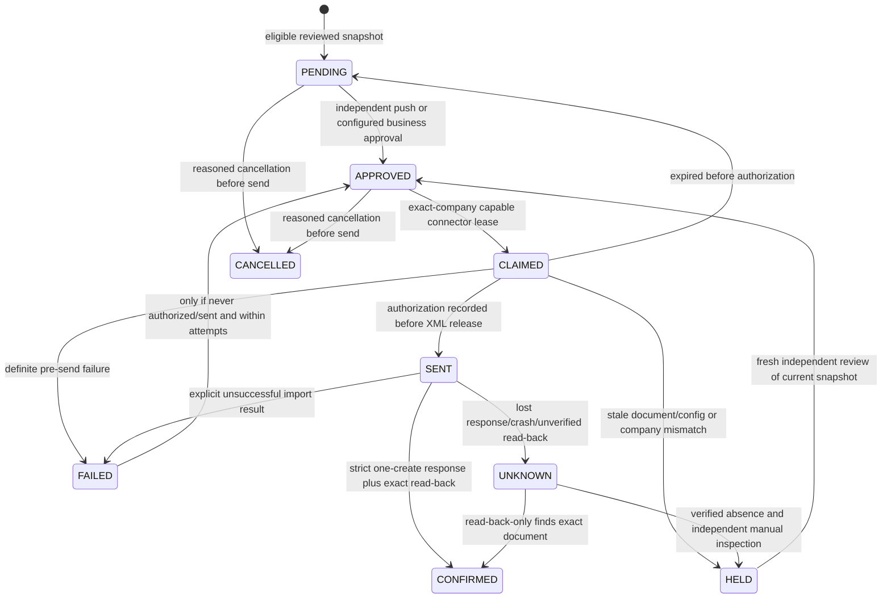

# Guarded CRM → Tally CREATE infrastructure

Date: 5 November 2026. **Built for review; not activated or certified for live Tally.** Existing Tally → CRM reads remain the production source of truth. No live Tally request, service installation or restart was performed for this work.

## Current installation

- One application listener and the existing Windows connector; no new listener, port, service installation, database, schema or external endpoint.
- The sole database is `mehta_electronics_local`. All integration tests use the existing rollback harness. The full runner checks every public table for `ZZTEST_` residue before and after tests.
- Master OFF; all three categories OFF; dry-run-only TRUE. Unconfirmed settings are SQL NULL, not the literal business value “Not set”. That phrase is a UI label. Mapping versions are empty until an Owner saves one. Tally version and XML-import availability remain unverified.
- Open **`/tally/write`** as Owner for settings, mapping versions, real imported-record lookup, dry-run XML, outbox, extra party approval, and UNKNOWN recovery. This direct route is documented rather than adding a permanent navigation item to the default-disabled UI.
- `/tally/monitor` adds write counts, oldest queued timestamps, breaker state and alerts only while the master is active. A live-write banner appears on Tally-backed screens when a category is enabled for live writes. The banner identifies company IDs and categories.
- Opening these pages does not save configuration. No real staff, passwords, business values or client documents are seeded.

## Architecture and boundaries

```mermaid
flowchart LR
  CRM[Approved locked CRM document] --> Gate[Master and category gates]
  Gate --> Source[Canonical source and stable company links]
  Source --> Mapping[Owner-approved immutable mapping version]
  Mapping --> Outbox[Isolated tw_outbox snapshot and XML]
  Outbox --> Approval[Independent push approval where required]
  Approval --> Claim[Authenticated capable connector lease]
  Claim --> Probe[Exact current company and duplicate read-back]
  Probe --> Authorize[Server authorization and current snapshot check]
  Authorize --> Create[One CREATE request to configured local Tally]
  Create --> Verify[Strict import result and mapped read-back]
  Verify --> Link[Immutable confirmed CRM reference]
  Import[Unchanged normal read import] --> Compare[Owner-initiated mapped comparison]
  Link --> Compare
  Compare --> Conflicts[Existing tally_conflicts review]
```



Server implementation is in `src/modules/tally-write/`. Existing application files contain route registration, startup initialization, the additive heartbeat observer, and guarded post-commit sales/procurement hooks. Business transactions complete before the producer opens its own transaction. Producer exceptions are held/alerted and do not report a committed CRM action as failed. For automatic production, the snapshot author is the original document maker; the actual triggering actor is retained in creation events/audit and validation provenance (`producedBy`, `automaticProducer`). The business approver remains distinct from that author. A manual enqueue by the business approver needs another push reviewer.

The connector's `Core/Write` executor uses separate HTTP clients and `Service/Write/WriteWorker` execution. It reads existing configuration and DPAPI-protected access credentials; it never refreshes, saves or rotates read-side credentials. Its encrypted journal is under `<existing profile root>/write/`, separate from the existing read queue/checkpoints. No folder is created by a disabled write cycle. A new additive heartbeat `writeCapability` advertises protocol 1, module version 1.0.0 and `createOnly: true`. This is separate from the existing connector release version.

The worker is an additional background execution path **inside the existing connector service process**, not another Windows service or server. Ordinary write exceptions and HTTP timeouts are caught independently. Process termination, machine failure, memory exhaustion, CPU/network contention and physical Tally locking cannot be made impossible inside a shared process/machine; do not interpret G4 as process-level fault isolation.

## Scope

| Category | Canonical source | Eligibility |
|---|---|---|
| SALES_ORDER | `sales_orders`, `crm_order_workflows`, current `crm_order_versions` | APPROVED; approval fingerprint and approved version match current version; independent business approval |
| PURCHASE_ORDER | `crm_supplier_pos` | Approved/issued with stored approval fingerprint and actual original maker/last editor retained |
| PARTY_LEDGER | Existing customer/vendor plus `tw_party_reviews` snapshot | Active party, independent extra approval, unchanged snapshot, and separate push approval |

Items, invoices, receipts, payments, GST/IRN/e-Way, ALTER and DELETE are excluded. XML templates emit one new voucher/ledger with `ACTION="Create"`; existing-record selectors are rejected. Party identity and voucher-number collision checks run before authorization. An existing identity is a review/link case, never permission to overwrite.

## States and recovery



`SENT` conservatively means **send authorized / may have been sent**, not proof Tally received it. A cancelled/held potentially sent job becomes UNKNOWN. No automatic resend follows ambiguity. An explicit failed import that was authorized also cannot be blindly reapproved; use read-back recovery.

The connector writes `AUTHORIZATION_REQUESTED` to its own durable journal before requesting authorization. A crash after this point reports uncertainty; it never repeats CREATE from that journal. Successful raw responses are journaled before post-send read-back. Lost result acknowledgments replay only the result report. Terminal result reports using the same authenticated lease return an idempotent receipt; they never create another reference.

UNKNOWN wizard: request read-back-only; a matching key and mapped values confirm. If the connector establishes absence, a different Owner must also inspect Tally and give a reason. This returns the job to HELD and clears approval. A new approval is required. A failed/expired local journal may require operator investigation; do not delete it to force a resend.

## Mapping and exact amounts

Mappings are immutable numbered versions with hash, reason, creator, Owner approval and company/category. Draft `{}` is permitted; approval/activation is blocked when required mappings or imported identities are missing. The editor loads actual imported names, record keys and stable GUID/master IDs for the chosen company. Name-only links are refused. Approving a mapping does not select it for a category automatically.

Empty template for review (not a valid approved mapping and not seeded):

```json
{
  "templateVersion": null,
  "reportName": null,
  "voucherType": null,
  "voucherTypeSourceKey": null,
  "numbering": null,
  "idempotencyField": null,
  "idempotencyMethod": null,
  "companyProbe": {},
  "identityProbe": {},
  "sourceFields": {},
  "header": {},
  "inventory": {},
  "batch": {},
  "godown": null,
  "godownSourceKey": null,
  "units": {},
  "unitSourceKeys": {},
  "partyBindings": {},
  "itemBindings": {},
  "ledgerContainer": null,
  "ledgerNameField": null,
  "ledgerAmountField": null,
  "ledgerEntries": [],
  "readback": {},
  "parentField": null,
  "parentName": null,
  "parentSourceKey": null,
  "partyFields": {}
}
```

The fixed implementation supports template 1, decimal strings, explicit posting signs and tax components. Those implementation capabilities do not approve any business mapping. Read-back checks total, party, mapped date/number, item identities, quantities, units, rates, discount, net amount, godown allocation and balanced accounting entries. Nonzero discounts require an explicit discount-field mapping. Party read-back also checks the exact name, parent and mapped party fields.

`sourceFields` chooses explicit canonical CRM paths; an Owner may explicitly choose the supported ISO-date transform. Read-back date transforms must also be explicit. Reference/narration and their corresponding Tally methods must agree. The current-company formula and identity-probe methods are constrained by the implementation and still require Tally-expert confirmation against the actual installation.

The preview endpoint always creates a dry-run job. It requires the selected company to equal the category's configured company and does not build XML while switches are OFF. Tests enable complete **synthetic** configuration only inside a rolled-back transaction, exercising dry-run storage/preview without activating production. Raw preview XML and source snapshots are rendered as escaped text. This does not claim exact totals from an issued client quotation; those policies/mappings remain unconfirmed.

## Settings and BLOCKED-PREM register

Every item below remains unconfirmed in the installation. Do not infer these from supplier quotations, incoming RFQs, ledger names or this document.

| Setting / decision | Initial state | Blocks |
|---|---|---|
| First category and activation authorization | None enabled | Live activation |
| Permission to create customer/vendor ledgers | Not authorized | PARTY_LEDGER |
| Owner-approved CRM → Tally field mapping (including the requested 13–14 business fields), template and report | Empty; versioned drafts only when explicitly saved | Preview/enqueue |
| Voucher type names and stable imported voucher-type IDs | Not set | Order XML |
| Voucher numbering authority and number field | Not set | Order XML / collision check |
| Party, accounting/tax ledger names and stable imported IDs | Not set | Order validation/XML |
| Godown name/ID and allocation fields | Not set | Order XML/read-back |
| Units/IDs per CRM item; stable item bindings | Not set | Order XML/read-back |
| Tax handling, posting signs and discount mapping | Not set | Balanced exact XML |
| Idempotency reference/narration field and export method | Not set | Duplicate protection |
| Current-company probe, identity collection and read-back fields/methods | Not set | Lease/authorization/confirmation |
| Party parent group and permitted party fields | Not set | PARTY_LEDGER |
| Global/category approval mode | Empty | Any queue workflow |
| Conflict winner for each mapped scalar and `mapped_record` | Empty | Category activation; never auto-resolves |
| Maximum attempts/backoff/breaker threshold/minimum gap/rolling-24-hour cap/lease duration | Empty | Category activation/claim |
| Tally version/edition | Unverified | Category activation |
| Tally HTTP XML import availability | Unverified | Category activation |
| Human Tally backup, copy-company test, acceptance and release sign-off | Not performed | Live release |

Flags: `tw_control.master_enabled` implements `tally.write.master`; `tw_categories.enabled` and `dry_run_only` implement per-category gates. Category direction is CREATE-only and opt-in, never an inferred two-way overwrite policy. All existing automation/send gates remain as before and OFF; no messaging automation was implemented.

## Storage, audit and migration notes

0045 adds only ten `tw_*` tables: control, categories, mapping_versions, party_reviews, outbox, outbox_events, connector_capabilities, document_links, alerts and conflict_observations. It adds new permissions without changing existing grants. Mutable write records have reasoned soft deletion; snapshots/mappings/events/confirmed links have immutable guards. All changes require actor or authenticated connector audit context. Audit rows contain metadata, not raw financial payloads or secrets.

0046 is a corrective migration for a function introduced by 0045 **in this same task**: the creation event must be inserted AFTER its parent outbox row exists. It replaces that new write-only audit function and adds an AFTER INSERT trigger. This is a disclosed exception to a literal “no routine replacement” interpretation; no pre-task table, column, constraint, index, trigger or protected read function was changed by these two migrations. Applied migration files must not be edited.

Before applying these migrations, `scripts/backup-db` created and verified `backups/mehta_electronics_local-2026-11-05T10-24-27-881Z-5e034f93.dump` with receipt/checksum/archive-list checks. This historical backup is not a currently fresh migration backup. A new pending migration needs a new verified backup through the existing runner.

## Permissions and APIs

- `tally.write.manage`: reserved to Owner, including switches/mapping/settings/source lookup/party request.
- `tally.write.approve`: independent push approval and reasoned review actions.
- `tally.write.read`: financial outbox XML/response/history/comparison. No new grants for existing non-Owner roles. Logistics roles receive none of these permissions.
- Staff endpoints live under `/api/tally-write/`, use existing session/CSRF/server permission gates and exact company IDs for scoped data.
- Connector endpoints are `/api/connectors/tally-write/config|claim|authorize|result`; they use existing connector bearer auth, explicit recent capability, configured company name/GUID, hashed random lease tokens, expiration and serialized claims.
- Company GUID/name is verified against actual Tally evidence before authorization and again in the connector immediately before CREATE. Each request is bounded; XML disallows DTD/entities, excessive size and existing-record selectors.
- `/api/health` is unchanged while disabled. While active, it adds cached queue depth/UNKNOWN/observation time. Null means not yet observed; it is not an invented zero. Old read endpoints perform no write-table queries while disabled.

## Failure runbook

1. Wrong/closed company or failed preflight: no CREATE; inspect HELD/FAILED reason and source mappings. A missing collection response is not proof of absence.
2. Response lost, crash, timeout after authorization, bad read-back: UNKNOWN. Request read-back, never blind retry.
3. Tally import errors/LINEERROR/ALTERED/DELETED/unexpected counts: retain response and stop. Exactly one CREATED and zero errors/mutations are required. Even that does not confirm without a stable-ID read-back.
4. Breaker opens: inspect alerts, Tally availability/company and raw results. Owner resumes explicitly; this does not approve failed/held jobs or enable a category.
5. Stale source/config/mapping: HELD; obtain new business review and queue/review the current snapshot. Immutable XML is not edited in place.
6. Normal import differs: use the Owner comparison action. It records differences/incomplete evidence in existing `tally_conflicts`, with configured proposed winners; no automatic resolution or rewrite. This comparison is explicitly initiated from the write screen, not injected into the protected read-sync loop.
7. Slow/missing monitoring evidence: refresh the write monitor. Cached health counters are observations with timestamps, not an independent continuously sampled metric collector.

## Kill switch and rollback

1. Owner turns master OFF at `/tally/write` with a reason. The control/claim/authorization paths serialize on the write lock. No new authorization is issued afterward; pending/unsent work is held, potentially sent work becomes UNKNOWN.
2. A POST already released onto the network cannot be recalled. Kill switch means stop new authorization/queue activity, not undo a voucher. Inspect every in-flight/UNKNOWN entry after stopping.
3. Leave additive tables/audit history in place. Do not drop tables, restore another PostgreSQL database, rewrite old migrations, clear journals or delete uncertain records.
4. Connector deployment is a HUMAN task only. Stage a build, record hashes/version, back up the current service folder using the existing administrative updater, verify the staged files, then follow the approved service update procedure. This work did not update a published installer/hash manifest or install a binary.
5. To roll back binaries: keep master OFF, preserve the separate encrypted write journals, restore the backed-up service folder and verify the old release hashes. An old connector ignores new write endpoints and keeps its existing read contract. Old servers return unsupported/404 to the new write path, which stays idle.

## G1–G9 evidence and limits

| Guarantee | Evidence | Limit |
|---|---|---|
| G1 | `tally-write-baseline.test.js` compares pre-task schema columns, constraints, indexes and trigger definitions; 0045/0046 only `tw_*` objects | 0046 replaces a function introduced in this task, disclosed above; baseline does not snapshot every unrelated routine |
| G2 | New server module and connector `Write/` files; limited app/startup/business/heartbeat/registration/UI hooks | Existing repository already contained unrelated uncommitted work; no reset was performed |
| G3 | `tally-write-pure`, `tally-write-hooks`, `tally-write-http`: zero producer/build/transport calls and zero write-table queries in tested old read/heartbeat/health paths while OFF | New explicit write/settings/banner endpoints and startup initialization have their own control queries |
| G4 | Protected read XML/schedule/queue/token/DPAPI source hashes match the baseline; separate worker/clients/journal/exception handling; C# fake timeout/crash tests | Shared-process fatal faults/resource contention are not preventable; no running Windows service was exercised |
| G5 | Server old/no-capability/wrong-company tests; C# OLD_SERVER and OFF tests; additive heartbeat model | No installed old binary/live mixed-version deployment was exercised |
| G6 | Immutable pre-integration response-shape/schema/source snapshots and full-suite step logs under ignored `output/schema-audit/` | Representative successful visibility/ingest variants, not every wildcard/detail/export response |
| G7 | Kill-switch test, sent/unsent lease tests, shared lock and rollback instructions | Cannot recall a POST already sent or undo Tally data |
| G8 | In-process fake HTTP handlers and synthetic XML only; canonical source tests roll back; no service commands | Actual Tally XML dialect/behavior remains unverified |
| G9 | Existing sole-DB guard, rollback harness and full initial/final residue scans | Claim tests serialize through the harness; no independent-session load/race certification |

## Verification commands

```powershell
npm.cmd test
npm.cmd run lint
npm.cmd --prefix apps/web run typecheck
npm.cmd run build
dotnet build connectors/tally-windows/TallyConnector.Service/TallyConnector.Service.csproj --no-restore
dotnet run --project connectors/tally-windows/TallyConnector.Service/TallyConnector.Service.csproj --no-restore -- --verify-write
```

The last command exits before connector configuration/service startup and uses only fake `HttpMessageHandler` instances and a test journal. It opens no socket and contacts neither API nor Tally. It is not a new service/project. See the implementation log for completed counts and commands. Production release remains blocked by the register and the human runbook.


### Additional live-acceptance risks

CREATE-only XML and a preflight lookup do not certify the native Tally behavior for an identity collision. An authorized Tally expert must verify that behavior before activation and control concurrent manual/native creation during the acceptance window. A preflight check and later HTTP import are not an atomic operation inside Tally. All live switches remain OFF while that behavior is unverified.

The cached health queue counters currently describe the last company observed through the write monitor, not a continuously sampled all-company aggregate. Use the company-scoped monitor and its observation time for operational decisions. A release should review metric aggregation requirements before relying on global alerting.
